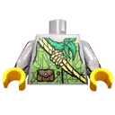
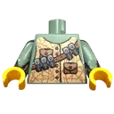
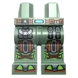
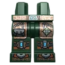

# Adventurer

[Classes](./README.md) | [Faction Guide](../Faction%20Guide.md) | [Buccaneer](./buccaneer.md) | [Daredevil](./daredevil.md)

**Faction:** Venture League · **Role:** Support / mobility · **Currency:** Venture League Token (LOT 8321)

A ranged support class. The crossbow fires a spread of bolts, the hat gives nearby allies a long speed boost, the whip stuns enemies, and the rank-3 backpack restores life to nearby allies.

This class was added in a later content update (`factionkit2`) and is not covered by
the 2010 guide. It has no rank-3 color variants.

## Abilities by rank

Abilities come from equipped pieces. Each rank's pieces replace the previous rank's,
so the table shows what a full set of that rank gives you. Descriptions are the client
tooltips.

| Rank | Slot | Ability | Effect | IP cost | Cooldown |
| --- | --- | --- | --- | --- | --- |
| 1 | Head | { .lu-ci width="24" } [Path Cutter 1](../skills/1070.md) | Gives a speed boost to nearby characters for 300 seconds. | 3 | 15 s |
| 1 | Main hand | { .lu-ci width="24" } [Adventurer Crossbow 1](../skills/1059.md) | Damage: 1+2+2. Charge attack: Fires a spread of bolts that do 2 damage each. | — | — |
| 2 | Head | { .lu-ci width="24" } [Path Cutter 2](../skills/1071.md) | Gives a speed boost to nearby characters for 300 seconds. | 4 | 15 s |
| 2 | Main hand | { .lu-ci width="24" } [Adventurer Crossbow 2](../skills/1060.md) | Damage: 2+2+3. Charge attack: Fires a spread of bolts that do 3 damage each. | — | — |
| 2 | Off hand | { .lu-ci width="24" } [Whip Snap 1](../skills/1068.md) | Damage: 5. Stuns enemies. | 5 | 9 s |
| 3 | Head | { .lu-ci width="24" } [Path Cutter 3](../skills/1072.md) | Gives a speed boost to nearby characters for 300 seconds. | 6 | 15 s |
| 3 | Main hand | { .lu-ci width="24" } [Adventurer Crossbow 3](../skills/1061.md) | Damage: 3+3+3. Charge attack: Fires a spread of bolts that do 4 damage each. | — | — |
| 3 | Off hand | { .lu-ci width="24" } [Whip Snap 2](../skills/1069.md) | Damage: 8. Stuns enemies. | 8 | 9 s |
| 3 | Neck/back | { .lu-ci width="24" } [Rations](../skills/1073.md) | Restores 10 Life to nearby characters. | 8 | 10 s |

## Unlocking the class

1. **Starter kit:** after joining Venture League, choose [Rank 1 Adventurer Kit Package (LOT 8034)](../items/8034.md) as the reward of
   *Get your … Gear!* (offered by Nexus Jay). It holds the four rank-1 pieces and the
   rank-1 book. The book is also sold by your Nimbus Station vendor if you start a
   second class later.
2. **Use the class book** for each rank to earn the rank achievement the gear requires.
3. **Wear the full set** of a rank to earn the next rank's book.
4. **Buy the next rank** with faction tokens once you reach its level.

| Rank | Level | Required achievement | Class book | How you get the book |
| --- | --- | --- | --- | --- |
| 1 | 5 | *Venture League Adventurer 1* | [Rank 1 Adventurer Book (LOT 11923)](../items/11923.md) | Starter package; Nimbus Station vendor |
| 2 | 15 | *Venture League Adventurer 2* | [Rank 2 Adventurer Book (LOT 11926)](../items/11926.md) | Reward for wearing the full rank-1 set |
| 3 | 30 | *Venture League Adventurer* | [Rank 3 Adventurer Book (LOT 11931)](../items/11931.md) | Reward for wearing the full rank-2 set |

**Vendors:** ranks 1–2 at [Magnus Bumperdent - Venture League Vendor (LOT 6634)](../items/sources/object-6634.md) in Nimbus Station; rank 3, color
variants, and valiant gear at [Billy Ganges - Venture League Vendor (LOT 13384)](../items/sources/object-13384.md) in Nexus Tower.

## Equipment

### Rank 1 (set 31)

| Slot | Item | Level | Tokens | Item abilities (IP cost, cooldown) |
| --- | --- | --- | --- | --- |
| Head | { .lu-ci width="32" } [Adventurer Hat 1 (LOT 7460)](../items/7460.md) | 5 | 25 | [Path Cutter 1](../skills/1070.md) (3 IP, 15 s) |
| Chest | { .lu-ci width="32" } [Adventurer Coat 1 (LOT 7484)](../items/7484.md) | 5 | 25 | — |
| Legs | { .lu-ci width="32" } [Adventurer Pants 1 (LOT 7508)](../items/7508.md) | 5 | 25 | — |
| Main hand | { .lu-ci width="32" } [Adventurer Crossbow 1 (LOT 7532)](../items/7532.md) | 5 | 50 | [Adventurer Crossbow 1](../skills/1059.md) |

**Set bonuses** (tiers add up as you equip more pieces of this rank):

- **4 pieces:** [Armor Boost 2](../skills/361.md) — +2 AP; [Imagination Boost 3](../skills/371.md) — +3 IP; [Skill 1175](../skills/1175.md) — full-set trigger: completes achievement *The Adventurer's Gear 1* (rewards [Rank 2 Adventurer Book (LOT 11926)](../items/11926.md))

### Rank 2 (set 32)

| Slot | Item | Level | Tokens | Item abilities (IP cost, cooldown) |
| --- | --- | --- | --- | --- |
| Head | { .lu-ci width="32" } [Adventurer Hat 2 (LOT 7461)](../items/7461.md) | 15 | 60 | [Path Cutter 2](../skills/1071.md) (4 IP, 15 s) |
| Chest | { .lu-ci width="32" } [Adventurer Coat 2 (LOT 7485)](../items/7485.md) | 15 | 60 | — |
| Legs | { .lu-ci width="32" } [Adventurer Pants 2 (LOT 7509)](../items/7509.md) | 15 | 60 | — |
| Main hand | { .lu-ci width="32" } [Adventurer Crossbow 2 (LOT 7533)](../items/7533.md) | 15 | 60 | [Adventurer Crossbow 2](../skills/1060.md) |
| Off hand | { .lu-ci width="32" } [Adventurer Whip 2 (LOT 11458)](../items/11458.md) | 15 | 60 | [Whip Snap 1](../skills/1068.md) (5 IP, 9 s) |
| Neck/back | { .lu-ci width="32" } [Adventurer Backpack 2 (LOT 8465)](../items/8465.md) | 15 | 60 | — |

Listed in `ItemSets` without an object definition in this database (likely an unreleased valiant weapon): LOT 13276.

**Set bonuses** (tiers add up as you equip more pieces of this rank):

- **4 pieces:** [Armor Boost 1](../skills/360.md) — +1 AP; [Imagination Boost 1](../skills/369.md) — +1 IP
- **5 pieces:** [Armor Boost 2](../skills/361.md) — +2 AP; [Imagination Boost 2](../skills/370.md) — +2 IP; Tracking (1074) — Shows the location of dangerous enemies and collectibles on your mini-map
- **6 pieces:** [Armor Boost 1](../skills/360.md) — +1 AP; [Imagination Boost 2](../skills/370.md) — +2 IP; [Life Boost 1](../skills/378.md) — +1 LP; [Lucky](../skills/402.md) — Attracts coins and other rewards towards you; Skill 1176 — full-set trigger: completes achievement *The Adventurer's Gear 2* (rewards [Rank 3 Adventurer Book (LOT 11931)](../items/11931.md))

### Rank 3 (set 33)

| Slot | Item | Level | Tokens | Item abilities (IP cost, cooldown) |
| --- | --- | --- | --- | --- |
| Head | { .lu-ci width="32" } [Adventurer Hat 3 (LOT 7462)](../items/7462.md) | 30 | 180 | [Path Cutter 3](../skills/1072.md) (6 IP, 15 s) |
| Chest | { .lu-ci width="32" } [Adventurer Coat 3 (LOT 7486)](../items/7486.md) | 30 | 180 | — |
| Legs | { .lu-ci width="32" } [Adventurer Pants 3 (LOT 7510)](../items/7510.md) | 30 | 180 | — |
| Main hand | { .lu-ci width="32" } [Adventurer Crossbow 3 (LOT 7534)](../items/7534.md) | 30 | 180 | [Adventurer Crossbow 3](../skills/1061.md) |
| Off hand | { .lu-ci width="32" } [Adventurer Whip 3 (LOT 11459)](../items/11459.md) | 30 | 180 | [Whip Snap 2](../skills/1069.md) (8 IP, 9 s) |
| Neck/back | { .lu-ci width="32" } [Adventurer Backpack 3 (LOT 7558)](../items/7558.md) | 30 | 180 | [Rations](../skills/1073.md) (8 IP, 10 s) |
| Neck/back | { .lu-ci width="32" } [Valiant Adventurer's Cape (LOT 16187)](../items/16187.md) (valiant) | 40 | 250 | [Rations](../skills/1073.md) (8 IP, 10 s) |

Listed in `ItemSets` without an object definition in this database (likely an unreleased valiant weapon): LOT 13276.

**Set bonuses** (tiers add up as you equip more pieces of this rank):

- **4 pieces:** [Armor Boost 1](../skills/360.md) — +1 AP; [Imagination Boost 1](../skills/369.md) — +1 IP
- **5 pieces:** Armor Boost 3 (362) — +3 AP; [Imagination Boost 3](../skills/371.md) — +3 IP; Tracking (1074) — Shows the location of dangerous enemies and collectibles on your mini-map
- **6 pieces:** [Armor Boost 2](../skills/361.md) — +2 AP; [Imagination Boost 2](../skills/370.md) — +2 IP; [Life Boost 1](../skills/378.md) — +1 LP; [Lucky](../skills/402.md) — Attracts coins and other rewards towards you; Skill 1177 — full-set trigger: completes achievement *The Adventurer's Gear 3* (LEGO Score only)

## Source and limitations

Generated by `scripts/build_classes.py` from the supplied CDServer database and the
English client locale. Values are stored definitions; a particular server can differ.
See [how classes work](./README.md) for vendors, tokens, and server implementation notes.
