# Buccaneer

[Classes](./README.md) | [Faction Guide](../Faction%20Guide.md) | [Adventurer](./adventurer.md) | [Daredevil](./daredevil.md)

**Faction:** Venture League · **Role:** Hybrid damage · **Currency:** Venture League Token (LOT 8321)

A sword-and-pistol fighter. The cutlass and pistol mix a four-hit melee combo with a heavy charged shot, the hat leaps onto enemies, and the rank-3 bandolier releases a monkey that mesmerizes enemies.

## Abilities by rank

Abilities come from equipped pieces. Each rank's pieces replace the previous rank's,
so the table shows what a full set of that rank gives you. Descriptions are the client
tooltips.

| Rank | Slot | Ability | Effect | IP cost | Cooldown |
| --- | --- | --- | --- | --- | --- |
| 1 | Head | 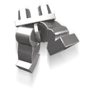{ .lu-ci .lu-on-dark width="24" } [Super Jump 1](../skills/445.md) | Damage: 4. Makes you leap on enemies, doing 4 damage. | 5 | 6 s |
| 1 | Main hand | 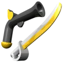{ .lu-ci .lu-on-dark width="24" } [Cutlass and Pistol 1](../skills/451.md) | Damage: 1+2+2+3. Charge attack: Fires a 5 damage projectile. | — | — |
| 2 | Head | { .lu-ci .lu-on-dark width="24" } [Super Jump 2](../skills/449.md) | Damage: 6. Makes you leap on enemies, doing 6 damage. | 6 | 6 s |
| 2 | Main hand | { .lu-ci .lu-on-dark width="24" } [Cutlass and Pistol 2](../skills/595.md) | Damage: 2+2+3+3. Charge attack: Fires a 7 damage projectile. | — | — |
| 3 | Head | { .lu-ci .lu-on-dark width="24" } [Super Jump 3](../skills/450.md) | Damage: 8. Makes you leap on enemies, doing 8 damage. | 7 | 6 s |
| 3 | Main hand | { .lu-ci .lu-on-dark width="24" } [Cutlass and Pistol 3](../skills/596.md) | Damage: 2+2+3+4. Charge attack: Fires a 10 damage projectile. | — | — |
| 3 | Main hand (valiant) | { .lu-ci .lu-on-dark width="24" } [Valiant Attack](../skills/1019.md) | Damage: 4+4+4. Charge attack: Fires all Cannons to do 11 damage to enemies. | — | — |
| 3 | Neck/back | { .lu-ci .lu-on-light width="24" } [Funky Monkey 1](../skills/383.md) | Damage: 5. Releases a monkey who mesmerizes enemies. | 10 | 30 s |

## Unlocking the class

1. **Starter kit:** after joining Venture League, choose [Rank 1 Buccaneer Kit Package (LOT 7586)](../items/7586.md) as the reward of
   *Get your … Gear!* (offered by Nexus Jay). It holds the four rank-1 pieces and the
   rank-1 book. The book is also sold by your Nimbus Station vendor if you start a
   second class later.
2. **Use the class book** for each rank to earn the rank achievement the gear requires.
3. **Wear the full set** of a rank to earn the next rank's book.
4. **Buy the next rank** with faction tokens once you reach its level.

| Rank | Level | Required achievement | Class book | How you get the book |
| --- | --- | --- | --- | --- |
| 1 | 5 | *Venture League Buccaneer 1* | [Rank 1 Buccaneer Book (LOT 20)](../items/20.md) | Starter package; Nimbus Station vendor |
| 2 | 15 | *Venture League Buccaneer 2* | [Rank 2 Buccaneer Book (LOT 9935)](../items/9935.md) | Reward for wearing the full rank-1 set |
| 3 | 30 | *Venture League Buccaneer* | [Rank 3 Buccaneer Book (LOT 9936)](../items/9936.md) | Reward for wearing the full rank-2 set |

**Vendors:** ranks 1–2 at [Magnus Bumperdent - Venture League Vendor (LOT 6634)](../items/sources/object-6634.md) in Nimbus Station; rank 3, color
variants, and valiant gear at [Billy Ganges - Venture League Vendor (LOT 13384)](../items/sources/object-13384.md) in Nexus Tower.

## Equipment

### Rank 1 (set 37)

| Slot | Item | Level | Tokens | Item abilities (IP cost, cooldown) |
| --- | --- | --- | --- | --- |
| Head | { .lu-ci .lu-on-light width="32" } [Buccaneer Scarf 1 (LOT 7358)](../items/7358.md) | 5 | 25 | [Super Jump 1](../skills/445.md) (5 IP, 6 s) |
| Chest | 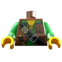{ .lu-ci .lu-on-light width="32" } [Buccaneer Shirt 1 (LOT 7376)](../items/7376.md) | 5 | 25 | — |
| Legs | 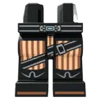{ .lu-ci .lu-on-light width="32" } [Buccaneer Pantaloons 1 (LOT 7388)](../items/7388.md) | 5 | 25 | — |
| Main hand | { .lu-ci .lu-on-dark width="32" } [Buccaneer Pistol &amp; Cutlass 1 (LOT 7400)](../items/7400.md) | 5 | 50 | [Cutlass and Pistol 1](../skills/451.md) |

**Set bonuses** (tiers add up as you equip more pieces of this rank):

- **5 pieces:** [Armor Boost 1](../skills/360.md) — +1 AP; [Imagination Boost 2](../skills/370.md) — +2 IP; Treasure Finding (721) — Shows collectibles on your mini-map; Skill 1169 — full-set trigger: completes achievement *The Buccaneer's Gear 1* (rewards [Rank 2 Buccaneer Book (LOT 9935)](../items/9935.md))

### Rank 2 (set 38)

| Slot | Item | Level | Tokens | Item abilities (IP cost, cooldown) |
| --- | --- | --- | --- | --- |
| Head | { .lu-ci .lu-on-light width="32" } [Buccaneer Scarf 2 (LOT 7365)](../items/7365.md) | 15 | 60 | [Super Jump 2](../skills/449.md) (6 IP, 6 s) |
| Chest | 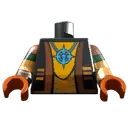{ .lu-ci .lu-on-light width="32" } [Buccaneer Shirt 2 (LOT 7377)](../items/7377.md) | 15 | 60 | — |
| Legs | 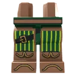{ .lu-ci .lu-on-light width="32" } [Buccaneer Pantaloons 2 (LOT 7389)](../items/7389.md) | 15 | 60 | — |
| Main hand | { .lu-ci .lu-on-dark width="32" } [Buccaneer Pistol &amp; Cutlass 2 (LOT 7401)](../items/7401.md) | 15 | 120 | [Cutlass and Pistol 2](../skills/595.md) |
| Neck/back | 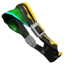{ .lu-ci .lu-on-light width="32" } [Buccaneer Bandolier 2 (LOT 8467)](../items/8467.md) | 15 | 60 | — |

**Set bonuses** (tiers add up as you equip more pieces of this rank):

- **5 pieces:** [Armor Boost 2](../skills/361.md) — +2 AP; [Imagination Boost 2](../skills/370.md) — +2 IP; Treasure Finding (721) — Shows collectibles on your mini-map
- **6 pieces:** [Armor Boost 2](../skills/361.md) — +2 AP; [Imagination Boost 3](../skills/371.md) — +3 IP; [Life Boost 1](../skills/378.md) — +1 LP; [Lucky](../skills/402.md) — Attracts coins and other rewards towards you; Skill 1170 — full-set trigger: completes achievement *The Buccaneer's Gear 2* (rewards [Rank 3 Buccaneer Book (LOT 9936)](../items/9936.md))

### Rank 3 (set 39)

| Slot | Item | Level | Tokens | Item abilities (IP cost, cooldown) |
| --- | --- | --- | --- | --- |
| Head | { .lu-ci .lu-on-light width="32" } [Buccaneer Hat 3 (LOT 7366)](../items/7366.md) | 30 | 180 | [Super Jump 3](../skills/450.md) (7 IP, 6 s) |
| Head | { .lu-ci .lu-on-light width="32" } [Buccaneer Hat 3 (LOT 12981)](../items/12981.md) (color variant) | 30 | 180 | [Super Jump 3](../skills/450.md) (7 IP, 6 s) |
| Chest | 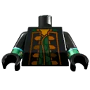{ .lu-ci .lu-on-light width="32" } [Buccaneer Shirt 3 (LOT 7378)](../items/7378.md) | 30 | 180 | — |
| Chest | { .lu-ci .lu-on-light width="32" } [Buccaneer Shirt 3 (LOT 12954)](../items/12954.md) (color variant) | 30 | 180 | — |
| Legs | 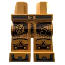{ .lu-ci .lu-on-light width="32" } [Buccaneer Pantaloons 3 (LOT 7390)](../items/7390.md) | 30 | 180 | — |
| Legs | 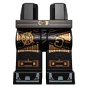{ .lu-ci .lu-on-light width="32" } [Buccaneer Pantaloons 3 (LOT 12955)](../items/12955.md) (color variant) | 30 | 180 | — |
| Main hand | 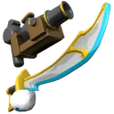{ .lu-ci .lu-on-dark width="32" } [Buccaneer Pistol &amp; Cutlass 3 (LOT 7402)](../items/7402.md) | 30 | 360 | [Cutlass and Pistol 3](../skills/596.md) |
| Main hand | 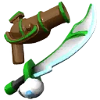{ .lu-ci .lu-on-dark width="32" } [Buccaneer Pistol &amp; Cutlass 3 (LOT 12982)](../items/12982.md) (color variant) | 30 | 360 | [Cutlass and Pistol 3](../skills/596.md) |
| Main hand | 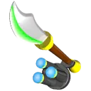{ .lu-ci .lu-on-dark width="32" } [The Broadsider (LOT 12638)](../items/12638.md) (valiant) | 35 | 500 | [Valiant Attack](../skills/1019.md) |
| Neck/back | 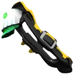{ .lu-ci .lu-on-light width="32" } [Buccaneer Bandolier 3 (LOT 7416)](../items/7416.md) | 30 | 180 | [Funky Monkey 1](../skills/383.md) (10 IP, 30 s) |
| Neck/back | 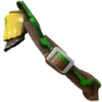{ .lu-ci .lu-on-light width="32" } [Buccaneer Bandolier 3 (LOT 12990)](../items/12990.md) (color variant) | 30 | 180 | [Funky Monkey 1](../skills/383.md) (10 IP, 30 s) |
| Neck/back | { .lu-ci .lu-on-light width="32" } [Valiant Buccaneer's Cape (LOT 16186)](../items/16186.md) (valiant) | 40 | 250 | [Funky Monkey 1](../skills/383.md) (10 IP, 30 s) |

**Set bonuses** (tiers add up as you equip more pieces of this rank):

- **5 pieces:** Armor Boost 3 (362) — +3 AP; [Imagination Boost 3](../skills/371.md) — +3 IP; Treasure Finding (721) — Shows collectibles on your mini-map
- **6 pieces:** Armor Boost 3 (362) — +3 AP; [Imagination Boost 3](../skills/371.md) — +3 IP; [Life Boost 1](../skills/378.md) — +1 LP; [Lucky](../skills/402.md) — Attracts coins and other rewards towards you; Skill 1171 — full-set trigger: completes achievement *The Buccaneer's Gear 3* (LEGO Score only)

## Source and limitations

Generated by `scripts/build_classes.py` from the supplied CDServer database and the
English client locale. Values are stored definitions; a particular server can differ.
See [how classes work](./README.md) for vendors, tokens, and server implementation notes.
