# Daredevil

[Classes](./README.md) | [Faction Guide](../Faction%20Guide.md) | [Adventurer](./adventurer.md) | [Buccaneer](./buccaneer.md)

**Faction:** Venture League · **Role:** Ranged damage / mobility · **Currency:** Venture League Token (LOT 8321)

A mobile gunslinger. The flare guns have a four-hit combo and a charged projectile, the helmet leaps onto enemies, and the rank-3 shoulderpads freeze enemies solid.

## Abilities by rank

Abilities come from equipped pieces. Each rank's pieces replace the previous rank's,
so the table shows what a full set of that rank gives you. Descriptions are the client
tooltips.

| Rank | Slot | Ability | Effect | IP cost | Cooldown |
| --- | --- | --- | --- | --- | --- |
| 1 | Head | 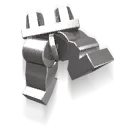{ .lu-ci .lu-on-dark width="24" } [Super Jump 1](../skills/445.md) | Damage: 4. Makes you leap on enemies, doing 4 damage. | 5 | 6 s |
| 1 | Main hand | { .lu-ci .lu-on-light width="24" } [Flare Guns 1](../skills/604.md) | Damage: 1+2+2+3. Charge attack: Fires a 3 damage projectile. | — | — |
| 2 | Head | { .lu-ci .lu-on-dark width="24" } [Super Jump 2](../skills/449.md) | Damage: 6. Makes you leap on enemies, doing 6 damage. | 6 | 6 s |
| 2 | Main hand | { .lu-ci .lu-on-light width="24" } [Flare Guns 2](../skills/639.md) | Damage: 2+2+3+3. Charge attack: Fires a 4 damage projectile. | — | — |
| 3 | Head | { .lu-ci .lu-on-dark width="24" } [Super Jump 3](../skills/450.md) | Damage: 8. Makes you leap on enemies, doing 8 damage. | 7 | 6 s |
| 3 | Main hand | 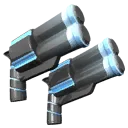{ .lu-ci .lu-on-light width="24" } [Flare Guns 3](../skills/640.md) | Damage: 2+2+3+4. Charge attack: Fires a 5 damage projectile. | — | — |
| 3 | Main hand (valiant) | { .lu-ci .lu-on-dark width="24" } [Valiant Attack](../skills/1022.md) | Damage: 3+3+4. Charge attack: Spins you around, doing 10 damage to enemies. | — | — |
| 3 | Neck/back | { .lu-ci .lu-on-dark width="24" } [Fire Extinguisher 3](../skills/599.md) | Damage: 14. Freezes enemies solid. | 10 | 20 s |

## Unlocking the class

1. **Starter kit:** after joining Venture League, choose [Rank 1 Daredevil Kit Package (LOT 8032)](../items/8032.md) as the reward of
   *Get your … Gear!* (offered by Nexus Jay). It holds the four rank-1 pieces and the
   rank-1 book. The book is also sold by your Nimbus Station vendor if you start a
   second class later.
2. **Use the class book** for each rank to earn the rank achievement the gear requires.
3. **Wear the full set** of a rank to earn the next rank's book.
4. **Buy the next rank** with faction tokens once you reach its level.

| Rank | Level | Required achievement | Class book | How you get the book |
| --- | --- | --- | --- | --- |
| 1 | 5 | *Venture League Daredevil 1* | [Rank 1 Daredevil Book (LOT 21)](../items/21.md) | Starter package; Nimbus Station vendor |
| 2 | 15 | *Venture League Daredevil 2* | [Rank 2 Daredevil Book (LOT 9976)](../items/9976.md) | Reward for wearing the full rank-1 set |
| 3 | 30 | *Venture League Daredevil* | [Rank 3 Daredevil Book (LOT 9963)](../items/9963.md) | Reward for wearing the full rank-2 set |

**Vendors:** ranks 1–2 at [Magnus Bumperdent - Venture League Vendor (LOT 6634)](../items/sources/object-6634.md) in Nimbus Station; rank 3, color
variants, and valiant gear at [Billy Ganges - Venture League Vendor (LOT 13384)](../items/sources/object-13384.md) in Nexus Tower.

## Equipment

### Rank 1 (set 34)

| Slot | Item | Level | Tokens | Item abilities (IP cost, cooldown) |
| --- | --- | --- | --- | --- |
| Head | { .lu-ci .lu-on-light width="32" } [Daredevil Helmet 1 (LOT 7463)](../items/7463.md) | 5 | 25 | [Super Jump 1](../skills/445.md) (5 IP, 6 s) |
| Chest | { .lu-ci .lu-on-light width="32" } [Daredevil Jacket 1 (LOT 7487)](../items/7487.md) | 5 | 25 | — |
| Legs | 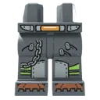{ .lu-ci .lu-on-light width="32" } [Daredevil Pants 1 (LOT 7511)](../items/7511.md) | 5 | 25 | — |
| Main hand | { .lu-ci .lu-on-light width="32" } [Daredevil Flareguns 1 (LOT 7535)](../items/7535.md) | 5 | 50 | [Flare Guns 1](../skills/604.md) |

**Set bonuses** (tiers add up as you equip more pieces of this rank):

- **5 pieces:** [Armor Boost 1](../skills/360.md) — +1 AP; [Imagination Boost 2](../skills/370.md) — +2 IP; Danger Sense (720) — Shows dangerous enemies on your mini-map; Skill 1172 — full-set trigger: completes achievement *The Daredevil's Gear 1* (rewards [Rank 2 Daredevil Book (LOT 9976)](../items/9976.md))

### Rank 2 (set 35)

| Slot | Item | Level | Tokens | Item abilities (IP cost, cooldown) |
| --- | --- | --- | --- | --- |
| Head | 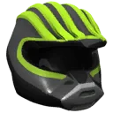{ .lu-ci .lu-on-light width="32" } [Daredevil Helmet 2 (LOT 7464)](../items/7464.md) | 15 | 60 | [Super Jump 2](../skills/449.md) (6 IP, 6 s) |
| Chest | 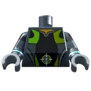{ .lu-ci .lu-on-light width="32" } [Daredevil Jacket 2 (LOT 7488)](../items/7488.md) | 15 | 60 | — |
| Legs | 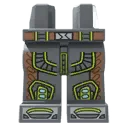{ .lu-ci .lu-on-light width="32" } [Daredevil Pants 2 (LOT 7512)](../items/7512.md) | 15 | 60 | — |
| Main hand | { .lu-ci .lu-on-light width="32" } [Daredevil Flareguns 2 (LOT 7536)](../items/7536.md) | 15 | 120 | [Flare Guns 2](../skills/639.md) |
| Neck/back | 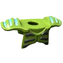{ .lu-ci .lu-on-dark width="32" } [Daredevil Shoulderpads 2 (LOT 8466)](../items/8466.md) | 15 | 60 | — |

**Set bonuses** (tiers add up as you equip more pieces of this rank):

- **5 pieces:** [Armor Boost 2](../skills/361.md) — +2 AP; [Imagination Boost 2](../skills/370.md) — +2 IP; Danger Sense (720) — Shows dangerous enemies on your mini-map
- **6 pieces:** [Armor Boost 2](../skills/361.md) — +2 AP; [Imagination Boost 2](../skills/370.md) — +2 IP; [Life Boost 1](../skills/378.md) — +1 LP; [Lucky](../skills/402.md) — Attracts coins and other rewards towards you; Skill 1173 — full-set trigger: completes achievement *The Daredevil's Gear 2* (rewards [Rank 3 Daredevil Book (LOT 9963)](../items/9963.md))

### Rank 3 (set 36)

| Slot | Item | Level | Tokens | Item abilities (IP cost, cooldown) |
| --- | --- | --- | --- | --- |
| Head | 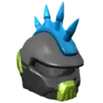{ .lu-ci .lu-on-light width="32" } [Daredevil Helmet 3 (LOT 7465)](../items/7465.md) | 30 | 180 | [Super Jump 3](../skills/450.md) (7 IP, 6 s) |
| Head | 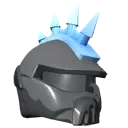{ .lu-ci .lu-on-dark width="32" } [Daredevil Helmet 3 (LOT 12993)](../items/12993.md) (color variant) | 30 | 180 | [Super Jump 3](../skills/450.md) (7 IP, 6 s) |
| Chest | 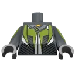{ .lu-ci .lu-on-light width="32" } [Daredevil Jacket 3 (LOT 7489)](../items/7489.md) | 30 | 180 | — |
| Chest | 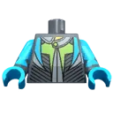{ .lu-ci .lu-on-dark width="32" } [Daredevil Jacket 3 (LOT 12956)](../items/12956.md) (color variant) | 30 | 180 | — |
| Legs | 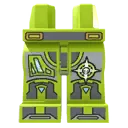{ .lu-ci .lu-on-dark width="32" } [Daredevil Pants 3 (LOT 7513)](../items/7513.md) | 30 | 180 | — |
| Legs | 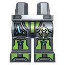{ .lu-ci .lu-on-light width="32" } [Daredevil Pants 3 (LOT 12957)](../items/12957.md) (color variant) | 30 | 180 | — |
| Main hand | { .lu-ci .lu-on-light width="32" } [Daredevil Flareguns 3 (LOT 7537)](../items/7537.md) | 30 | 360 | [Flare Guns 3](../skills/640.md) |
| Main hand | { .lu-ci .lu-on-dark width="32" } [Daredevil Flareguns 3 (LOT 12994)](../items/12994.md) (color variant) | 30 | 360 | [Flare Guns 3](../skills/640.md) |
| Main hand | { .lu-ci .lu-on-light width="32" } [The Rutcarver (LOT 12647)](../items/12647.md) (valiant) | 35 | 500 | [Valiant Attack](../skills/1022.md) |
| Neck/back | 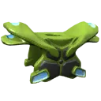{ .lu-ci .lu-on-light width="32" } [Daredevil Shoulderpads 3 (LOT 7543)](../items/7543.md) | 30 | 180 | [Fire Extinguisher 3](../skills/599.md) (10 IP, 20 s) |
| Neck/back | 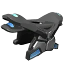{ .lu-ci .lu-on-light width="32" } [Daredevil Shoulderpads 3 (LOT 12995)](../items/12995.md) (color variant) | 30 | 180 | [Fire Extinguisher 3](../skills/599.md) (10 IP, 20 s) |
| Neck/back | { .lu-ci .lu-on-light width="32" } [Valiant Daredevil's Cape (LOT 16185)](../items/16185.md) (valiant) | 40 | 250 | [Fire Extinguisher 3](../skills/599.md) (10 IP, 20 s) |

**Set bonuses** (tiers add up as you equip more pieces of this rank):

- **5 pieces:** Armor Boost 3 (362) — +3 AP; [Imagination Boost 3](../skills/371.md) — +3 IP; Danger Sense (720) — Shows dangerous enemies on your mini-map
- **6 pieces:** Armor Boost 3 (362) — +3 AP; [Imagination Boost 3](../skills/371.md) — +3 IP; [Life Boost 1](../skills/378.md) — +1 LP; [Lucky](../skills/402.md) — Attracts coins and other rewards towards you; Skill 1174 — full-set trigger: completes achievement *The Daredevil's Gear 3* (LEGO Score only)

## Source and limitations

Generated by `scripts/build_classes.py` from the supplied CDServer database and the
English client locale. Values are stored definitions; a particular server can differ.
See [how classes work](./README.md) for vendors, tokens, and server implementation notes.
