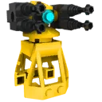
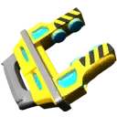
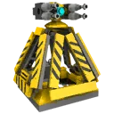
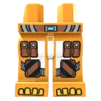
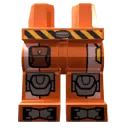
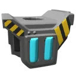
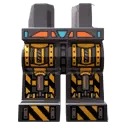
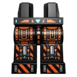
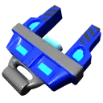

# Engineer

[Classes](./README.md) | [Faction Guide](../Faction%20Guide.md) | [Inventor](./inventor.md) | [Summoner](./summoner.md)

**Faction:** Assembly · **Role:** Support / builder · **Currency:** Assembly Token (LOT 8318)

A support class built around Quick Build turrets. The wrench's charge attack restores armor to nearby allies, the helmet deploys a turret, the controller lifts enemies with a magnet, and the rank-3 vest builds a fortified turret.

## Abilities by rank

Abilities come from equipped pieces. Each rank's pieces replace the previous rank's,
so the table shows what a full set of that rank gives you. Descriptions are the client
tooltips.

| Rank | Slot | Ability | Effect | IP cost | Cooldown |
| --- | --- | --- | --- | --- | --- |
| 1 | Head | { width="24" } [Deploy Turret 1](../skills/624.md) | Creates a Quick Build turret that attacks enemies. | 5 | 45 s |
| 1 | Main hand | { width="24" } [Wrench Wrecker 1](../skills/475.md) | Damage: 1+2+2. Charge attack: Restores up to 2 Armor to nearby characters. | — | — |
| 2 | Head | { width="24" } [Deploy Turret 2](../skills/625.md) | Creates a Quick Build turret that attacks enemies. | 6 | 45 s |
| 2 | Main hand | { width="24" } [Wrench Wrecker 2](../skills/593.md) | Damage: 2+2+3. Charge attack: Restores up to 6 Armor to nearby characters - charge longer for more Armor. | — | — |
| 2 | Off hand | { width="24" } [Magnetize 1](../skills/358.md) | Lifts enemies into the air. | 4 | 10 s |
| 3 | Head | { width="24" } [Deploy Turret 3](../skills/626.md) | Creates a Quick Build turret that attacks enemies. | 7 | 45 s |
| 3 | Main hand | { width="24" } [Wrench Wrecker 3](../skills/600.md) | Damage: 2+3+3. Charge attack: Restores up to 12 Armor to nearby characters - charge longer for more Armor. | — | — |
| 3 | Main hand (valiant) | { width="24" } [Valiant Attack](../skills/1009.md) | Damage: 3+3+4. Charge attack: Spins you around, doing up to 15 damage over time. | — | — |
| 3 | Off hand | { width="24" } [Magnetize 2](../skills/634.md) | Calls in a magnet to lift enemies into the air. | 5 | 10 s |
| 3 | Neck/back | { width="24" } [Personal Fortress](../skills/649.md) | Damage: 1x16. Creates a fortified turret that attacks enemies. | 10 | 30 s |

## Unlocking the class

1. **Starter kit:** after joining Assembly, choose [Rank 1 Engineer Kit Package (LOT 7591)](../items/7591.md) as the reward of
   *Get your … Gear!* (offered by Nexus Jay). It holds the four rank-1 pieces and the
   rank-1 book. The book is also sold by your Nimbus Station vendor if you start a
   second class later.
2. **Use the class book** for each rank to earn the rank achievement the gear requires.
3. **Wear the full set** of a rank to earn the next rank's book.
4. **Buy the next rank** with faction tokens once you reach its level.

| Rank | Level | Required achievement | Class book | How you get the book |
| --- | --- | --- | --- | --- |
| 1 | 5 | *Assembly Engineer 1* | [Rank 1 Engineer Book (LOT 130)](../items/130.md) | Starter package; Nimbus Station vendor |
| 2 | 15 | *Assembly Engineer 2* | [Rank 2 Engineer Book (LOT 9968)](../items/9968.md) | Reward for wearing the full rank-1 set |
| 3 | 30 | *Assembly Engineer* | [Rank 3 Engineer Book (LOT 9969)](../items/9969.md) | Reward for wearing the full rank-2 set |

**Vendors:** ranks 1–2 at [Meldric Steamvalve - Assembly Vendor (LOT 6633)](../items/sources/object-6633.md) in Nimbus Station; rank 3, color
variants, and valiant gear at [Torbert Oscillator - Assembly Vendor (LOT 13380)](../items/sources/object-13380.md) in Nexus Tower.

## Equipment

### Rank 1 (set 2)

| Slot | Item | Level | Tokens | Item abilities (IP cost, cooldown) |
| --- | --- | --- | --- | --- |
| Head | { width="32" } [Engineer Helmet 1 (LOT 7356)](../items/7356.md) | 5 | 25 | [Deploy Turret 1](../skills/624.md) (5 IP, 45 s) |
| Chest | { width="32" } [Engineer Shirt 1 (LOT 7370)](../items/7370.md) | 5 | 25 | — |
| Legs | { width="32" } [Engineer Pants 1 (LOT 7382)](../items/7382.md) | 5 | 25 | — |
| Main hand | { width="32" } [Engineer Wrench 1 (LOT 7394)](../items/7394.md) | 5 | 25 | [Wrench Wrecker 1](../skills/475.md) |

**Set bonuses** (tiers add up as you equip more pieces of this rank):

- **4 pieces:** [Armor Boost 1](../skills/360.md) — +1 AP; [Imagination Boost 2](../skills/370.md) — +2 IP; [Imagination Bank 1](../skills/659.md) — Restores 1 Imagination when you run out; [Skill 1187](../skills/1187.md) — full-set trigger: completes achievement *The Engineer's Gear 1* (rewards [Rank 2 Engineer Book (LOT 9968)](../items/9968.md))

### Rank 2 (set 3)

| Slot | Item | Level | Tokens | Item abilities (IP cost, cooldown) |
| --- | --- | --- | --- | --- |
| Head | { width="32" } [Engineer Helmet 2 (LOT 7363)](../items/7363.md) | 15 | 60 | [Deploy Turret 2](../skills/625.md) (6 IP, 45 s) |
| Chest | { width="32" } [Engineer Shirt 2 (LOT 7371)](../items/7371.md) | 15 | 60 | — |
| Legs | { width="32" } [Engineer Pants 2 (LOT 7383)](../items/7383.md) | 15 | 60 | — |
| Main hand | { width="32" } [Engineer Wrench 2 (LOT 7395)](../items/7395.md) | 15 | 60 | [Wrench Wrecker 2](../skills/593.md) |
| Off hand | { width="32" } [Engineer Controller 2 (LOT 7405)](../items/7405.md) | 15 | 60 | [Magnetize 1](../skills/358.md) (4 IP, 10 s) |
| Neck/back | { width="32" } [Engineer Vest 2 (LOT 8462)](../items/8462.md) | 15 | 60 | — |

**Set bonuses** (tiers add up as you equip more pieces of this rank):

- **4 pieces:** [Armor Boost 1](../skills/360.md) — +1 AP; [Imagination Boost 1](../skills/369.md) — +1 IP; [Imagination Bank 2](../skills/660.md) — Restores 2 Imagination when you run out
- **5 pieces:** [Armor Boost 1](../skills/360.md) — +1 AP; [Imagination Boost 2](../skills/370.md) — +2 IP; [Master Builder](../skills/584.md) — Prevents attacks from knocking you out of a Quick Build
- **6 pieces:** [Armor Boost 2](../skills/361.md) — +2 AP; [Imagination Boost 2](../skills/370.md) — +2 IP; [Skill 1188](../skills/1188.md) — full-set trigger: completes achievement *The Engineer's Gear 2* (rewards [Rank 3 Engineer Book (LOT 9969)](../items/9969.md))

### Rank 3 (set 4)

| Slot | Item | Level | Tokens | Item abilities (IP cost, cooldown) |
| --- | --- | --- | --- | --- |
| Head | { width="32" } [Engineer Helmet 3 (LOT 7364)](../items/7364.md) | 30 | 180 | [Deploy Turret 3](../skills/626.md) (7 IP, 45 s) |
| Head | { width="32" } [Engineer Helmet 3 (LOT 12962)](../items/12962.md) (color variant) | 30 | 180 | [Deploy Turret 3](../skills/626.md) (7 IP, 45 s) |
| Chest | { width="32" } [Engineer Shirt 3 (LOT 7372)](../items/7372.md) | 30 | 180 | — |
| Chest | { width="32" } [Engineer Shirt 3 (LOT 12947)](../items/12947.md) (color variant) | 30 | 180 | — |
| Legs | { width="32" } [Engineer Pants 3 (LOT 7384)](../items/7384.md) | 30 | 180 | — |
| Legs | { width="32" } [Engineer Pants 3 (LOT 12949)](../items/12949.md) (color variant) | 30 | 180 | — |
| Main hand | { width="32" } [Engineer Wrench 3 (LOT 7396)](../items/7396.md) | 30 | 180 | [Wrench Wrecker 3](../skills/600.md) |
| Main hand | { width="32" } [Engineer Wrench 3 (LOT 12964)](../items/12964.md) (color variant) | 30 | 180 | [Wrench Wrecker 3](../skills/600.md) |
| Main hand | { width="32" } [The Serratorizer (LOT 12636)](../items/12636.md) (valiant) | 35 | 500 | [Valiant Attack](../skills/1009.md) |
| Off hand | { width="32" } [Engineer Controller 3 (LOT 7406)](../items/7406.md) | 30 | 180 | [Magnetize 2](../skills/634.md) (5 IP, 10 s) |
| Off hand | { width="32" } [Engineer Controller 3 (LOT 12965)](../items/12965.md) (color variant) | 30 | 180 | [Magnetize 2](../skills/634.md) (5 IP, 10 s) |
| Neck/back | { width="32" } [Engineer Vest 3 (LOT 7417)](../items/7417.md) | 30 | 180 | [Personal Fortress](../skills/649.md) (10 IP, 30 s) |
| Neck/back | { width="32" } [Engineer Vest 3 (LOT 12963)](../items/12963.md) (color variant) | 30 | 180 | [Personal Fortress](../skills/649.md) (10 IP, 30 s) |
| Neck/back | { width="32" } [Valiant Engineer's Cape (LOT 16182)](../items/16182.md) (valiant) | 40 | 250 | [Personal Fortress](../skills/649.md) (10 IP, 30 s) |

**Set bonuses** (tiers add up as you equip more pieces of this rank):

- **4 pieces:** [Armor Boost 1](../skills/360.md) — +1 AP; [Imagination Boost 2](../skills/370.md) — +2 IP; Imagination Bank 3 (661) — Restores 3 Imagination when you run out
- **5 pieces:** [Armor Boost 2](../skills/361.md) — +2 AP; [Imagination Boost 2](../skills/370.md) — +2 IP; [Master Builder](../skills/584.md) — Prevents attacks from knocking you out of a Quick Build
- **6 pieces:** Armor Boost 3 (362) — +3 AP; [Imagination Boost 3](../skills/371.md) — +3 IP; [Life Boost 1](../skills/378.md) — +1 LP; Skill 1189 — full-set trigger: completes achievement *The Engineer's Gear 3* (LEGO Score only)

## Source and limitations

Generated by `scripts/build_classes.py` from the supplied CDServer database and the
English client locale. Values are stored definitions; a particular server can differ.
See [how classes work](./README.md) for vendors, tokens, and server implementation notes.
