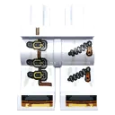
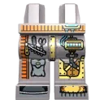
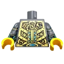

# Inventor

[Classes](./README.md) | [Faction Guide](../Faction%20Guide.md) | [Engineer](./engineer.md) | [Summoner](./summoner.md)

**Faction:** Assembly · **Role:** Support / summoner · **Currency:** Assembly Token (LOT 8318)

A ranged support class. The two-handed launcher's charge attack restores armor to nearby allies, the goggles create a firing invention that assists in battle, and the rank-3 shoulderpads add ongoing area damage.

This class was added in a later content update (`factionkit2`) and is not covered by
the 2010 guide. It has no rank-3 color variants.

## Abilities by rank

Abilities come from equipped pieces. Each rank's pieces replace the previous rank's,
so the table shows what a full set of that rank gives you. Descriptions are the client
tooltips.

| Rank | Slot | Ability | Effect | IP cost | Cooldown |
| --- | --- | --- | --- | --- | --- |
| 1 | Head | { .lu-ci width="24" } [Summon Make-Shift Buddy 1](../skills/1055.md) | Damage: 2. Creates a slow firing Invention that assists you in battle. | 4 | 45 s |
| 1 | Main hand | { .lu-ci width="24" } [Improvised Launcher 1](../skills/1043.md) | Damage: 1+1+2. Charge attack: Restores up to 2 Armor to nearby characters. | — | — |
| 2 | Head | { .lu-ci width="24" } [Summon Make-Shift Buddy 2](../skills/1056.md) | Damage: 2. Creates a medium fast firing Invention that assists you in battle. | 6 | 45 s |
| 2 | Main hand | { .lu-ci width="24" } [Improvised Launcher 2](../skills/1042.md) | Damage: 2+2+3. Charge attack: Restores up to 6 Armor to nearby characters - charge longer for more Armor. | — | — |
| 3 | Head | { .lu-ci width="24" } [Summon Make-Shift Buddy 3](../skills/1057.md) | Damage: 2. Creates a faster firing Invention that assists you in battle. | 8 | 45 s |
| 3 | Main hand | { .lu-ci width="24" } [Improvised Launcher 3](../skills/1038.md) | Damage: 2+3+3. Charge attack: Restores up to 12 Armor to nearby characters - charge longer for more Armor. | — | — |
| 3 | Neck/back | { .lu-ci width="24" } [Gadgets Extreme](../skills/1058.md) | Does 3 ongoing damage to enemies. | 10 | 60 s |

## Unlocking the class

1. **Starter kit:** after joining Assembly, choose [Rank 1 Inventor Kit Package (LOT 8031)](../items/8031.md) as the reward of
   *Get your … Gear!* (offered by Nexus Jay). It holds the four rank-1 pieces and the
   rank-1 book. The book is also sold by your Nimbus Station vendor if you start a
   second class later.
2. **Use the class book** for each rank to earn the rank achievement the gear requires.
3. **Wear the full set** of a rank to earn the next rank's book.
4. **Buy the next rank** with faction tokens once you reach its level.

| Rank | Level | Required achievement | Class book | How you get the book |
| --- | --- | --- | --- | --- |
| 1 | 5 | *Assembly Inventor 1* | [Rank 1 Inventor Book (LOT 11925)](../items/11925.md) | Starter package; Nimbus Station vendor |
| 2 | 15 | *Assembly Inventor 2* | [Rank 2 Inventor Book (LOT 11929)](../items/11929.md) | Reward for wearing the full rank-1 set |
| 3 | 30 | *Assembly Inventor* | [Rank 3 Inventor Book (LOT 11934)](../items/11934.md) | Reward for wearing the full rank-2 set |

**Vendors:** ranks 1–2 at [Meldric Steamvalve - Assembly Vendor (LOT 6633)](../items/sources/object-6633.md) in Nimbus Station; rank 3, color
variants, and valiant gear at [Torbert Oscillator - Assembly Vendor (LOT 13380)](../items/sources/object-13380.md) in Nexus Tower.

## Equipment

### Rank 1 (set 25)

| Slot | Item | Level | Tokens | Item abilities (IP cost, cooldown) |
| --- | --- | --- | --- | --- |
| Head | { .lu-ci width="32" } [Inventor Goggles 1 (LOT 7454)](../items/7454.md) | 5 | 25 | [Summon Make-Shift Buddy 1](../skills/1055.md) (4 IP, 45 s) |
| Chest | { .lu-ci width="32" } [Inventor Armor 1 (LOT 7478)](../items/7478.md) | 5 | 25 | — |
| Legs | { .lu-ci width="32" } [Inventor Pants 1 (LOT 7502)](../items/7502.md) | 5 | 25 | — |
| Main hand | { .lu-ci width="32" } [Inventor Improved Launcher 1 (LOT 7526)](../items/7526.md) | 5 | 25 | [Improvised Launcher 1](../skills/1043.md) |

**Set bonuses** (tiers add up as you equip more pieces of this rank):

- **4 pieces:** [Armor Boost 1](../skills/360.md) — +1 AP; [Imagination Boost 2](../skills/370.md) — +2 IP; [Imagination Bank 1](../skills/659.md) — Restores 1 Imagination when you run out; [Skill 1193](../skills/1193.md) — full-set trigger: completes achievement *The Inventor's Gear 1* (rewards [Rank 2 Inventor Book (LOT 11929)](../items/11929.md))

### Rank 2 (set 26)

| Slot | Item | Level | Tokens | Item abilities (IP cost, cooldown) |
| --- | --- | --- | --- | --- |
| Head | { .lu-ci width="32" } [Inventor Goggles 2 (LOT 7455)](../items/7455.md) | 15 | 60 | [Summon Make-Shift Buddy 2](../skills/1056.md) (6 IP, 45 s) |
| Chest | { .lu-ci width="32" } [Inventor Armor 2 (LOT 7479)](../items/7479.md) | 15 | 60 | — |
| Legs | { .lu-ci width="32" } [Inventor Pants 2 (LOT 7503)](../items/7503.md) | 15 | 60 | — |
| Main hand | { .lu-ci width="32" } [Inventor Improved Launcher 2 (LOT 7527)](../items/7527.md) | 15 | 120 | [Improvised Launcher 2](../skills/1042.md) |
| Neck/back | { .lu-ci width="32" } [Inventor Shoulderpads 2 (LOT 8463)](../items/8463.md) | 15 | 60 | — |

**Set bonuses** (tiers add up as you equip more pieces of this rank):

- **4 pieces:** Armor Boost 3 (362) — +3 AP; [Imagination Boost 4](../skills/372.md) — +4 IP; [Imagination Bank 2](../skills/660.md) — Restores 2 Imagination when you run out
- **5 pieces:** [Armor Boost 2](../skills/361.md) — +2 AP; [Imagination Boost 3](../skills/371.md) — +3 IP; [Master Builder](../skills/584.md) — Prevents attacks from knocking you out of a Quick Build
- **6 pieces:** [Armor Boost 2](../skills/361.md) — +2 AP; [Imagination Boost 2](../skills/370.md) — +2 IP; Skill 1194 — full-set trigger: completes achievement *The Inventor's Gear 2* (rewards [Rank 3 Inventor Book (LOT 11934)](../items/11934.md))

### Rank 3 (set 27)

| Slot | Item | Level | Tokens | Item abilities (IP cost, cooldown) |
| --- | --- | --- | --- | --- |
| Head | { .lu-ci width="32" } [Inventor Goggles 3 (LOT 7456)](../items/7456.md) | 30 | 180 | [Summon Make-Shift Buddy 3](../skills/1057.md) (8 IP, 45 s) |
| Chest | { .lu-ci width="32" } [Inventor Armor 3 (LOT 7480)](../items/7480.md) | 30 | 180 | — |
| Legs | { .lu-ci width="32" } [Inventor Pants 3 (LOT 7504)](../items/7504.md) | 30 | 180 | — |
| Main hand | { .lu-ci width="32" } [Inventor Improved Launcher 3 (LOT 7528)](../items/7528.md) | 30 | 360 | [Improvised Launcher 3](../skills/1038.md) |
| Neck/back | { .lu-ci width="32" } [Inventor Shoulderpads 3 (LOT 7542)](../items/7542.md) | 30 | 180 | [Gadgets Extreme](../skills/1058.md) (10 IP, 60 s) |
| Neck/back | { .lu-ci width="32" } [Valiant Inventor's Cape (LOT 16184)](../items/16184.md) (valiant) | 40 | 250 | [Gadgets Extreme](../skills/1058.md) (10 IP, 60 s) |

Listed in `ItemSets` without an object definition in this database (likely an unreleased valiant weapon): LOT 13278.

**Set bonuses** (tiers add up as you equip more pieces of this rank):

- **4 pieces:** Armor Boost 4 (363) — +4 AP; Imagination Boost 5 (373) — +5 IP; Imagination Bank 3 (661) — Restores 3 Imagination when you run out
- **5 pieces:** Armor Boost 3 (362) — +3 AP; [Imagination Boost 3](../skills/371.md) — +3 IP; [Master Builder](../skills/584.md) — Prevents attacks from knocking you out of a Quick Build
- **6 pieces:** [Armor Boost 2](../skills/361.md) — +2 AP; [Imagination Boost 4](../skills/372.md) — +4 IP; [Life Boost 1](../skills/378.md) — +1 LP; Skill 1195 — full-set trigger: completes achievement *The Inventor's Gear 3* (LEGO Score only)

## Source and limitations

Generated by `scripts/build_classes.py` from the supplied CDServer database and the
English client locale. Values are stored definitions; a particular server can differ.
See [how classes work](./README.md) for vendors, tokens, and server implementation notes.
