# Knight

[Classes](./README.md) | [Faction Guide](../Faction%20Guide.md) | [Samurai](./samurai.md) | [Space Ranger](./space-ranger.md)

**Faction:** Sentinels · **Role:** Defender · **Currency:** Sentinel Faction Token (LOT 8319)

A melee protector. The greatsword blocks attacks while charged, the helm raises the armor of nearby allies and draws enemy attention, and the shield and shoulderpads add a knock-down rush and a spinning area attack.

## Abilities by rank

Abilities come from equipped pieces. Each rank's pieces replace the previous rank's,
so the table shows what a full set of that rank gives you. Descriptions are the client
tooltips.

| Rank | Slot | Ability | Effect | IP cost | Cooldown |
| --- | --- | --- | --- | --- | --- |
| 1 | Head | { width="24" } [Strengthen Armor 1](../skills/777.md) | Boosts Armor of nearby characters by 2 for 60 seconds and angers enemies. | 3 | 8 s |
| 1 | Main hand | { width="24" } [Knight's Blade 1](../skills/476.md) | Damage: 1+2+3. Charge attack: Blocks 4 attacks while charged. | — | 1.35 s |
| 2 | Head | { width="24" } [Strengthen Armor 2](../skills/778.md) | Boosts Armor of nearby characters by 4 for 60 seconds and angers enemies. | 5 | 8 s |
| 2 | Main hand | { width="24" } [Knight's Blade 2](../skills/477.md) | Damage: 2+2+3. Charge attack: Blocks 6 attacks while charged. | — | — |
| 2 | Off hand | 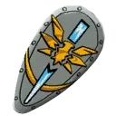{ width="24" } [Shield Slam 1](../skills/342.md) | Damage: 5. Makes you rush forward, doing 5 damage and knocking down the enemy that you strike. | 4 | 7 s |
| 3 | Head | { width="24" } [Strengthen Armor 3](../skills/779.md) | Boosts Armor of nearby characters by 6 for 60 seconds and angers enemies. | 7 | 8 s |
| 3 | Main hand | { width="24" } [Knight's Blade 3](../skills/478.md) | Damage: 2+3+3. Charge attack: Blocks 8 attacks while charged. | — | — |
| 3 | Main hand (valiant) | { width="24" } [Valiant Attack](../skills/1015.md) | Damage: 3+4+4. Charge attack: Does 12 damage to enemies. | — | — |
| 3 | Off hand | 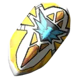{ width="24" } [Shield Slam 2](../skills/565.md) | Damage: 10. Makes you rush forward, doing 10 damage and knocking down the enemy that you strike. | 7 | 7 s |
| 3 | Neck/back | 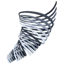{ width="24" } [Roundhouse](../skills/338.md) | Damage: 10. Makes you spin around and do 10 damage to enemies. | 8 | 10 s |

## Unlocking the class

1. **Starter kit:** after joining the Sentinels, choose [Rank 1 Knight Kit Package (LOT 7590)](../items/7590.md) as the reward of
   *Get your … Gear!* (offered by Nexus Jay). It holds the four rank-1 pieces and the
   rank-1 book. The book is also sold by your Nimbus Station vendor if you start a
   second class later.
2. **Use the class book** for each rank to earn the rank achievement the gear requires.
3. **Wear the full set** of a rank to earn the next rank's book.
4. **Buy the next rank** with faction tokens once you reach its level.

| Rank | Level | Required achievement | Class book | How you get the book |
| --- | --- | --- | --- | --- |
| 1 | 5 | *Sentinel Knight 1* | [Rank 1 Knight Book (LOT 80)](../items/80.md) | Starter package; Nimbus Station vendor |
| 2 | 15 | *Sentinel Knight 2* | [Rank 2 Knight Book (LOT 9972)](../items/9972.md) | Reward for wearing the full rank-1 set |
| 3 | 30 | *Sentinel Knight* | [Rank 3 Knight Book (LOT 9973)](../items/9973.md) | Reward for wearing the full rank-2 set |

**Vendors:** ranks 1–2 at [Xeno Blueblade - Sentinel Vendor (LOT 6631)](../items/sources/object-6631.md) in Nimbus Station; rank 3, color
variants, and valiant gear at [Nikolai Gammapulse - Sentinel Vendor (LOT 13376)](../items/sources/object-13376.md) in Nexus Tower.

## Equipment

### Rank 1 (set 7)

| Slot | Item | Level | Tokens | Item abilities (IP cost, cooldown) |
| --- | --- | --- | --- | --- |
| Head | { width="32" } [Knight Helm 1 (LOT 7355)](../items/7355.md) | 5 | 25 | [Strengthen Armor 1](../skills/777.md) (3 IP, 8 s) |
| Chest | 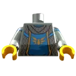{ width="32" } [Knight Breastplate 1 (LOT 7367)](../items/7367.md) | 5 | 25 | — |
| Legs | 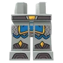{ width="32" } [Knight Leggings 1 (LOT 7379)](../items/7379.md) | 5 | 25 | — |
| Main hand | { width="32" } [Knight Greatsword 1 (LOT 7391)](../items/7391.md) | 5 | 25 | [Knight's Blade 1](../skills/476.md) (1.35 s) |

**Set bonuses** (tiers add up as you equip more pieces of this rank):

- **4 pieces:** [Armor Boost 2](../skills/361.md) — +2 AP; [Imagination Boost 1](../skills/369.md) — +1 IP; [Toughness 1](../skills/704.md) — When you reach 0 Armor, reduces the amount of damage you take by 1, to a minimum of 1; [Skill 1160](../skills/1160.md) — full-set trigger: completes achievement *The Knight's Gear 1* (rewards [Rank 2 Knight Book (LOT 9972)](../items/9972.md))

### Rank 2 (set 8)

| Slot | Item | Level | Tokens | Item abilities (IP cost, cooldown) |
| --- | --- | --- | --- | --- |
| Head | { width="32" } [Knight Helm 2 (LOT 7359)](../items/7359.md) | 15 | 60 | [Strengthen Armor 2](../skills/778.md) (5 IP, 8 s) |
| Chest | 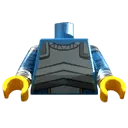{ width="32" } [Knight Breastplate 2 (LOT 7368)](../items/7368.md) | 15 | 60 | — |
| Legs | 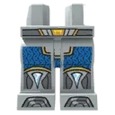{ width="32" } [Knight Leggings 2 (LOT 7380)](../items/7380.md) | 15 | 60 | — |
| Main hand | 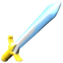{ width="32" } [Knight Greatsword 2 (LOT 7392)](../items/7392.md) | 15 | 60 | [Knight's Blade 2](../skills/477.md) |
| Off hand | { width="32" } [Knight Shield 2 (LOT 7403)](../items/7403.md) | 15 | 60 | [Shield Slam 1](../skills/342.md) (4 IP, 7 s) |
| Neck/back | { width="32" } [Knight Shoulderpads 2 (LOT 8456)](../items/8456.md) | 15 | 60 | — |

**Set bonuses** (tiers add up as you equip more pieces of this rank):

- **4 pieces:** [Armor Boost 1](../skills/360.md) — +1 AP; [Toughness 2](../skills/703.md) — When you reach 0 Armor, reduces the amount of damage you take by 2, to a minimum of 1
- **5 pieces:** [Armor Boost 1](../skills/360.md) — +1 AP; [Imagination Boost 1](../skills/369.md) — +1 IP; [Juggernaut 1](../skills/431.md) — Restores 1 Armor every time you smash an enemy
- **6 pieces:** [Armor Boost 2](../skills/361.md) — +2 AP; [Imagination Boost 2](../skills/370.md) — +2 IP; [Skill 1161](../skills/1161.md) — full-set trigger: completes achievement *The Knight's Gear 2* (rewards [Rank 3 Knight Book (LOT 9973)](../items/9973.md))

### Rank 3 (set 9)

| Slot | Item | Level | Tokens | Item abilities (IP cost, cooldown) |
| --- | --- | --- | --- | --- |
| Head | { width="32" } [Knight Helm 3 (LOT 7360)](../items/7360.md) | 30 | 180 | [Strengthen Armor 3](../skills/779.md) (7 IP, 8 s) |
| Head | { width="32" } [Knight Helm 3 (LOT 12966)](../items/12966.md) (color variant) | 30 | 180 | [Strengthen Armor 3](../skills/779.md) (7 IP, 8 s) |
| Chest | 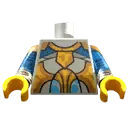{ width="32" } [Knight Breastplate 3 (LOT 7369)](../items/7369.md) | 30 | 180 | — |
| Chest | { width="32" } [Knight Breastplate 3 (LOT 12950)](../items/12950.md) (color variant) | 30 | 180 | — |
| Legs | 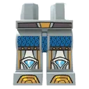{ width="32" } [Knight Leggings 3 (LOT 7381)](../items/7381.md) | 30 | 180 | — |
| Legs | 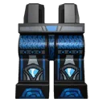{ width="32" } [Knight Leggings 3 (LOT 12951)](../items/12951.md) (color variant) | 30 | 180 | — |
| Main hand | 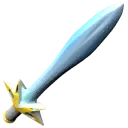{ width="32" } [Knight Greatsword 3 (LOT 7393)](../items/7393.md) | 30 | 180 | [Knight's Blade 3](../skills/478.md) |
| Main hand | { width="32" } [Knight Greatsword 3 (LOT 12968)](../items/12968.md) (color variant) | 30 | 180 | [Knight's Blade 3](../skills/478.md) |
| Main hand | 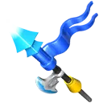{ width="32" } [The Powerjouster (LOT 12637)](../items/12637.md) (valiant) | 35 | 500 | [Valiant Attack](../skills/1015.md) |
| Off hand | { width="32" } [Knight Shield 3 (LOT 7404)](../items/7404.md) | 30 | 180 | [Shield Slam 2](../skills/565.md) (7 IP, 7 s) |
| Off hand | { width="32" } [Knight Shield 3 (LOT 12969)](../items/12969.md) (color variant) | 30 | 180 | [Shield Slam 2](../skills/565.md) (7 IP, 7 s) |
| Neck/back | 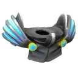{ width="32" } [Knight Shoulderpads 3 (LOT 7409)](../items/7409.md) | 30 | 180 | [Roundhouse](../skills/338.md) (8 IP, 10 s) |
| Neck/back | { width="32" } [Knight Shoulderpads 3 (LOT 12967)](../items/12967.md) (color variant) | 30 | 180 | [Roundhouse](../skills/338.md) (8 IP, 10 s) |
| Neck/back | { width="32" } [Valiant Knight's Cape (LOT 16179)](../items/16179.md) (valiant) | 40 | 250 | [Roundhouse](../skills/338.md) (8 IP, 10 s) |

**Set bonuses** (tiers add up as you equip more pieces of this rank):

- **4 pieces:** [Armor Boost 1](../skills/360.md) — +1 AP; Toughness 3 (702) — When you reach 0 Armor, reduces the amount of damage you take by 3, to a minimum of 1
- **5 pieces:** [Armor Boost 2](../skills/361.md) — +2 AP; [Imagination Boost 1](../skills/369.md) — +1 IP; [Juggernaut 1](../skills/431.md) — Restores 1 Armor every time you smash an enemy
- **6 pieces:** Armor Boost 3 (362) — +3 AP; [Imagination Boost 3](../skills/371.md) — +3 IP; Skill 1162 — full-set trigger: completes achievement *The Knight's Gear 3* (LEGO Score only)

## Source and limitations

Generated by `scripts/build_classes.py` from the supplied CDServer database and the
English client locale. Values are stored definitions; a particular server can differ.
See [how classes work](./README.md) for vendors, tokens, and server implementation notes.
