# Samurai

[Classes](./README.md) | [Faction Guide](../Faction%20Guide.md) | [Knight](./knight.md) | [Space Ranger](./space-ranger.md)

**Faction:** Sentinels · **Role:** Defender · **Currency:** Sentinel Faction Token (LOT 8319)

A melee protector with a ranged option. The katana blocks attacks while charged, the helm raises nearby allies' armor and draws enemy attention, the bow adds a damage-over-time arrow, and the rank-3 shoulderpads a flying-kick knock-back.

## Abilities by rank

Abilities come from equipped pieces. Each rank's pieces replace the previous rank's,
so the table shows what a full set of that rank gives you. Descriptions are the client
tooltips.

| Rank | Slot | Ability | Effect | IP cost | Cooldown |
| --- | --- | --- | --- | --- | --- |
| 1 | Head | { .lu-ci .lu-on-dark width="24" } [Strengthen Armor 1](../skills/777.md) | Boosts Armor of nearby characters by 2 for 60 seconds and angers enemies. | 3 | 8 s |
| 1 | Main hand | 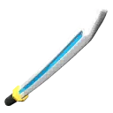{ .lu-ci .lu-on-dark width="24" } [Katana Mastery 1](../skills/572.md) | Damage: 1+2+3. Charge attack: Blocks 3 attacks while charged. | — | 1 s |
| 2 | Head | { .lu-ci .lu-on-dark width="24" } [Strengthen Armor 2](../skills/778.md) | Boosts Armor of nearby characters by 4 for 60 seconds and angers enemies. | 5 | 8 s |
| 2 | Main hand | { .lu-ci .lu-on-dark width="24" } [Katana Mastery 2](../skills/573.md) | Damage: 2+3+3. Charge attack: Blocks 5 attacks while charged. | — | — |
| 2 | Off hand | { .lu-ci .lu-on-light width="24" } [Flaming Arrow 1](../skills/558.md) | Damage: 5. Shoots a flaming arrow that does up to 5 damage over time. | 4 | 8 s |
| 3 | Head | { .lu-ci .lu-on-dark width="24" } [Strengthen Armor 3](../skills/779.md) | Boosts Armor of nearby characters by 6 for 60 seconds and angers enemies. | 7 | 8 s |
| 3 | Main hand | 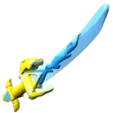{ .lu-ci .lu-on-dark width="24" } [Katana Mastery 3](../skills/574.md) | Damage: 2+3+3. Charge attack: Blocks 7 attacks while charged. | — | — |
| 3 | Main hand (valiant) | { .lu-ci .lu-on-dark width="24" } [Valiant Attack](../skills/1021.md) | Damage: 3+3+4. Charge attack: Spins you around, doing 10 damage to enemies. | — | — |
| 3 | Off hand | { .lu-ci .lu-on-light width="24" } [Flaming Arrow 2](../skills/571.md) | Damage: 10. Shoots a flaming arrow that does up to 10 damage over time. | 6 | 8 s |
| 3 | Neck/back | { .lu-ci .lu-on-dark width="24" } [Ronin Rush](../skills/550.md) | Damage: 12. Makes you perform a flying kick, doing 12 damage and knocking down enemies. | 9 | 7 s |

## Unlocking the class

1. **Starter kit:** after joining the Sentinels, choose [Rank 1 Samurai Kit Package (LOT 8028)](../items/8028.md) as the reward of
   *Get your … Gear!* (offered by Nexus Jay). It holds the four rank-1 pieces and the
   rank-1 book. The book is also sold by your Nimbus Station vendor if you start a
   second class later.
2. **Use the class book** for each rank to earn the rank achievement the gear requires.
3. **Wear the full set** of a rank to earn the next rank's book.
4. **Buy the next rank** with faction tokens once you reach its level.

| Rank | Level | Required achievement | Class book | How you get the book |
| --- | --- | --- | --- | --- |
| 1 | 5 | *Sentinel Samurai 1* | [Rank 1 Samurai Book (LOT 89)](../items/89.md) | Starter package; Nimbus Station vendor |
| 2 | 15 | *Sentinel Samurai 2* | [Rank 2 Samurai Book (LOT 9974)](../items/9974.md) | Reward for wearing the full rank-1 set |
| 3 | 30 | *Sentinel Samurai* | [Rank 3 Samurai Book (LOT 9975)](../items/9975.md) | Reward for wearing the full rank-2 set |

**Vendors:** ranks 1–2 at [Xeno Blueblade - Sentinel Vendor (LOT 6631)](../items/sources/object-6631.md) in Nimbus Station; rank 3, color
variants, and valiant gear at [Nikolai Gammapulse - Sentinel Vendor (LOT 13376)](../items/sources/object-13376.md) in Nexus Tower.

## Equipment

### Rank 1 (set 13)

| Slot | Item | Level | Tokens | Item abilities (IP cost, cooldown) |
| --- | --- | --- | --- | --- |
| Head | { .lu-ci .lu-on-light width="32" } [Samurai Helm 1 (LOT 7445)](../items/7445.md) | 5 | 25 | [Strengthen Armor 1](../skills/777.md) (3 IP, 8 s) |
| Chest | 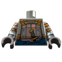{ .lu-ci .lu-on-light width="32" } [Samurai Breastplate 1 (LOT 7469)](../items/7469.md) | 5 | 25 | — |
| Legs | { .lu-ci .lu-on-light width="32" } [Samurai Leggings 1 (LOT 7493)](../items/7493.md) | 5 | 25 | — |
| Main hand | { .lu-ci .lu-on-dark width="32" } [Samurai Katana 1 (LOT 7517)](../items/7517.md) | 5 | 25 | [Katana Mastery 1](../skills/572.md) (1 s) |

**Set bonuses** (tiers add up as you equip more pieces of this rank):

- **4 pieces:** [Armor Boost 1](../skills/360.md) — +1 AP; [Imagination Boost 2](../skills/370.md) — +2 IP; [For the Shogun 1](../skills/705.md) — When you reach 0 Armor, nearby characters will be shielded from 8 damage for a short time; [Skill 1163](../skills/1163.md) — full-set trigger: completes achievement *The Samurai's Gear 1* (rewards [Rank 2 Samurai Book (LOT 9974)](../items/9974.md))

### Rank 2 (set 14)

| Slot | Item | Level | Tokens | Item abilities (IP cost, cooldown) |
| --- | --- | --- | --- | --- |
| Head | 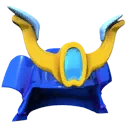{ .lu-ci .lu-on-dark width="32" } [Samurai Helm 2 (LOT 7446)](../items/7446.md) | 15 | 60 | [Strengthen Armor 2](../skills/778.md) (5 IP, 8 s) |
| Chest | 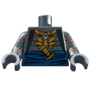{ .lu-ci .lu-on-light width="32" } [Samurai Breastplate 2 (LOT 7470)](../items/7470.md) | 15 | 60 | — |
| Legs | { .lu-ci .lu-on-light width="32" } [Samurai Leggings 2 (LOT 7494)](../items/7494.md) | 15 | 60 | — |
| Main hand | { .lu-ci .lu-on-dark width="32" } [Samurai Katana 2 (LOT 7518)](../items/7518.md) | 15 | 60 | [Katana Mastery 2](../skills/573.md) |
| Off hand | { .lu-ci .lu-on-dark width="32" } [Samurai Bow 2 (LOT 7546)](../items/7546.md) | 15 | 60 | [Flaming Arrow 1](../skills/558.md) (4 IP, 8 s) |
| Neck/back | { .lu-ci .lu-on-light width="32" } [Samurai Shoulderpads 2 (LOT 8458)](../items/8458.md) | 15 | 60 | — |

**Set bonuses** (tiers add up as you equip more pieces of this rank):

- **4 pieces:** [Armor Boost 1](../skills/360.md) — +1 AP; [For the Shogun 2](../skills/706.md) — When you reach 0 Armor, nearby characters will be shielded from 12 damage for a short time
- **5 pieces:** [Armor Boost 1](../skills/360.md) — +1 AP; [Imagination Boost 2](../skills/370.md) — +2 IP; [Juggernaut 1](../skills/431.md) — Restores 1 Armor every time you smash an enemy
- **6 pieces:** [Armor Boost 2](../skills/361.md) — +2 AP; [Imagination Boost 3](../skills/371.md) — +3 IP; [Skill 1164](../skills/1164.md) — full-set trigger: completes achievement *The Samurai's Gear 2* (rewards [Rank 3 Samurai Book (LOT 9975)](../items/9975.md))

### Rank 3 (set 15)

| Slot | Item | Level | Tokens | Item abilities (IP cost, cooldown) |
| --- | --- | --- | --- | --- |
| Head | 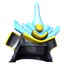{ .lu-ci .lu-on-dark width="32" } [Samurai Helm 3 (LOT 7447)](../items/7447.md) | 30 | 180 | [Strengthen Armor 3](../skills/779.md) (7 IP, 8 s) |
| Head | 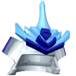{ .lu-ci .lu-on-dark width="32" } [Samurai Helm 3 (LOT 12976)](../items/12976.md) (color variant) | 30 | 180 | [Strengthen Armor 3](../skills/779.md) (7 IP, 8 s) |
| Chest | { .lu-ci .lu-on-light width="32" } [Samurai Breastplate 3 (LOT 7471)](../items/7471.md) | 30 | 180 | — |
| Chest | { .lu-ci .lu-on-dark width="32" } [Samurai Breastplate 3 (LOT 12952)](../items/12952.md) (color variant) | 30 | 180 | — |
| Legs | 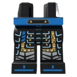{ .lu-ci .lu-on-light width="32" } [Samurai Leggings 3 (LOT 7495)](../items/7495.md) | 30 | 180 | — |
| Legs | { .lu-ci .lu-on-light width="32" } [Samurai Leggings 3 (LOT 12953)](../items/12953.md) (color variant) | 30 | 180 | — |
| Main hand | { .lu-ci .lu-on-dark width="32" } [Samurai Katana 3 (LOT 7519)](../items/7519.md) | 30 | 180 | [Katana Mastery 3](../skills/574.md) |
| Main hand | { .lu-ci .lu-on-dark width="32" } [Samurai Katana 3 (LOT 12977)](../items/12977.md) (color variant) | 30 | 180 | [Katana Mastery 3](../skills/574.md) |
| Main hand | { .lu-ci .lu-on-dark width="32" } [The Samuraizor (LOT 12642)](../items/12642.md) (valiant) | 35 | 500 | [Valiant Attack](../skills/1021.md) |
| Off hand | 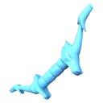{ .lu-ci .lu-on-dark width="32" } [Samurai Bow 3 (LOT 7547)](../items/7547.md) | 30 | 180 | [Flaming Arrow 2](../skills/571.md) (6 IP, 8 s) |
| Off hand | 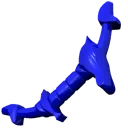{ .lu-ci .lu-on-light width="32" } [Samurai Bow 3 (LOT 12978)](../items/12978.md) (color variant) | 30 | 180 | [Flaming Arrow 2](../skills/1216.md) (6 IP, 8 s) |
| Neck/back | 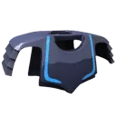{ .lu-ci .lu-on-light width="32" } [Samurai Shoulderpads 3 (LOT 7539)](../items/7539.md) | 30 | 180 | [Ronin Rush](../skills/550.md) (9 IP, 7 s) |
| Neck/back | 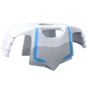{ .lu-ci .lu-on-dark width="32" } [Samurai Shoulderpads 3 (LOT 12992)](../items/12992.md) (color variant) | 30 | 180 | [Ronin Rush](../skills/550.md) (9 IP, 7 s) |
| Neck/back | { .lu-ci .lu-on-light width="32" } [Valiant Samurai's Cape (LOT 16180)](../items/16180.md) (valiant) | 40 | 250 | [Ronin Rush](../skills/550.md) (9 IP, 7 s) |

**Set bonuses** (tiers add up as you equip more pieces of this rank):

- **4 pieces:** [Armor Boost 1](../skills/360.md) — +1 AP; [Imagination Boost 1](../skills/369.md) — +1 IP; For the Shogun 3 (707) — When you reach 0 Armor, nearby characters will be shielded from 15 damage for a short time
- **5 pieces:** [Armor Boost 2](../skills/361.md) — +2 AP; [Imagination Boost 2](../skills/370.md) — +2 IP; [Juggernaut 1](../skills/431.md) — Restores 1 Armor every time you smash an enemy
- **6 pieces:** [Armor Boost 2](../skills/361.md) — +2 AP; [Imagination Boost 3](../skills/371.md) — +3 IP; Skill 1165 — full-set trigger: completes achievement *The Samurai's Gear 3* (LEGO Score only)

## Source and limitations

Generated by `scripts/build_classes.py` from the supplied CDServer database and the
English client locale. Values are stored definitions; a particular server can differ.
See [how classes work](./README.md) for vendors, tokens, and server implementation notes.
