# Shinobi

[Classes](./README.md) | [Faction Guide](../Faction%20Guide.md) | [Sorcerer](./sorcerer.md) | [Space Marauder](./space-marauder.md)

**Faction:** Paradox · **Role:** Melee damage · **Currency:** Paradox Token (LOT 8320)

A fast melee attacker. The katana's charge attack restores imagination to nearby allies, the hood strikes enemies with dark lightning, and the rank-3 shoulderpads throw a shuriken barrage.

This class was added in a later content update (`factionkit2`) and is not covered by
the 2010 guide. It has no rank-3 color variants.

## Abilities by rank

Abilities come from equipped pieces. Each rank's pieces replace the previous rank's,
so the table shows what a full set of that rank gives you. Descriptions are the client
tooltips.

| Rank | Slot | Ability | Effect | IP cost | Cooldown |
| --- | --- | --- | --- | --- | --- |
| 1 | Head | { .lu-ci width="24" } [Dark Lightning 1](../skills/1075.md) | Damage: 5. Strikes enemies with lightning, doing 5 damage. | 6 | 10 s |
| 1 | Main hand | { .lu-ci width="24" } [Shadow Blade 1](../skills/1081.md) | Damage: 1+2+2. Charge attack: Restores 2 Imagination for nearby characters. | — | 1.25 s |
| 2 | Head | { .lu-ci width="24" } [Dark Lightning 2](../skills/1076.md) | Damage: 7. Strikes enemies with lightning, doing 7 damage. | 7 | 10 s |
| 2 | Main hand | { .lu-ci width="24" } [Shadow Blade 2](../skills/1082.md) | Damage: 2+2+3. Charge attack: Restores up to 5 Imagination for nearby characters - charge longer for more Imagination. | — | 1.25 s |
| 3 | Head | { .lu-ci width="24" } [Dark Lightning 3](../skills/1077.md) | Damage: 9. Strikes enemies with lightning, doing 9 damage. | 8 | 10 s |
| 3 | Main hand | { .lu-ci width="24" } [Shadow Blade 3](../skills/1083.md) | Damage: 3+3+3. Charge attack: Restores up to 11 Imagination for nearby characters - charge longer for more Imagination. | — | 1.25 s |
| 3 | Neck/back | { .lu-ci width="24" } [Shuriken Barrage](../skills/482.md) | Damage: 12. Throws shuriken that do 12 damage to enemies. | 10 | 20 s |

## Unlocking the class

1. **Starter kit:** after joining Paradox, choose [Rank 1 Shinobi Kit Package (LOT 8030)](../items/8030.md) as the reward of
   *Get your … Gear!* (offered by Nexus Jay). It holds the four rank-1 pieces and the
   rank-1 book. The book is also sold by your Nimbus Station vendor if you start a
   second class later.
2. **Use the class book** for each rank to earn the rank achievement the gear requires.
3. **Wear the full set** of a rank to earn the next rank's book.
4. **Buy the next rank** with faction tokens once you reach its level.

| Rank | Level | Required achievement | Class book | How you get the book |
| --- | --- | --- | --- | --- |
| 1 | 5 | *Paradox Shinobi 1* | [Rank 1 Shinobi Book (LOT 11922)](../items/11922.md) | Starter package; Nimbus Station vendor |
| 2 | 15 | *Paradox Shinobi 2* | [Rank 2 Shinobi Book (LOT 11927)](../items/11927.md) | Reward for wearing the full rank-1 set |
| 3 | 30 | *Paradox Shinobi* | [Rank 3 Shinobi Book (LOT 11932)](../items/11932.md) | Reward for wearing the full rank-2 set |

**Vendors:** ranks 1–2 at [Cog Blammo - Paradox Vendor (LOT 6632)](../items/sources/object-6632.md) in Nimbus Station; rank 3, color
variants, and valiant gear at [Sutoro Hatto - Paradox Vendor (LOT 13378)](../items/sources/object-13378.md) in Nexus Tower.

## Equipment

### Rank 1 (set 22)

| Slot | Item | Level | Tokens | Item abilities (IP cost, cooldown) |
| --- | --- | --- | --- | --- |
| Head | { .lu-ci width="32" } [Shinobi Hood 1 (LOT 7451)](../items/7451.md) | 5 | 25 | [Dark Lightning 1](../skills/1075.md) (6 IP, 10 s) |
| Chest | 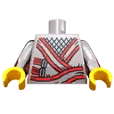{ .lu-ci width="32" } [Shinobi Gi 1 (LOT 7475)](../items/7475.md) | 5 | 25 | — |
| Legs | 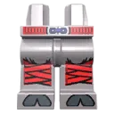{ .lu-ci width="32" } [Shinobi Leggings 1 (LOT 7499)](../items/7499.md) | 5 | 25 | — |
| Main hand | 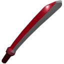{ .lu-ci width="32" } [Shinobi Katana 1 (LOT 7523)](../items/7523.md) | 5 | 25 | [Shadow Blade 1](../skills/1081.md) (1.25 s) |

**Set bonuses** (tiers add up as you equip more pieces of this rank):

- **4 pieces:** [Armor Boost 1](../skills/360.md) — +1 AP; [Imagination Boost 2](../skills/370.md) — +2 IP; [Dark Inspiration 1](../skills/693.md) — Restores 1 Imagination every time you smash an enemy; [Skill 1184](../skills/1184.md) — full-set trigger: completes achievement *The Shinobi's Gear 1* (rewards [Rank 2 Shinobi Book (LOT 11927)](../items/11927.md))

### Rank 2 (set 23)

| Slot | Item | Level | Tokens | Item abilities (IP cost, cooldown) |
| --- | --- | --- | --- | --- |
| Head | { .lu-ci width="32" } [Shinobi Hood 2 (LOT 7452)](../items/7452.md) | 15 | 60 | [Dark Lightning 2](../skills/1076.md) (7 IP, 10 s) |
| Chest | 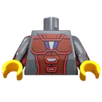{ .lu-ci width="32" } [Shinobi Gi 2 (LOT 7476)](../items/7476.md) | 15 | 60 | — |
| Legs | 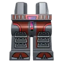{ .lu-ci width="32" } [Shinobi Leggings 2 (LOT 7500)](../items/7500.md) | 15 | 60 | — |
| Main hand | 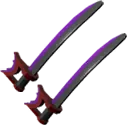{ .lu-ci width="32" } [Shinobi Katana 2 (LOT 7524)](../items/7524.md) | 15 | 120 | [Shadow Blade 2](../skills/1082.md) (1.25 s) |
| Neck/back | 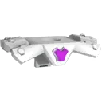{ .lu-ci width="32" } [Shinobi Shoulderpads 2 (LOT 8461)](../items/8461.md) | 15 | 60 | — |

**Set bonuses** (tiers add up as you equip more pieces of this rank):

- **4 pieces:** [Armor Boost 1](../skills/360.md) — +1 AP; [Imagination Boost 1](../skills/369.md) — +1 IP; [Dark Inspiration 2](../skills/694.md) — Restores 2 Imagination every time you smash an enemy
- **5 pieces:** [Armor Boost 1](../skills/360.md) — +1 AP; [Imagination Boost 1](../skills/369.md) — +1 IP; [Brainstorm 1](../skills/774.md) — Restores 1 Imagination to nearby characters when you smash an enemy
- **6 pieces:** [Armor Boost 1](../skills/360.md) — +1 AP; [Imagination Boost 2](../skills/370.md) — +2 IP; Skill 1185 — full-set trigger: completes achievement *The Shinobi's Gear 2* (rewards [Rank 3 Shinobi Book (LOT 11932)](../items/11932.md))

### Rank 3 (set 24)

| Slot | Item | Level | Tokens | Item abilities (IP cost, cooldown) |
| --- | --- | --- | --- | --- |
| Head | { .lu-ci width="32" } [Shinobi Hood 3 (LOT 7453)](../items/7453.md) | 30 | 180 | [Dark Lightning 3](../skills/1077.md) (8 IP, 10 s) |
| Chest | 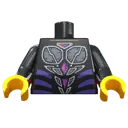{ .lu-ci width="32" } [Shinobi Gi 3 (LOT 7477)](../items/7477.md) | 30 | 180 | — |
| Legs | 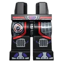{ .lu-ci width="32" } [Shinobi Leggings 3 (LOT 7501)](../items/7501.md) | 30 | 180 | — |
| Main hand | 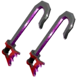{ .lu-ci width="32" } [Shinobi Katana 3 (LOT 7525)](../items/7525.md) | 30 | 360 | [Shadow Blade 3](../skills/1083.md) (1.25 s) |
| Neck/back | 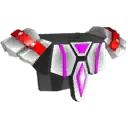{ .lu-ci width="32" } [Shinobi Shoulderpads 3 (LOT 7541)](../items/7541.md) | 30 | 180 | [Shuriken Barrage](../skills/482.md) (10 IP, 20 s) |
| Neck/back | { .lu-ci width="32" } [Valiant Shinobi's Cape (LOT 16190)](../items/16190.md) (valiant) | 40 | 250 | [Shuriken Barrage](../skills/482.md) (10 IP, 20 s) |

Listed in `ItemSets` without an object definition in this database (likely an unreleased valiant weapon): LOT 13275.

**Set bonuses** (tiers add up as you equip more pieces of this rank):

- **4 pieces:** [Armor Boost 1](../skills/360.md) — +1 AP; [Imagination Boost 1](../skills/369.md) — +1 IP; Dark Inspiration 3 (695) — Restores 3 Imagination every time you smash an enemy
- **5 pieces:** [Armor Boost 1](../skills/360.md) — +1 AP; [Imagination Boost 2](../skills/370.md) — +2 IP; Brainstorm 2 (775) — Restores 3 Imagination to nearby characters when you smash an enemy
- **6 pieces:** [Armor Boost 2](../skills/361.md) — +2 AP; [Imagination Boost 2](../skills/370.md) — +2 IP; Skill 1186 — full-set trigger: completes achievement *The Shinobi's Gear 3* (LEGO Score only)

## Source and limitations

Generated by `scripts/build_classes.py` from the supplied CDServer database and the
English client locale. Values are stored definitions; a particular server can differ.
See [how classes work](./README.md) for vendors, tokens, and server implementation notes.
