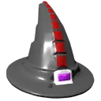
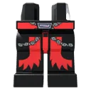
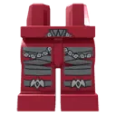
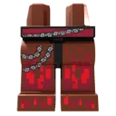
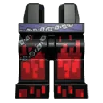
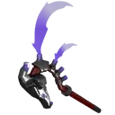
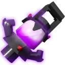

# Sorcerer

[Classes](./README.md) | [Faction Guide](../Faction%20Guide.md) | [Shinobi](./shinobi.md) | [Space Marauder](./space-marauder.md)

**Faction:** Paradox · **Role:** Caster / imagination support · **Currency:** Paradox Token (LOT 8320)

A Maelstrom caster. The wand's charge attack restores imagination to nearby allies, the hat breathes a damaging cone, the orb knocks enemies back, and the rank-3 shoulderpads release a blast that also restores imagination.

## Abilities by rank

Abilities come from equipped pieces. Each rank's pieces replace the previous rank's,
so the table shows what a full set of that rank gives you. Descriptions are the client
tooltips.

| Rank | Slot | Ability | Effect | IP cost | Cooldown |
| --- | --- | --- | --- | --- | --- |
| 1 | Head | { width="24" } [Maelstrom Breath 1](../skills/346.md) | Damage: 8. Breath a cone of Maelstrom energy that does up to 8 damage to enemies over time. | 6 | 6 s |
| 1 | Main hand | { width="24" } [Wand Mastery 1](../skills/355.md) | Damage: 1+2+2. Charge attack: Restores 2 Imagination for nearby characters. | — | — |
| 2 | Head | { width="24" } [Maelstrom Breath 2](../skills/575.md) | Damage: 12. Breath a cone of Maelstrom energy that does up to 12 damage to enemies over time. | 8 | 6 s |
| 2 | Main hand | { width="24" } [Wand Mastery 2](../skills/433.md) | Damage: 2+2+2. Charge attack: Restores up to 5 Imagination for nearby characters - charge longer for more Imagination. | — | — |
| 2 | Off hand | { width="24" } [Dark Thunder 1](../skills/345.md) | Damage: 8. Knocks back enemies. | 7 | 6 s |
| 3 | Head | { width="24" } [Maelstrom Breath 3](../skills/576.md) | Damage: 16. Breath a cone of Maelstrom energy that does up to 16 damage to enemies over time. | 10 | 6 s |
| 3 | Main hand | { width="24" } [Wand Mastery 3](../skills/434.md) | Damage: 2+3+3. Charge attack: Restores up to 11 Imagination for nearby characters - charge longer for more Imagination. | — | — |
| 3 | Main hand (valiant) | { width="24" } [Valiant Attack](../skills/1036.md) | Damage: 3+3+4. Charge attack: Spins you around, doing 8 damage to nearby enemies. | — | — |
| 3 | Off hand | { width="24" } [Dark Thunder 2](../skills/577.md) | Damage: 10. Knocks back enemies. | 8 | 6 s |
| 3 | Neck/back | { width="24" } [Last Blast](../skills/655.md) | Damage: 13. Releases a blast that does 13 damage and restores 30 Imagination to nearby characters. | 14 | 30 s |

## Unlocking the class

1. **Starter kit:** after joining Paradox, choose [Rank 1 Sorcerer Kit Package (LOT 7589)](../items/7589.md) as the reward of
   *Get your … Gear!* (offered by Nexus Jay). It holds the four rank-1 pieces and the
   rank-1 book. The book is also sold by your Nimbus Station vendor if you start a
   second class later.
2. **Use the class book** for each rank to earn the rank achievement the gear requires.
3. **Wear the full set** of a rank to earn the next rank's book.
4. **Buy the next rank** with faction tokens once you reach its level.

| Rank | Level | Required achievement | Class book | How you get the book |
| --- | --- | --- | --- | --- |
| 1 | 5 | *Paradox Sorcerer 1* | [Rank 1 Sorcerer Book (LOT 118)](../items/118.md) | Starter package; Nimbus Station vendor |
| 2 | 15 | *Paradox Sorcerer 2* | [Rank 2 Sorcerer Book (LOT 9964)](../items/9964.md) | Reward for wearing the full rank-1 set |
| 3 | 30 | *Paradox Sorcerer* | [Rank 3 Sorcerer Book (LOT 9965)](../items/9965.md) | Reward for wearing the full rank-2 set |

**Vendors:** ranks 1–2 at [Cog Blammo - Paradox Vendor (LOT 6632)](../items/sources/object-6632.md) in Nimbus Station; rank 3, color
variants, and valiant gear at [Sutoro Hatto - Paradox Vendor (LOT 13378)](../items/sources/object-13378.md) in Nexus Tower.

## Equipment

### Rank 1 (set 16)

| Slot | Item | Level | Tokens | Item abilities (IP cost, cooldown) |
| --- | --- | --- | --- | --- |
| Head | { width="32" } [Sorcerer Hat 1 (LOT 7357)](../items/7357.md) | 5 | 25 | [Maelstrom Breath 1](../skills/346.md) (6 IP, 6 s) |
| Chest | { width="32" } [Sorcerer Breastplate 1 (LOT 7373)](../items/7373.md) | 5 | 25 | — |
| Legs | { width="32" } [Sorcerer Pants 1 (LOT 7385)](../items/7385.md) | 5 | 25 | — |
| Main hand | { width="32" } [Sorcerer Wand 1 (LOT 7397)](../items/7397.md) | 5 | 25 | [Wand Mastery 1](../skills/355.md) |

**Set bonuses** (tiers add up as you equip more pieces of this rank):

- **4 pieces:** [Armor Boost 1](../skills/360.md) — +1 AP; [Imagination Boost 2](../skills/370.md) — +2 IP; [Dark Inspiration 1](../skills/693.md) — Restores 1 Imagination every time you smash an enemy; [Skill 1178](../skills/1178.md) — full-set trigger: completes achievement *The Sorcerer's Gear 1* (rewards [Rank 2 Sorcerer Book (LOT 9964)](../items/9964.md))

### Rank 2 (set 17)

| Slot | Item | Level | Tokens | Item abilities (IP cost, cooldown) |
| --- | --- | --- | --- | --- |
| Head | { width="32" } [Sorcerer Hat 2 (LOT 7361)](../items/7361.md) | 15 | 60 | [Maelstrom Breath 2](../skills/575.md) (8 IP, 6 s) |
| Chest | { width="32" } [Sorcerer Breastplate 2 (LOT 7374)](../items/7374.md) | 15 | 60 | — |
| Legs | { width="32" } [Sorcerer Pants 2 (LOT 7386)](../items/7386.md) | 15 | 60 | — |
| Main hand | { width="32" } [Sorcerer Wand 2 (LOT 7398)](../items/7398.md) | 15 | 60 | [Wand Mastery 2](../skills/433.md) |
| Off hand | { width="32" } [Sorcerer Orb 2 (LOT 7407)](../items/7407.md) | 15 | 60 | [Dark Thunder 1](../skills/345.md) (7 IP, 6 s) |
| Neck/back | { width="32" } [Sorcerer Shoulderpads 2 (LOT 8459)](../items/8459.md) | 15 | 60 | — |

**Set bonuses** (tiers add up as you equip more pieces of this rank):

- **4 pieces:** [Armor Boost 1](../skills/360.md) — +1 AP; [Imagination Boost 1](../skills/369.md) — +1 IP; [Dark Inspiration 2](../skills/694.md) — Restores 2 Imagination every time you smash an enemy
- **5 pieces:** [Armor Boost 1](../skills/360.md) — +1 AP; [Imagination Boost 1](../skills/369.md) — +1 IP; [Brainstorm 1](../skills/774.md) — Restores 1 Imagination to nearby characters when you smash an enemy
- **6 pieces:** [Armor Boost 1](../skills/360.md) — +1 AP; [Imagination Boost 2](../skills/370.md) — +2 IP; [Skill 1179](../skills/1179.md) — full-set trigger: completes achievement *The Sorcerer's Gear 2* (rewards [Rank 3 Sorcerer Book (LOT 9965)](../items/9965.md))

### Rank 3 (set 18)

| Slot | Item | Level | Tokens | Item abilities (IP cost, cooldown) |
| --- | --- | --- | --- | --- |
| Head | { width="32" } [Sorcerer Hat 3 (LOT 7362)](../items/7362.md) | 30 | 180 | [Maelstrom Breath 3](../skills/576.md) (10 IP, 6 s) |
| Head | { width="32" } [Sorcerer Hat 3 (LOT 12983)](../items/12983.md) (color variant) | 30 | 180 | [Maelstrom Breath 3](../skills/576.md) (10 IP, 6 s) |
| Chest | { width="32" } [Sorcerer Breastplate 3 (LOT 7375)](../items/7375.md) | 30 | 180 | — |
| Chest | { width="32" } [Sorcerer Breastplate 3 (LOT 12958)](../items/12958.md) (color variant) | 30 | 180 | — |
| Legs | { width="32" } [Sorcerer Pants 3 (LOT 7387)](../items/7387.md) | 30 | 180 | — |
| Legs | { width="32" } [Sorcerer Pants 3 (LOT 12959)](../items/12959.md) (color variant) | 30 | 180 | — |
| Main hand | { width="32" } [Sorcerer Wand 3 (LOT 7399)](../items/7399.md) | 30 | 180 | [Wand Mastery 3](../skills/434.md) |
| Main hand | { width="32" } [Sorcerer Wand 3 (LOT 12984)](../items/12984.md) (color variant) | 30 | 180 | [Wand Mastery 3](../skills/434.md) |
| Main hand | { width="32" } [The Doomslicer (LOT 12816)](../items/12816.md) (valiant) | 35 | 500 | [Valiant Attack](../skills/1036.md) |
| Off hand | { width="32" } [Sorcerer Orb 3 (LOT 7408)](../items/7408.md) | 30 | 180 | [Dark Thunder 2](../skills/577.md) (8 IP, 6 s) |
| Off hand | { width="32" } [Sorcerer Orb 3 (LOT 12985)](../items/12985.md) (color variant) | 30 | 180 | [Dark Thunder 2](../skills/577.md) (8 IP, 6 s) |
| Neck/back | { width="32" } [Sorcerer Shoulderpads 3 (LOT 7415)](../items/7415.md) | 30 | 180 | [Last Blast](../skills/655.md) (14 IP, 30 s) |
| Neck/back | { width="32" } [Sorcerer Shoulderpads 3 (LOT 12989)](../items/12989.md) (color variant) | 30 | 180 | [Last Blast](../skills/655.md) (14 IP, 30 s) |
| Neck/back | { width="32" } [Valiant Sorcerer's Cape (LOT 16189)](../items/16189.md) (valiant) | 40 | 250 | [Last Blast](../skills/655.md) (14 IP, 30 s) |

**Set bonuses** (tiers add up as you equip more pieces of this rank):

- **4 pieces:** [Armor Boost 1](../skills/360.md) — +1 AP; [Imagination Boost 1](../skills/369.md) — +1 IP; Dark Inspiration 3 (695) — Restores 3 Imagination every time you smash an enemy
- **5 pieces:** [Armor Boost 2](../skills/361.md) — +2 AP; [Imagination Boost 2](../skills/370.md) — +2 IP; Brainstorm 2 (775) — Restores 3 Imagination to nearby characters when you smash an enemy
- **6 pieces:** [Armor Boost 2](../skills/361.md) — +2 AP; [Imagination Boost 2](../skills/370.md) — +2 IP; [Life Boost 1](../skills/378.md) — +1 LP; Skill 1180 — full-set trigger: completes achievement *The Sorcerer's Gear 3* (LEGO Score only)

## Source and limitations

Generated by `scripts/build_classes.py` from the supplied CDServer database and the
English client locale. Values are stored definitions; a particular server can differ.
See [how classes work](./README.md) for vendors, tokens, and server implementation notes.
