# Space Marauder

[Classes](./README.md) | [Faction Guide](../Faction%20Guide.md) | [Shinobi](./shinobi.md) | [Sorcerer](./sorcerer.md)

**Faction:** Paradox · **Role:** Ranged damage · **Currency:** Paradox Token (LOT 8320)

A ranged damage dealer. The blaster's charge attack restores imagination to nearby allies, the helm throws plasma balls, the launcher fires Maelstrom rockets, and the rank-3 shoulderpads a cluster of energy spheres.

## Abilities by rank

Abilities come from equipped pieces. Each rank's pieces replace the previous rank's,
so the table shows what a full set of that rank gives you. Descriptions are the client
tooltips.

| Rank | Slot | Ability | Effect | IP cost | Cooldown |
| --- | --- | --- | --- | --- | --- |
| 1 | Head | { width="24" } [Plasma Ball 1](../skills/458.md) | Damage: 6. Tosses an energy sphere that does 6 damage to enemies. | 6 | 5 s |
| 1 | Main hand | { width="24" } [Blaster Master 1](../skills/605.md) | Damage: 1+2+2. Charge attack: Restores 2 Imagination for nearby characters. | — | — |
| 2 | Head | { width="24" } [Plasma Ball 2](../skills/459.md) | Damage: 8. Tosses an energy sphere that does 8 damage to enemies. | 7 | 5 s |
| 2 | Main hand | 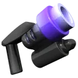{ width="24" } [Blaster Master 2](../skills/645.md) | Damage: 2+2+2. Charge attack: Restores up to 5 Imagination for nearby characters - charge longer for more Imagination. | — | — |
| 2 | Off hand | { width="24" } [Maelstrom Rocket 1](../skills/609.md) | Damage: 7. Launches a rocket that does 7 damage. | 6 | 5 s |
| 3 | Head | { width="24" } [Plasma Ball 3](../skills/460.md) | Damage: 10. Tosses an energy sphere that does 10 damage to enemies. | 8 | 5 s |
| 3 | Main hand | 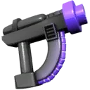{ width="24" } [Blaster Master 3](../skills/646.md) | Damage: 2+3+3. Charge attack: Restores up to 5 Imagination for nearby characters - charge longer for more Imagination. | — | — |
| 3 | Main hand (valiant) | { width="24" } [Valiant Attack](../skills/1032.md) | Damage: 5. Charge attack: Hold down to do up to 30 damage over time. | — | 1 s |
| 3 | Off hand | 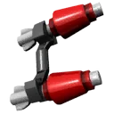{ width="24" } [Maelstrom Rocket 2](../skills/647.md) | Damage: 9. Launches a rocket that does 9 damage. | 7 | 5 s |
| 3 | Neck/back | { width="24" } [Cluster Strike](../skills/606.md) | Damage: 4x8. Throws spheres of Maelstrom energy that each do 4 damage. | 12 | 30 s |

## Unlocking the class

1. **Starter kit:** after joining Paradox, choose [Rank 1 Space Marauder Kit Package (LOT 8029)](../items/8029.md) as the reward of
   *Get your … Gear!* (offered by Nexus Jay). It holds the four rank-1 pieces and the
   rank-1 book. The book is also sold by your Nimbus Station vendor if you start a
   second class later.
2. **Use the class book** for each rank to earn the rank achievement the gear requires.
3. **Wear the full set** of a rank to earn the next rank's book.
4. **Buy the next rank** with faction tokens once you reach its level.

| Rank | Level | Required achievement | Class book | How you get the book |
| --- | --- | --- | --- | --- |
| 1 | 5 | *Paradox Space Marauder 1* | [Rank 1 Space Marauder Book (LOT 125)](../items/125.md) | Starter package; Nimbus Station vendor |
| 2 | 15 | *Paradox Space Marauder 2* | [Rank 2 Space Marauder Book (LOT 9966)](../items/9966.md) | Reward for wearing the full rank-1 set |
| 3 | 30 | *Paradox Space Marauder* | [Rank 3 Space Marauder Book (LOT 9967)](../items/9967.md) | Reward for wearing the full rank-2 set |

**Vendors:** ranks 1–2 at [Cog Blammo - Paradox Vendor (LOT 6632)](../items/sources/object-6632.md) in Nimbus Station; rank 3, color
variants, and valiant gear at [Sutoro Hatto - Paradox Vendor (LOT 13378)](../items/sources/object-13378.md) in Nexus Tower.

## Equipment

### Rank 1 (set 19)

| Slot | Item | Level | Tokens | Item abilities (IP cost, cooldown) |
| --- | --- | --- | --- | --- |
| Head | 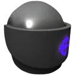{ width="32" } [Space Marauder Helm 1 (LOT 7448)](../items/7448.md) | 5 | 25 | [Plasma Ball 1](../skills/458.md) (6 IP, 5 s) |
| Chest | 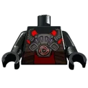{ width="32" } [Space Marauder Jacket 1 (LOT 7472)](../items/7472.md) | 5 | 25 | — |
| Legs | 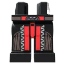{ width="32" } [Space Marauder Pants 1 (LOT 7496)](../items/7496.md) | 5 | 25 | — |
| Main hand | { width="32" } [Space Marauder Blaster 1 (LOT 7520)](../items/7520.md) | 5 | 25 | [Blaster Master 1](../skills/605.md) |

**Set bonuses** (tiers add up as you equip more pieces of this rank):

- **4 pieces:** [Armor Boost 1](../skills/360.md) — +1 AP; [Imagination Boost 2](../skills/370.md) — +2 IP; [Dark Inspiration 1](../skills/693.md) — Restores 1 Imagination every time you smash an enemy; [Skill 1181](../skills/1181.md) — full-set trigger: completes achievement *The Space Marauder's Gear 1* (rewards [Rank 2 Space Marauder Book (LOT 9966)](../items/9966.md))

### Rank 2 (set 20)

| Slot | Item | Level | Tokens | Item abilities (IP cost, cooldown) |
| --- | --- | --- | --- | --- |
| Head | { width="32" } [Space Marauder Helm 2 (LOT 7449)](../items/7449.md) | 15 | 60 | [Plasma Ball 2](../skills/459.md) (7 IP, 5 s) |
| Chest | 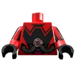{ width="32" } [Space Marauder Jacket 2 (LOT 7473)](../items/7473.md) | 15 | 60 | — |
| Legs | 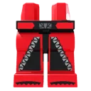{ width="32" } [Space Marauder Pants 2 (LOT 7497)](../items/7497.md) | 15 | 60 | — |
| Main hand | { width="32" } [Space Marauder Blaster 2 (LOT 7521)](../items/7521.md) | 15 | 60 | [Blaster Master 2](../skills/645.md) |
| Off hand | { width="32" } [Space Marauder Launcher 2 (LOT 7548)](../items/7548.md) | 15 | 60 | [Maelstrom Rocket 1](../skills/609.md) (6 IP, 5 s) |
| Neck/back | 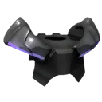{ width="32" } [Space Marauder Shoulderpads 2 (LOT 8460)](../items/8460.md) | 15 | 60 | — |

**Set bonuses** (tiers add up as you equip more pieces of this rank):

- **4 pieces:** [Armor Boost 1](../skills/360.md) — +1 AP; [Imagination Boost 1](../skills/369.md) — +1 IP; [Dark Inspiration 2](../skills/694.md) — Restores 2 Imagination every time you smash an enemy
- **5 pieces:** [Armor Boost 1](../skills/360.md) — +1 AP; [Imagination Boost 1](../skills/369.md) — +1 IP; [Scanner](../skills/776.md) — Shows the location of dangerous enemies and collectibles on your mini-map
- **6 pieces:** [Armor Boost 2](../skills/361.md) — +2 AP; [Imagination Boost 2](../skills/370.md) — +2 IP; [Skill 1182](../skills/1182.md) — full-set trigger: completes achievement *The Space Marauder's Gear 2* (rewards [Rank 3 Space Marauder Book (LOT 9967)](../items/9967.md))

### Rank 3 (set 21)

| Slot | Item | Level | Tokens | Item abilities (IP cost, cooldown) |
| --- | --- | --- | --- | --- |
| Head | { width="32" } [Space Marauder Helm 3 (LOT 7450)](../items/7450.md) | 30 | 180 | [Plasma Ball 3](../skills/460.md) (8 IP, 5 s) |
| Head | { width="32" } [Space Marauder Helm 3 (LOT 12986)](../items/12986.md) (color variant) | 30 | 180 | [Plasma Ball 3](../skills/460.md) (8 IP, 5 s) |
| Chest | 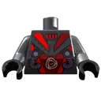{ width="32" } [Space Marauder Jacket 3 (LOT 7474)](../items/7474.md) | 30 | 180 | — |
| Chest | 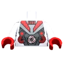{ width="32" } [Space Marauder Jacket 3 (LOT 12960)](../items/12960.md) (color variant) | 30 | 180 | — |
| Legs | 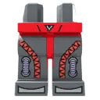{ width="32" } [Space Marauder Pants 3 (LOT 7498)](../items/7498.md) | 30 | 180 | — |
| Legs | 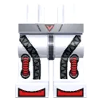{ width="32" } [Space Marauder Pants 3 (LOT 12961)](../items/12961.md) (color variant) | 30 | 180 | — |
| Main hand | { width="32" } [Space Marauder Blaster 3 (LOT 7522)](../items/7522.md) | 30 | 180 | [Blaster Master 3](../skills/646.md) |
| Main hand | { width="32" } [Space Marauder Blaster 3 (LOT 12987)](../items/12987.md) (color variant) | 30 | 180 | [Blaster Master 3](../skills/646.md) |
| Main hand | 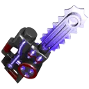{ width="32" } [The Wormholer (LOT 12809)](../items/12809.md) (valiant) | 35 | 500 | [Valiant Attack](../skills/1032.md) (1 s) |
| Off hand | { width="32" } [Space Marauder Launcher 3 (LOT 7550)](../items/7550.md) | 30 | 180 | [Maelstrom Rocket 2](../skills/647.md) (7 IP, 5 s) |
| Off hand | 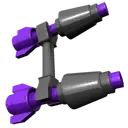{ width="32" } [Space Marauder Launcher 3 (LOT 12988)](../items/12988.md) (color variant) | 30 | 180 | [Maelstrom Rocket 2.0](../skills/1439.md) (7 IP, 5 s) |
| Neck/back | 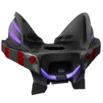{ width="32" } [Space Marauder Shoulderpads 3 (LOT 7540)](../items/7540.md) | 30 | 180 | [Cluster Strike](../skills/606.md) (12 IP, 30 s) |
| Neck/back | { width="32" } [Space Marauder Shoulderpads 3 (LOT 12991)](../items/12991.md) (color variant) | 30 | 180 | [Cluster Strike](../skills/606.md) (12 IP, 30 s) |
| Neck/back | { width="32" } [Valiant Space Marauder's Cape (LOT 16188)](../items/16188.md) (valiant) | 40 | 250 | [Cluster Strike](../skills/606.md) (12 IP, 30 s) |

**Set bonuses** (tiers add up as you equip more pieces of this rank):

- **4 pieces:** [Armor Boost 1](../skills/360.md) — +1 AP; [Imagination Boost 1](../skills/369.md) — +1 IP; Dark Inspiration 3 (695) — Restores 3 Imagination every time you smash an enemy
- **5 pieces:** [Armor Boost 2](../skills/361.md) — +2 AP; [Imagination Boost 1](../skills/369.md) — +1 IP; [Scanner](../skills/776.md) — Shows the location of dangerous enemies and collectibles on your mini-map
- **6 pieces:** Armor Boost 3 (362) — +3 AP; [Imagination Boost 2](../skills/370.md) — +2 IP; [Life Boost 1](../skills/378.md) — +1 LP; Skill 1183 — full-set trigger: completes achievement *The Space Marauder's Gear 3* (LEGO Score only)

## Source and limitations

Generated by `scripts/build_classes.py` from the supplied CDServer database and the
English client locale. Values are stored definitions; a particular server can differ.
See [how classes work](./README.md) for vendors, tokens, and server implementation notes.
