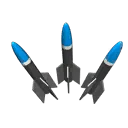
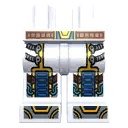
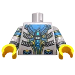
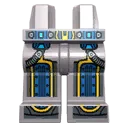
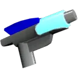
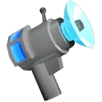
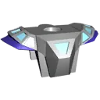
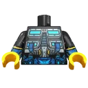
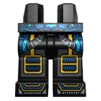
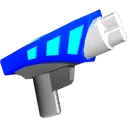

# Space Ranger

[Classes](./README.md) | [Faction Guide](../Faction%20Guide.md) | [Knight](./knight.md) | [Samurai](./samurai.md)

**Faction:** Sentinels · **Role:** Crowd control · **Currency:** Sentinel Faction Token (LOT 8319)

A ranged controller. The ripple gun blocks attacks while charged, the helmet throws a gravity well that pulls in and stuns enemies, and the launcher and pack call an orbital laser and release a stored-energy blast.

This class was added in a later content update (`factionkit2`) and is not covered by
the 2010 guide. It has no rank-3 color variants.

## Abilities by rank

Abilities come from equipped pieces. Each rank's pieces replace the previous rank's,
so the table shows what a full set of that rank gives you. Descriptions are the client
tooltips.

| Rank | Slot | Ability | Effect | IP cost | Cooldown |
| --- | --- | --- | --- | --- | --- |
| 1 | Head | { .lu-ci .lu-on-light width="24" } [Gravity Well 1](../skills/1088.md) | Tosses a gadget that pulls enemies to it and stuns them. | 4 | 8 s |
| 1 | Main hand | { .lu-ci .lu-on-dark width="24" } [Ripple Gun 1](../skills/1094.md) | Damage: 1+1+2. Charge attack: Blocks 4 attacks while charged. | — | — |
| 2 | Head | { .lu-ci .lu-on-light width="24" } [Gravity Well 2](../skills/1089.md) | Tosses a gadget that pulls enemies to it and stuns them. | 5 | 8 s |
| 2 | Main hand | { .lu-ci .lu-on-dark width="24" } [Ripple Gun 2](../skills/1099.md) | Damage: 2+2+2. Charge attack: Blocks 6 attacks while charged. | — | — |
| 2 | Off hand | { .lu-ci .lu-on-dark width="24" } [Orbital Strike 1](../skills/1091.md) | Damage: 4. Calls an orbital laser that does 4 damage to enemies and briefly stuns them. | 5 | 8 s |
| 3 | Head | { .lu-ci .lu-on-light width="24" } [Gravity Well 3](../skills/1090.md) | Tosses a gadget that pulls enemies to it and stuns them. | 6 | 8 s |
| 3 | Main hand | { .lu-ci .lu-on-dark width="24" } [Ripple Gun 3](../skills/1100.md) | Damage: 2+3+3. Charge attack: Blocks 8 attacks while charged. | — | — |
| 3 | Off hand | { .lu-ci .lu-on-dark width="24" } [Orbital Strike 2](../skills/1092.md) | Damage: 8. Calls an orbital laser that does 8 damage to enemies and briefly stuns them. | 7 | 8 s |
| 3 | Neck/back | { .lu-ci .lu-on-light width="24" } [Sentinel Blast](../skills/1093.md) | Damage: 14. Releases stored energy that does 14 damage to enemies. | 10 | 12 s |

## Unlocking the class

1. **Starter kit:** after joining the Sentinels, choose [Rank 1 Space Ranger Kit Package (LOT 8027)](../items/8027.md) as the reward of
   *Get your … Gear!* (offered by Nexus Jay). It holds the four rank-1 pieces and the
   rank-1 book. The book is also sold by your Nimbus Station vendor if you start a
   second class later.
2. **Use the class book** for each rank to earn the rank achievement the gear requires.
3. **Wear the full set** of a rank to earn the next rank's book.
4. **Buy the next rank** with faction tokens once you reach its level.

| Rank | Level | Required achievement | Class book | How you get the book |
| --- | --- | --- | --- | --- |
| 1 | 5 | *Sentinel Space Ranger 1* | [Rank 1 Space Ranger Book (LOT 11924)](../items/11924.md) | Starter package; Nimbus Station vendor |
| 2 | 15 | *Sentinel Space Ranger 2* | [Rank 2 Space Ranger Book (LOT 11928)](../items/11928.md) | Reward for wearing the full rank-1 set |
| 3 | 30 | *Sentinel Space Ranger* | [Rank 3 Space Ranger Book (LOT 11933)](../items/11933.md) | Reward for wearing the full rank-2 set |

**Vendors:** ranks 1–2 at [Xeno Blueblade - Sentinel Vendor (LOT 6631)](../items/sources/object-6631.md) in Nimbus Station; rank 3, color
variants, and valiant gear at [Nikolai Gammapulse - Sentinel Vendor (LOT 13376)](../items/sources/object-13376.md) in Nexus Tower.

## Equipment

### Rank 1 (set 10)

| Slot | Item | Level | Tokens | Item abilities (IP cost, cooldown) |
| --- | --- | --- | --- | --- |
| Head | { .lu-ci .lu-on-dark width="32" } [Space Ranger Helmet 1 (LOT 7442)](../items/7442.md) | 5 | 25 | [Gravity Well 1](../skills/1088.md) (4 IP, 8 s) |
| Chest | { .lu-ci .lu-on-dark width="32" } [Space Ranger Armor 1 (LOT 7466)](../items/7466.md) | 5 | 25 | — |
| Legs | { .lu-ci .lu-on-dark width="32" } [Space Ranger Pants 1 (LOT 7490)](../items/7490.md) | 5 | 25 | — |
| Main hand | { .lu-ci .lu-on-dark width="32" } [Space Ranger Zipgun 1 (LOT 7514)](../items/7514.md) | 5 | 25 | [Ripple Gun 1](../skills/1094.md) |

**Set bonuses** (tiers add up as you equip more pieces of this rank):

- **4 pieces:** [Armor Boost 1](../skills/360.md) — +1 AP; [Imagination Boost 2](../skills/370.md) — +2 IP; [Emergency Shield 1](../skills/1104.md) — When you reach 0 Armor, you will be shielded from 10 damage for a short time; [Skill 1166](../skills/1166.md) — full-set trigger: completes achievement *The Space Ranger's Gear 1* (rewards [Rank 2 Space Ranger Book (LOT 11928)](../items/11928.md))

### Rank 2 (set 11)

| Slot | Item | Level | Tokens | Item abilities (IP cost, cooldown) |
| --- | --- | --- | --- | --- |
| Head | { .lu-ci .lu-on-dark width="32" } [Space Ranger Helmet 2 (LOT 7443)](../items/7443.md) | 15 | 60 | [Gravity Well 2](../skills/1089.md) (5 IP, 8 s) |
| Chest | { .lu-ci .lu-on-dark width="32" } [Space Ranger Armor 2 (LOT 7467)](../items/7467.md) | 15 | 60 | — |
| Legs | { .lu-ci .lu-on-dark width="32" } [Space Ranger Pants 2 (LOT 7491)](../items/7491.md) | 15 | 60 | — |
| Main hand | { .lu-ci .lu-on-light width="32" } [Space Ranger Zipgun 2 (LOT 7515)](../items/7515.md) | 15 | 60 | [Ripple Gun 2](../skills/1099.md) |
| Off hand | { .lu-ci .lu-on-dark width="32" } [Space Ranger Launcher 2 (LOT 7544)](../items/7544.md) | 15 | 60 | [Orbital Strike 1](../skills/1091.md) (5 IP, 8 s) |
| Neck/back | { .lu-ci .lu-on-dark width="32" } [Space Ranger Pack 2 (LOT 8457)](../items/8457.md) | 15 | 60 | — |

**Set bonuses** (tiers add up as you equip more pieces of this rank):

- **4 pieces:** [Armor Boost 1](../skills/360.md) — +1 AP; [Emergency Shield 2](../skills/1105.md) — When you reach 0 Armor, you will be shielded from 15 damage for a short time
- **5 pieces:** [Armor Boost 1](../skills/360.md) — +1 AP; [Imagination Boost 2](../skills/370.md) — +2 IP; [Juggernaut 1](../skills/431.md) — Restores 1 Armor every time you smash an enemy
- **6 pieces:** [Armor Boost 2](../skills/361.md) — +2 AP; [Imagination Boost 3](../skills/371.md) — +3 IP; [Skill 1167](../skills/1167.md) — full-set trigger: completes achievement *The Space Ranger's Gear 2* (rewards [Rank 3 Space Ranger Book (LOT 11933)](../items/11933.md))

### Rank 3 (set 12)

| Slot | Item | Level | Tokens | Item abilities (IP cost, cooldown) |
| --- | --- | --- | --- | --- |
| Head | { .lu-ci .lu-on-dark width="32" } [Space Ranger Helmet 3 (LOT 7444)](../items/7444.md) | 30 | 180 | [Gravity Well 3](../skills/1090.md) (6 IP, 8 s) |
| Chest | { .lu-ci .lu-on-light width="32" } [Space Ranger Armor 3 (LOT 7468)](../items/7468.md) | 30 | 180 | — |
| Legs | { .lu-ci .lu-on-light width="32" } [Space Ranger Pants 3 (LOT 7492)](../items/7492.md) | 30 | 180 | — |
| Main hand | { .lu-ci .lu-on-dark width="32" } [Space Ranger Zipgun 3 (LOT 7516)](../items/7516.md) | 30 | 180 | [Ripple Gun 3](../skills/1100.md) |
| Off hand | { .lu-ci .lu-on-dark width="32" } [Space Ranger Launcher 3 (LOT 7545)](../items/7545.md) | 30 | 180 | [Orbital Strike 2](../skills/1092.md) (7 IP, 8 s) |
| Neck/back | { .lu-ci .lu-on-dark width="32" } [Space Ranger Pack 3 (LOT 7538)](../items/7538.md) | 30 | 180 | [Sentinel Blast](../skills/1093.md) (10 IP, 12 s) |
| Neck/back | { .lu-ci .lu-on-light width="32" } [Valiant Space Ranger's Cape (LOT 16181)](../items/16181.md) (valiant) | 40 | 250 | [Sentinel Blast](../skills/1093.md) (10 IP, 12 s) |

Listed in `ItemSets` without an object definition in this database (likely an unreleased valiant weapon): LOT 13277.

**Set bonuses** (tiers add up as you equip more pieces of this rank):

- **4 pieces:** [Armor Boost 1](../skills/360.md) — +1 AP; [Imagination Boost 1](../skills/369.md) — +1 IP; Emergency Shield 3 (1106) — When you reach 0 Armor, you will be shielded from 20 damage for a short time
- **5 pieces:** [Armor Boost 2](../skills/361.md) — +2 AP; [Imagination Boost 2](../skills/370.md) — +2 IP; [Juggernaut 1](../skills/431.md) — Restores 1 Armor every time you smash an enemy
- **6 pieces:** [Armor Boost 2](../skills/361.md) — +2 AP; [Imagination Boost 3](../skills/371.md) — +3 IP; Skill 1168 — full-set trigger: completes achievement *The Space Ranger's Gear 3* (LEGO Score only)

## Source and limitations

Generated by `scripts/build_classes.py` from the supplied CDServer database and the
English client locale. Values are stored definitions; a particular server can differ.
See [how classes work](./README.md) for vendors, tokens, and server implementation notes.
