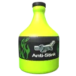

# Un-Stink Potion

<!-- media:start (generated by scripts/build_media.py) -->
{ width="64" loading="lazy" }
<!-- media:end -->

[Item database](./README.md) | [Methodology](./Methodology.md)

**LOT: 10021** | Consumable | Rarity code: 1

## Description

Double-click to use!

Player tooltip: official English client text (`locale.xml`, `en_US`).

| Field | Stored value |
| --- | --- |
| Display name | Un-Stink Potion |
| Internal name | Anti-Stink Potion |
| Object row | Present |
| Equipment slot / stack size | Not recorded / 10 |
| Binding / uniqueness | Bind on pickup: False; bind on equip: False; unique: False |
| Requirements | Flag: 0; achievement: 0; precondition: 248; specialty/rank: 0 / 0 |
| Base value (not a vendor quote) | 35 |
| Currencies | Costs: not recorded; alternate LOT/cost:  / ; commendation LOT/cost:  /  |

## Drops, packages, activities, and vendors

| Definition | Source kind | Named sources | Probability / stock |
| --- | --- | --- | --- |
| [Matrix 115](sources/matrix-115.md) | Vendor | [Farnham Spoon - Supplies Vendor (LOT 3918)](sources/object-3918.md) [TEST Mission Giver Vendor (LOT 12538)](sources/object-12538.md) [TEST multimission giver (LOT 12911)](sources/object-12911.md) | Not a rolled drop source Default vendor stock: 100% per refresh |
| [Matrix 277](sources/matrix-277.md) | Drop | [NS - Newspaper Box 2 (LOT 3170)](sources/object-3170.md) [NS - Newspaper Box 3 (LOT 3171)](sources/object-3171.md) [NS - Mailbox (LOT 3197)](sources/object-3197.md) [all 16 source LOTs](sources/matrix-277.md) | Loot: 0.11413043%; mean 0.0011413043 |
| [Matrix 574](sources/matrix-574.md) | Activity | [NS - Wishing Well Birdbath (LOT 11280)](sources/object-11280.md) | Loot: 1.14130435%; mean 0.011413043 |
| [Matrix 575](sources/matrix-575.md) | Activity | [NS - Wishing Well Birdbath (LOT 11280)](sources/object-11280.md) | Loot: 1.63043478%; mean 0.016304348 |
| [Matrix 576](sources/matrix-576.md) | Activity | [NS - Wishing Well Birdbath (LOT 11280)](sources/object-11280.md) | Loot: 2.44565217%; mean 0.024456522 |
| [Matrix 577](sources/matrix-577.md) | Activity | [NS - Wishing Well Birdbath (LOT 11280)](sources/object-11280.md) | Loot: 3.26086957%; mean 0.032608696 |
| [Matrix 578](sources/matrix-578.md) | Activity | [NS - Wishing Well Birdbath (LOT 11280)](sources/object-11280.md) | Loot: 3.26086957%; mean 0.032608696 |
| [Matrix 579](sources/matrix-579.md) | Activity | [NS - Wishing Well Birdbath (LOT 11280)](sources/object-11280.md) | Loot: 4.838138%; mean 0.048913043 |
| [Matrix 580](sources/matrix-580.md) | Activity | [NS - Wishing Well Birdbath (LOT 11280)](sources/object-11280.md) | Loot: 6.38111798%; mean 0.065217391 |
| [Matrix 581](sources/matrix-581.md) | Activity | [NS - Wishing Well Birdbath (LOT 11280)](sources/object-11280.md) | Loot: 9.43390761%; mean 0.097826087 |
| [Matrix 598](sources/matrix-598.md) | Activity | [Natso Fast - Foot Race Host (LOT 8663)](sources/object-8663.md) [Boris Toobsox - Foot Race Host (LOT 9714)](sources/object-9714.md) [FV - Panda Block (LOT 9732)](sources/object-9732.md) [all 9 source LOTs](sources/matrix-598.md) | Loot: 0.00032609%; mean 0.0000032608696 |
| [Matrix 701](sources/matrix-701.md) | Vendor | [Olivia Nightshade - Supplies Vendor (LOT 13392)](sources/object-13392.md) | Not a rolled drop source Default vendor stock: 100% per refresh |
| [Matrix 719](sources/matrix-719.md) | Activity | [NT - Interactable Console - Wishing Well (LOT 14086)](sources/object-14086.md) | Loot: 1.1576087%; mean 0.011576087 |
| [Matrix 720](sources/matrix-720.md) | Activity | [NT - Interactable Console - Wishing Well (LOT 14086)](sources/object-14086.md) | Loot: 1.79347826%; mean 0.017934783 |
| [Matrix 721](sources/matrix-721.md) | Activity | [NT - Interactable Console - Wishing Well (LOT 14086)](sources/object-14086.md) | Loot: 2.46195652%; mean 0.024619565 |
| [Matrix 722](sources/matrix-722.md) | Activity | [NT - Interactable Console - Wishing Well (LOT 14086)](sources/object-14086.md) | Loot: 3.26086957%; mean 0.032608696 |
| [Matrix 723](sources/matrix-723.md) | Activity | [NT - Interactable Console - Wishing Well (LOT 14086)](sources/object-14086.md) | Loot: 3.26086957%; mean 0.032608696 |
| [Matrix 724](sources/matrix-724.md) | Activity | [NT - Interactable Console - Wishing Well (LOT 14086)](sources/object-14086.md) | Loot: 4.838138%; mean 0.048913043 |
| [Matrix 725](sources/matrix-725.md) | Activity | [NT - Interactable Console - Wishing Well (LOT 14086)](sources/object-14086.md) | Loot: 6.38111798%; mean 0.065217391 |
| [Matrix 726](sources/matrix-726.md) | Activity | [NT - Interactable Console - Wishing Well (LOT 14086)](sources/object-14086.md) | Loot: 9.43390761%; mean 0.097826087 |

Rates above mean **at least one item per matrix invocation before player filters**, followed by expected item count. They are not a universal chance per kill. Vendor stock is a separate calculation, not a drop rate. Mission-only drops, team ownership, scripts, availability, and vendor scene overrides can change actual receipt. Follow the source links for mapped locations and coordinates.

## Mission, achievement, mail, and code rewards

No reward association was found in the covered mission, mail, or code tables.

## Community acquisition references

**Historical community evidence, matched by a unique local item name—not a verified LOT or current-server availability match.**

- [Consumable](https://legouniverse.fandom.com/wiki/Consumable?oldid=164121): reported methods: drop, vendor; named acquisition references: none extracted. Matched name: Un-Stink Potion.

## Evidence

[Objects](../../db/Objects.md), [ComponentsRegistry](../../db/ComponentsRegistry.md), [ItemComponent](../../db/ItemComponent.md), [LootMatrix](../../db/LootMatrix.md), [LootTable](../../db/LootTable.md), [RarityTable](../../db/RarityTable.md). [Coverage and limitations](./Methodology.md).
