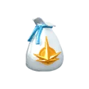

# Large Bag of Faction Tokens

<!-- media:start (generated by scripts/build_media.py) -->
{ .lu-icon .lu-on-dark width="128" loading="lazy" }
<!-- media:end -->

[Item database](./README.md) | [Methodology](./Methodology.md)

**LOT: 10096** | Package | Rarity code: 1

## Description

Double-click to get 10 Faction Tokens!

Player tooltip: official English client text (`locale.xml`, `en_US`).

| Field | Stored value |
| --- | --- |
| Display name | Large Bag of Faction Tokens |
| Internal name | Faction Token Bag - 10 tokens |
| Object row | Present |
| Equipment slot / stack size | Not recorded / 10 |
| Binding / uniqueness | Bind on pickup: True; bind on equip: False; unique: False |
| Requirements | Flag: 0; achievement: 0; precondition: 211;47; specialty/rank: 0 / 0 |
| Base value (not a vendor quote) | 0 |
| Currencies | Costs: not recorded; alternate LOT/cost:  / ; commendation LOT/cost:  /  |

## Drops, packages, activities, and vendors

No qualifying static loot-matrix or vendor association was resolved.

Rates above mean **at least one item per matrix invocation before player filters**, followed by expected item count. They are not a universal chance per kill. Vendor stock is a separate calculation, not a drop rate. Mission-only drops, team ownership, scripts, availability, and vendor scene overrides can change actual receipt. Follow the source links for mapped locations and coordinates.

## Mission, achievement, mail, and code rewards

| Reward | Classification | Conditions | Associated NPCs / mapped locations |
| --- | --- | --- | --- |
| Achievement 529: Not the Boss of Me 1 | Battle / General | First completion; listed completion reward; quantity 1 | No associated NPC placement resolved |
| Achievement 530: Not the Boss of Me 2 | Battle / General | First completion; listed completion reward; quantity 1 | No associated NPC placement resolved |
| Achievement 531: Not the Boss of Me 3 | Battle / General | First completion; listed completion reward; quantity 1 | No associated NPC placement resolved |
| Achievement 531: Not the Boss of Me 3 | Battle / General | First completion; listed completion reward; quantity 1 | No associated NPC placement resolved |
| Achievement 532: Not the Boss of Me 4 | Battle / General | First completion; listed completion reward; quantity 1 | No associated NPC placement resolved |
| Achievement 532: Not the Boss of Me 4 | Battle / General | First completion; listed completion reward; quantity 1 | No associated NPC placement resolved |
| Achievement 532: Not the Boss of Me 4 | Battle / General | First completion; listed completion reward; quantity 1 | No associated NPC placement resolved |
| Mission 859: Pet Cove Treasure Hunter | Location / Nimbus Station | First completion; listed completion reward; quantity 1 | [Johnny Thunder - Venture League Hero (LOT 6630)](sources/object-6630.md) [Nimbus Station (1200)](locations/zone-1200.md) |
| Mission 889: Starbase 3001 Treasure Hunter | Location / Nimbus Station | First completion; listed completion reward; quantity 1 | [Johnny Thunder - Venture League Hero (LOT 6630)](sources/object-6630.md) [Nimbus Station (1200)](locations/zone-1200.md) |
| Mission 899: Slayer of Dragons | Location / Forbidden Valley | Repeat reward (only if repeatable and available); listed completion reward; quantity 1 | [Numb Chuck - Paradox Agent (LOT 7426)](sources/object-7426.md) [Forbidden Valley (1400)](locations/zone-1400.md) |
| Mission 961: Crux Prime Treasure Hunter | Location / Nimbus Station | First completion; listed completion reward; quantity 1; gate auramar | [Johnny Thunder - Venture League Hero (LOT 6630)](sources/object-6630.md) [Nimbus Station (1200)](locations/zone-1200.md) |
| Achievement 1052: Crux Prime Observer | Location / Crux Prime | First completion; listed completion reward; quantity 1; gate auramar | No associated NPC placement resolved |
| Achievement 1053: The Crux Prime Story | Location / Crux Prime | First completion; listed completion reward; quantity 1; gate auramar | No associated NPC placement resolved |
| Achievement 1085: Snow Day 1 | Events / Winter | First completion; listed completion reward; quantity 1; gate dec2010content | No associated NPC placement resolved |
| Achievement 1187: Nexus Tower Observer | Location / Nexus Tower | First completion; listed completion reward; quantity 1; gate nexustower | No associated NPC placement resolved |
| Mission 1195: Compass Crisis | Location / Nexus Tower | First completion; listed completion reward; quantity 1; gate nexustower | [Trek Furino - Venture League Guard (LOT 12256)](sources/object-12256.md) [Nexus Tower (1900)](locations/zone-1900.md) |
| Mission 1219: Another Bug Hunt | Battle / Venture Instance | First completion; listed completion reward; quantity 1; gate ventureinstance | [Epsilon Starcracker - Nexus Force Scout (LOT 8223)](sources/object-8223.md) [Return to the Venture Explorer (1001)](locations/zone-1001.md) |
| Achievement 1226: Murgle Blotch Timesmash 1 | Battle / Nimbus Instance | First completion; listed completion reward; quantity 1; gate nimbusinstance | No associated NPC placement resolved |
| Mission 1324: Nexus Tower Treasure Hunter | Location / Nimbus Station | First completion; listed completion reward; quantity 1; gate nexustower | [Johnny Thunder - Venture League Hero (LOT 6630)](sources/object-6630.md) [Nimbus Station (1200)](locations/zone-1200.md) |
| Achievement 1442: Nexus Tower Builder 2 | Location / Nexus Tower | First completion; listed completion reward; quantity 1; gate communitymissions1.0 | No associated NPC placement resolved |
| Mission 1618: Epic Survivor | Hidden / Hidden | First completion; reward choice; quantity 1; gate dailymissions2.0 | [Bullet Mullet - Sentinel Faction Guard (LOT 12260)](sources/object-12260.md) [Nexus Tower (1900)](locations/zone-1900.md) |
| Mission 1618: Epic Survivor | Hidden / Hidden | Repeat reward (only if repeatable and available); reward choice; quantity 1; gate dailymissions2.0 | [Bullet Mullet - Sentinel Faction Guard (LOT 12260)](sources/object-12260.md) [Nexus Tower (1900)](locations/zone-1900.md) |
| Mission 1619: Maelstrom Scourge | Hidden / Hidden | First completion; reward choice; quantity 1; gate dailymissions2.0 | [Bullet Mullet - Sentinel Faction Guard (LOT 12260)](sources/object-12260.md) [Nexus Tower (1900)](locations/zone-1900.md) |
| Mission 1619: Maelstrom Scourge | Hidden / Hidden | Repeat reward (only if repeatable and available); reward choice; quantity 1; gate dailymissions2.0 | [Bullet Mullet - Sentinel Faction Guard (LOT 12260)](sources/object-12260.md) [Nexus Tower (1900)](locations/zone-1900.md) |
| Mission 1621: Smack in Time | Hidden / Hidden | First completion; reward choice; quantity 1; gate dailymissions2.0 | [Bullet Mullet - Sentinel Faction Guard (LOT 12260)](sources/object-12260.md) [Nexus Tower (1900)](locations/zone-1900.md) |
| Mission 1621: Smack in Time | Hidden / Hidden | Repeat reward (only if repeatable and available); reward choice; quantity 1; gate dailymissions2.0 | [Bullet Mullet - Sentinel Faction Guard (LOT 12260)](sources/object-12260.md) [Nexus Tower (1900)](locations/zone-1900.md) |
| Mission 1622: Forbidden Valiance | Hidden / Hidden | First completion; reward choice; quantity 1; gate dailymissions2.0 | [Bullet Mullet - Sentinel Faction Guard (LOT 12260)](sources/object-12260.md) [Nexus Tower (1900)](locations/zone-1900.md) |
| Mission 1622: Forbidden Valiance | Hidden / Hidden | Repeat reward (only if repeatable and available); reward choice; quantity 1; gate dailymissions2.0 | [Bullet Mullet - Sentinel Faction Guard (LOT 12260)](sources/object-12260.md) [Nexus Tower (1900)](locations/zone-1900.md) |
| Mission 1623: Forbidden Vandal | Hidden / Hidden | First completion; reward choice; quantity 1; gate dailymissions2.0 | [Bullet Mullet - Sentinel Faction Guard (LOT 12260)](sources/object-12260.md) [Nexus Tower (1900)](locations/zone-1900.md) |
| Mission 1623: Forbidden Vandal | Hidden / Hidden | Repeat reward (only if repeatable and available); reward choice; quantity 1; gate dailymissions2.0 | [Bullet Mullet - Sentinel Faction Guard (LOT 12260)](sources/object-12260.md) [Nexus Tower (1900)](locations/zone-1900.md) |
| Mission 1624: Keelhaul Canyon Pro | Hidden / Hidden | First completion; reward choice; quantity 1; gate dailymissions2.0 | [Bullet Mullet - Sentinel Faction Guard (LOT 12260)](sources/object-12260.md) [Nexus Tower (1900)](locations/zone-1900.md) |
| Mission 1624: Keelhaul Canyon Pro | Hidden / Hidden | Repeat reward (only if repeatable and available); reward choice; quantity 1; gate dailymissions2.0 | [Bullet Mullet - Sentinel Faction Guard (LOT 12260)](sources/object-12260.md) [Nexus Tower (1900)](locations/zone-1900.md) |
| Mission 1625: Vertigo Loop Pro | Hidden / Hidden | First completion; reward choice; quantity 1; gate dailymissions2.0 | [Bullet Mullet - Sentinel Faction Guard (LOT 12260)](sources/object-12260.md) [Nexus Tower (1900)](locations/zone-1900.md) |
| Mission 1625: Vertigo Loop Pro | Hidden / Hidden | Repeat reward (only if repeatable and available); reward choice; quantity 1; gate dailymissions2.0 | [Bullet Mullet - Sentinel Faction Guard (LOT 12260)](sources/object-12260.md) [Nexus Tower (1900)](locations/zone-1900.md) |
| Mission 1626: Dragonmaw Chasm Pro | Hidden / Hidden | First completion; reward choice; quantity 1; gate dailymissions2.0 | [Bullet Mullet - Sentinel Faction Guard (LOT 12260)](sources/object-12260.md) [Nexus Tower (1900)](locations/zone-1900.md) |
| Mission 1626: Dragonmaw Chasm Pro | Hidden / Hidden | Repeat reward (only if repeatable and available); reward choice; quantity 1; gate dailymissions2.0 | [Bullet Mullet - Sentinel Faction Guard (LOT 12260)](sources/object-12260.md) [Nexus Tower (1900)](locations/zone-1900.md) |
| Mission 1627: Explosive Personality | Hidden / Hidden | First completion; reward choice; quantity 1; gate dailymissions2.0 | [Bullet Mullet - Sentinel Faction Guard (LOT 12260)](sources/object-12260.md) [Nexus Tower (1900)](locations/zone-1900.md) |
| Mission 1627: Explosive Personality | Hidden / Hidden | Repeat reward (only if repeatable and available); reward choice; quantity 1; gate dailymissions2.0 | [Bullet Mullet - Sentinel Faction Guard (LOT 12260)](sources/object-12260.md) [Nexus Tower (1900)](locations/zone-1900.md) |
| Mission 1628: Epic Survivor | Hidden / Hidden | First completion; reward choice; quantity 1; gate dailymissions2.0 | [Meyer Muckrake - Paradox Guard (LOT 12263)](sources/object-12263.md) [Nexus Tower (1900)](locations/zone-1900.md) |
| Mission 1628: Epic Survivor | Hidden / Hidden | Repeat reward (only if repeatable and available); reward choice; quantity 1; gate dailymissions2.0 | [Meyer Muckrake - Paradox Guard (LOT 12263)](sources/object-12263.md) [Nexus Tower (1900)](locations/zone-1900.md) |
| Mission 1629: Maelstrom Scourge | Hidden / Hidden | First completion; reward choice; quantity 1; gate dailymissions2.0 | [Meyer Muckrake - Paradox Guard (LOT 12263)](sources/object-12263.md) [Nexus Tower (1900)](locations/zone-1900.md) |
| Mission 1629: Maelstrom Scourge | Hidden / Hidden | Repeat reward (only if repeatable and available); reward choice; quantity 1; gate dailymissions2.0 | [Meyer Muckrake - Paradox Guard (LOT 12263)](sources/object-12263.md) [Nexus Tower (1900)](locations/zone-1900.md) |
| Mission 1631: Smack in Time | Hidden / Hidden | First completion; reward choice; quantity 1; gate dailymissions2.0 | [Meyer Muckrake - Paradox Guard (LOT 12263)](sources/object-12263.md) [Nexus Tower (1900)](locations/zone-1900.md) |
| Mission 1631: Smack in Time | Hidden / Hidden | Repeat reward (only if repeatable and available); reward choice; quantity 1; gate dailymissions2.0 | [Meyer Muckrake - Paradox Guard (LOT 12263)](sources/object-12263.md) [Nexus Tower (1900)](locations/zone-1900.md) |
| Mission 1632: Forbidden Valiance | Hidden / Hidden | First completion; reward choice; quantity 1; gate dailymissions2.0 | [Meyer Muckrake - Paradox Guard (LOT 12263)](sources/object-12263.md) [Nexus Tower (1900)](locations/zone-1900.md) |
| Mission 1632: Forbidden Valiance | Hidden / Hidden | Repeat reward (only if repeatable and available); reward choice; quantity 1; gate dailymissions2.0 | [Meyer Muckrake - Paradox Guard (LOT 12263)](sources/object-12263.md) [Nexus Tower (1900)](locations/zone-1900.md) |
| Mission 1633: Forbidden Vandal | Hidden / Hidden | First completion; reward choice; quantity 1; gate dailymissions2.0 | [Meyer Muckrake - Paradox Guard (LOT 12263)](sources/object-12263.md) [Nexus Tower (1900)](locations/zone-1900.md) |
| Mission 1633: Forbidden Vandal | Hidden / Hidden | Repeat reward (only if repeatable and available); reward choice; quantity 1; gate dailymissions2.0 | [Meyer Muckrake - Paradox Guard (LOT 12263)](sources/object-12263.md) [Nexus Tower (1900)](locations/zone-1900.md) |
| Mission 1634: Keelhaul Canyon Pro | Hidden / Hidden | First completion; reward choice; quantity 1; gate dailymissions2.0 | [Meyer Muckrake - Paradox Guard (LOT 12263)](sources/object-12263.md) [Nexus Tower (1900)](locations/zone-1900.md) |
| Mission 1634: Keelhaul Canyon Pro | Hidden / Hidden | Repeat reward (only if repeatable and available); reward choice; quantity 1; gate dailymissions2.0 | [Meyer Muckrake - Paradox Guard (LOT 12263)](sources/object-12263.md) [Nexus Tower (1900)](locations/zone-1900.md) |
| Mission 1635: Vertigo Loop Pro | Hidden / Hidden | First completion; reward choice; quantity 1; gate dailymissions2.0 | [Meyer Muckrake - Paradox Guard (LOT 12263)](sources/object-12263.md) [Nexus Tower (1900)](locations/zone-1900.md) |
| Mission 1635: Vertigo Loop Pro | Hidden / Hidden | Repeat reward (only if repeatable and available); reward choice; quantity 1; gate dailymissions2.0 | [Meyer Muckrake - Paradox Guard (LOT 12263)](sources/object-12263.md) [Nexus Tower (1900)](locations/zone-1900.md) |
| Mission 1636: Dragonmaw Chasm Pro | Hidden / Hidden | First completion; reward choice; quantity 1; gate dailymissions2.0 | [Meyer Muckrake - Paradox Guard (LOT 12263)](sources/object-12263.md) [Nexus Tower (1900)](locations/zone-1900.md) |
| Mission 1636: Dragonmaw Chasm Pro | Hidden / Hidden | Repeat reward (only if repeatable and available); reward choice; quantity 1; gate dailymissions2.0 | [Meyer Muckrake - Paradox Guard (LOT 12263)](sources/object-12263.md) [Nexus Tower (1900)](locations/zone-1900.md) |
| Mission 1637: Explosive Personality | Hidden / Hidden | First completion; reward choice; quantity 1; gate dailymissions2.0 | [Meyer Muckrake - Paradox Guard (LOT 12263)](sources/object-12263.md) [Nexus Tower (1900)](locations/zone-1900.md) |
| Mission 1637: Explosive Personality | Hidden / Hidden | Repeat reward (only if repeatable and available); reward choice; quantity 1; gate dailymissions2.0 | [Meyer Muckrake - Paradox Guard (LOT 12263)](sources/object-12263.md) [Nexus Tower (1900)](locations/zone-1900.md) |
| Mission 1638: Epic Survivor | Hidden / Hidden | First completion; reward choice; quantity 1; gate dailymissions2.0 | [Trek Furino - Venture League Guard (LOT 12256)](sources/object-12256.md) [Nexus Tower (1900)](locations/zone-1900.md) |
| Mission 1638: Epic Survivor | Hidden / Hidden | Repeat reward (only if repeatable and available); reward choice; quantity 1; gate dailymissions2.0 | [Trek Furino - Venture League Guard (LOT 12256)](sources/object-12256.md) [Nexus Tower (1900)](locations/zone-1900.md) |
| Mission 1639: Maelstrom Scourge | Hidden / Hidden | First completion; reward choice; quantity 1; gate dailymissions2.0 | [Trek Furino - Venture League Guard (LOT 12256)](sources/object-12256.md) [Nexus Tower (1900)](locations/zone-1900.md) |
| Mission 1639: Maelstrom Scourge | Hidden / Hidden | Repeat reward (only if repeatable and available); reward choice; quantity 1; gate dailymissions2.0 | [Trek Furino - Venture League Guard (LOT 12256)](sources/object-12256.md) [Nexus Tower (1900)](locations/zone-1900.md) |
| Mission 1641: Smack in Time | Hidden / Hidden | First completion; reward choice; quantity 1; gate dailymissions2.0 | [Trek Furino - Venture League Guard (LOT 12256)](sources/object-12256.md) [Nexus Tower (1900)](locations/zone-1900.md) |
| Mission 1641: Smack in Time | Hidden / Hidden | Repeat reward (only if repeatable and available); reward choice; quantity 1; gate dailymissions2.0 | [Trek Furino - Venture League Guard (LOT 12256)](sources/object-12256.md) [Nexus Tower (1900)](locations/zone-1900.md) |
| Mission 1642: Forbidden Valiance | Hidden / Hidden | First completion; reward choice; quantity 1; gate dailymissions2.0 | [Trek Furino - Venture League Guard (LOT 12256)](sources/object-12256.md) [Nexus Tower (1900)](locations/zone-1900.md) |
| Mission 1642: Forbidden Valiance | Hidden / Hidden | Repeat reward (only if repeatable and available); reward choice; quantity 1; gate dailymissions2.0 | [Trek Furino - Venture League Guard (LOT 12256)](sources/object-12256.md) [Nexus Tower (1900)](locations/zone-1900.md) |
| Mission 1643: Forbidden Vandal | Hidden / Hidden | First completion; reward choice; quantity 1; gate dailymissions2.0 | [Trek Furino - Venture League Guard (LOT 12256)](sources/object-12256.md) [Nexus Tower (1900)](locations/zone-1900.md) |
| Mission 1643: Forbidden Vandal | Hidden / Hidden | Repeat reward (only if repeatable and available); reward choice; quantity 1; gate dailymissions2.0 | [Trek Furino - Venture League Guard (LOT 12256)](sources/object-12256.md) [Nexus Tower (1900)](locations/zone-1900.md) |
| Mission 1644: Keelhaul Canyon Pro | Hidden / Hidden | First completion; reward choice; quantity 1; gate dailymissions2.0 | [Trek Furino - Venture League Guard (LOT 12256)](sources/object-12256.md) [Nexus Tower (1900)](locations/zone-1900.md) |
| Mission 1644: Keelhaul Canyon Pro | Hidden / Hidden | Repeat reward (only if repeatable and available); reward choice; quantity 1; gate dailymissions2.0 | [Trek Furino - Venture League Guard (LOT 12256)](sources/object-12256.md) [Nexus Tower (1900)](locations/zone-1900.md) |
| Mission 1645: Vertigo Loop Pro | Hidden / Hidden | First completion; reward choice; quantity 1; gate dailymissions2.0 | [Trek Furino - Venture League Guard (LOT 12256)](sources/object-12256.md) [Nexus Tower (1900)](locations/zone-1900.md) |
| Mission 1645: Vertigo Loop Pro | Hidden / Hidden | Repeat reward (only if repeatable and available); reward choice; quantity 1; gate dailymissions2.0 | [Trek Furino - Venture League Guard (LOT 12256)](sources/object-12256.md) [Nexus Tower (1900)](locations/zone-1900.md) |
| Mission 1646: Dragonmaw Chasm Pro | Hidden / Hidden | First completion; reward choice; quantity 1; gate dailymissions2.0 | [Trek Furino - Venture League Guard (LOT 12256)](sources/object-12256.md) [Nexus Tower (1900)](locations/zone-1900.md) |
| Mission 1646: Dragonmaw Chasm Pro | Hidden / Hidden | Repeat reward (only if repeatable and available); reward choice; quantity 1; gate dailymissions2.0 | [Trek Furino - Venture League Guard (LOT 12256)](sources/object-12256.md) [Nexus Tower (1900)](locations/zone-1900.md) |
| Mission 1647: Explosive Personality | Hidden / Hidden | First completion; reward choice; quantity 1; gate dailymissions2.0 | [Trek Furino - Venture League Guard (LOT 12256)](sources/object-12256.md) [Nexus Tower (1900)](locations/zone-1900.md) |
| Mission 1647: Explosive Personality | Hidden / Hidden | Repeat reward (only if repeatable and available); reward choice; quantity 1; gate dailymissions2.0 | [Trek Furino - Venture League Guard (LOT 12256)](sources/object-12256.md) [Nexus Tower (1900)](locations/zone-1900.md) |
| Mission 1648: Epic Survivor | Hidden / Hidden | First completion; reward choice; quantity 1; gate dailymissions2.0 | [Augie Ninewells - Assembly Guard (LOT 12257)](sources/object-12257.md) [Nexus Tower (1900)](locations/zone-1900.md) |
| Mission 1648: Epic Survivor | Hidden / Hidden | Repeat reward (only if repeatable and available); reward choice; quantity 1; gate dailymissions2.0 | [Augie Ninewells - Assembly Guard (LOT 12257)](sources/object-12257.md) [Nexus Tower (1900)](locations/zone-1900.md) |
| Mission 1649: Maelstrom Scourge | Hidden / Hidden | First completion; reward choice; quantity 1; gate dailymissions2.0 | [Augie Ninewells - Assembly Guard (LOT 12257)](sources/object-12257.md) [Nexus Tower (1900)](locations/zone-1900.md) |
| Mission 1649: Maelstrom Scourge | Hidden / Hidden | Repeat reward (only if repeatable and available); reward choice; quantity 1; gate dailymissions2.0 | [Augie Ninewells - Assembly Guard (LOT 12257)](sources/object-12257.md) [Nexus Tower (1900)](locations/zone-1900.md) |
| Mission 1651: Smack in Time | Hidden / Hidden | First completion; reward choice; quantity 1; gate dailymissions2.0 | [Augie Ninewells - Assembly Guard (LOT 12257)](sources/object-12257.md) [Nexus Tower (1900)](locations/zone-1900.md) |
| Mission 1651: Smack in Time | Hidden / Hidden | Repeat reward (only if repeatable and available); reward choice; quantity 1; gate dailymissions2.0 | [Augie Ninewells - Assembly Guard (LOT 12257)](sources/object-12257.md) [Nexus Tower (1900)](locations/zone-1900.md) |
| Mission 1652: Forbidden Valiance | Hidden / Hidden | First completion; reward choice; quantity 1; gate dailymissions2.0 | [Augie Ninewells - Assembly Guard (LOT 12257)](sources/object-12257.md) [Nexus Tower (1900)](locations/zone-1900.md) |
| Mission 1652: Forbidden Valiance | Hidden / Hidden | Repeat reward (only if repeatable and available); reward choice; quantity 1; gate dailymissions2.0 | [Augie Ninewells - Assembly Guard (LOT 12257)](sources/object-12257.md) [Nexus Tower (1900)](locations/zone-1900.md) |
| Mission 1653: Forbidden Vandal | Hidden / Hidden | First completion; reward choice; quantity 1; gate dailymissions2.0 | [Augie Ninewells - Assembly Guard (LOT 12257)](sources/object-12257.md) [Nexus Tower (1900)](locations/zone-1900.md) |
| Mission 1653: Forbidden Vandal | Hidden / Hidden | Repeat reward (only if repeatable and available); reward choice; quantity 1; gate dailymissions2.0 | [Augie Ninewells - Assembly Guard (LOT 12257)](sources/object-12257.md) [Nexus Tower (1900)](locations/zone-1900.md) |
| Mission 1654: Keelhaul Canyon Pro | Hidden / Hidden | First completion; reward choice; quantity 1; gate dailymissions2.0 | [Augie Ninewells - Assembly Guard (LOT 12257)](sources/object-12257.md) [Nexus Tower (1900)](locations/zone-1900.md) |
| Mission 1654: Keelhaul Canyon Pro | Hidden / Hidden | Repeat reward (only if repeatable and available); reward choice; quantity 1; gate dailymissions2.0 | [Augie Ninewells - Assembly Guard (LOT 12257)](sources/object-12257.md) [Nexus Tower (1900)](locations/zone-1900.md) |
| Mission 1655: Vertigo Loop Pro | Hidden / Hidden | First completion; reward choice; quantity 1; gate dailymissions2.0 | [Augie Ninewells - Assembly Guard (LOT 12257)](sources/object-12257.md) [Nexus Tower (1900)](locations/zone-1900.md) |
| Mission 1655: Vertigo Loop Pro | Hidden / Hidden | Repeat reward (only if repeatable and available); reward choice; quantity 1; gate dailymissions2.0 | [Augie Ninewells - Assembly Guard (LOT 12257)](sources/object-12257.md) [Nexus Tower (1900)](locations/zone-1900.md) |
| Mission 1656: Dragonmaw Chasm Pro | Hidden / Hidden | First completion; reward choice; quantity 1; gate dailymissions2.0 | [Augie Ninewells - Assembly Guard (LOT 12257)](sources/object-12257.md) [Nexus Tower (1900)](locations/zone-1900.md) |
| Mission 1656: Dragonmaw Chasm Pro | Hidden / Hidden | Repeat reward (only if repeatable and available); reward choice; quantity 1; gate dailymissions2.0 | [Augie Ninewells - Assembly Guard (LOT 12257)](sources/object-12257.md) [Nexus Tower (1900)](locations/zone-1900.md) |
| Mission 1657: Explosive Personality | Hidden / Hidden | First completion; reward choice; quantity 1; gate dailymissions2.0 | [Augie Ninewells - Assembly Guard (LOT 12257)](sources/object-12257.md) [Nexus Tower (1900)](locations/zone-1900.md) |
| Mission 1657: Explosive Personality | Hidden / Hidden | Repeat reward (only if repeatable and available); reward choice; quantity 1; gate dailymissions2.0 | [Augie Ninewells - Assembly Guard (LOT 12257)](sources/object-12257.md) [Nexus Tower (1900)](locations/zone-1900.md) |
| Mission 1809: Maelstrom Metal | Location / Ninjago Monastery | First completion; listed completion reward; quantity 1; gate njhub | [Vanda Darkflame - Paradox Faction Leader (LOT 12262)](sources/object-12262.md) [Nexus Tower (1900)](locations/zone-1900.md) [Nya - Ninjago Gear Vendor (LOT 13799)](sources/object-13799.md) [Ninjago Monastery (2000)](locations/zone-2000.md) |
| Mission 1828: Gems of Black | Location / Ninjago Monastery | First completion; listed completion reward; quantity 1; gate njhub | [Bubu Mumu - Ninjago Models Vendor (LOT 13801)](sources/object-13801.md) [Ninjago Monastery (2000)](locations/zone-2000.md) |
| Mission 1832: Bone's Eye | Location / Ninjago Monastery | First completion; listed completion reward; quantity 1; gate njhub | [Furious Urufu - Dog Boy (LOT 13796)](sources/object-13796.md) [Ninjago Monastery (2000)](locations/zone-2000.md) |
| Mission 1833: Funny Bone | Location / Ninjago Monastery | First completion; listed completion reward; quantity 1; gate njhub | [Furious Urufu - Dog Boy (LOT 13796)](sources/object-13796.md) [Ninjago Monastery (2000)](locations/zone-2000.md) |
| Mission 1834: Jaw Breaker | Location / Ninjago Monastery | First completion; listed completion reward; quantity 1; gate njhub | [Furious Urufu - Dog Boy (LOT 13796)](sources/object-13796.md) [Ninjago Monastery (2000)](locations/zone-2000.md) |
| Achievement 1942: Smash Frakjaw! | Location / Ninjago Monastery | First completion; listed completion reward; quantity 1; gate njhub | No associated NPC placement resolved |
| Achievement 1943: Smash Chopov! | Location / Ninjago Monastery | First completion; listed completion reward; quantity 1; gate njhub | No associated NPC placement resolved |
| Achievement 1944: Smash Bonezai! | Location / Ninjago Monastery | First completion; listed completion reward; quantity 1; gate njhub | No associated NPC placement resolved |
| Achievement 1945: Smash Krazi! | Location / Ninjago Monastery | First completion; listed completion reward; quantity 1; gate njhub | No associated NPC placement resolved |
| Mission 1954: The Nunchuks of Lightning | Location / Ninjago Monastery | First completion; listed completion reward; quantity 1; gate njhub | [Sensei Wu - Spinjitzu Master (LOT 13789)](sources/object-13789.md) [Ninjago Monastery (2000)](locations/zone-2000.md) |
| Mission 1964: The Sword of Fire | Location / Ninjago Monastery | First completion; listed completion reward; quantity 1; gate njhub | [Sensei Wu - Spinjitzu Master (LOT 13789)](sources/object-13789.md) [Ninjago Monastery (2000)](locations/zone-2000.md) |
| Achievement 1975: Fight in the Shade | Location / Ninjago Monastery | First completion; listed completion reward; quantity 1; gate njhub | No associated NPC placement resolved |
| Achievement 1976: Just a Fling | Location / Ninjago Monastery | First completion; listed completion reward; quantity 1; gate njhub | No associated NPC placement resolved |

## Community acquisition references

No conservative name-matched acquisition fact was found in the 17 researched community pages. This does not establish that the wider wiki has no article or information.

## Evidence

[Objects](../../db/Objects.md), [ComponentsRegistry](../../db/ComponentsRegistry.md), [ItemComponent](../../db/ItemComponent.md), [Missions](../../db/Missions.md), [MissionNPCComponent](../../db/MissionNPCComponent.md), [MissionEmail](../../db/MissionEmail.md), [RewardCodes](../../db/RewardCodes.md). [Coverage and limitations](./Methodology.md).
