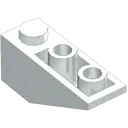

# Slope Brick 25° 1x3 Inverted

<!-- media:start (generated by scripts/build_media.py) -->
{ width="64" loading="lazy" }
<!-- media:end -->

[Item database](./README.md) | [Methodology](./Methodology.md)

**LOT: 114** | Brick | Rarity code: 1

## Description

No client object description is present in this snapshot. No lore or effect has been invented.

| Field | Stored value |
| --- | --- |
| Display name | Slope Brick 25° 1x3 Inverted |
| Internal name | m4287 |
| Object row | Present |
| Equipment slot / stack size | Not recorded / 0 |
| Binding / uniqueness | Bind on pickup: False; bind on equip: False; unique: False |
| Requirements | Flag: 0; achievement: 0; precondition: ; specialty/rank: 0 / 0 |
| Base value (not a vendor quote) | 10 |
| Currencies | Costs: not recorded; alternate LOT/cost:  / ; commendation LOT/cost:  /  |

## Drops, packages, activities, and vendors

| Definition | Source kind | Named sources | Probability / stock |
| --- | --- | --- | --- |
| [Matrix 123](sources/matrix-123.md) | Vendor | [Bruno Underbite - Brick Vendor (LOT 3921)](sources/object-3921.md) | Not a rolled drop source Default vendor stock: 100% per refresh |
| [Matrix 147](sources/matrix-147.md) | Package | [Super Brick Booster Pack (LOT 5835)](sources/object-5835.md) | Loot: 2.03245247%; mean 0.020491803 |
| [Matrix 196](sources/matrix-196.md) | Drop, Activity | [Sentinel Turret (LOT 6254)](sources/object-6254.md) [AG - Choice Build Buff Station (LOT 6412)](sources/object-6412.md) [VE Instance - Ship Turret (LOT 8432)](sources/object-8432.md) [all 4 source LOTs](sources/matrix-196.md) | Loot: 0.00819672%; mean 0.000081967213 |
| [Matrix 259](sources/matrix-259.md) | Drop | [AG - Cooler (LOT 4890)](sources/object-4890.md) [AG - Open Cooler (LOT 4919)](sources/object-4919.md) | Loot: 0.00819672%; mean 0.000081967213 |
| [Matrix 277](sources/matrix-277.md) | Drop | [NS - Newspaper Box 2 (LOT 3170)](sources/object-3170.md) [NS - Newspaper Box 3 (LOT 3171)](sources/object-3171.md) [NS - Mailbox (LOT 3197)](sources/object-3197.md) [all 16 source LOTs](sources/matrix-277.md) | Loot: 0.00409836%; mean 0.000040983607 |
| [Matrix 414](sources/matrix-414.md) | Package | [Mega Brick Booster Pack (LOT 10165)](sources/object-10165.md) | Loot: 2.03245247%; mean 0.020491803 |
| [Matrix 574](sources/matrix-574.md) | Activity | [NS - Wishing Well Birdbath (LOT 11280)](sources/object-11280.md) | Loot: 1.02123429%; mean 0.010245902 |
| [Matrix 575](sources/matrix-575.md) | Activity | [NS - Wishing Well Birdbath (LOT 11280)](sources/object-11280.md) | Loot: 0.61391427%; mean 0.006147541 |
| [Matrix 576](sources/matrix-576.md) | Activity | [NS - Wishing Well Birdbath (LOT 11280)](sources/object-11280.md) | Loot: 1.22281019%; mean 0.012295082 |
| [Matrix 577](sources/matrix-577.md) | Activity | [NS - Wishing Well Birdbath (LOT 11280)](sources/object-11280.md) | Loot: 0.81743488%; mean 0.0081967213 |
| [Matrix 578](sources/matrix-578.md) | Activity | [NS - Wishing Well Birdbath (LOT 11280)](sources/object-11280.md) | Loot: 0.81743488%; mean 0.0081967213 |
| [Matrix 579](sources/matrix-579.md) | Activity | [NS - Wishing Well Birdbath (LOT 11280)](sources/object-11280.md) | Loot: 1.22392081%; mean 0.012295082 |
| [Matrix 580](sources/matrix-580.md) | Activity | [NS - Wishing Well Birdbath (LOT 11280)](sources/object-11280.md) | Loot: 1.6287408%; mean 0.016393443 |
| [Matrix 581](sources/matrix-581.md) | Activity | [NS - Wishing Well Birdbath (LOT 11280)](sources/object-11280.md) | Loot: 3.03075009%; mean 0.030737705 |
| [Matrix 598](sources/matrix-598.md) | Activity | [Natso Fast - Foot Race Host (LOT 8663)](sources/object-8663.md) [Boris Toobsox - Foot Race Host (LOT 9714)](sources/object-9714.md) [FV - Panda Block (LOT 9732)](sources/object-9732.md) [all 9 source LOTs](sources/matrix-598.md) | Loot: 0.02868852%; mean 0.00028688525 |
| [Matrix 689](sources/matrix-689.md) | Drop | [NT - Wall Smashable 1 (LOT 12436)](sources/object-12436.md) [NT - Wall Smashable 2 (LOT 12438)](sources/object-12438.md) [nextower&#95;sentShield (LOT 12930)](sources/object-12930.md) [all 13 source LOTs](sources/matrix-689.md) | Loot: 0.00409836%; mean 0.000040983607 |
| [Matrix 697](sources/matrix-697.md) | Vendor | [Axon Klaxon - Brick Vendor (LOT 13379)](sources/object-13379.md) | Not a rolled drop source Default vendor stock: 100% per refresh |
| [Matrix 719](sources/matrix-719.md) | Activity | [NT - Interactable Console - Wishing Well (LOT 14086)](sources/object-14086.md) | Loot: 1.02123429%; mean 0.010245902 |
| [Matrix 720](sources/matrix-720.md) | Activity | [NT - Interactable Console - Wishing Well (LOT 14086)](sources/object-14086.md) | Loot: 0.61391427%; mean 0.006147541 |
| [Matrix 721](sources/matrix-721.md) | Activity | [NT - Interactable Console - Wishing Well (LOT 14086)](sources/object-14086.md) | Loot: 1.22281019%; mean 0.012295082 |
| [Matrix 722](sources/matrix-722.md) | Activity | [NT - Interactable Console - Wishing Well (LOT 14086)](sources/object-14086.md) | Loot: 0.81743488%; mean 0.0081967213 |
| [Matrix 723](sources/matrix-723.md) | Activity | [NT - Interactable Console - Wishing Well (LOT 14086)](sources/object-14086.md) | Loot: 0.81743488%; mean 0.0081967213 |
| [Matrix 724](sources/matrix-724.md) | Activity | [NT - Interactable Console - Wishing Well (LOT 14086)](sources/object-14086.md) | Loot: 1.22392081%; mean 0.012295082 |
| [Matrix 725](sources/matrix-725.md) | Activity | [NT - Interactable Console - Wishing Well (LOT 14086)](sources/object-14086.md) | Loot: 1.6287408%; mean 0.016393443 |
| [Matrix 726](sources/matrix-726.md) | Activity | [NT - Interactable Console - Wishing Well (LOT 14086)](sources/object-14086.md) | Loot: 3.03075009%; mean 0.030737705 |

Rates above mean **at least one item per matrix invocation before player filters**, followed by expected item count. They are not a universal chance per kill. Vendor stock is a separate calculation, not a drop rate. Mission-only drops, team ownership, scripts, availability, and vendor scene overrides can change actual receipt. Follow the source links for mapped locations and coordinates.

## Mission, achievement, mail, and code rewards

No reward association was found in the covered mission, mail, or code tables.

## Community acquisition references

No conservative name-matched acquisition fact was found in the 17 researched community pages. This does not establish that the wider wiki has no article or information.

## Evidence

[Objects](../../db/Objects.md), [ComponentsRegistry](../../db/ComponentsRegistry.md), [ItemComponent](../../db/ItemComponent.md), [LootMatrix](../../db/LootMatrix.md), [LootTable](../../db/LootTable.md), [RarityTable](../../db/RarityTable.md). [Coverage and limitations](./Methodology.md).
