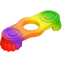

# Mosaic Shoulderpads

<!-- media:start (generated by scripts/build_media.py) -->
{ width="64" loading="lazy" }
<!-- media:end -->

[Item database](./README.md) | [Methodology](./Methodology.md)

**LOT: 12101** | Neck | Rarity code: 2

## Description

No client object description is present in this snapshot. No lore or effect has been invented.

| Field | Stored value |
| --- | --- |
| Display name | Mosaic Shoulderpads |
| Internal name | Mosaic Armor |
| Object row | Present |
| Equipment slot / stack size | clavicle / 1 |
| Binding / uniqueness | Bind on pickup: True; bind on equip: False; unique: False |
| Requirements | Flag: 0; achievement: 0; precondition: 224; specialty/rank: 0 / 0 |
| Base value (not a vendor quote) | 4925 |
| Currencies | Costs: not recorded; alternate LOT/cost:  / ; commendation LOT/cost: 13763 / 27 |

## Drops, packages, activities, and vendors

No qualifying static loot-matrix or vendor association was resolved.

Rates above mean **at least one item per matrix invocation before player filters**, followed by expected item count. They are not a universal chance per kill. Vendor stock is a separate calculation, not a drop rate. Mission-only drops, team ownership, scripts, availability, and vendor scene overrides can change actual receipt. Follow the source links for mapped locations and coordinates.

## Mission, achievement, mail, and code rewards

| Reward | Classification | Conditions | Associated NPCs / mapped locations |
| --- | --- | --- | --- |
| Achievement 1122: Crux Prime Guardian 3 | Location / Crux Prime | First completion; listed completion reward; quantity 1; gate auramar | No associated NPC placement resolved |

## Community acquisition references

**Historical community evidence, matched by a unique local item name—not a verified LOT or current-server availability match.**

- [Specialties](https://legouniverse.fandom.com/wiki/Specialties?oldid=163848): reported methods: not categorized; named acquisition references: Crux&#95;Prime&#95;Guardian#Crux&#95;Prime&#95;Guardian&#95;3, Crux Prime. Matched name: Mosaic Shoulderpads.

## Evidence

[Objects](../../db/Objects.md), [ComponentsRegistry](../../db/ComponentsRegistry.md), [ItemComponent](../../db/ItemComponent.md), [Missions](../../db/Missions.md), [MissionNPCComponent](../../db/MissionNPCComponent.md), [MissionEmail](../../db/MissionEmail.md), [RewardCodes](../../db/RewardCodes.md). [Coverage and limitations](./Methodology.md).
