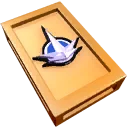

# S.N.A.C.K.

<!-- media:start (generated by scripts/build_media.py) -->
{ .lu-icon .lu-on-dark width="128" loading="lazy" }
<!-- media:end -->

[Item database](./README.md) | [Methodology](./Methodology.md)

**LOT: 12114** | Consumable | Rarity code: 1

## Description

Double-click to unwrap this S.N.A.C.K. pack!

Player tooltip: official English client text (`locale.xml`, `en_US`).

| Field | Stored value |
| --- | --- |
| Display name | S.N.A.C.K. |
| Internal name | S.N.A.C.K. |
| Object row | Present |
| Equipment slot / stack size | Not recorded / 10 |
| Binding / uniqueness | Bind on pickup: False; bind on equip: False; unique: False |
| Requirements | Flag: 0; achievement: 0; precondition: ; specialty/rank: 0 / 0 |
| Base value (not a vendor quote) | 500 |
| Currencies | Costs: not recorded; alternate LOT/cost:  / ; commendation LOT/cost:  /  |

## Drops, packages, activities, and vendors

No qualifying static loot-matrix or vendor association was resolved.

Rates above mean **at least one item per matrix invocation before player filters**, followed by expected item count. They are not a universal chance per kill. Vendor stock is a separate calculation, not a drop rate. Mission-only drops, team ownership, scripts, availability, and vendor scene overrides can change actual receipt. Follow the source links for mapped locations and coordinates.

## Mission, achievement, mail, and code rewards

| Reward | Classification | Conditions | Associated NPCs / mapped locations |
| --- | --- | --- | --- |
| Achievement 996: Smash Talli Reeko! | Location / Crux Prime | First completion; listed completion reward; quantity 1; gate auramar | No associated NPC placement resolved |
| Mission 1254: Mutiny on Crux Prime | Hidden / Hidden | First completion; reward choice; quantity 3; gate auramar | [Bronson Jarls - Sentinel Faction Lieutenant (LOT 11992)](sources/object-11992.md) [Crux Prime (1800)](locations/zone-1800.md) |
| Mission 1254: Mutiny on Crux Prime | Hidden / Hidden | Repeat reward (only if repeatable and available); reward choice; quantity 3; gate auramar | [Bronson Jarls - Sentinel Faction Lieutenant (LOT 11992)](sources/object-11992.md) [Crux Prime (1800)](locations/zone-1800.md) |
| Mission 1255: Horsemaster | Hidden / Hidden | First completion; reward choice; quantity 3; gate auramar | [Bronson Jarls - Sentinel Faction Lieutenant (LOT 11992)](sources/object-11992.md) [Crux Prime (1800)](locations/zone-1800.md) |
| Mission 1255: Horsemaster | Hidden / Hidden | Repeat reward (only if repeatable and available); reward choice; quantity 3; gate auramar | [Bronson Jarls - Sentinel Faction Lieutenant (LOT 11992)](sources/object-11992.md) [Crux Prime (1800)](locations/zone-1800.md) |
| Mission 1256: Spider Slayer | Hidden / Hidden | First completion; reward choice; quantity 3; gate auramar | [Bronson Jarls - Sentinel Faction Lieutenant (LOT 11992)](sources/object-11992.md) [Crux Prime (1800)](locations/zone-1800.md) |
| Mission 1256: Spider Slayer | Hidden / Hidden | Repeat reward (only if repeatable and available); reward choice; quantity 3; gate auramar | [Bronson Jarls - Sentinel Faction Lieutenant (LOT 11992)](sources/object-11992.md) [Crux Prime (1800)](locations/zone-1800.md) |
| Mission 1257: Dragonlord | Hidden / Hidden | First completion; reward choice; quantity 3; gate auramar | [Bronson Jarls - Sentinel Faction Lieutenant (LOT 11992)](sources/object-11992.md) [Crux Prime (1800)](locations/zone-1800.md) |
| Mission 1257: Dragonlord | Hidden / Hidden | Repeat reward (only if repeatable and available); reward choice; quantity 3; gate auramar | [Bronson Jarls - Sentinel Faction Lieutenant (LOT 11992)](sources/object-11992.md) [Crux Prime (1800)](locations/zone-1800.md) |
| Mission 1258: Invaders! | Hidden / Hidden | First completion; reward choice; quantity 3; gate auramar | [Bronson Jarls - Sentinel Faction Lieutenant (LOT 11992)](sources/object-11992.md) [Crux Prime (1800)](locations/zone-1800.md) |
| Mission 1258: Invaders! | Hidden / Hidden | Repeat reward (only if repeatable and available); reward choice; quantity 3; gate auramar | [Bronson Jarls - Sentinel Faction Lieutenant (LOT 11992)](sources/object-11992.md) [Crux Prime (1800)](locations/zone-1800.md) |
| Mission 1259: Bone Patrol | Hidden / Hidden | First completion; reward choice; quantity 3; gate auramar | [Bronson Jarls - Sentinel Faction Lieutenant (LOT 11992)](sources/object-11992.md) [Crux Prime (1800)](locations/zone-1800.md) |
| Mission 1259: Bone Patrol | Hidden / Hidden | Repeat reward (only if repeatable and available); reward choice; quantity 3; gate auramar | [Bronson Jarls - Sentinel Faction Lieutenant (LOT 11992)](sources/object-11992.md) [Crux Prime (1800)](locations/zone-1800.md) |
| Mission 1260: Arrr is for Robot | Hidden / Hidden | First completion; reward choice; quantity 3; gate auramar | [Bronson Jarls - Sentinel Faction Lieutenant (LOT 11992)](sources/object-11992.md) [Crux Prime (1800)](locations/zone-1800.md) |
| Mission 1260: Arrr is for Robot | Hidden / Hidden | Repeat reward (only if repeatable and available); reward choice; quantity 3; gate auramar | [Bronson Jarls - Sentinel Faction Lieutenant (LOT 11992)](sources/object-11992.md) [Crux Prime (1800)](locations/zone-1800.md) |
| Mission 1261: Boss Battler | Hidden / Hidden | First completion; reward choice; quantity 3; gate auramar | [Bronson Jarls - Sentinel Faction Lieutenant (LOT 11992)](sources/object-11992.md) [Crux Prime (1800)](locations/zone-1800.md) |
| Mission 1261: Boss Battler | Hidden / Hidden | Repeat reward (only if repeatable and available); reward choice; quantity 3; gate auramar | [Bronson Jarls - Sentinel Faction Lieutenant (LOT 11992)](sources/object-11992.md) [Crux Prime (1800)](locations/zone-1800.md) |
| Mission 1262: Maelstrom Mangler | Hidden / Hidden | First completion; reward choice; quantity 3; gate auramar | [Bronson Jarls - Sentinel Faction Lieutenant (LOT 11992)](sources/object-11992.md) [Crux Prime (1800)](locations/zone-1800.md) |
| Mission 1262: Maelstrom Mangler | Hidden / Hidden | Repeat reward (only if repeatable and available); reward choice; quantity 3; gate auramar | [Bronson Jarls - Sentinel Faction Lieutenant (LOT 11992)](sources/object-11992.md) [Crux Prime (1800)](locations/zone-1800.md) |
| Mission 1263: Chaos Crusher | Hidden / Hidden | First completion; reward choice; quantity 3; gate auramar | [Bronson Jarls - Sentinel Faction Lieutenant (LOT 11992)](sources/object-11992.md) [Crux Prime (1800)](locations/zone-1800.md) |
| Mission 1263: Chaos Crusher | Hidden / Hidden | Repeat reward (only if repeatable and available); reward choice; quantity 3; gate auramar | [Bronson Jarls - Sentinel Faction Lieutenant (LOT 11992)](sources/object-11992.md) [Crux Prime (1800)](locations/zone-1800.md) |
| Mission 1264: Smash Pack | Hidden / Hidden | First completion; reward choice; quantity 3; gate auramar | [Bronson Jarls - Sentinel Faction Lieutenant (LOT 11992)](sources/object-11992.md) [Crux Prime (1800)](locations/zone-1800.md) |
| Mission 1264: Smash Pack | Hidden / Hidden | Repeat reward (only if repeatable and available); reward choice; quantity 3; gate auramar | [Bronson Jarls - Sentinel Faction Lieutenant (LOT 11992)](sources/object-11992.md) [Crux Prime (1800)](locations/zone-1800.md) |
| Mission 1265: Bone Voyage | Hidden / Hidden | First completion; reward choice; quantity 3; gate auramar | [Bronson Jarls - Sentinel Faction Lieutenant (LOT 11992)](sources/object-11992.md) [Crux Prime (1800)](locations/zone-1800.md) |
| Mission 1265: Bone Voyage | Hidden / Hidden | Repeat reward (only if repeatable and available); reward choice; quantity 3; gate auramar | [Bronson Jarls - Sentinel Faction Lieutenant (LOT 11992)](sources/object-11992.md) [Crux Prime (1800)](locations/zone-1800.md) |
| Mission 1266: Easy and Hard | Hidden / Hidden | First completion; reward choice; quantity 3; gate auramar | [Bronson Jarls - Sentinel Faction Lieutenant (LOT 11992)](sources/object-11992.md) [Crux Prime (1800)](locations/zone-1800.md) |
| Mission 1266: Easy and Hard | Hidden / Hidden | Repeat reward (only if repeatable and available); reward choice; quantity 3; gate auramar | [Bronson Jarls - Sentinel Faction Lieutenant (LOT 11992)](sources/object-11992.md) [Crux Prime (1800)](locations/zone-1800.md) |
| Mission 1305: Mining Marauder | Hidden / Hidden | First completion; reward choice; quantity 3; gate auramar | [Neido - Ninja of Imagination (LOT 11998)](sources/object-11998.md) [Crux Prime (1800)](locations/zone-1800.md) |
| Mission 1305: Mining Marauder | Hidden / Hidden | Repeat reward (only if repeatable and available); reward choice; quantity 3; gate auramar | [Neido - Ninja of Imagination (LOT 11998)](sources/object-11998.md) [Crux Prime (1800)](locations/zone-1800.md) |
| Mission 1306: Ninja Avenger | Hidden / Hidden | First completion; reward choice; quantity 3; gate auramar | [Neido - Ninja of Imagination (LOT 11998)](sources/object-11998.md) [Crux Prime (1800)](locations/zone-1800.md) |
| Mission 1306: Ninja Avenger | Hidden / Hidden | Repeat reward (only if repeatable and available); reward choice; quantity 3; gate auramar | [Neido - Ninja of Imagination (LOT 11998)](sources/object-11998.md) [Crux Prime (1800)](locations/zone-1800.md) |
| Mission 1307: Breaking Ranks | Hidden / Hidden | First completion; reward choice; quantity 3; gate auramar | [Neido - Ninja of Imagination (LOT 11998)](sources/object-11998.md) [Crux Prime (1800)](locations/zone-1800.md) |
| Mission 1307: Breaking Ranks | Hidden / Hidden | Repeat reward (only if repeatable and available); reward choice; quantity 3; gate auramar | [Neido - Ninja of Imagination (LOT 11998)](sources/object-11998.md) [Crux Prime (1800)](locations/zone-1800.md) |
| Mission 1308: Your Spinjitzu is Strong | Hidden / Hidden | First completion; reward choice; quantity 3; gate auramar | [Neido - Ninja of Imagination (LOT 11998)](sources/object-11998.md) [Crux Prime (1800)](locations/zone-1800.md) |
| Mission 1308: Your Spinjitzu is Strong | Hidden / Hidden | Repeat reward (only if repeatable and available); reward choice; quantity 3; gate auramar | [Neido - Ninja of Imagination (LOT 11998)](sources/object-11998.md) [Crux Prime (1800)](locations/zone-1800.md) |
| Mission 1309: Compound Fracture | Hidden / Hidden | First completion; reward choice; quantity 3; gate auramar | [Neido - Ninja of Imagination (LOT 11998)](sources/object-11998.md) [Crux Prime (1800)](locations/zone-1800.md) |
| Mission 1309: Compound Fracture | Hidden / Hidden | Repeat reward (only if repeatable and available); reward choice; quantity 3; gate auramar | [Neido - Ninja of Imagination (LOT 11998)](sources/object-11998.md) [Crux Prime (1800)](locations/zone-1800.md) |
| Achievement 1443: Nexus Tower Builder 3 | Location / Nexus Tower | First completion; listed completion reward; quantity 1; gate communitymissions1.0 | No associated NPC placement resolved |
| Mission 1618: Epic Survivor | Hidden / Hidden | First completion; reward choice; quantity 1; gate dailymissions2.0 | [Bullet Mullet - Sentinel Faction Guard (LOT 12260)](sources/object-12260.md) [Nexus Tower (1900)](locations/zone-1900.md) |
| Mission 1618: Epic Survivor | Hidden / Hidden | Repeat reward (only if repeatable and available); reward choice; quantity 1; gate dailymissions2.0 | [Bullet Mullet - Sentinel Faction Guard (LOT 12260)](sources/object-12260.md) [Nexus Tower (1900)](locations/zone-1900.md) |
| Mission 1619: Maelstrom Scourge | Hidden / Hidden | First completion; reward choice; quantity 1; gate dailymissions2.0 | [Bullet Mullet - Sentinel Faction Guard (LOT 12260)](sources/object-12260.md) [Nexus Tower (1900)](locations/zone-1900.md) |
| Mission 1619: Maelstrom Scourge | Hidden / Hidden | Repeat reward (only if repeatable and available); reward choice; quantity 1; gate dailymissions2.0 | [Bullet Mullet - Sentinel Faction Guard (LOT 12260)](sources/object-12260.md) [Nexus Tower (1900)](locations/zone-1900.md) |
| Mission 1621: Smack in Time | Hidden / Hidden | First completion; reward choice; quantity 1; gate dailymissions2.0 | [Bullet Mullet - Sentinel Faction Guard (LOT 12260)](sources/object-12260.md) [Nexus Tower (1900)](locations/zone-1900.md) |
| Mission 1621: Smack in Time | Hidden / Hidden | Repeat reward (only if repeatable and available); reward choice; quantity 1; gate dailymissions2.0 | [Bullet Mullet - Sentinel Faction Guard (LOT 12260)](sources/object-12260.md) [Nexus Tower (1900)](locations/zone-1900.md) |
| Mission 1622: Forbidden Valiance | Hidden / Hidden | First completion; reward choice; quantity 1; gate dailymissions2.0 | [Bullet Mullet - Sentinel Faction Guard (LOT 12260)](sources/object-12260.md) [Nexus Tower (1900)](locations/zone-1900.md) |
| Mission 1622: Forbidden Valiance | Hidden / Hidden | Repeat reward (only if repeatable and available); reward choice; quantity 1; gate dailymissions2.0 | [Bullet Mullet - Sentinel Faction Guard (LOT 12260)](sources/object-12260.md) [Nexus Tower (1900)](locations/zone-1900.md) |
| Mission 1623: Forbidden Vandal | Hidden / Hidden | First completion; reward choice; quantity 1; gate dailymissions2.0 | [Bullet Mullet - Sentinel Faction Guard (LOT 12260)](sources/object-12260.md) [Nexus Tower (1900)](locations/zone-1900.md) |
| Mission 1623: Forbidden Vandal | Hidden / Hidden | Repeat reward (only if repeatable and available); reward choice; quantity 1; gate dailymissions2.0 | [Bullet Mullet - Sentinel Faction Guard (LOT 12260)](sources/object-12260.md) [Nexus Tower (1900)](locations/zone-1900.md) |
| Mission 1624: Keelhaul Canyon Pro | Hidden / Hidden | First completion; reward choice; quantity 1; gate dailymissions2.0 | [Bullet Mullet - Sentinel Faction Guard (LOT 12260)](sources/object-12260.md) [Nexus Tower (1900)](locations/zone-1900.md) |
| Mission 1624: Keelhaul Canyon Pro | Hidden / Hidden | Repeat reward (only if repeatable and available); reward choice; quantity 1; gate dailymissions2.0 | [Bullet Mullet - Sentinel Faction Guard (LOT 12260)](sources/object-12260.md) [Nexus Tower (1900)](locations/zone-1900.md) |
| Mission 1625: Vertigo Loop Pro | Hidden / Hidden | First completion; reward choice; quantity 1; gate dailymissions2.0 | [Bullet Mullet - Sentinel Faction Guard (LOT 12260)](sources/object-12260.md) [Nexus Tower (1900)](locations/zone-1900.md) |
| Mission 1625: Vertigo Loop Pro | Hidden / Hidden | Repeat reward (only if repeatable and available); reward choice; quantity 1; gate dailymissions2.0 | [Bullet Mullet - Sentinel Faction Guard (LOT 12260)](sources/object-12260.md) [Nexus Tower (1900)](locations/zone-1900.md) |
| Mission 1626: Dragonmaw Chasm Pro | Hidden / Hidden | First completion; reward choice; quantity 1; gate dailymissions2.0 | [Bullet Mullet - Sentinel Faction Guard (LOT 12260)](sources/object-12260.md) [Nexus Tower (1900)](locations/zone-1900.md) |
| Mission 1626: Dragonmaw Chasm Pro | Hidden / Hidden | Repeat reward (only if repeatable and available); reward choice; quantity 1; gate dailymissions2.0 | [Bullet Mullet - Sentinel Faction Guard (LOT 12260)](sources/object-12260.md) [Nexus Tower (1900)](locations/zone-1900.md) |
| Mission 1627: Explosive Personality | Hidden / Hidden | First completion; reward choice; quantity 1; gate dailymissions2.0 | [Bullet Mullet - Sentinel Faction Guard (LOT 12260)](sources/object-12260.md) [Nexus Tower (1900)](locations/zone-1900.md) |
| Mission 1627: Explosive Personality | Hidden / Hidden | Repeat reward (only if repeatable and available); reward choice; quantity 1; gate dailymissions2.0 | [Bullet Mullet - Sentinel Faction Guard (LOT 12260)](sources/object-12260.md) [Nexus Tower (1900)](locations/zone-1900.md) |
| Mission 1628: Epic Survivor | Hidden / Hidden | First completion; reward choice; quantity 1; gate dailymissions2.0 | [Meyer Muckrake - Paradox Guard (LOT 12263)](sources/object-12263.md) [Nexus Tower (1900)](locations/zone-1900.md) |
| Mission 1628: Epic Survivor | Hidden / Hidden | Repeat reward (only if repeatable and available); reward choice; quantity 1; gate dailymissions2.0 | [Meyer Muckrake - Paradox Guard (LOT 12263)](sources/object-12263.md) [Nexus Tower (1900)](locations/zone-1900.md) |
| Mission 1629: Maelstrom Scourge | Hidden / Hidden | First completion; reward choice; quantity 1; gate dailymissions2.0 | [Meyer Muckrake - Paradox Guard (LOT 12263)](sources/object-12263.md) [Nexus Tower (1900)](locations/zone-1900.md) |
| Mission 1629: Maelstrom Scourge | Hidden / Hidden | Repeat reward (only if repeatable and available); reward choice; quantity 1; gate dailymissions2.0 | [Meyer Muckrake - Paradox Guard (LOT 12263)](sources/object-12263.md) [Nexus Tower (1900)](locations/zone-1900.md) |
| Mission 1631: Smack in Time | Hidden / Hidden | First completion; reward choice; quantity 1; gate dailymissions2.0 | [Meyer Muckrake - Paradox Guard (LOT 12263)](sources/object-12263.md) [Nexus Tower (1900)](locations/zone-1900.md) |
| Mission 1631: Smack in Time | Hidden / Hidden | Repeat reward (only if repeatable and available); reward choice; quantity 1; gate dailymissions2.0 | [Meyer Muckrake - Paradox Guard (LOT 12263)](sources/object-12263.md) [Nexus Tower (1900)](locations/zone-1900.md) |
| Mission 1632: Forbidden Valiance | Hidden / Hidden | First completion; reward choice; quantity 1; gate dailymissions2.0 | [Meyer Muckrake - Paradox Guard (LOT 12263)](sources/object-12263.md) [Nexus Tower (1900)](locations/zone-1900.md) |
| Mission 1632: Forbidden Valiance | Hidden / Hidden | Repeat reward (only if repeatable and available); reward choice; quantity 1; gate dailymissions2.0 | [Meyer Muckrake - Paradox Guard (LOT 12263)](sources/object-12263.md) [Nexus Tower (1900)](locations/zone-1900.md) |
| Mission 1633: Forbidden Vandal | Hidden / Hidden | First completion; reward choice; quantity 1; gate dailymissions2.0 | [Meyer Muckrake - Paradox Guard (LOT 12263)](sources/object-12263.md) [Nexus Tower (1900)](locations/zone-1900.md) |
| Mission 1633: Forbidden Vandal | Hidden / Hidden | Repeat reward (only if repeatable and available); reward choice; quantity 1; gate dailymissions2.0 | [Meyer Muckrake - Paradox Guard (LOT 12263)](sources/object-12263.md) [Nexus Tower (1900)](locations/zone-1900.md) |
| Mission 1634: Keelhaul Canyon Pro | Hidden / Hidden | First completion; reward choice; quantity 1; gate dailymissions2.0 | [Meyer Muckrake - Paradox Guard (LOT 12263)](sources/object-12263.md) [Nexus Tower (1900)](locations/zone-1900.md) |
| Mission 1634: Keelhaul Canyon Pro | Hidden / Hidden | Repeat reward (only if repeatable and available); reward choice; quantity 1; gate dailymissions2.0 | [Meyer Muckrake - Paradox Guard (LOT 12263)](sources/object-12263.md) [Nexus Tower (1900)](locations/zone-1900.md) |
| Mission 1635: Vertigo Loop Pro | Hidden / Hidden | First completion; reward choice; quantity 1; gate dailymissions2.0 | [Meyer Muckrake - Paradox Guard (LOT 12263)](sources/object-12263.md) [Nexus Tower (1900)](locations/zone-1900.md) |
| Mission 1635: Vertigo Loop Pro | Hidden / Hidden | Repeat reward (only if repeatable and available); reward choice; quantity 1; gate dailymissions2.0 | [Meyer Muckrake - Paradox Guard (LOT 12263)](sources/object-12263.md) [Nexus Tower (1900)](locations/zone-1900.md) |
| Mission 1636: Dragonmaw Chasm Pro | Hidden / Hidden | First completion; reward choice; quantity 1; gate dailymissions2.0 | [Meyer Muckrake - Paradox Guard (LOT 12263)](sources/object-12263.md) [Nexus Tower (1900)](locations/zone-1900.md) |
| Mission 1636: Dragonmaw Chasm Pro | Hidden / Hidden | Repeat reward (only if repeatable and available); reward choice; quantity 1; gate dailymissions2.0 | [Meyer Muckrake - Paradox Guard (LOT 12263)](sources/object-12263.md) [Nexus Tower (1900)](locations/zone-1900.md) |
| Mission 1637: Explosive Personality | Hidden / Hidden | First completion; reward choice; quantity 1; gate dailymissions2.0 | [Meyer Muckrake - Paradox Guard (LOT 12263)](sources/object-12263.md) [Nexus Tower (1900)](locations/zone-1900.md) |
| Mission 1637: Explosive Personality | Hidden / Hidden | Repeat reward (only if repeatable and available); reward choice; quantity 1; gate dailymissions2.0 | [Meyer Muckrake - Paradox Guard (LOT 12263)](sources/object-12263.md) [Nexus Tower (1900)](locations/zone-1900.md) |
| Mission 1638: Epic Survivor | Hidden / Hidden | First completion; reward choice; quantity 1; gate dailymissions2.0 | [Trek Furino - Venture League Guard (LOT 12256)](sources/object-12256.md) [Nexus Tower (1900)](locations/zone-1900.md) |
| Mission 1638: Epic Survivor | Hidden / Hidden | Repeat reward (only if repeatable and available); reward choice; quantity 1; gate dailymissions2.0 | [Trek Furino - Venture League Guard (LOT 12256)](sources/object-12256.md) [Nexus Tower (1900)](locations/zone-1900.md) |
| Mission 1639: Maelstrom Scourge | Hidden / Hidden | First completion; reward choice; quantity 1; gate dailymissions2.0 | [Trek Furino - Venture League Guard (LOT 12256)](sources/object-12256.md) [Nexus Tower (1900)](locations/zone-1900.md) |
| Mission 1639: Maelstrom Scourge | Hidden / Hidden | Repeat reward (only if repeatable and available); reward choice; quantity 1; gate dailymissions2.0 | [Trek Furino - Venture League Guard (LOT 12256)](sources/object-12256.md) [Nexus Tower (1900)](locations/zone-1900.md) |
| Mission 1641: Smack in Time | Hidden / Hidden | First completion; reward choice; quantity 1; gate dailymissions2.0 | [Trek Furino - Venture League Guard (LOT 12256)](sources/object-12256.md) [Nexus Tower (1900)](locations/zone-1900.md) |
| Mission 1641: Smack in Time | Hidden / Hidden | Repeat reward (only if repeatable and available); reward choice; quantity 1; gate dailymissions2.0 | [Trek Furino - Venture League Guard (LOT 12256)](sources/object-12256.md) [Nexus Tower (1900)](locations/zone-1900.md) |
| Mission 1642: Forbidden Valiance | Hidden / Hidden | First completion; reward choice; quantity 1; gate dailymissions2.0 | [Trek Furino - Venture League Guard (LOT 12256)](sources/object-12256.md) [Nexus Tower (1900)](locations/zone-1900.md) |
| Mission 1642: Forbidden Valiance | Hidden / Hidden | Repeat reward (only if repeatable and available); reward choice; quantity 1; gate dailymissions2.0 | [Trek Furino - Venture League Guard (LOT 12256)](sources/object-12256.md) [Nexus Tower (1900)](locations/zone-1900.md) |
| Mission 1643: Forbidden Vandal | Hidden / Hidden | First completion; reward choice; quantity 1; gate dailymissions2.0 | [Trek Furino - Venture League Guard (LOT 12256)](sources/object-12256.md) [Nexus Tower (1900)](locations/zone-1900.md) |
| Mission 1643: Forbidden Vandal | Hidden / Hidden | Repeat reward (only if repeatable and available); reward choice; quantity 1; gate dailymissions2.0 | [Trek Furino - Venture League Guard (LOT 12256)](sources/object-12256.md) [Nexus Tower (1900)](locations/zone-1900.md) |
| Mission 1644: Keelhaul Canyon Pro | Hidden / Hidden | First completion; reward choice; quantity 1; gate dailymissions2.0 | [Trek Furino - Venture League Guard (LOT 12256)](sources/object-12256.md) [Nexus Tower (1900)](locations/zone-1900.md) |
| Mission 1644: Keelhaul Canyon Pro | Hidden / Hidden | Repeat reward (only if repeatable and available); reward choice; quantity 1; gate dailymissions2.0 | [Trek Furino - Venture League Guard (LOT 12256)](sources/object-12256.md) [Nexus Tower (1900)](locations/zone-1900.md) |
| Mission 1645: Vertigo Loop Pro | Hidden / Hidden | First completion; reward choice; quantity 1; gate dailymissions2.0 | [Trek Furino - Venture League Guard (LOT 12256)](sources/object-12256.md) [Nexus Tower (1900)](locations/zone-1900.md) |
| Mission 1645: Vertigo Loop Pro | Hidden / Hidden | Repeat reward (only if repeatable and available); reward choice; quantity 1; gate dailymissions2.0 | [Trek Furino - Venture League Guard (LOT 12256)](sources/object-12256.md) [Nexus Tower (1900)](locations/zone-1900.md) |
| Mission 1646: Dragonmaw Chasm Pro | Hidden / Hidden | First completion; reward choice; quantity 1; gate dailymissions2.0 | [Trek Furino - Venture League Guard (LOT 12256)](sources/object-12256.md) [Nexus Tower (1900)](locations/zone-1900.md) |
| Mission 1646: Dragonmaw Chasm Pro | Hidden / Hidden | Repeat reward (only if repeatable and available); reward choice; quantity 1; gate dailymissions2.0 | [Trek Furino - Venture League Guard (LOT 12256)](sources/object-12256.md) [Nexus Tower (1900)](locations/zone-1900.md) |
| Mission 1647: Explosive Personality | Hidden / Hidden | First completion; reward choice; quantity 1; gate dailymissions2.0 | [Trek Furino - Venture League Guard (LOT 12256)](sources/object-12256.md) [Nexus Tower (1900)](locations/zone-1900.md) |
| Mission 1647: Explosive Personality | Hidden / Hidden | Repeat reward (only if repeatable and available); reward choice; quantity 1; gate dailymissions2.0 | [Trek Furino - Venture League Guard (LOT 12256)](sources/object-12256.md) [Nexus Tower (1900)](locations/zone-1900.md) |
| Mission 1648: Epic Survivor | Hidden / Hidden | First completion; reward choice; quantity 1; gate dailymissions2.0 | [Augie Ninewells - Assembly Guard (LOT 12257)](sources/object-12257.md) [Nexus Tower (1900)](locations/zone-1900.md) |
| Mission 1648: Epic Survivor | Hidden / Hidden | Repeat reward (only if repeatable and available); reward choice; quantity 1; gate dailymissions2.0 | [Augie Ninewells - Assembly Guard (LOT 12257)](sources/object-12257.md) [Nexus Tower (1900)](locations/zone-1900.md) |
| Mission 1649: Maelstrom Scourge | Hidden / Hidden | First completion; reward choice; quantity 1; gate dailymissions2.0 | [Augie Ninewells - Assembly Guard (LOT 12257)](sources/object-12257.md) [Nexus Tower (1900)](locations/zone-1900.md) |
| Mission 1649: Maelstrom Scourge | Hidden / Hidden | Repeat reward (only if repeatable and available); reward choice; quantity 1; gate dailymissions2.0 | [Augie Ninewells - Assembly Guard (LOT 12257)](sources/object-12257.md) [Nexus Tower (1900)](locations/zone-1900.md) |
| Mission 1651: Smack in Time | Hidden / Hidden | First completion; reward choice; quantity 1; gate dailymissions2.0 | [Augie Ninewells - Assembly Guard (LOT 12257)](sources/object-12257.md) [Nexus Tower (1900)](locations/zone-1900.md) |
| Mission 1651: Smack in Time | Hidden / Hidden | Repeat reward (only if repeatable and available); reward choice; quantity 1; gate dailymissions2.0 | [Augie Ninewells - Assembly Guard (LOT 12257)](sources/object-12257.md) [Nexus Tower (1900)](locations/zone-1900.md) |
| Mission 1652: Forbidden Valiance | Hidden / Hidden | First completion; reward choice; quantity 1; gate dailymissions2.0 | [Augie Ninewells - Assembly Guard (LOT 12257)](sources/object-12257.md) [Nexus Tower (1900)](locations/zone-1900.md) |
| Mission 1652: Forbidden Valiance | Hidden / Hidden | Repeat reward (only if repeatable and available); reward choice; quantity 1; gate dailymissions2.0 | [Augie Ninewells - Assembly Guard (LOT 12257)](sources/object-12257.md) [Nexus Tower (1900)](locations/zone-1900.md) |
| Mission 1653: Forbidden Vandal | Hidden / Hidden | First completion; reward choice; quantity 1; gate dailymissions2.0 | [Augie Ninewells - Assembly Guard (LOT 12257)](sources/object-12257.md) [Nexus Tower (1900)](locations/zone-1900.md) |
| Mission 1653: Forbidden Vandal | Hidden / Hidden | Repeat reward (only if repeatable and available); reward choice; quantity 1; gate dailymissions2.0 | [Augie Ninewells - Assembly Guard (LOT 12257)](sources/object-12257.md) [Nexus Tower (1900)](locations/zone-1900.md) |
| Mission 1654: Keelhaul Canyon Pro | Hidden / Hidden | First completion; reward choice; quantity 1; gate dailymissions2.0 | [Augie Ninewells - Assembly Guard (LOT 12257)](sources/object-12257.md) [Nexus Tower (1900)](locations/zone-1900.md) |
| Mission 1654: Keelhaul Canyon Pro | Hidden / Hidden | Repeat reward (only if repeatable and available); reward choice; quantity 1; gate dailymissions2.0 | [Augie Ninewells - Assembly Guard (LOT 12257)](sources/object-12257.md) [Nexus Tower (1900)](locations/zone-1900.md) |
| Mission 1655: Vertigo Loop Pro | Hidden / Hidden | First completion; reward choice; quantity 1; gate dailymissions2.0 | [Augie Ninewells - Assembly Guard (LOT 12257)](sources/object-12257.md) [Nexus Tower (1900)](locations/zone-1900.md) |
| Mission 1655: Vertigo Loop Pro | Hidden / Hidden | Repeat reward (only if repeatable and available); reward choice; quantity 1; gate dailymissions2.0 | [Augie Ninewells - Assembly Guard (LOT 12257)](sources/object-12257.md) [Nexus Tower (1900)](locations/zone-1900.md) |
| Mission 1656: Dragonmaw Chasm Pro | Hidden / Hidden | First completion; reward choice; quantity 1; gate dailymissions2.0 | [Augie Ninewells - Assembly Guard (LOT 12257)](sources/object-12257.md) [Nexus Tower (1900)](locations/zone-1900.md) |
| Mission 1656: Dragonmaw Chasm Pro | Hidden / Hidden | Repeat reward (only if repeatable and available); reward choice; quantity 1; gate dailymissions2.0 | [Augie Ninewells - Assembly Guard (LOT 12257)](sources/object-12257.md) [Nexus Tower (1900)](locations/zone-1900.md) |
| Mission 1657: Explosive Personality | Hidden / Hidden | First completion; reward choice; quantity 1; gate dailymissions2.0 | [Augie Ninewells - Assembly Guard (LOT 12257)](sources/object-12257.md) [Nexus Tower (1900)](locations/zone-1900.md) |
| Mission 1657: Explosive Personality | Hidden / Hidden | Repeat reward (only if repeatable and available); reward choice; quantity 1; gate dailymissions2.0 | [Augie Ninewells - Assembly Guard (LOT 12257)](sources/object-12257.md) [Nexus Tower (1900)](locations/zone-1900.md) |

## Community acquisition references

No conservative name-matched acquisition fact was found in the 17 researched community pages. This does not establish that the wider wiki has no article or information.

## Evidence

[Objects](../../db/Objects.md), [ComponentsRegistry](../../db/ComponentsRegistry.md), [ItemComponent](../../db/ItemComponent.md), [Missions](../../db/Missions.md), [MissionNPCComponent](../../db/MissionNPCComponent.md), [MissionEmail](../../db/MissionEmail.md), [RewardCodes](../../db/RewardCodes.md). [Coverage and limitations](./Methodology.md).
