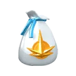

# Very Large Bag of Faction Tokens

<!-- media:start (generated by scripts/build_media.py) -->
{ .lu-icon .lu-on-dark width="128" loading="lazy" }
<!-- media:end -->

[Item database](./README.md) | [Methodology](./Methodology.md)

**LOT: 12424** | Package | Rarity code: 1

## Description

Double-click to get 15 Faction Tokens!

Player tooltip: official English client text (`locale.xml`, `en_US`).

| Field | Stored value |
| --- | --- |
| Display name | Very Large Bag of Faction Tokens |
| Internal name | Faction Token Bag - 15 tokens |
| Object row | Present |
| Equipment slot / stack size | Not recorded / 10 |
| Binding / uniqueness | Bind on pickup: True; bind on equip: False; unique: False |
| Requirements | Flag: 0; achievement: 0; precondition: 211;47; specialty/rank: 0 / 0 |
| Base value (not a vendor quote) | 0 |
| Currencies | Costs: not recorded; alternate LOT/cost:  / ; commendation LOT/cost:  /  |

## Drops, packages, activities, and vendors

No qualifying static loot-matrix or vendor association was resolved.

Rates above mean **at least one item per matrix invocation before player filters**, followed by expected item count. They are not a universal chance per kill. Vendor stock is a separate calculation, not a drop rate. Mission-only drops, team ownership, scripts, availability, and vendor scene overrides can change actual receipt. Follow the source links for mapped locations and coordinates.

## Mission, achievement, mail, and code rewards

| Reward | Classification | Conditions | Associated NPCs / mapped locations |
| --- | --- | --- | --- |
| Mission 668: Race Series 1 | Racing / Nimbus Station | First completion; listed completion reward; quantity 1 | [Velocity Lane - Racing Trainer (LOT 9821)](sources/object-9821.md) [Nimbus Station (1200)](locations/zone-1200.md) |
| Mission 857: Avant Gardens Treasure Hunter | Location / Nimbus Station | First completion; listed completion reward; quantity 1 | [Johnny Thunder - Venture League Hero (LOT 6630)](sources/object-6630.md) [Nimbus Station (1200)](locations/zone-1200.md) |
| Mission 858: Gnarled Forest Treasure Hunter | Location / Nimbus Station | First completion; listed completion reward; quantity 1 | [Johnny Thunder - Venture League Hero (LOT 6630)](sources/object-6630.md) [Nimbus Station (1200)](locations/zone-1200.md) |
| Mission 860: Forbidden Valley Treasure Hunter | Location / Nimbus Station | First completion; listed completion reward; quantity 1 | [Johnny Thunder - Venture League Hero (LOT 6630)](sources/object-6630.md) [Nimbus Station (1200)](locations/zone-1200.md) |
| Mission 899: Slayer of Dragons | Location / Forbidden Valley | First completion; listed completion reward; quantity 1 | [Numb Chuck - Paradox Agent (LOT 7426)](sources/object-7426.md) [Forbidden Valley (1400)](locations/zone-1400.md) |
| Achievement 1078: Hammer Down 1 | Battle / Venture Instance | First completion; listed completion reward; quantity 1; gate ventureinstance | No associated NPC placement resolved |
| Achievement 1080: Corrupted Sentry Destroyer 1 | Battle / Venture Instance | First completion; listed completion reward; quantity 1; gate ventureinstance | No associated NPC placement resolved |
| Achievement 1082: Elite Spiderling Destroyer 1 | Battle / Venture Instance | First completion; listed completion reward; quantity 1; gate ventureinstance | No associated NPC placement resolved |
| Achievement 1227: Kinga Hurl Timesmash 1 | Battle / Nimbus Instance | First completion; listed completion reward; quantity 1; gate nimbusinstance | No associated NPC placement resolved |
| Achievement 1229: The Four Riders Timesmash 1 | Battle / Nimbus Instance | First completion; listed completion reward; quantity 1; gate nimbusinstance | No associated NPC placement resolved |
| Achievement 1229: The Four Riders Timesmash 1 | Battle / Nimbus Instance | First completion; listed completion reward; quantity 1; gate nimbusinstance | No associated NPC placement resolved |
| Achievement 1755: Venture League Privateer | Location / Gnarled Forest | First completion; listed completion reward; quantity 1; gate freetrial | No associated NPC placement resolved |
| Achievement 1760: Space Debris | Location / Crux Prime | First completion; listed completion reward; quantity 1; gate freetrial | No associated NPC placement resolved |
| Achievement 1761: Bone to Pick | Location / Crux Prime | First completion; listed completion reward; quantity 1; gate freetrial | No associated NPC placement resolved |
| Achievement 1763: Crux Prime Hacker | Location / Crux Prime | First completion; listed completion reward; quantity 1; gate freetrial | No associated NPC placement resolved |
| Achievement 1767: Crux Prime Guardian | Location / Crux Prime | First completion; listed completion reward; quantity 1; gate freetrial | No associated NPC placement resolved |
| Achievement 1774: Fifty-Time Champion | Racing / General | First completion; listed completion reward; quantity 1; gate freetrial | No associated NPC placement resolved |

## Community acquisition references

No conservative name-matched acquisition fact was found in the 17 researched community pages. This does not establish that the wider wiki has no article or information.

## Evidence

[Objects](../../db/Objects.md), [ComponentsRegistry](../../db/ComponentsRegistry.md), [ItemComponent](../../db/ItemComponent.md), [Missions](../../db/Missions.md), [MissionNPCComponent](../../db/MissionNPCComponent.md), [MissionEmail](../../db/MissionEmail.md), [RewardCodes](../../db/RewardCodes.md). [Coverage and limitations](./Methodology.md).
