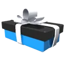

# Surprise Model Pack

<!-- media:start (generated by scripts/build_media.py) -->
{ .lu-icon width="128" loading="lazy" }
<!-- media:end -->

[Item database](./README.md) | [Methodology](./Methodology.md)

**LOT: 13117** | Package | Rarity code: 3

## Description

Double-click to use!

Player tooltip: official English client text (`locale.xml`, `en_US`).

| Field | Stored value |
| --- | --- |
| Display name | Surprise Model Pack |
| Internal name | CP Model Surprise Pack |
| Object row | Present |
| Equipment slot / stack size | Not recorded / 5 |
| Binding / uniqueness | Bind on pickup: False; bind on equip: False; unique: False |
| Requirements | Flag: 0; achievement: 0; precondition: ; specialty/rank: 0 / 0 |
| Base value (not a vendor quote) | 0 |
| Currencies | Costs: not recorded; alternate LOT/cost:  / ; commendation LOT/cost:  /  |

## Drops, packages, activities, and vendors

No qualifying static loot-matrix or vendor association was resolved.

Rates above mean **at least one item per matrix invocation before player filters**, followed by expected item count. They are not a universal chance per kill. Vendor stock is a separate calculation, not a drop rate. Mission-only drops, team ownership, scripts, availability, and vendor scene overrides can change actual receipt. Follow the source links for mapped locations and coordinates.

## Mission, achievement, mail, and code rewards

| Reward | Classification | Conditions | Associated NPCs / mapped locations |
| --- | --- | --- | --- |
| Achievement 996: Smash Talli Reeko! | Location / Crux Prime | First completion; listed completion reward; quantity 1; gate auramar | No associated NPC placement resolved |
| Mission 1197: Chantey Shanty Visitor | Hidden / Hidden | First completion; listed completion reward; quantity 1; gate march2011content | [Betty Hatchesbatten - Pirate Guard (LOT 1933)](sources/object-1933.md) [Gnarled Forest Deep Dive Map (375)](locations/zone-375.md); [Gnarled Forest (1300)](locations/zone-1300.md) |
| Mission 1197: Chantey Shanty Visitor | Hidden / Hidden | Repeat reward (only if repeatable and available); listed completion reward; quantity 1; gate march2011content | [Betty Hatchesbatten - Pirate Guard (LOT 1933)](sources/object-1933.md) [Gnarled Forest Deep Dive Map (375)](locations/zone-375.md); [Gnarled Forest (1300)](locations/zone-1300.md) |
| Mission 1198: Raven Bluff Visitor | Hidden / Hidden | First completion; listed completion reward; quantity 1; gate march2011content | [Ninja Tashi - Ninja Scout (LOT 7411)](sources/object-7411.md) [Forbidden Valley (1400)](locations/zone-1400.md) |
| Mission 1198: Raven Bluff Visitor | Hidden / Hidden | Repeat reward (only if repeatable and available); listed completion reward; quantity 1; gate march2011content | [Ninja Tashi - Ninja Scout (LOT 7411)](sources/object-7411.md) [Forbidden Valley (1400)](locations/zone-1400.md) |
| Mission 1254: Mutiny on Crux Prime | Hidden / Hidden | First completion; reward choice; quantity 1; gate auramar | [Bronson Jarls - Sentinel Faction Lieutenant (LOT 11992)](sources/object-11992.md) [Crux Prime (1800)](locations/zone-1800.md) |
| Mission 1254: Mutiny on Crux Prime | Hidden / Hidden | Repeat reward (only if repeatable and available); reward choice; quantity 1; gate auramar | [Bronson Jarls - Sentinel Faction Lieutenant (LOT 11992)](sources/object-11992.md) [Crux Prime (1800)](locations/zone-1800.md) |
| Mission 1255: Horsemaster | Hidden / Hidden | First completion; reward choice; quantity 1; gate auramar | [Bronson Jarls - Sentinel Faction Lieutenant (LOT 11992)](sources/object-11992.md) [Crux Prime (1800)](locations/zone-1800.md) |
| Mission 1255: Horsemaster | Hidden / Hidden | Repeat reward (only if repeatable and available); reward choice; quantity 1; gate auramar | [Bronson Jarls - Sentinel Faction Lieutenant (LOT 11992)](sources/object-11992.md) [Crux Prime (1800)](locations/zone-1800.md) |
| Mission 1256: Spider Slayer | Hidden / Hidden | First completion; reward choice; quantity 1; gate auramar | [Bronson Jarls - Sentinel Faction Lieutenant (LOT 11992)](sources/object-11992.md) [Crux Prime (1800)](locations/zone-1800.md) |
| Mission 1256: Spider Slayer | Hidden / Hidden | Repeat reward (only if repeatable and available); reward choice; quantity 1; gate auramar | [Bronson Jarls - Sentinel Faction Lieutenant (LOT 11992)](sources/object-11992.md) [Crux Prime (1800)](locations/zone-1800.md) |
| Mission 1257: Dragonlord | Hidden / Hidden | First completion; reward choice; quantity 1; gate auramar | [Bronson Jarls - Sentinel Faction Lieutenant (LOT 11992)](sources/object-11992.md) [Crux Prime (1800)](locations/zone-1800.md) |
| Mission 1257: Dragonlord | Hidden / Hidden | Repeat reward (only if repeatable and available); reward choice; quantity 1; gate auramar | [Bronson Jarls - Sentinel Faction Lieutenant (LOT 11992)](sources/object-11992.md) [Crux Prime (1800)](locations/zone-1800.md) |
| Mission 1258: Invaders! | Hidden / Hidden | First completion; reward choice; quantity 1; gate auramar | [Bronson Jarls - Sentinel Faction Lieutenant (LOT 11992)](sources/object-11992.md) [Crux Prime (1800)](locations/zone-1800.md) |
| Mission 1258: Invaders! | Hidden / Hidden | Repeat reward (only if repeatable and available); reward choice; quantity 1; gate auramar | [Bronson Jarls - Sentinel Faction Lieutenant (LOT 11992)](sources/object-11992.md) [Crux Prime (1800)](locations/zone-1800.md) |
| Mission 1259: Bone Patrol | Hidden / Hidden | First completion; reward choice; quantity 1; gate auramar | [Bronson Jarls - Sentinel Faction Lieutenant (LOT 11992)](sources/object-11992.md) [Crux Prime (1800)](locations/zone-1800.md) |
| Mission 1259: Bone Patrol | Hidden / Hidden | Repeat reward (only if repeatable and available); reward choice; quantity 1; gate auramar | [Bronson Jarls - Sentinel Faction Lieutenant (LOT 11992)](sources/object-11992.md) [Crux Prime (1800)](locations/zone-1800.md) |
| Mission 1260: Arrr is for Robot | Hidden / Hidden | First completion; reward choice; quantity 1; gate auramar | [Bronson Jarls - Sentinel Faction Lieutenant (LOT 11992)](sources/object-11992.md) [Crux Prime (1800)](locations/zone-1800.md) |
| Mission 1260: Arrr is for Robot | Hidden / Hidden | Repeat reward (only if repeatable and available); reward choice; quantity 1; gate auramar | [Bronson Jarls - Sentinel Faction Lieutenant (LOT 11992)](sources/object-11992.md) [Crux Prime (1800)](locations/zone-1800.md) |
| Mission 1261: Boss Battler | Hidden / Hidden | First completion; reward choice; quantity 1; gate auramar | [Bronson Jarls - Sentinel Faction Lieutenant (LOT 11992)](sources/object-11992.md) [Crux Prime (1800)](locations/zone-1800.md) |
| Mission 1261: Boss Battler | Hidden / Hidden | Repeat reward (only if repeatable and available); reward choice; quantity 1; gate auramar | [Bronson Jarls - Sentinel Faction Lieutenant (LOT 11992)](sources/object-11992.md) [Crux Prime (1800)](locations/zone-1800.md) |
| Mission 1262: Maelstrom Mangler | Hidden / Hidden | First completion; reward choice; quantity 1; gate auramar | [Bronson Jarls - Sentinel Faction Lieutenant (LOT 11992)](sources/object-11992.md) [Crux Prime (1800)](locations/zone-1800.md) |
| Mission 1262: Maelstrom Mangler | Hidden / Hidden | Repeat reward (only if repeatable and available); reward choice; quantity 1; gate auramar | [Bronson Jarls - Sentinel Faction Lieutenant (LOT 11992)](sources/object-11992.md) [Crux Prime (1800)](locations/zone-1800.md) |
| Mission 1263: Chaos Crusher | Hidden / Hidden | First completion; reward choice; quantity 1; gate auramar | [Bronson Jarls - Sentinel Faction Lieutenant (LOT 11992)](sources/object-11992.md) [Crux Prime (1800)](locations/zone-1800.md) |
| Mission 1263: Chaos Crusher | Hidden / Hidden | Repeat reward (only if repeatable and available); reward choice; quantity 1; gate auramar | [Bronson Jarls - Sentinel Faction Lieutenant (LOT 11992)](sources/object-11992.md) [Crux Prime (1800)](locations/zone-1800.md) |
| Mission 1264: Smash Pack | Hidden / Hidden | First completion; reward choice; quantity 1; gate auramar | [Bronson Jarls - Sentinel Faction Lieutenant (LOT 11992)](sources/object-11992.md) [Crux Prime (1800)](locations/zone-1800.md) |
| Mission 1264: Smash Pack | Hidden / Hidden | Repeat reward (only if repeatable and available); reward choice; quantity 1; gate auramar | [Bronson Jarls - Sentinel Faction Lieutenant (LOT 11992)](sources/object-11992.md) [Crux Prime (1800)](locations/zone-1800.md) |
| Mission 1265: Bone Voyage | Hidden / Hidden | First completion; reward choice; quantity 1; gate auramar | [Bronson Jarls - Sentinel Faction Lieutenant (LOT 11992)](sources/object-11992.md) [Crux Prime (1800)](locations/zone-1800.md) |
| Mission 1265: Bone Voyage | Hidden / Hidden | Repeat reward (only if repeatable and available); reward choice; quantity 1; gate auramar | [Bronson Jarls - Sentinel Faction Lieutenant (LOT 11992)](sources/object-11992.md) [Crux Prime (1800)](locations/zone-1800.md) |
| Mission 1266: Easy and Hard | Hidden / Hidden | First completion; reward choice; quantity 1; gate auramar | [Bronson Jarls - Sentinel Faction Lieutenant (LOT 11992)](sources/object-11992.md) [Crux Prime (1800)](locations/zone-1800.md) |
| Mission 1266: Easy and Hard | Hidden / Hidden | Repeat reward (only if repeatable and available); reward choice; quantity 1; gate auramar | [Bronson Jarls - Sentinel Faction Lieutenant (LOT 11992)](sources/object-11992.md) [Crux Prime (1800)](locations/zone-1800.md) |
| Mission 1305: Mining Marauder | Hidden / Hidden | First completion; reward choice; quantity 1; gate auramar | [Neido - Ninja of Imagination (LOT 11998)](sources/object-11998.md) [Crux Prime (1800)](locations/zone-1800.md) |
| Mission 1305: Mining Marauder | Hidden / Hidden | Repeat reward (only if repeatable and available); reward choice; quantity 1; gate auramar | [Neido - Ninja of Imagination (LOT 11998)](sources/object-11998.md) [Crux Prime (1800)](locations/zone-1800.md) |
| Mission 1306: Ninja Avenger | Hidden / Hidden | First completion; reward choice; quantity 1; gate auramar | [Neido - Ninja of Imagination (LOT 11998)](sources/object-11998.md) [Crux Prime (1800)](locations/zone-1800.md) |
| Mission 1306: Ninja Avenger | Hidden / Hidden | Repeat reward (only if repeatable and available); reward choice; quantity 1; gate auramar | [Neido - Ninja of Imagination (LOT 11998)](sources/object-11998.md) [Crux Prime (1800)](locations/zone-1800.md) |
| Mission 1307: Breaking Ranks | Hidden / Hidden | First completion; reward choice; quantity 1; gate auramar | [Neido - Ninja of Imagination (LOT 11998)](sources/object-11998.md) [Crux Prime (1800)](locations/zone-1800.md) |
| Mission 1307: Breaking Ranks | Hidden / Hidden | Repeat reward (only if repeatable and available); reward choice; quantity 1; gate auramar | [Neido - Ninja of Imagination (LOT 11998)](sources/object-11998.md) [Crux Prime (1800)](locations/zone-1800.md) |
| Mission 1308: Your Spinjitzu is Strong | Hidden / Hidden | First completion; reward choice; quantity 1; gate auramar | [Neido - Ninja of Imagination (LOT 11998)](sources/object-11998.md) [Crux Prime (1800)](locations/zone-1800.md) |
| Mission 1308: Your Spinjitzu is Strong | Hidden / Hidden | Repeat reward (only if repeatable and available); reward choice; quantity 1; gate auramar | [Neido - Ninja of Imagination (LOT 11998)](sources/object-11998.md) [Crux Prime (1800)](locations/zone-1800.md) |
| Mission 1309: Compound Fracture | Hidden / Hidden | First completion; reward choice; quantity 1; gate auramar | [Neido - Ninja of Imagination (LOT 11998)](sources/object-11998.md) [Crux Prime (1800)](locations/zone-1800.md) |
| Mission 1309: Compound Fracture | Hidden / Hidden | Repeat reward (only if repeatable and available); reward choice; quantity 1; gate auramar | [Neido - Ninja of Imagination (LOT 11998)](sources/object-11998.md) [Crux Prime (1800)](locations/zone-1800.md) |
| Achievement 1353: Like Clockwork 4 | General / No subtype | First completion; reward choice; quantity 1; gate nexustower | No associated NPC placement resolved |
| Achievement 1739: The Visitor | Build / No subtype | First completion; listed completion reward; quantity 1; gate freetrial | No associated NPC placement resolved |
| Achievement 1740: Pirate Sharpshooter | Play / Shooting Galleries | First completion; listed completion reward; quantity 1; gate freetrial | No associated NPC placement resolved |
| Achievement 1841: A Worthy Builder 4 | Build / No subtype | First completion; listed completion reward; quantity 5; gate freetrial | No associated NPC placement resolved |
| Achievement 1976: Just a Fling | Location / Ninjago Monastery | First completion; listed completion reward; quantity 1; gate njhub | No associated NPC placement resolved |

## Community acquisition references

No conservative name-matched acquisition fact was found in the 17 researched community pages. This does not establish that the wider wiki has no article or information.

## Evidence

[Objects](../../db/Objects.md), [ComponentsRegistry](../../db/ComponentsRegistry.md), [ItemComponent](../../db/ItemComponent.md), [Missions](../../db/Missions.md), [MissionNPCComponent](../../db/MissionNPCComponent.md), [MissionEmail](../../db/MissionEmail.md), [RewardCodes](../../db/RewardCodes.md). [Coverage and limitations](./Methodology.md).
