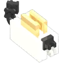

# Toaster Model 1

<!-- media:start (generated by scripts/build_media.py) -->
{ .lu-icon width="128" loading="lazy" }
<!-- media:end -->

[Item database](./README.md) | [Methodology](./Methodology.md)

**LOT: 13716** | Loot model | Rarity code: 3

## Description

A model for your property!

Player tooltip: official English client text (`locale.xml`, `en_US`).

| Field | Stored value |
| --- | --- |
| Display name | Toaster Model 1 |
| Internal name | Model Reward Toaster 1  |
| Object row | Present |
| Equipment slot / stack size | Extra&#95;1 / 10 |
| Binding / uniqueness | Bind on pickup: False; bind on equip: False; unique: False |
| Requirements | Flag: 0; achievement: 0; precondition: 62&#124;26; specialty/rank: 0 / 0 |
| Base value (not a vendor quote) | 380 |
| Currencies | Costs: not recorded; alternate LOT/cost:  / ; commendation LOT/cost: 13763 / 10 |

## Drops, packages, activities, and vendors

No qualifying static loot-matrix or vendor association was resolved.

Rates above mean **at least one item per matrix invocation before player filters**, followed by expected item count. They are not a universal chance per kill. Vendor stock is a separate calculation, not a drop rate. Mission-only drops, team ownership, scripts, availability, and vendor scene overrides can change actual receipt. Follow the source links for mapped locations and coordinates.

## Mission, achievement, mail, and code rewards

| Reward | Classification | Conditions | Associated NPCs / mapped locations |
| --- | --- | --- | --- |
| Mission 1203: Vault Account | Location / Nexus Tower | First completion; listed completion reward; quantity 1; gate nexustower | [Nexus Naomi - Nexus Tower Artificial Intelligence (LOT 12841)](sources/object-12841.md) [Nexus Tower (1900)](locations/zone-1900.md) |

## Community acquisition references

No conservative name-matched acquisition fact was found in the 17 researched community pages. This does not establish that the wider wiki has no article or information.

## Evidence

[Objects](../../db/Objects.md), [ComponentsRegistry](../../db/ComponentsRegistry.md), [ItemComponent](../../db/ItemComponent.md), [Missions](../../db/Missions.md), [MissionNPCComponent](../../db/MissionNPCComponent.md), [MissionEmail](../../db/MissionEmail.md), [RewardCodes](../../db/RewardCodes.md). [Coverage and limitations](./Methodology.md).
