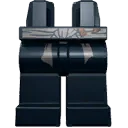

# Pants of Quakes

<!-- media:start (generated by scripts/build_media.py) -->
{ .lu-icon width="128" loading="lazy" }
<!-- media:end -->

[Item database](./README.md) | [Methodology](./Methodology.md)

**LOT: 14172** | Legs | Rarity code: 3

## Description

Wear this to look like a Ninja of Earth and rocket directly to the Ninjago Caves!

Player tooltip: official English client text (`locale.xml`, `en_US`).

| Field | Stored value |
| --- | --- |
| Display name | Pants of Quakes |
| Internal name | Earth Spinjitzu Pants Pants of Quakes |
| Object row | Present |
| Equipment slot / stack size | legs / 1 |
| Binding / uniqueness | Bind on pickup: True; bind on equip: False; unique: True |
| Requirements | Flag: 0; achievement: 0; precondition: 324; specialty/rank: 0 / 0 |
| Base value (not a vendor quote) | 5225 |
| Currencies | Costs: not recorded; alternate LOT/cost:  / ; commendation LOT/cost: 13763 / 30 |

## Drops, packages, activities, and vendors

| Definition | Source kind | Named sources | Probability / stock |
| --- | --- | --- | --- |
| [Matrix 789](sources/matrix-789.md) | Vendor | [Nya - Ninjago Gear Vendor (LOT 13799)](sources/object-13799.md) | Not a rolled drop source Default vendor stock: 100% per refresh |
| [Matrix 791](sources/matrix-791.md) | Unresolved matrix | No named static consumer identified; not a verified acquisition route | Loot: 100%; mean 1 |

Rates above mean **at least one item per matrix invocation before player filters**, followed by expected item count. They are not a universal chance per kill. Vendor stock is a separate calculation, not a drop rate. Mission-only drops, team ownership, scripts, availability, and vendor scene overrides can change actual receipt. Follow the source links for mapped locations and coordinates.

## Mission, achievement, mail, and code rewards

| Reward | Classification | Conditions | Associated NPCs / mapped locations |
| --- | --- | --- | --- |
| Mission 1946: The Power of Earth | Location / Ninjago Monastery | First completion; listed completion reward; quantity 1; gate njhub | [Cole - Ninja of Earth (LOT 13790)](sources/object-13790.md) [Ninjago Monastery (2000)](locations/zone-2000.md) |

## Community acquisition references

**Historical community evidence, matched by a unique local item name—not a verified LOT or current-server availability match.**

- [Ninjago Items](https://legouniverse.fandom.com/wiki/Ninjago_Items?oldid=163250): reported methods: vendor; named acquisition references: none extracted. Matched name: Pants of Quakes.

## Evidence

[Objects](../../db/Objects.md), [ComponentsRegistry](../../db/ComponentsRegistry.md), [ItemComponent](../../db/ItemComponent.md), [LootMatrix](../../db/LootMatrix.md), [LootTable](../../db/LootTable.md), [RarityTable](../../db/RarityTable.md), [Missions](../../db/Missions.md), [MissionNPCComponent](../../db/MissionNPCComponent.md), [MissionEmail](../../db/MissionEmail.md), [RewardCodes](../../db/RewardCodes.md). [Coverage and limitations](./Methodology.md).
