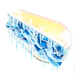

# Chilly Freezesteak

<!-- media:start (generated by scripts/build_media.py) -->
{ .lu-icon width="128" loading="lazy" }
<!-- media:end -->

[Item database](./README.md) | [Methodology](./Methodology.md)

**LOT: 14506** | Consumable | Rarity code: 3

## Description

Double-click to use!

Player tooltip: official English client text (`locale.xml`, `en_US`).

| Field | Stored value |
| --- | --- |
| Display name | Chilly Freezesteak |
| Internal name | Chilly Freezesteak |
| Object row | Present |
| Equipment slot / stack size | Not recorded / 10 |
| Binding / uniqueness | Bind on pickup: True; bind on equip: False; unique: False |
| Requirements | Flag: 0; achievement: 0; precondition: 240;214; specialty/rank: 0 / 0 |
| Base value (not a vendor quote) | 1000 |
| Currencies | Costs: 3011:1,8376:1,14471:4; alternate LOT/cost:  / ; commendation LOT/cost:  /  |

## Drops, packages, activities, and vendors

| Definition | Source kind | Named sources | Probability / stock |
| --- | --- | --- | --- |
| [Matrix 790](sources/matrix-790.md) | Vendor | [Johnny Umami - Ninjago Supplies Vendor (LOT 13800)](sources/object-13800.md) | Not a rolled drop source Default vendor stock: 100% per refresh |

Rates above mean **at least one item per matrix invocation before player filters**, followed by expected item count. They are not a universal chance per kill. Vendor stock is a separate calculation, not a drop rate. Mission-only drops, team ownership, scripts, availability, and vendor scene overrides can change actual receipt. Follow the source links for mapped locations and coordinates.

## Mission, achievement, mail, and code rewards

| Reward | Classification | Conditions | Associated NPCs / mapped locations |
| --- | --- | --- | --- |
| Mission 1868: Jeet Yet? | Location / Ninjago Monastery | First completion; listed completion reward; quantity 1; gate njhub | [Johnny Umami - Ninjago Supplies Vendor (LOT 13800)](sources/object-13800.md) [Ninjago Monastery (2000)](locations/zone-2000.md) |

## Community acquisition references

No conservative name-matched acquisition fact was found in the 17 researched community pages. This does not establish that the wider wiki has no article or information.

## Evidence

[Objects](../../db/Objects.md), [ComponentsRegistry](../../db/ComponentsRegistry.md), [ItemComponent](../../db/ItemComponent.md), [LootMatrix](../../db/LootMatrix.md), [LootTable](../../db/LootTable.md), [RarityTable](../../db/RarityTable.md), [Missions](../../db/Missions.md), [MissionNPCComponent](../../db/MissionNPCComponent.md), [MissionEmail](../../db/MissionEmail.md), [RewardCodes](../../db/RewardCodes.md). [Coverage and limitations](./Methodology.md).
