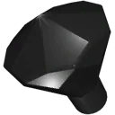

# Onyx Gem

<!-- media:start (generated by scripts/build_media.py) -->
{ .lu-icon .lu-on-light width="128" loading="lazy" }
<!-- media:end -->

[Item database](./README.md) | [Methodology](./Methodology.md)

**LOT: 14512** | Consumable | Rarity code: 1

## Description

A gem that can be sold!

Player tooltip: official English client text (`locale.xml`, `en_US`).

| Field | Stored value |
| --- | --- |
| Display name | Onyx Gem |
| Internal name | Onyx Gem |
| Object row | Present |
| Equipment slot / stack size | Not recorded / 20 |
| Binding / uniqueness | Bind on pickup: False; bind on equip: False; unique: False |
| Requirements | Flag: 0; achievement: 0; precondition: ; specialty/rank: 0 / 0 |
| Base value (not a vendor quote) | 200 |
| Currencies | Costs: not recorded; alternate LOT/cost:  / ; commendation LOT/cost:  /  |

## Drops, packages, activities, and vendors

| Definition | Source kind | Named sources | Probability / stock |
| --- | --- | --- | --- |
| [Matrix 776](sources/matrix-776.md) | Drop | [NJ - Cave Rock Smashable Small (LOT 15895)](sources/object-15895.md) [NJ - Cave Rock Smashable Medium (LOT 15896)](sources/object-15896.md) [NJ - Cave Rock Smashable Large (LOT 15897)](sources/object-15897.md) | Loot: 33%; mean 0.495 |

Rates above mean **at least one item per matrix invocation before player filters**, followed by expected item count. They are not a universal chance per kill. Vendor stock is a separate calculation, not a drop rate. Mission-only drops, team ownership, scripts, availability, and vendor scene overrides can change actual receipt. Follow the source links for mapped locations and coordinates.

## Mission, achievement, mail, and code rewards

No reward association was found in the covered mission, mail, or code tables.

## Community acquisition references

No conservative name-matched acquisition fact was found in the 17 researched community pages. This does not establish that the wider wiki has no article or information.

## Evidence

[Objects](../../db/Objects.md), [ComponentsRegistry](../../db/ComponentsRegistry.md), [ItemComponent](../../db/ItemComponent.md), [LootMatrix](../../db/LootMatrix.md), [LootTable](../../db/LootTable.md), [RarityTable](../../db/RarityTable.md). [Coverage and limitations](./Methodology.md).
