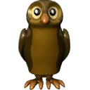

# Brown Shoulder Owl

<!-- media:start (generated by scripts/build_media.py) -->
{ .lu-icon width="128" loading="lazy" }
<!-- media:end -->

[Item database](./README.md) | [Methodology](./Methodology.md)

**LOT: 14816** | Neck | Rarity code: 2

## Description

No client object description is present in this snapshot. No lore or effect has been invented.

| Field | Stored value |
| --- | --- |
| Display name | Brown Shoulder Owl |
| Internal name | Shoulder Owl Brown |
| Object row | Present |
| Equipment slot / stack size | clavicle / 1 |
| Binding / uniqueness | Bind on pickup: True; bind on equip: False; unique: False |
| Requirements | Flag: 0; achievement: 0; precondition: 248; specialty/rank: 0 / 0 |
| Base value (not a vendor quote) | 1000 |
| Currencies | Costs: not recorded; alternate LOT/cost:  / ; commendation LOT/cost:  /  |

## Drops, packages, activities, and vendors

No qualifying static loot-matrix or vendor association was resolved.

Rates above mean **at least one item per matrix invocation before player filters**, followed by expected item count. They are not a universal chance per kill. Vendor stock is a separate calculation, not a drop rate. Mission-only drops, team ownership, scripts, availability, and vendor scene overrides can change actual receipt. Follow the source links for mapped locations and coordinates.

## Mission, achievement, mail, and code rewards

No reward association was found in the covered mission, mail, or code tables.

## Community acquisition references

**Historical community evidence, matched by a unique local item name—not a verified LOT or current-server availability match.**

- [Neck Items](https://legouniverse.fandom.com/wiki/Neck_Items?oldid=161377): reported methods: not categorized; named acquisition references: Levels. Matched name: Brown Shoulder Owl.

## Evidence

[Objects](../../db/Objects.md), [ComponentsRegistry](../../db/ComponentsRegistry.md), [ItemComponent](../../db/ItemComponent.md). [Coverage and limitations](./Methodology.md).
