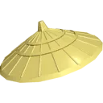

# Athlete's Shade

<!-- media:start (generated by scripts/build_media.py) -->
{ .lu-icon .lu-on-dark width="128" loading="lazy" }
<!-- media:end -->

[Item database](./README.md) | [Methodology](./Methodology.md)

**LOT: 15918** | Hat | Rarity code: 4

## Description

No client object description is present in this snapshot. No lore or effect has been invented.

| Field | Stored value |
| --- | --- |
| Display name | Athlete's Shade |
| Internal name | Athlete's Shade |
| Object row | Present |
| Equipment slot / stack size | hair / 1 |
| Binding / uniqueness | Bind on pickup: False; bind on equip: True; unique: False |
| Requirements | Flag: ; achievement: ; precondition: 222; specialty/rank:  /  |
| Base value (not a vendor quote) | 9950 |
| Currencies | Costs: not recorded; alternate LOT/cost:  / ; commendation LOT/cost:  /  |

## Drops, packages, activities, and vendors

| Definition | Source kind | Named sources | Probability / stock |
| --- | --- | --- | --- |
| [Matrix 896](sources/matrix-896.md) | Drop | [NJ -  Dungeon Gen Sensi Chest Regular - brown with iron bands (LOT 16088)](sources/object-16088.md) | Loot: 0.0005%; mean 0.000005 |

Rates above mean **at least one item per matrix invocation before player filters**, followed by expected item count. They are not a universal chance per kill. Vendor stock is a separate calculation, not a drop rate. Mission-only drops, team ownership, scripts, availability, and vendor scene overrides can change actual receipt. Follow the source links for mapped locations and coordinates.

## Mission, achievement, mail, and code rewards

No reward association was found in the covered mission, mail, or code tables.

## Community acquisition references

No conservative name-matched acquisition fact was found in the 17 researched community pages. This does not establish that the wider wiki has no article or information.

## Evidence

[Objects](../../db/Objects.md), [ComponentsRegistry](../../db/ComponentsRegistry.md), [ItemComponent](../../db/ItemComponent.md), [LootMatrix](../../db/LootMatrix.md), [LootTable](../../db/LootTable.md), [RarityTable](../../db/RarityTable.md). [Coverage and limitations](./Methodology.md).
