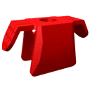

# Crimson Guard

<!-- media:start (generated by scripts/build_media.py) -->
{ width="64" loading="lazy" }
<!-- media:end -->

[Item database](./README.md) | [Methodology](./Methodology.md)

**LOT: 15990** | Neck | Rarity code: 2

## Description

No client object description is present in this snapshot. No lore or effect has been invented.

| Field | Stored value |
| --- | --- |
| Display name | Crimson Guard |
| Internal name | Crimson Guard |
| Object row | Present |
| Equipment slot / stack size | clavicle / 1 |
| Binding / uniqueness | Bind on pickup: False; bind on equip: True; unique: False |
| Requirements | Flag: ; achievement: ; precondition: 214; specialty/rank:  /  |
| Base value (not a vendor quote) | 2925 |
| Currencies | Costs: not recorded; alternate LOT/cost:  / ; commendation LOT/cost: 13763 / 15 |

## Drops, packages, activities, and vendors

| Definition | Source kind | Named sources | Probability / stock |
| --- | --- | --- | --- |
| [Matrix 896](sources/matrix-896.md) | Drop | [NJ -  Dungeon Gen Sensi Chest Regular - brown with iron bands (LOT 16088)](sources/object-16088.md) | Loot: 0.0115%; mean 0.000115 |

Rates above mean **at least one item per matrix invocation before player filters**, followed by expected item count. They are not a universal chance per kill. Vendor stock is a separate calculation, not a drop rate. Mission-only drops, team ownership, scripts, availability, and vendor scene overrides can change actual receipt. Follow the source links for mapped locations and coordinates.

## Mission, achievement, mail, and code rewards

| Reward | Classification | Conditions | Associated NPCs / mapped locations |
| --- | --- | --- | --- |
| Mission 1832: Bone's Eye | Location / Ninjago Monastery | First completion; listed completion reward; quantity 1; gate njhub | [Furious Urufu - Dog Boy (LOT 13796)](sources/object-13796.md) [Ninjago Monastery (2000)](locations/zone-2000.md) |

## Community acquisition references

**Historical community evidence, matched by a unique local item name—not a verified LOT or current-server availability match.**

- [Ninjago Items](https://legouniverse.fandom.com/wiki/Ninjago_Items?oldid=163250): reported methods: mission; named acquisition references: none extracted. Matched name: Crimson Guard.

## Evidence

[Objects](../../db/Objects.md), [ComponentsRegistry](../../db/ComponentsRegistry.md), [ItemComponent](../../db/ItemComponent.md), [LootMatrix](../../db/LootMatrix.md), [LootTable](../../db/LootTable.md), [RarityTable](../../db/RarityTable.md), [Missions](../../db/Missions.md), [MissionNPCComponent](../../db/MissionNPCComponent.md), [MissionEmail](../../db/MissionEmail.md), [RewardCodes](../../db/RewardCodes.md). [Coverage and limitations](./Methodology.md).
