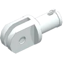

# Link with Snap with Friction

<!-- media:start (generated by scripts/build_media.py) -->
{ .lu-icon .lu-on-dark width="128" loading="lazy" }
<!-- media:end -->

[Item database](./README.md) | [Methodology](./Methodology.md)

**LOT: 16387** | Brick | Rarity code: 1

## Description

No client object description is present in this snapshot. No lore or effect has been invented.

| Field | Stored value |
| --- | --- |
| Display name | Link with Snap with Friction |
| Internal name | m6048 |
| Object row | Present |
| Equipment slot / stack size | Not recorded / 0 |
| Binding / uniqueness | Bind on pickup: False; bind on equip: False; unique: False |
| Requirements | Flag: ; achievement: ; precondition: ; specialty/rank:  /  |
| Base value (not a vendor quote) | 10 |
| Currencies | Costs: not recorded; alternate LOT/cost:  / ; commendation LOT/cost:  /  |

## Drops, packages, activities, and vendors

| Definition | Source kind | Named sources | Probability / stock |
| --- | --- | --- | --- |
| [Matrix 51](sources/matrix-51.md) | Drop | [FV - Hammer Parts Bell Smashable 1 (LOT 7606)](sources/object-7606.md) | Loot: 0.01020408%; mean 0.00010204082 |
| [Matrix 52](sources/matrix-52.md) | Drop | [FV - Hammer Parts Bell Smashable 2 (LOT 7620)](sources/object-7620.md) | Loot: 0.01020408%; mean 0.00010204082 |
| [Matrix 53](sources/matrix-53.md) | Drop | [FV - Hammer Parts Bell Smashable 3 (LOT 7621)](sources/object-7621.md) | Loot: 0.01020408%; mean 0.00010204082 |
| [Matrix 54](sources/matrix-54.md) | Drop | [FV - Hammer Parts Bell Smashable 4 (LOT 7622)](sources/object-7622.md) | Loot: 0.01020408%; mean 0.00010204082 |
| [Matrix 123](sources/matrix-123.md) | Vendor | [Bruno Underbite - Brick Vendor (LOT 3921)](sources/object-3921.md) | Not a rolled drop source Default vendor stock: 100% per refresh |
| [Matrix 277](sources/matrix-277.md) | Drop | [NS - Newspaper Box 2 (LOT 3170)](sources/object-3170.md) [NS - Newspaper Box 3 (LOT 3171)](sources/object-3171.md) [NS - Mailbox (LOT 3197)](sources/object-3197.md) [all 16 source LOTs](sources/matrix-277.md) | Loot: 0.01020408%; mean 0.00010204082 |
| [Matrix 414](sources/matrix-414.md) | Package | [Mega Brick Booster Pack (LOT 10165)](sources/object-10165.md) | Loot: 1.02040816%; mean 0.010204082 |
| [Matrix 577](sources/matrix-577.md) | Activity | [NS - Wishing Well Birdbath (LOT 11280)](sources/object-11280.md) | Loot: 2.02696864%; mean 0.020408163 |
| [Matrix 578](sources/matrix-578.md) | Activity | [NS - Wishing Well Birdbath (LOT 11280)](sources/object-11280.md) | Loot: 2.02696864%; mean 0.020408163 |
| [Matrix 579](sources/matrix-579.md) | Activity | [NS - Wishing Well Birdbath (LOT 11280)](sources/object-11280.md) | Loot: 3.02669345%; mean 0.030612245 |
| [Matrix 580](sources/matrix-580.md) | Activity | [NS - Wishing Well Birdbath (LOT 11280)](sources/object-11280.md) | Loot: 4.01621698%; mean 0.040816327 |
| [Matrix 581](sources/matrix-581.md) | Activity | [NS - Wishing Well Birdbath (LOT 11280)](sources/object-11280.md) | Loot: 7.38974874%; mean 0.076530612 |
| [Matrix 598](sources/matrix-598.md) | Activity | [Natso Fast - Foot Race Host (LOT 8663)](sources/object-8663.md) [Boris Toobsox - Foot Race Host (LOT 9714)](sources/object-9714.md) [FV - Panda Block (LOT 9732)](sources/object-9732.md) [all 9 source LOTs](sources/matrix-598.md) | Loot: 0.07142857%; mean 0.00071428571 |
| [Matrix 689](sources/matrix-689.md) | Drop | [NT - Wall Smashable 1 (LOT 12436)](sources/object-12436.md) [NT - Wall Smashable 2 (LOT 12438)](sources/object-12438.md) [nextower&#95;sentShield (LOT 12930)](sources/object-12930.md) [all 13 source LOTs](sources/matrix-689.md) | Loot: 0.01020408%; mean 0.00010204082 |
| [Matrix 722](sources/matrix-722.md) | Activity | [NT - Interactable Console - Wishing Well (LOT 14086)](sources/object-14086.md) | Loot: 2.02696864%; mean 0.020408163 |
| [Matrix 723](sources/matrix-723.md) | Activity | [NT - Interactable Console - Wishing Well (LOT 14086)](sources/object-14086.md) | Loot: 2.02696864%; mean 0.020408163 |
| [Matrix 724](sources/matrix-724.md) | Activity | [NT - Interactable Console - Wishing Well (LOT 14086)](sources/object-14086.md) | Loot: 3.02669345%; mean 0.030612245 |
| [Matrix 725](sources/matrix-725.md) | Activity | [NT - Interactable Console - Wishing Well (LOT 14086)](sources/object-14086.md) | Loot: 4.01621698%; mean 0.040816327 |
| [Matrix 726](sources/matrix-726.md) | Activity | [NT - Interactable Console - Wishing Well (LOT 14086)](sources/object-14086.md) | Loot: 7.38974874%; mean 0.076530612 |

Rates above mean **at least one item per matrix invocation before player filters**, followed by expected item count. They are not a universal chance per kill. Vendor stock is a separate calculation, not a drop rate. Mission-only drops, team ownership, scripts, availability, and vendor scene overrides can change actual receipt. Follow the source links for mapped locations and coordinates.

## Mission, achievement, mail, and code rewards

No reward association was found in the covered mission, mail, or code tables.

## Community acquisition references

No conservative name-matched acquisition fact was found in the 17 researched community pages. This does not establish that the wider wiki has no article or information.

## Evidence

[Objects](../../db/Objects.md), [ComponentsRegistry](../../db/ComponentsRegistry.md), [ItemComponent](../../db/ItemComponent.md), [LootMatrix](../../db/LootMatrix.md), [LootTable](../../db/LootTable.md), [RarityTable](../../db/RarityTable.md). [Coverage and limitations](./Methodology.md).
