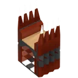

# Skeleton Outpost Short Wall 2 Model

<!-- media:start (generated by scripts/build_media.py) -->
{ width="64" loading="lazy" }
<!-- media:end -->

[Item database](./README.md) | [Methodology](./Methodology.md)

**LOT: 16578** | Loot model | Rarity code: 2

## Description

A model for your Property!

Player tooltip: official English client text (`locale.xml`, `en_US`).

| Field | Stored value |
| --- | --- |
| Display name | Skeleton Outpost Short Wall 2 Model |
| Internal name | Model Reward Skeleton Outpost Short Wall 2 |
| Object row | Present |
| Equipment slot / stack size | Extra&#95;1 / 10 |
| Binding / uniqueness | Bind on pickup: False; bind on equip: False; unique: False |
| Requirements | Flag: 0; achievement: 0; precondition: 62&#124;26; specialty/rank: 0 / 0 |
| Base value (not a vendor quote) | 2200 |
| Currencies | Costs: not recorded; alternate LOT/cost:  / ; commendation LOT/cost:  /  |

## Drops, packages, activities, and vendors

| Definition | Source kind | Named sources | Probability / stock |
| --- | --- | --- | --- |
| [Matrix 748](sources/matrix-748.md) | Drop | [NJ Smashable Statue (LOT 13622)](sources/object-13622.md) [NJ - Ancient Smashable Gate (LOT 13635)](sources/object-13635.md) [NJ - Smash Door (LOT 13956)](sources/object-13956.md) [all 64 source LOTs](sources/matrix-748.md) | Loot: 0.01363636%; mean 0.00013636364 |
| [Matrix 753](sources/matrix-753.md) | Drop, Activity | [Skeleton Miner (LOT 13558)](sources/object-13558.md) [Skeleton Engineer (LOT 13568)](sources/object-13568.md) [Skeleton Pit Boss (LOT 13588)](sources/object-13588.md) [all 27 source LOTs](sources/matrix-753.md) | Loot: 0.00681818%; mean 0.000068181818 |
| [Matrix 759](sources/matrix-759.md) | Drop | [Skeleton Trooper (LOT 14491)](sources/object-14491.md) | Loot: 0.00170455%; mean 0.000017045455 |
| [Matrix 760](sources/matrix-760.md) | Unresolved matrix | No named static consumer identified; not a verified acquisition route | Loot: 0.02045455%; mean 0.00020454545 |
| [Matrix 761](sources/matrix-761.md) | Drop | [Bone Wolf (LOT 13995)](sources/object-13995.md) [Bone Wolf (LOT 16191)](sources/object-16191.md) | Loot: 0.06818182%; mean 0.00068181818 |
| [Matrix 763](sources/matrix-763.md) | Drop | [Krazi - Skeleton of Lightning (LOT 16049)](sources/object-16049.md) | Loot: 0.06818182%; mean 0.00068181818 |
| [Matrix 764](sources/matrix-764.md) | Drop | [Unnamed LOT 16046 (LOT 16046)](sources/object-16046.md) | Loot: 0.06818182%; mean 0.00068181818 |
| [Matrix 765](sources/matrix-765.md) | Activity | [NJ - Frakjaw Boss Instance Enter (LOT 16476)](sources/object-16476.md) [NJ -Frakjaw Treasure Chest (LOT 16486)](sources/object-16486.md) [NJ - Frakjaw instance Zone Control Object (LOT 16487)](sources/object-16487.md) | Loot: 0.81818182%; mean 0.0081818182 |
| [Matrix 766](sources/matrix-766.md) | Drop | [Bonezai - Skeleton of Ice (LOT 16050)](sources/object-16050.md) | Loot: 0.06818182%; mean 0.00068181818 |
| [Matrix 769](sources/matrix-769.md) | Unresolved matrix | No named static consumer identified; not a verified acquisition route | Loot: 0.00681818%; mean 0.000068181818 |
| [Matrix 770](sources/matrix-770.md) | Unresolved matrix | No named static consumer identified; not a verified acquisition route | Loot: 0.00681818%; mean 0.000068181818 |
| [Matrix 771](sources/matrix-771.md) | Drop | [NJ Smashable Bamboo (LOT 14296)](sources/object-14296.md) | Loot: 0.00681818%; mean 0.000068181818 |
| [Matrix 776](sources/matrix-776.md) | Drop | [NJ - Cave Rock Smashable Small (LOT 15895)](sources/object-15895.md) [NJ - Cave Rock Smashable Medium (LOT 15896)](sources/object-15896.md) [NJ - Cave Rock Smashable Large (LOT 15897)](sources/object-15897.md) | Loot: 0.00681818%; mean 0.000068181818 |
| [Matrix 792](sources/matrix-792.md) | Drop | [NJ - Skullkin Siege Shield Smashable (LOT 14416)](sources/object-14416.md) [NJ - Skullkin Coffin Smashable (LOT 14421)](sources/object-14421.md) [NJ - Skulken Siege Ladder (LOT 14429)](sources/object-14429.md) [all 9 source LOTs](sources/matrix-792.md) | Loot: 0.00681818%; mean 0.000068181818 |
| [Matrix 793](sources/matrix-793.md) | Drop | [Unnamed LOT 13996 (LOT 13996)](sources/object-13996.md) | Loot: 0.00681818%; mean 0.000068181818 |
| [Matrix 794](sources/matrix-794.md) | Drop | [Unnamed LOT 13997 (LOT 13997)](sources/object-13997.md) | Loot: 0.02045455%; mean 0.00020454545 |
| [Matrix 796](sources/matrix-796.md) | Drop | [Unnamed LOT 13998 (LOT 13998)](sources/object-13998.md) | Loot: 0.00681818%; mean 0.000068181818 |
| [Matrix 797](sources/matrix-797.md) | Drop | [Unnamed LOT 13999 (LOT 13999)](sources/object-13999.md) | Loot: 0.02045455%; mean 0.00020454545 |
| [Matrix 798](sources/matrix-798.md) | Drop | [Unnamed LOT 14000 (LOT 14000)](sources/object-14000.md) | Loot: 0.00681818%; mean 0.000068181818 |
| [Matrix 799](sources/matrix-799.md) | Drop | [Unnamed LOT 14001 (LOT 14001)](sources/object-14001.md) | Loot: 0.02045455%; mean 0.00020454545 |
| [Matrix 800](sources/matrix-800.md) | Drop | [Unnamed LOT 14002 (LOT 14002)](sources/object-14002.md) | Loot: 0.00681818%; mean 0.000068181818 |
| [Matrix 875](sources/matrix-875.md) | Activity | [NJ - Frakjaw Boss Instance Enter (LOT 16476)](sources/object-16476.md) [NJ -Frakjaw Treasure Chest (LOT 16486)](sources/object-16486.md) [NJ - Frakjaw instance Zone Control Object (LOT 16487)](sources/object-16487.md) | Loot: 1.36363636%; mean 0.013636364 |
| [Matrix 876](sources/matrix-876.md) | Activity | [NJ - Frakjaw Boss Instance Enter (LOT 16476)](sources/object-16476.md) [NJ -Frakjaw Treasure Chest (LOT 16486)](sources/object-16486.md) [NJ - Frakjaw instance Zone Control Object (LOT 16487)](sources/object-16487.md) | Loot: 3.37202761%; mean 0.034090909 |
| [Matrix 877](sources/matrix-877.md) | Activity | [NJ - Frakjaw Boss Instance Enter (LOT 16476)](sources/object-16476.md) [NJ -Frakjaw Treasure Chest (LOT 16486)](sources/object-16486.md) [NJ - Frakjaw instance Zone Control Object (LOT 16487)](sources/object-16487.md) | Loot: 4.02934708%; mean 0.040909091 |
| [Matrix 879](sources/matrix-879.md) | Drop | [Chopov - Skeleton of Earth (LOT 16047)](sources/object-16047.md) | Loot: 0.06818182%; mean 0.00068181818 |
| [Matrix 880](sources/matrix-880.md) | Drop | [Skeleton Commando (LOT 14026)](sources/object-14026.md) | Loot: 0.00681818%; mean 0.000068181818 |
| [Matrix 881](sources/matrix-881.md) | Drop | [Skeleton Blacksmith (LOT 14007)](sources/object-14007.md) [Skeleton Marksman (LOT 14008)](sources/object-14008.md) [Skeleton Commando (LOT 14009)](sources/object-14009.md) [all 5 source LOTs](sources/matrix-881.md) | Loot: 0.00170455%; mean 0.000017045455 |
| [Matrix 882](sources/matrix-882.md) | Drop | [Skeleton Raider (LOT 14025)](sources/object-14025.md) | Loot: 0.00170455%; mean 0.000017045455 |
| [Matrix 883](sources/matrix-883.md) | Drop | [Skeleton Overseer (LOT 14027)](sources/object-14027.md) | Loot: 0.00681818%; mean 0.000068181818 |
| [Matrix 884](sources/matrix-884.md) | Drop | [Skeleton Marksman (LOT 14028)](sources/object-14028.md) | Loot: 0.00170455%; mean 0.000017045455 |
| [Matrix 888](sources/matrix-888.md) | Drop | [NJ -  Dungeon Gen Sensi Chest Special - brown with gold bands (LOT 16093)](sources/object-16093.md) | Loot: 0.00681818%; mean 0.000068181818 |
| [Matrix 893](sources/matrix-893.md) | Drop | [Skeleton Mad Scientist (LOT 14029)](sources/object-14029.md) | Loot: 0.00681818%; mean 0.000068181818 |
| [Matrix 895](sources/matrix-895.md) | Drop | [NJ -  Dragon Emblem Daily Chest (LOT 16552)](sources/object-16552.md) | Loot: 0.68181818%; mean 0.0068181818 |
| [Matrix 897](sources/matrix-897.md) | Drop | [NJ - Rock Smashable Large (LOT 15877)](sources/object-15877.md) [NJ - Rock Smashable Medium (LOT 15878)](sources/object-15878.md) [NJ - Rock Smashable Small (LOT 15879)](sources/object-15879.md) | Loot: 0.00681818%; mean 0.000068181818 |

Rates above mean **at least one item per matrix invocation before player filters**, followed by expected item count. They are not a universal chance per kill. Vendor stock is a separate calculation, not a drop rate. Mission-only drops, team ownership, scripts, availability, and vendor scene overrides can change actual receipt. Follow the source links for mapped locations and coordinates.

## Mission, achievement, mail, and code rewards

No reward association was found in the covered mission, mail, or code tables.

## Community acquisition references

No conservative name-matched acquisition fact was found in the 17 researched community pages. This does not establish that the wider wiki has no article or information.

## Evidence

[Objects](../../db/Objects.md), [ComponentsRegistry](../../db/ComponentsRegistry.md), [ItemComponent](../../db/ItemComponent.md), [LootMatrix](../../db/LootMatrix.md), [LootTable](../../db/LootTable.md), [RarityTable](../../db/RarityTable.md). [Coverage and limitations](./Methodology.md).
