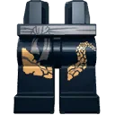

# Cole's DX Pants of Quakes

<!-- media:start (generated by scripts/build_media.py) -->
{ width="64" loading="lazy" }
<!-- media:end -->

[Item database](./README.md) | [Methodology](./Methodology.md)

**LOT: 16640** | Legs | Rarity code: 4

## Description

Wear this to look like Cole DX!

Player tooltip: official English client text (`locale.xml`, `en_US`).

| Field | Stored value |
| --- | --- |
| Display name | Cole's DX Pants of Quakes |
| Internal name | Earth Spinjitzu Pants Cole's DX Pants of Quakes |
| Object row | Present |
| Equipment slot / stack size | legs / 1 |
| Binding / uniqueness | Bind on pickup: True; bind on equip: False; unique: False |
| Requirements | Flag: ; achievement: ; precondition: 222; specialty/rank:  /  |
| Base value (not a vendor quote) | 12500 |
| Currencies | Costs: not recorded; alternate LOT/cost:  / ; commendation LOT/cost:  /  |

## Drops, packages, activities, and vendors

| Definition | Source kind | Named sources | Probability / stock |
| --- | --- | --- | --- |
| [Matrix 876](sources/matrix-876.md) | Activity | [NJ - Frakjaw Boss Instance Enter (LOT 16476)](sources/object-16476.md) [NJ -Frakjaw Treasure Chest (LOT 16486)](sources/object-16486.md) [NJ - Frakjaw instance Zone Control Object (LOT 16487)](sources/object-16487.md) | Loot: 1.5%; mean 0.015 |
| [Matrix 877](sources/matrix-877.md) | Activity | [NJ - Frakjaw Boss Instance Enter (LOT 16476)](sources/object-16476.md) [NJ -Frakjaw Treasure Chest (LOT 16486)](sources/object-16486.md) [NJ - Frakjaw instance Zone Control Object (LOT 16487)](sources/object-16487.md) | Loot: 2%; mean 0.02 |

Rates above mean **at least one item per matrix invocation before player filters**, followed by expected item count. They are not a universal chance per kill. Vendor stock is a separate calculation, not a drop rate. Mission-only drops, team ownership, scripts, availability, and vendor scene overrides can change actual receipt. Follow the source links for mapped locations and coordinates.

## Mission, achievement, mail, and code rewards

No reward association was found in the covered mission, mail, or code tables.

## Community acquisition references

No conservative name-matched acquisition fact was found in the 17 researched community pages. This does not establish that the wider wiki has no article or information.

## Evidence

[Objects](../../db/Objects.md), [ComponentsRegistry](../../db/ComponentsRegistry.md), [ItemComponent](../../db/ItemComponent.md), [LootMatrix](../../db/LootMatrix.md), [LootTable](../../db/LootTable.md), [RarityTable](../../db/RarityTable.md). [Coverage and limitations](./Methodology.md).
