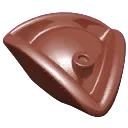

# Brown Pirate Hat

<!-- media:start (generated by scripts/build_media.py) -->
{ width="64" loading="lazy" }
<!-- media:end -->

[Item database](./README.md) | [Methodology](./Methodology.md)

**LOT: 2632** | Hat | Rarity code: 3

## Description

Wear this in Nimbus Station to launch your rocket to the Pirate Camp

Player tooltip: official English client text (`locale.xml`, `en_US`).

| Field | Stored value |
| --- | --- |
| Display name | Brown Pirate Hat |
| Internal name | Brown Pirate Hat |
| Object row | Present |
| Equipment slot / stack size | hair / 1 |
| Binding / uniqueness | Bind on pickup: True; bind on equip: False; unique: False |
| Requirements | Flag: 0; achievement: 0; precondition: 248; specialty/rank: 0 / 0 |
| Base value (not a vendor quote) | 4150 |
| Currencies | Costs: not recorded; alternate LOT/cost:  / ; commendation LOT/cost: 13763 / 18 |

## Drops, packages, activities, and vendors

| Definition | Source kind | Named sources | Probability / stock |
| --- | --- | --- | --- |
| [Matrix 65](sources/matrix-65.md) | Drop, Package | [Test Zoo Ninja 2 (LOT 1813)](sources/object-1813.md) [Test - Always Loot (LOT 3228)](sources/object-3228.md) [Test Package (LOT 5710)](sources/object-5710.md) | Loot: 22.54195147%; mean 0.26 |

Rates above mean **at least one item per matrix invocation before player filters**, followed by expected item count. They are not a universal chance per kill. Vendor stock is a separate calculation, not a drop rate. Mission-only drops, team ownership, scripts, availability, and vendor scene overrides can change actual receipt. Follow the source links for mapped locations and coordinates.

## Mission, achievement, mail, and code rewards

| Reward | Classification | Conditions | Associated NPCs / mapped locations |
| --- | --- | --- | --- |
| Mission 771: Loose Cannonballs | Location / Gnarled Forest | First completion; listed completion reward; quantity 1 | [Black-Hearted Kevin - Pirate Cannoneer (LOT 3095)](sources/object-3095.md) [Gnarled Forest Deep Dive Map (375)](locations/zone-375.md); [Gnarled Forest (1300)](locations/zone-1300.md) |

## Community acquisition references

**Historical community evidence, matched by a unique local item name—not a verified LOT or current-server availability match.**

- [Headgear](https://legouniverse.fandom.com/wiki/Headgear?oldid=164262): reported methods: mission; named acquisition references: Loose Cannonballs. Matched name: Brown Pirate Hat.

## Evidence

[Objects](../../db/Objects.md), [ComponentsRegistry](../../db/ComponentsRegistry.md), [ItemComponent](../../db/ItemComponent.md), [LootMatrix](../../db/LootMatrix.md), [LootTable](../../db/LootTable.md), [RarityTable](../../db/RarityTable.md), [Missions](../../db/Missions.md), [MissionNPCComponent](../../db/MissionNPCComponent.md), [MissionEmail](../../db/MissionEmail.md), [RewardCodes](../../db/RewardCodes.md). [Coverage and limitations](./Methodology.md).
