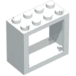

# Window Frame 2x4x3

<!-- media:start (generated by scripts/build_media.py) -->
{ width="64" loading="lazy" }
<!-- media:end -->

[Item database](./README.md) | [Methodology](./Methodology.md)

**LOT: 360** | Brick | Rarity code: 1

## Description

No client object description is present in this snapshot. No lore or effect has been invented.

| Field | Stored value |
| --- | --- |
| Display name | Window Frame 2x4x3 |
| Internal name | m4132 |
| Object row | Present |
| Equipment slot / stack size | Not recorded / 0 |
| Binding / uniqueness | Bind on pickup: False; bind on equip: False; unique: False |
| Requirements | Flag: 0; achievement: 0; precondition: ; specialty/rank: 0 / 0 |
| Base value (not a vendor quote) | 10 |
| Currencies | Costs: not recorded; alternate LOT/cost:  / ; commendation LOT/cost:  /  |

## Drops, packages, activities, and vendors

| Definition | Source kind | Named sources | Probability / stock |
| --- | --- | --- | --- |
| [Matrix 369](sources/matrix-369.md) | Vendor | [Darby Snapwish - Brick Vendor (LOT 9706)](sources/object-9706.md) | Not a rolled drop source Default vendor stock: 100% per refresh |
| [Matrix 414](sources/matrix-414.md) | Package | [Mega Brick Booster Pack (LOT 10165)](sources/object-10165.md) | Loot: 0.51020408%; mean 0.0051020408 |
| [Matrix 585](sources/matrix-585.md) | Activity | [AG - Wishing Well Vending Machine (LOT 11281)](sources/object-11281.md) | Loot: 1.01694181%; mean 0.010204082 |
| [Matrix 586](sources/matrix-586.md) | Activity | [AG - Wishing Well Vending Machine (LOT 11281)](sources/object-11281.md) | Loot: 1.01694181%; mean 0.010204082 |
| [Matrix 587](sources/matrix-587.md) | Activity | [AG - Wishing Well Vending Machine (LOT 11281)](sources/object-11281.md) | Loot: 1.52195742%; mean 0.015306122 |
| [Matrix 588](sources/matrix-588.md) | Activity | [AG - Wishing Well Vending Machine (LOT 11281)](sources/object-11281.md) | Loot: 2.02439641%; mean 0.020408163 |
| [Matrix 589](sources/matrix-589.md) | Activity | [AG - Wishing Well Vending Machine (LOT 11281)](sources/object-11281.md) | Loot: 3.75999854%; mean 0.038265306 |

Rates above mean **at least one item per matrix invocation before player filters**, followed by expected item count. They are not a universal chance per kill. Vendor stock is a separate calculation, not a drop rate. Mission-only drops, team ownership, scripts, availability, and vendor scene overrides can change actual receipt. Follow the source links for mapped locations and coordinates.

## Mission, achievement, mail, and code rewards

No reward association was found in the covered mission, mail, or code tables.

## Community acquisition references

No conservative name-matched acquisition fact was found in the 17 researched community pages. This does not establish that the wider wiki has no article or information.

## Evidence

[Objects](../../db/Objects.md), [ComponentsRegistry](../../db/ComponentsRegistry.md), [ItemComponent](../../db/ItemComponent.md), [LootMatrix](../../db/LootMatrix.md), [LootTable](../../db/LootTable.md), [RarityTable](../../db/RarityTable.md). [Coverage and limitations](./Methodology.md).
