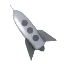

# re&#95;nim&#95;ag&#95;rocket-steam-steam-steam

<!-- media:start (generated by scripts/build_media.py) -->
{ width="64" loading="lazy" }
<!-- media:end -->

[Item database](./README.md) | [Methodology](./Methodology.md)

**LOT: 4697** | Vehicle | Rarity code: not recorded

## Description

Choice Build result

The text above is the raw client object description; it may be internal text rather than a localized player tooltip.

| Field | Stored value |
| --- | --- |
| Display name | Not recorded |
| Internal name | re&#95;nim&#95;ag&#95;rocket-steam-steam-steam |
| Object row | Present |
| Equipment slot / stack size | special&#95;r / 0 |
| Binding / uniqueness | Bind on pickup: False; bind on equip: False; unique: True |
| Requirements | Flag: 0; achievement: 0; precondition: ; specialty/rank: 0 / 0 |
| Base value (not a vendor quote) | Not recorded |
| Currencies | Costs: not recorded; alternate LOT/cost:  / ; commendation LOT/cost:  /  |

## Drops, packages, activities, and vendors

No qualifying static loot-matrix or vendor association was resolved.

Rates above mean **at least one item per matrix invocation before player filters**, followed by expected item count. They are not a universal chance per kill. Vendor stock is a separate calculation, not a drop rate. Mission-only drops, team ownership, scripts, availability, and vendor scene overrides can change actual receipt. Follow the source links for mapped locations and coordinates.

## Mission, achievement, mail, and code rewards

No reward association was found in the covered mission, mail, or code tables.

## Community acquisition references

No conservative name-matched acquisition fact was found in the 17 researched community pages. This does not establish that the wider wiki has no article or information.

## Evidence

[Objects](../../db/Objects.md), [ComponentsRegistry](../../db/ComponentsRegistry.md), [ItemComponent](../../db/ItemComponent.md). [Coverage and limitations](./Methodology.md).
