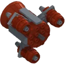

# Steampunk Rocket Engine

<!-- media:start (generated by scripts/build_media.py) -->
{ width="64" loading="lazy" }
<!-- media:end -->

[Item database](./README.md) | [Methodology](./Methodology.md)

**LOT: 4718** | Loot model | Rarity code: 1

## Description

Modular Build rocket engine

Player tooltip: official English client text (`locale.xml`, `en_US`).

| Field | Stored value |
| --- | --- |
| Display name | Steampunk Rocket Engine |
| Internal name | MOD Rocket Steampunk Engine |
| Object row | Present |
| Equipment slot / stack size | Extra&#95;1 / 10 |
| Binding / uniqueness | Bind on pickup: True; bind on equip: False; unique: False |
| Requirements | Flag: 0; achievement: 0; precondition: 62&#124;26; specialty/rank: 0 / 0 |
| Base value (not a vendor quote) | 500 |
| Currencies | Costs: not recorded; alternate LOT/cost:  / ; commendation LOT/cost:  /  |

## Drops, packages, activities, and vendors

| Definition | Source kind | Named sources | Probability / stock |
| --- | --- | --- | --- |
| [Matrix 185](sources/matrix-185.md) | Unresolved matrix | No named static consumer identified; not a verified acquisition route | Loot: 33.33333333%; mean 0.33333333 |
| [Matrix 230](sources/matrix-230.md) | Drop | [Stromling Mech (LOT 6253)](sources/object-6253.md) [Unnamed LOT 16142 (LOT 16142)](sources/object-16142.md) | Loot: 0.83333333%; mean 0.0083333333 |
| [Matrix 405](sources/matrix-405.md) | Vendor | [Brutus Speck - Model Vendor (LOT 10026)](sources/object-10026.md) | Not a rolled drop source Default vendor stock: 100% per refresh |

Rates above mean **at least one item per matrix invocation before player filters**, followed by expected item count. They are not a universal chance per kill. Vendor stock is a separate calculation, not a drop rate. Mission-only drops, team ownership, scripts, availability, and vendor scene overrides can change actual receipt. Follow the source links for mapped locations and coordinates.

## Mission, achievement, mail, and code rewards

No reward association was found in the covered mission, mail, or code tables.

## Community acquisition references

No conservative name-matched acquisition fact was found in the 17 researched community pages. This does not establish that the wider wiki has no article or information.

## Evidence

[Objects](../../db/Objects.md), [ComponentsRegistry](../../db/ComponentsRegistry.md), [ItemComponent](../../db/ItemComponent.md), [LootMatrix](../../db/LootMatrix.md), [LootTable](../../db/LootTable.md), [RarityTable](../../db/RarityTable.md). [Coverage and limitations](./Methodology.md).
