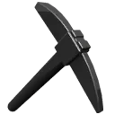

# Great Mattock

<!-- media:start (generated by scripts/build_media.py) -->
{ .lu-icon .lu-on-light width="128" loading="lazy" }
<!-- media:end -->

[Item database](./README.md) | [Methodology](./Methodology.md)

**LOT: 5696** | Right hand | Rarity code: 1

## Description

No client object description is present in this snapshot. No lore or effect has been invented.

| Field | Stored value |
| --- | --- |
| Display name | Great Mattock |
| Internal name | Great Mattock |
| Object row | Present |
| Equipment slot / stack size | special&#95;r / 1 |
| Binding / uniqueness | Bind on pickup: True; bind on equip: False; unique: False |
| Requirements | Flag: 0; achievement: 0; precondition: 214; specialty/rank: 0 / 0 |
| Base value (not a vendor quote) | 5000 |
| Currencies | Costs: not recorded; alternate LOT/cost:  / ; commendation LOT/cost: 13763 / 28 |

## Drops, packages, activities, and vendors

| Definition | Source kind | Named sources | Probability / stock |
| --- | --- | --- | --- |
| [Matrix 314](sources/matrix-314.md) | Activity | [FV Entrance Instance Dragon Statue (LOT 11165)](sources/object-11165.md) [FV - Dragon Treasure Chest (LOT 11229)](sources/object-11229.md) [FV Dragon Zone Control Object (LOT 11243)](sources/object-11243.md) [all 5 source LOTs](sources/matrix-314.md) | Loot: 3.125%; mean 0.03125 |
| [Matrix 347](sources/matrix-347.md) | Drop | [Maelstrom Horseman (LOT 7816)](sources/object-7816.md) | Loot: 0.0875%; mean 0.000875 |
| [Matrix 348](sources/matrix-348.md) | Drop | [FV - Grumpy Stromling (LOT 3031)](sources/object-3031.md) [FV - Freak Stromling (LOT 3033)](sources/object-3033.md) [FV - Hyper Stromling (LOT 3035)](sources/object-3035.md) [all 5 source LOTs](sources/matrix-348.md) | Loot: 0.04375%; mean 0.0004375 |
| [Matrix 393](sources/matrix-393.md) | Activity | [FV - Wishing Well Fountain (LOT 9930)](sources/object-9930.md) | Loot: 0.125%; mean 0.00125 |
| [Matrix 394](sources/matrix-394.md) | Activity | [FV - Wishing Well Fountain (LOT 9930)](sources/object-9930.md) | Loot: 0.625%; mean 0.00625 |
| [Matrix 395](sources/matrix-395.md) | Activity | [FV - Wishing Well Fountain (LOT 9930)](sources/object-9930.md) | Loot: 1.25%; mean 0.0125 |
| [Matrix 396](sources/matrix-396.md) | Activity | [FV - Wishing Well Fountain (LOT 9930)](sources/object-9930.md) | Loot: 2.5%; mean 0.025 |
| [Matrix 397](sources/matrix-397.md) | Activity | [FV - Wishing Well Fountain (LOT 9930)](sources/object-9930.md) | Loot: 5%; mean 0.05 |
| [Matrix 398](sources/matrix-398.md) | Activity | [FV - Wishing Well Fountain (LOT 9930)](sources/object-9930.md) | Loot: 9.625%; mean 0.09625 |
| [Matrix 399](sources/matrix-399.md) | Activity | [FV - Wishing Well Fountain (LOT 9930)](sources/object-9930.md) | Loot: 12.5%; mean 0.125 |
| [Matrix 483](sources/matrix-483.md) | Activity | [FV Entrance Instance Dragon Statue (LOT 11165)](sources/object-11165.md) [FV - Dragon Treasure Chest (LOT 11229)](sources/object-11229.md) [FV Dragon Zone Control Object (LOT 11243)](sources/object-11243.md) [all 4 source LOTs](sources/matrix-483.md) | Loot: 6.25%; mean 0.0625 |
| [Matrix 484](sources/matrix-484.md) | Activity | [FV Entrance Instance Dragon Statue (LOT 11165)](sources/object-11165.md) [FV - Dragon Treasure Chest (LOT 11229)](sources/object-11229.md) [FV Dragon Zone Control Object (LOT 11243)](sources/object-11243.md) [all 4 source LOTs](sources/matrix-484.md) | Loot: 12.5%; mean 0.125 |
| [Matrix 485](sources/matrix-485.md) | Activity | [FV Entrance Instance Dragon Statue (LOT 11165)](sources/object-11165.md) [FV - Dragon Treasure Chest (LOT 11229)](sources/object-11229.md) [FV Dragon Zone Control Object (LOT 11243)](sources/object-11243.md) [all 4 source LOTs](sources/matrix-485.md) | Loot: 12.5%; mean 0.125 |
| [Matrix 621](sources/matrix-621.md) | Drop | [Whack Bliddo - Dark Spiderling Invader (LOT 12609)](sources/object-12609.md) | Loot: 12.5%; mean 0.125 |
| [Matrix 622](sources/matrix-622.md) | Unresolved matrix | No named static consumer identified; not a verified acquisition route | Loot: 28.22265625%; mean 0.3125 |
| [Matrix 666](sources/matrix-666.md) | Package | [Superior Surprise Pack (LOT 13103)](sources/object-13103.md) | Loot: 14.375%; mean 0.15 |
| [Matrix 873](sources/matrix-873.md) | Drop | [NAMED Dark Ronin (LOT 16474)](sources/object-16474.md) | Loot: 0.4375%; mean 0.004375 |
| [Matrix 874](sources/matrix-874.md) | Drop | [NAMED Maelstrom Horseman (LOT 16475)](sources/object-16475.md) | Loot: 0.875%; mean 0.00875 |

Rates above mean **at least one item per matrix invocation before player filters**, followed by expected item count. They are not a universal chance per kill. Vendor stock is a separate calculation, not a drop rate. Mission-only drops, team ownership, scripts, availability, and vendor scene overrides can change actual receipt. Follow the source links for mapped locations and coordinates.

## Mission, achievement, mail, and code rewards

| Reward | Classification | Conditions | Associated NPCs / mapped locations |
| --- | --- | --- | --- |
| Achievement 1242: Murgle Blotch Timesmash 2 | Battle / Nimbus Instance | First completion; listed completion reward; quantity 1; gate nimbusinstance | No associated NPC placement resolved |

## Community acquisition references

**Historical community evidence, matched by a unique local item name—not a verified LOT or current-server availability match.**

- [Weapons](https://legouniverse.fandom.com/wiki/Weapons?oldid=163946): reported methods: drop, achievement; named acquisition references: Murgle Blotch Timesmash 2, Forbidden Valley. Matched name: Great Mattock.

## Evidence

[Objects](../../db/Objects.md), [ComponentsRegistry](../../db/ComponentsRegistry.md), [ItemComponent](../../db/ItemComponent.md), [LootMatrix](../../db/LootMatrix.md), [LootTable](../../db/LootTable.md), [RarityTable](../../db/RarityTable.md), [Missions](../../db/Missions.md), [MissionNPCComponent](../../db/MissionNPCComponent.md), [MissionEmail](../../db/MissionEmail.md), [RewardCodes](../../db/RewardCodes.md). [Coverage and limitations](./Methodology.md).
