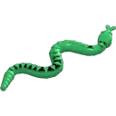

# Snake Model

<!-- media:start (generated by scripts/build_media.py) -->
{ .lu-icon .lu-on-dark width="128" loading="lazy" }
<!-- media:end -->

[Item database](./README.md) | [Methodology](./Methodology.md)

**LOT: 6870** | Loot model | Rarity code: 1

## Description

Place this animated creature model on your Property!

Player tooltip: official English client text (`locale.xml`, `en_US`).

| Field | Stored value |
| --- | --- |
| Display name | Snake Model |
| Internal name | Model Reward Ambient Snake |
| Object row | Present |
| Equipment slot / stack size | Extra&#95;1 / 10 |
| Binding / uniqueness | Bind on pickup: True; bind on equip: False; unique: False |
| Requirements | Flag: 0; achievement: 0; precondition: 62&#124;26; specialty/rank: 0 / 0 |
| Base value (not a vendor quote) | 20 |
| Currencies | Costs: not recorded; alternate LOT/cost:  / ; commendation LOT/cost: 13763 / 10 |

## Drops, packages, activities, and vendors

| Definition | Source kind | Named sources | Probability / stock |
| --- | --- | --- | --- |
| [Matrix 216](sources/matrix-216.md) | Drop | [VO - Generated Grumpy Stromling (LOT 1876)](sources/object-1876.md) [Unnamed LOT 1976 (LOT 1976)](sources/object-1976.md) [Unnamed LOT 1977 (LOT 1977)](sources/object-1977.md) [all 15 source LOTs](sources/matrix-216.md) | Loot: 0.00240385%; mean 0.000024038462 |
| [Matrix 217](sources/matrix-217.md) | Drop | [Test Ian H (LOT 6003)](sources/object-6003.md) [rafOrangeEnemy2 (LOT 6369)](sources/object-6369.md) [Stromling Admiral (LOT 6789)](sources/object-6789.md) [all 4 source LOTs](sources/matrix-217.md) | Loot: 0.00480769%; mean 0.000048076923 |
| [Matrix 218](sources/matrix-218.md) | Drop | [Stromling Ape (LOT 6806)](sources/object-6806.md) [Stromling Ape (LOT 10041)](sources/object-10041.md) [Chicka (LOT 11147)](sources/object-11147.md) [all 4 source LOTs](sources/matrix-218.md) | Loot: 0.09615385%; mean 0.00096153846 |
| [Matrix 227](sources/matrix-227.md) | Drop | [VO - Obelisk (LOT 1638)](sources/object-1638.md) [GF - LEGO Fence (LOT 1766)](sources/object-1766.md) [GF - Mushroom 2 (LOT 1806)](sources/object-1806.md) [all 61 source LOTs](sources/matrix-227.md) | Loot: 0.01923077%; mean 0.00019230769 |
| [Matrix 350](sources/matrix-350.md) | Unresolved matrix | No named static consumer identified; not a verified acquisition route | Loot: 0.01923077%; mean 0.00019230769 |
| [Matrix 566](sources/matrix-566.md) | Activity | [GF - Wishing Well Dingy (LOT 11279)](sources/object-11279.md) | Loot: 0.09615385%; mean 0.00096153846 |
| [Matrix 567](sources/matrix-567.md) | Activity | [GF - Wishing Well Dingy (LOT 11279)](sources/object-11279.md) | Loot: 0.19230769%; mean 0.0019230769 |
| [Matrix 568](sources/matrix-568.md) | Activity | [GF - Wishing Well Dingy (LOT 11279)](sources/object-11279.md) | Loot: 0.28846154%; mean 0.0028846154 |
| [Matrix 569](sources/matrix-569.md) | Activity | [GF - Wishing Well Dingy (LOT 11279)](sources/object-11279.md) | Loot: 0.48076923%; mean 0.0048076923 |
| [Matrix 570](sources/matrix-570.md) | Activity | [GF - Wishing Well Dingy (LOT 11279)](sources/object-11279.md) | Loot: 0.96153846%; mean 0.0096153846 |
| [Matrix 571](sources/matrix-571.md) | Activity | [GF - Wishing Well Dingy (LOT 11279)](sources/object-11279.md) | Loot: 1.53846154%; mean 0.015384615 |
| [Matrix 572](sources/matrix-572.md) | Activity | [GF - Wishing Well Dingy (LOT 11279)](sources/object-11279.md) | Loot: 1.92307692%; mean 0.019230769 |
| [Matrix 573](sources/matrix-573.md) | Activity | [GF - Wishing Well Dingy (LOT 11279)](sources/object-11279.md) | Loot: 2.86612426%; mean 0.028846154 |
| [Matrix 620](sources/matrix-620.md) | Drop | [Kinga Hurl - Stromling Ape (LOT 12591)](sources/object-12591.md) | Loot: 4.73408341%; mean 0.048076923 |
| [Matrix 665](sources/matrix-665.md) | Package | [Quality Surprise Pack (LOT 13102)](sources/object-13102.md) | Loot: 2.3670417%; mean 0.024038462 |
| [Matrix 870](sources/matrix-870.md) | Drop | [NAMED Stromling Pirate (LOT 16470)](sources/object-16470.md) | Loot: 0.19230769%; mean 0.0019230769 |
| [Matrix 871](sources/matrix-871.md) | Drop | [NAMED Stromling Admiral (LOT 16471)](sources/object-16471.md) | Loot: 0.28846154%; mean 0.0028846154 |
| [Matrix 872](sources/matrix-872.md) | Drop | [NAMED Stromling Ape (LOT 16473)](sources/object-16473.md) | Loot: 0.76923077%; mean 0.0076923077 |

Rates above mean **at least one item per matrix invocation before player filters**, followed by expected item count. They are not a universal chance per kill. Vendor stock is a separate calculation, not a drop rate. Mission-only drops, team ownership, scripts, availability, and vendor scene overrides can change actual receipt. Follow the source links for mapped locations and coordinates.

## Mission, achievement, mail, and code rewards

| Reward | Classification | Conditions | Associated NPCs / mapped locations |
| --- | --- | --- | --- |
| Mission 944: Nate is Missing! | Location / Nimbus Station | First completion; listed completion reward; quantity 1 | [Peppy Slapbiscuit (LOT 3002)](sources/object-3002.md) [Nimbus Station (1200)](locations/zone-1200.md) |

## Community acquisition references

No conservative name-matched acquisition fact was found in the 17 researched community pages. This does not establish that the wider wiki has no article or information.

## Evidence

[Objects](../../db/Objects.md), [ComponentsRegistry](../../db/ComponentsRegistry.md), [ItemComponent](../../db/ItemComponent.md), [LootMatrix](../../db/LootMatrix.md), [LootTable](../../db/LootTable.md), [RarityTable](../../db/RarityTable.md), [Missions](../../db/Missions.md), [MissionNPCComponent](../../db/MissionNPCComponent.md), [MissionEmail](../../db/MissionEmail.md), [RewardCodes](../../db/RewardCodes.md). [Coverage and limitations](./Methodology.md).
