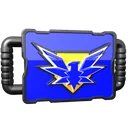

# Rank 1 Samurai Kit Package

<!-- media:start (generated by scripts/build_media.py) -->
{ width="64" loading="lazy" }
<!-- media:end -->

[Item database](./README.md) | [Methodology](./Methodology.md)

**LOT: 8028** | Package | Rarity code: 4

## Description

Double-click to get the Rank 1 Samurai Specialty Gear!

Player tooltip: official English client text (`locale.xml`, `en_US`).

| Field | Stored value |
| --- | --- |
| Display name | Rank 1 Samurai Kit Package |
| Internal name | Rank 1 Samurai Kit Package |
| Object row | Present |
| Equipment slot / stack size | Not recorded / 1 |
| Binding / uniqueness | Bind on pickup: True; bind on equip: False; unique: True |
| Requirements | Flag: 0; achievement: 0; precondition: 211;39; specialty/rank: 0 / 0 |
| Base value (not a vendor quote) | 0 |
| Currencies | Costs: not recorded; alternate LOT/cost:  / ; commendation LOT/cost:  /  |

## Drops, packages, activities, and vendors

No qualifying static loot-matrix or vendor association was resolved.

Rates above mean **at least one item per matrix invocation before player filters**, followed by expected item count. They are not a universal chance per kill. Vendor stock is a separate calculation, not a drop rate. Mission-only drops, team ownership, scripts, availability, and vendor scene overrides can change actual receipt. Follow the source links for mapped locations and coordinates.

## Mission, achievement, mail, and code rewards

| Reward | Classification | Conditions | Associated NPCs / mapped locations |
| --- | --- | --- | --- |
| Mission 591: Get your Sentinel Faction Gear! | Location / Nimbus Station | First completion; reward choice; quantity 1 | [Xeno Blueblade - Sentinel Vendor (LOT 6631)](sources/object-6631.md) [Nimbus Station (1200)](locations/zone-1200.md) [Nexus Jay - Nexus Force Recruiter (LOT 7098)](sources/object-7098.md) [Nimbus Station (1200)](locations/zone-1200.md) |

## Community acquisition references

No conservative name-matched acquisition fact was found in the 17 researched community pages. This does not establish that the wider wiki has no article or information.

## Evidence

[Objects](../../db/Objects.md), [ComponentsRegistry](../../db/ComponentsRegistry.md), [ItemComponent](../../db/ItemComponent.md), [Missions](../../db/Missions.md), [MissionNPCComponent](../../db/MissionNPCComponent.md), [MissionEmail](../../db/MissionEmail.md), [RewardCodes](../../db/RewardCodes.md). [Coverage and limitations](./Methodology.md).
