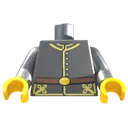

# Confederate Shirt

<!-- media:start (generated by scripts/build_media.py) -->
{ .lu-icon .lu-on-dark width="128" loading="lazy" }
<!-- media:end -->

[Item database](./README.md) | [Methodology](./Methodology.md)

**LOT: 8631** | Chest | Rarity code: 3

## Description

No client object description is present in this snapshot. No lore or effect has been invented.

| Field | Stored value |
| --- | --- |
| Display name | Confederate Shirt |
| Internal name | Grey Cavalry Shirt |
| Object row | Present |
| Equipment slot / stack size | chest / 1 |
| Binding / uniqueness | Bind on pickup: False; bind on equip: True; unique: False |
| Requirements | Flag: 0; achievement: 0; precondition: 214; specialty/rank: 0 / 0 |
| Base value (not a vendor quote) | 4750 |
| Currencies | Costs: not recorded; alternate LOT/cost:  / ; commendation LOT/cost:  /  |

## Drops, packages, activities, and vendors

| Definition | Source kind | Named sources | Probability / stock |
| --- | --- | --- | --- |
| [Matrix 216](sources/matrix-216.md) | Drop | [VO - Generated Grumpy Stromling (LOT 1876)](sources/object-1876.md) [Unnamed LOT 1976 (LOT 1976)](sources/object-1976.md) [Unnamed LOT 1977 (LOT 1977)](sources/object-1977.md) [all 15 source LOTs](sources/matrix-216.md) | Loot: 0.00153846%; mean 0.000015384615 |
| [Matrix 217](sources/matrix-217.md) | Drop | [Test Ian H (LOT 6003)](sources/object-6003.md) [rafOrangeEnemy2 (LOT 6369)](sources/object-6369.md) [Stromling Admiral (LOT 6789)](sources/object-6789.md) [all 4 source LOTs](sources/matrix-217.md) | Loot: 0.00307692%; mean 0.000030769231 |
| [Matrix 218](sources/matrix-218.md) | Drop | [Stromling Ape (LOT 6806)](sources/object-6806.md) [Stromling Ape (LOT 10041)](sources/object-10041.md) [Chicka (LOT 11147)](sources/object-11147.md) [all 4 source LOTs](sources/matrix-218.md) | Loot: 0.01230769%; mean 0.00012307692 |
| [Matrix 620](sources/matrix-620.md) | Drop | [Kinga Hurl - Stromling Ape (LOT 12591)](sources/object-12591.md) | Loot: 0.61538462%; mean 0.0061538462 |
| [Matrix 665](sources/matrix-665.md) | Package | [Quality Surprise Pack (LOT 13102)](sources/object-13102.md) | Loot: 0.76544961%; mean 0.0076923077 |
| [Matrix 870](sources/matrix-870.md) | Drop | [NAMED Stromling Pirate (LOT 16470)](sources/object-16470.md) | Loot: 0.02461538%; mean 0.00024615385 |
| [Matrix 871](sources/matrix-871.md) | Drop | [NAMED Stromling Admiral (LOT 16471)](sources/object-16471.md) | Loot: 0.03692308%; mean 0.00036923077 |
| [Matrix 872](sources/matrix-872.md) | Drop | [NAMED Stromling Ape (LOT 16473)](sources/object-16473.md) | Loot: 0.06153846%; mean 0.00061538462 |

Rates above mean **at least one item per matrix invocation before player filters**, followed by expected item count. They are not a universal chance per kill. Vendor stock is a separate calculation, not a drop rate. Mission-only drops, team ownership, scripts, availability, and vendor scene overrides can change actual receipt. Follow the source links for mapped locations and coordinates.

## Mission, achievement, mail, and code rewards

No reward association was found in the covered mission, mail, or code tables.

## Community acquisition references

**Historical community evidence, matched by a unique local item name—not a verified LOT or current-server availability match.**

- [Shirts](https://legouniverse.fandom.com/wiki/Shirts?oldid=163412): reported methods: drop; named acquisition references: Gnarled Forest. Matched name: Confederate Shirt.

## Evidence

[Objects](../../db/Objects.md), [ComponentsRegistry](../../db/ComponentsRegistry.md), [ItemComponent](../../db/ItemComponent.md), [LootMatrix](../../db/LootMatrix.md), [LootTable](../../db/LootTable.md), [RarityTable](../../db/RarityTable.md). [Coverage and limitations](./Methodology.md).
