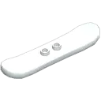

# Snowboard

<!-- media:start (generated by scripts/build_media.py) -->
{ width="64" loading="lazy" }
<!-- media:end -->

[Item database](./README.md) | [Methodology](./Methodology.md)

**LOT: 9028** | Brick | Rarity code: 1

## Description

No client object description is present in this snapshot. No lore or effect has been invented.

| Field | Stored value |
| --- | --- |
| Display name | Snowboard |
| Internal name | m46203 |
| Object row | Present |
| Equipment slot / stack size | Not recorded / 0 |
| Binding / uniqueness | Bind on pickup: False; bind on equip: False; unique: False |
| Requirements | Flag: 0; achievement: 0; precondition: ; specialty/rank: 0 / 0 |
| Base value (not a vendor quote) | 10 |
| Currencies | Costs: not recorded; alternate LOT/cost:  / ; commendation LOT/cost:  /  |

## Drops, packages, activities, and vendors

| Definition | Source kind | Named sources | Probability / stock |
| --- | --- | --- | --- |
| [Matrix 139](sources/matrix-139.md) | Drop | [GF - Hanging Shark (LOT 2186)](sources/object-2186.md) | Loot: 0.03250261%; mean 0.0003257329 |
| [Matrix 216](sources/matrix-216.md) | Drop | [VO - Generated Grumpy Stromling (LOT 1876)](sources/object-1876.md) [Unnamed LOT 1976 (LOT 1976)](sources/object-1976.md) [Unnamed LOT 1977 (LOT 1977)](sources/object-1977.md) [all 15 source LOTs](sources/matrix-216.md) | Loot: 0.00651466%; mean 0.00006514658 |
| [Matrix 217](sources/matrix-217.md) | Drop | [Test Ian H (LOT 6003)](sources/object-6003.md) [rafOrangeEnemy2 (LOT 6369)](sources/object-6369.md) [Stromling Admiral (LOT 6789)](sources/object-6789.md) [all 4 source LOTs](sources/matrix-217.md) | Loot: 0.00977199%; mean 0.00009771987 |
| [Matrix 218](sources/matrix-218.md) | Drop | [Stromling Ape (LOT 6806)](sources/object-6806.md) [Stromling Ape (LOT 10041)](sources/object-10041.md) [Chicka (LOT 11147)](sources/object-11147.md) [all 4 source LOTs](sources/matrix-218.md) | Loot: 0.04370429%; mean 0.00043973941 |
| [Matrix 227](sources/matrix-227.md) | Drop | [VO - Obelisk (LOT 1638)](sources/object-1638.md) [GF - LEGO Fence (LOT 1766)](sources/object-1766.md) [GF - Mushroom 2 (LOT 1806)](sources/object-1806.md) [all 61 source LOTs](sources/matrix-227.md) | Loot: 0.00325733%; mean 0.00003257329 |
| [Matrix 350](sources/matrix-350.md) | Unresolved matrix | No named static consumer identified; not a verified acquisition route | Loot: 0.00325733%; mean 0.00003257329 |
| [Matrix 370](sources/matrix-370.md) | Vendor | [Billy Picaroon - Brick Vendor (LOT 2264)](sources/object-2264.md) | Not a rolled drop source Default vendor stock: 100% per refresh |
| [Matrix 395](sources/matrix-395.md) | Activity | [FV - Wishing Well Fountain (LOT 9930)](sources/object-9930.md) | Loot: 0.65005226%; mean 0.006514658 |
| [Matrix 396](sources/matrix-396.md) | Activity | [FV - Wishing Well Fountain (LOT 9930)](sources/object-9930.md) | Loot: 0.65005226%; mean 0.006514658 |
| [Matrix 414](sources/matrix-414.md) | Package | [Mega Brick Booster Pack (LOT 10165)](sources/object-10165.md) | Loot: 0.3257329%; mean 0.003257329 |
| [Matrix 566](sources/matrix-566.md) | Activity | [GF - Wishing Well Dingy (LOT 11279)](sources/object-11279.md) | Loot: 0.81221194%; mean 0.0081433225 |
| [Matrix 567](sources/matrix-567.md) | Activity | [GF - Wishing Well Dingy (LOT 11279)](sources/object-11279.md) | Loot: 0.48806884%; mean 0.0048859935 |
| [Matrix 568](sources/matrix-568.md) | Activity | [GF - Wishing Well Dingy (LOT 11279)](sources/object-11279.md) | Loot: 0.97296497%; mean 0.009771987 |
| [Matrix 569](sources/matrix-569.md) | Activity | [GF - Wishing Well Dingy (LOT 11279)](sources/object-11279.md) | Loot: 0.65005226%; mean 0.006514658 |
| [Matrix 570](sources/matrix-570.md) | Activity | [GF - Wishing Well Dingy (LOT 11279)](sources/object-11279.md) | Loot: 0.65005226%; mean 0.006514658 |
| [Matrix 571](sources/matrix-571.md) | Activity | [GF - Wishing Well Dingy (LOT 11279)](sources/object-11279.md) | Loot: 0.97366772%; mean 0.009771987 |
| [Matrix 572](sources/matrix-572.md) | Activity | [GF - Wishing Well Dingy (LOT 11279)](sources/object-11279.md) | Loot: 1.29622907%; mean 0.013029316 |
| [Matrix 573](sources/matrix-573.md) | Activity | [GF - Wishing Well Dingy (LOT 11279)](sources/object-11279.md) | Loot: 2.41577342%; mean 0.024429967 |
| [Matrix 870](sources/matrix-870.md) | Drop | [NAMED Stromling Pirate (LOT 16470)](sources/object-16470.md) | Loot: 0.08740857%; mean 0.00087947883 |
| [Matrix 871](sources/matrix-871.md) | Drop | [NAMED Stromling Admiral (LOT 16471)](sources/object-16471.md) | Loot: 0.13111286%; mean 0.0013192182 |
| [Matrix 872](sources/matrix-872.md) | Drop | [NAMED Stromling Ape (LOT 16473)](sources/object-16473.md) | Loot: 0.21852143%; mean 0.0021986971 |

Rates above mean **at least one item per matrix invocation before player filters**, followed by expected item count. They are not a universal chance per kill. Vendor stock is a separate calculation, not a drop rate. Mission-only drops, team ownership, scripts, availability, and vendor scene overrides can change actual receipt. Follow the source links for mapped locations and coordinates.

## Mission, achievement, mail, and code rewards

No reward association was found in the covered mission, mail, or code tables.

## Community acquisition references

No conservative name-matched acquisition fact was found in the 17 researched community pages. This does not establish that the wider wiki has no article or information.

## Evidence

[Objects](../../db/Objects.md), [ComponentsRegistry](../../db/ComponentsRegistry.md), [ItemComponent](../../db/ItemComponent.md), [LootMatrix](../../db/LootMatrix.md), [LootTable](../../db/LootTable.md), [RarityTable](../../db/RarityTable.md). [Coverage and limitations](./Methodology.md).
