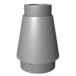

# Loot matrix 137

[Item database](../README.md) | [Methodology](../Methodology.md)

## Sources and mapped locations

| Kind | Source | Location evidence | Conditions |
| --- | --- | --- | --- |
| Vendor | [Test Systems Vendor (LOT 12159)](../sources/object-12159.md) | No default-stock placement found | Default inventory; vendorInvOverride can replace it |

## Item candidates

Default vendor-stock probabilities are shown only when this matrix has a registered vendor. Loot probabilities use the generic algorithm, not a guarantee of actual use by every script/activity.

| Item | Modeled loot chance / expected count | Default vendor stock |
| --- | --- | --- |
| { .lu-ti width="24" loading="lazy" } [Water Sprayer Module 1 (LOT 3290)](../3290.md) | 10%; mean 0.1 | 100% |
| { .lu-ti width="24" loading="lazy" } [Test Item with Precondition for Vendor (LOT 12219)](../12219.md) | 100%; mean 1 | 100% |

## Raw matrix entries

| Row | Loot table | Rarity table | Trigger | Min | Max | Flag | Gate |
| --- | --- | --- | --- | --- | --- | --- | --- |
| 322 | 79 | 4 | 1 | 1 | 1 |  |  |
| 1798 | 457 | 4 | 1 | 1 | 1 |  |  |

[LootMatrix](../../../db/LootMatrix.md), [LootTable](../../../db/LootTable.md), [RarityTable](../../../db/RarityTable.md).
