# Loot matrix 139

[Item database](../README.md) | [Methodology](../Methodology.md)

## Sources and mapped locations

| Kind | Source | Location evidence | Conditions |
| --- | --- | --- | --- |
| Drop | [GF - Hanging Shark (LOT 2186)](../sources/object-2186.md) | [Gnarled Forest Deep Dive Map (375)](../locations/zone-375.md); [Gnarled Forest (1300)](../locations/zone-1300.md) | DestructibleComponent 452; static component precedence; Static association, not a live-spawn guarantee |

## Item candidates

Default vendor-stock probabilities are shown only when this matrix has a registered vendor. Loot probabilities use the generic algorithm, not a guarantee of actual use by every script/activity.

| Item | Modeled loot chance / expected count | Default vendor stock |
| --- | --- | --- |
| { .lu-ti width="24" loading="lazy" } [Brick 2x4 (LOT 29)](../29.md) | 1.5%; mean 0.015 | Not associated with a vendor |
| { .lu-ti width="24" loading="lazy" } [Brick 2x3 (LOT 30)](../30.md) | 1.5%; mean 0.015 | Not associated with a vendor |
| { .lu-ti width="24" loading="lazy" } [Brick 2x2 (LOT 31)](../31.md) | 1.5%; mean 0.015 | Not associated with a vendor |
| { .lu-ti width="24" loading="lazy" } [Brick 1x2 (LOT 32)](../32.md) | 1.5%; mean 0.015 | Not associated with a vendor |
| { .lu-ti width="24" loading="lazy" } [Brick 1x1 (LOT 33)](../33.md) | 1.5%; mean 0.015 | Not associated with a vendor |
| { .lu-ti width="24" loading="lazy" } [Brick 2x8 (LOT 35)](../35.md) | 1.5%; mean 0.015 | Not associated with a vendor |
| { .lu-ti width="24" loading="lazy" } [Brick 1x8 (LOT 36)](../36.md) | 1.5%; mean 0.015 | Not associated with a vendor |
| { .lu-ti width="24" loading="lazy" } [Brick 1x6 (LOT 37)](../37.md) | 1.5%; mean 0.015 | Not associated with a vendor |
| { .lu-ti width="24" loading="lazy" } [Brick 1x4 (LOT 38)](../38.md) | 1.5%; mean 0.015 | Not associated with a vendor |
| { .lu-ti width="24" loading="lazy" } [Plate 2x4 (LOT 39)](../39.md) | 1.5%; mean 0.015 | Not associated with a vendor |
| { .lu-ti width="24" loading="lazy" } [Plate 2x3 (LOT 40)](../40.md) | 1.5%; mean 0.015 | Not associated with a vendor |
| { .lu-ti width="24" loading="lazy" } [Plate 1x2 (LOT 41)](../41.md) | 1.5%; mean 0.015 | Not associated with a vendor |
| { .lu-ti width="24" loading="lazy" } [Plate 1x1 (LOT 42)](../42.md) | 1.5%; mean 0.015 | Not associated with a vendor |
| { .lu-ti width="24" loading="lazy" } [Plate 1x8 (LOT 58)](../58.md) | 1.5%; mean 0.015 | Not associated with a vendor |
| { .lu-ti width="24" loading="lazy" } [Brick 1x3 (LOT 59)](../59.md) | 1.5%; mean 0.015 | Not associated with a vendor |
| { .lu-ti width="24" loading="lazy" } [Plate 1x3 (LOT 60)](../60.md) | 1.5%; mean 0.015 | Not associated with a vendor |
| { .lu-ti width="24" loading="lazy" } [Plate 1x6 (LOT 62)](../62.md) | 1.5%; mean 0.015 | Not associated with a vendor |
| { .lu-ti width="24" loading="lazy" } [Plate 1x4 (LOT 66)](../66.md) | 1.5%; mean 0.015 | Not associated with a vendor |
| { .lu-ti width="24" loading="lazy" } [Brick 2x6 (LOT 98)](../98.md) | 1.5%; mean 0.015 | Not associated with a vendor |
| { .lu-ti width="24" loading="lazy" } [Plate 2x6 (LOT 144)](../144.md) | 1.5%; mean 0.015 | Not associated with a vendor |
| 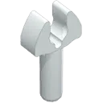{ .lu-ti width="24" loading="lazy" } [Bar 1.5 with Clip (LOT 724)](../724.md) | 0.03250261%; mean 0.0003257329 | Not associated with a vendor |
| { .lu-ti width="24" loading="lazy" } [Plate 2x2 (LOT 865)](../865.md) | 1.5%; mean 0.015 | Not associated with a vendor |
| { .lu-ti width="24" loading="lazy" } [Plate 2x8 (LOT 869)](../869.md) | 1.5%; mean 0.015 | Not associated with a vendor |
| { .lu-ti width="24" loading="lazy" } [Minifigure Head (LOT 1209)](../1209.md) | 0.03250261%; mean 0.0003257329 | Not associated with a vendor |
| { .lu-ti width="24" loading="lazy" } [Bracket 1x1 with Pin Hole - 1x1 with Stud (LOT 1210)](../1210.md) | 0.03250261%; mean 0.0003257329 | Not associated with a vendor |
| { .lu-ti width="24" loading="lazy" } [Tool Holder (LOT 1212)](../1212.md) | 0.03250261%; mean 0.0003257329 | Not associated with a vendor |
| { .lu-ti width="24" loading="lazy" } [Hand Ladle (LOT 1214)](../1214.md) | 0.03250261%; mean 0.0003257329 | Not associated with a vendor |
| { .lu-ti width="24" loading="lazy" } [Megaphone (LOT 1217)](../1217.md) | 0.03250261%; mean 0.0003257329 | Not associated with a vendor |
| 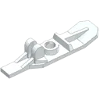{ .lu-ti width="24" loading="lazy" } [Skid 1x4 with Stud and Clip (LOT 1219)](../1219.md) | 0.03250261%; mean 0.0003257329 | Not associated with a vendor |
| { .lu-ti width="24" loading="lazy" } [Telephone Receiver (LOT 1220)](../1220.md) | 0.03250261%; mean 0.0003257329 | Not associated with a vendor |
| { .lu-ti width="24" loading="lazy" } [Chalice (LOT 1222)](../1222.md) | 0.03250261%; mean 0.0003257329 | Not associated with a vendor |
| { .lu-ti width="24" loading="lazy" } [Binoculars, Round (LOT 1224)](../1224.md) | 0.03250261%; mean 0.0003257329 | Not associated with a vendor |
| { .lu-ti width="24" loading="lazy" } [Wheel for Skate Board (LOT 1225)](../1225.md) | 0.03250261%; mean 0.0003257329 | Not associated with a vendor |
| { .lu-ti width="24" loading="lazy" } [Whip with Loop (LOT 2135)](../2135.md) | 0.03250261%; mean 0.0003257329 | Not associated with a vendor |
| { .lu-ti width="24" loading="lazy" } [Cannonball (LOT 4859)](../4859.md) | 100%; mean 2 | Not associated with a vendor |
| { .lu-ti width="24" loading="lazy" } [Castle Maiden's Headdress (LOT 5032)](../5032.md) | 0.03250261%; mean 0.0003257329 | Not associated with a vendor |
| { .lu-ti width="24" loading="lazy" } [Crash Helmet Visor (LOT 5033)](../5033.md) | 0.03250261%; mean 0.0003257329 | Not associated with a vendor |
| { .lu-ti width="24" loading="lazy" } [Knapsack (LOT 5039)](../5039.md) | 0.03250261%; mean 0.0003257329 | Not associated with a vendor |
| { .lu-ti width="24" loading="lazy" } [Admiral's Hat (LOT 5040)](../5040.md) | 0.03250261%; mean 0.0003257329 | Not associated with a vendor |
| { .lu-ti width="24" loading="lazy" } [Sabre (LOT 5041)](../5041.md) | 0.03250261%; mean 0.0003257329 | Not associated with a vendor |
| { .lu-ti width="24" loading="lazy" } [Paddle (LOT 5046)](../5046.md) | 0.03250261%; mean 0.0003257329 | Not associated with a vendor |
| { .lu-ti width="24" loading="lazy" } [Head Scarf (LOT 5047)](../5047.md) | 0.03250261%; mean 0.0003257329 | Not associated with a vendor |
| { .lu-ti width="24" loading="lazy" } [Shako (LOT 5049)](../5049.md) | 0.03250261%; mean 0.0003257329 | Not associated with a vendor |
| { .lu-ti width="24" loading="lazy" } [Flintlock Rifle (LOT 5055)](../5055.md) | 0.03250261%; mean 0.0003257329 | Not associated with a vendor |
| { .lu-ti width="24" loading="lazy" } [Crossbow (LOT 5056)](../5056.md) | 0.03250261%; mean 0.0003257329 | Not associated with a vendor |
| { .lu-ti width="24" loading="lazy" } [Oval Battle Shield (LOT 5058)](../5058.md) | 0.03250261%; mean 0.0003257329 | Not associated with a vendor |
| { .lu-ti width="24" loading="lazy" } [Knight Armor with Skirt (LOT 5059)](../5059.md) | 0.03250261%; mean 0.0003257329 | Not associated with a vendor |
| { .lu-ti width="24" loading="lazy" } [Ghost Costume (LOT 5060)](../5060.md) | 0.03250261%; mean 0.0003257329 | Not associated with a vendor |
| { .lu-ti width="24" loading="lazy" } [Visor for Knight's Helmet (LOT 5061)](../5061.md) | 0.03250261%; mean 0.0003257329 | Not associated with a vendor |
| { .lu-ti width="24" loading="lazy" } [Life Vest (LOT 5062)](../5062.md) | 0.03250261%; mean 0.0003257329 | Not associated with a vendor |
| { .lu-ti width="24" loading="lazy" } [Fishing Rod (LOT 5063)](../5063.md) | 0.03250261%; mean 0.0003257329 | Not associated with a vendor |
| { .lu-ti width="24" loading="lazy" } [Peaked Cap (LOT 5079)](../5079.md) | 0.03250261%; mean 0.0003257329 | Not associated with a vendor |
| { .lu-ti width="24" loading="lazy" } [Construction Worker's Helmet (LOT 5089)](../5089.md) | 0.03250261%; mean 0.0003257329 | Not associated with a vendor |
| { .lu-ti width="24" loading="lazy" } [Firefighter's Helmet (LOT 5090)](../5090.md) | 0.03250261%; mean 0.0003257329 | Not associated with a vendor |
| { .lu-ti width="24" loading="lazy" } [Firefighter's Axe (LOT 5091)](../5091.md) | 0.03250261%; mean 0.0003257329 | Not associated with a vendor |
| { .lu-ti width="24" loading="lazy" } [Push Broom (LOT 5092)](../5092.md) | 0.03250261%; mean 0.0003257329 | Not associated with a vendor |
| { .lu-ti width="24" loading="lazy" } [Shovel (LOT 5093)](../5093.md) | 0.03250261%; mean 0.0003257329 | Not associated with a vendor |
| { .lu-ti width="24" loading="lazy" } [Oxygen Bottles (LOT 5094)](../5094.md) | 0.03250261%; mean 0.0003257329 | Not associated with a vendor |
| { .lu-ti width="24" loading="lazy" } [Vest (LOT 5095)](../5095.md) | 0.03250261%; mean 0.0003257329 | Not associated with a vendor |
| { .lu-ti width="24" loading="lazy" } [PickAxe (LOT 5096)](../5096.md) | 0.03250261%; mean 0.0003257329 | Not associated with a vendor |
| { .lu-ti width="24" loading="lazy" } [Great Helm with Neck Protection (LOT 5097)](../5097.md) | 0.03250261%; mean 0.0003257329 | Not associated with a vendor |
| { .lu-ti width="24" loading="lazy" } [Knight Shield Triangular (LOT 5098)](../5098.md) | 0.03250261%; mean 0.0003257329 | Not associated with a vendor |
| { .lu-ti width="24" loading="lazy" } [Shortsword (LOT 5099)](../5099.md) | 0.03250261%; mean 0.0003257329 | Not associated with a vendor |
| 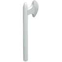{ .lu-ti width="24" loading="lazy" } [Battle Axe (LOT 5100)](../5100.md) | 0.03250261%; mean 0.0003257329 | Not associated with a vendor |
| { .lu-ti width="24" loading="lazy" } [Knight Jousting Lance (LOT 5101)](../5101.md) | 0.03250261%; mean 0.0003257329 | Not associated with a vendor |
| { .lu-ti width="24" loading="lazy" } [Hair Brush (LOT 5102)](../5102.md) | 0.03250261%; mean 0.0003257329 | Not associated with a vendor |
| { .lu-ti width="24" loading="lazy" } [Baker's Hat (LOT 5106)](../5106.md) | 0.03250261%; mean 0.0003257329 | Not associated with a vendor |
| { .lu-ti width="24" loading="lazy" } [Mug with Holder (LOT 5107)](../5107.md) | 0.03250261%; mean 0.0003257329 | Not associated with a vendor |
| { .lu-ti width="24" loading="lazy" } [Wig, Boy (LOT 5108)](../5108.md) | 0.03250261%; mean 0.0003257329 | Not associated with a vendor |
| { .lu-ti width="24" loading="lazy" } [Handheld Radio (LOT 5109)](../5109.md) | 0.03250261%; mean 0.0003257329 | Not associated with a vendor |
| { .lu-ti width="24" loading="lazy" } [Screwdriver/Wrench (LOT 5110)](../5110.md) | 0.03250261%; mean 0.0003257329 | Not associated with a vendor |
| { .lu-ti width="24" loading="lazy" } [Pipe Wrench (LOT 5116)](../5116.md) | 0.03250261%; mean 0.0003257329 | Not associated with a vendor |
| { .lu-ti width="24" loading="lazy" } [Broom (LOT 5117)](../5117.md) | 0.03250261%; mean 0.0003257329 | Not associated with a vendor |
| { .lu-ti width="24" loading="lazy" } [Ladle (LOT 5118)](../5118.md) | 0.03250261%; mean 0.0003257329 | Not associated with a vendor |
| { .lu-ti width="24" loading="lazy" } [Pot with Handles (LOT 5119)](../5119.md) | 0.03250261%; mean 0.0003257329 | Not associated with a vendor |
| { .lu-ti width="24" loading="lazy" } [Loaf of Bread (LOT 5120)](../5120.md) | 0.03250261%; mean 0.0003257329 | Not associated with a vendor |
| { .lu-ti width="24" loading="lazy" } [Space Gun (LOT 5123)](../5123.md) | 0.03250261%; mean 0.0003257329 | Not associated with a vendor |
| { .lu-ti width="24" loading="lazy" } [Pitcher (LOT 5124)](../5124.md) | 0.03250261%; mean 0.0003257329 | Not associated with a vendor |
| { .lu-ti width="24" loading="lazy" } [Butterfly Net (LOT 5125)](../5125.md) | 0.03250261%; mean 0.0003257329 | Not associated with a vendor |
| 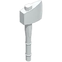{ .lu-ti width="24" loading="lazy" } [Large Axe (LOT 5126)](../5126.md) | 0.03250261%; mean 0.0003257329 | Not associated with a vendor |
| { .lu-ti width="24" loading="lazy" } [Suitcase (LOT 5128)](../5128.md) | 0.03250261%; mean 0.0003257329 | Not associated with a vendor |
| 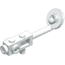{ .lu-ti width="24" loading="lazy" } [Metal Detector (LOT 5129)](../5129.md) | 0.03250261%; mean 0.0003257329 | Not associated with a vendor |
| 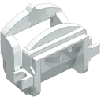{ .lu-ti width="24" loading="lazy" } [Horse Saddle (LOT 5130)](../5130.md) | 0.03250261%; mean 0.0003257329 | Not associated with a vendor |
| { .lu-ti width="24" loading="lazy" } [Spear (LOT 5133)](../5133.md) | 0.03250261%; mean 0.0003257329 | Not associated with a vendor |
| { .lu-ti width="24" loading="lazy" } [Quiver (LOT 5134)](../5134.md) | 0.03250261%; mean 0.0003257329 | Not associated with a vendor |
| { .lu-ti width="24" loading="lazy" } [Bow (LOT 5135)](../5135.md) | 0.03250261%; mean 0.0003257329 | Not associated with a vendor |
| { .lu-ti width="24" loading="lazy" } [Knight Tournament Helmet (LOT 5136)](../5136.md) | 0.03250261%; mean 0.0003257329 | Not associated with a vendor |
| 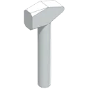{ .lu-ti width="24" loading="lazy" } [Sledgehammer (LOT 5138)](../5138.md) | 0.03250261%; mean 0.0003257329 | Not associated with a vendor |
| { .lu-ti width="24" loading="lazy" } [Pannier (LOT 5139)](../5139.md) | 0.03250261%; mean 0.0003257329 | Not associated with a vendor |
| { .lu-ti width="24" loading="lazy" } [Pan (LOT 5140)](../5140.md) | 0.03250261%; mean 0.0003257329 | Not associated with a vendor |
| { .lu-ti width="24" loading="lazy" } [Pot with Handle (LOT 5141)](../5141.md) | 0.03250261%; mean 0.0003257329 | Not associated with a vendor |
| { .lu-ti width="24" loading="lazy" } [Wig with Wavy Hair (LOT 5142)](../5142.md) | 0.03250261%; mean 0.0003257329 | Not associated with a vendor |
| { .lu-ti width="24" loading="lazy" } [Stretcher 2x6 (LOT 5145)](../5145.md) | 0.03250261%; mean 0.0003257329 | Not associated with a vendor |
| { .lu-ti width="24" loading="lazy" } [Underframe for Stretcher (LOT 5146)](../5146.md) | 0.03250261%; mean 0.0003257329 | Not associated with a vendor |
| { .lu-ti width="24" loading="lazy" } [Jetpack with Studs (LOT 5150)](../5150.md) | 0.03250261%; mean 0.0003257329 | Not associated with a vendor |
| 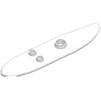{ .lu-ti width="24" loading="lazy" } [Surfboard 10M (LOT 5156)](../5156.md) | 0.03250261%; mean 0.0003257329 | Not associated with a vendor |
| { .lu-ti width="24" loading="lazy" } [Frogman Visor (LOT 5161)](../5161.md) | 0.03250261%; mean 0.0003257329 | Not associated with a vendor |
| { .lu-ti width="24" loading="lazy" } [Wig Ponytail (LOT 5162)](../5162.md) | 0.03250261%; mean 0.0003257329 | Not associated with a vendor |
| 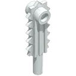{ .lu-ti width="24" loading="lazy" } [Ice Saw (LOT 5164)](../5164.md) | 0.03250261%; mean 0.0003257329 | Not associated with a vendor |
| 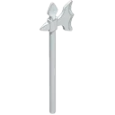{ .lu-ti width="24" loading="lazy" } [Halberd (LOT 5166)](../5166.md) | 0.03250261%; mean 0.0003257329 | Not associated with a vendor |
| { .lu-ti width="24" loading="lazy" } [Magic Wand (LOT 5167)](../5167.md) | 0.03250261%; mean 0.0003257329 | Not associated with a vendor |
| { .lu-ti width="24" loading="lazy" } [Horse Dragon Mask with Clip (LOT 5168)](../5168.md) | 0.03250261%; mean 0.0003257329 | Not associated with a vendor |
| { .lu-ti width="24" loading="lazy" } [Magic Hat (LOT 5173)](../5173.md) | 0.03250261%; mean 0.0003257329 | Not associated with a vendor |
| { .lu-ti width="24" loading="lazy" } [Santa Beard (LOT 5174)](../5174.md) | 0.03250261%; mean 0.0003257329 | Not associated with a vendor |
| { .lu-ti width="24" loading="lazy" } [Fireman Breathing Mask (LOT 5175)](../5175.md) | 0.03250261%; mean 0.0003257329 | Not associated with a vendor |
| 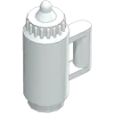{ .lu-ti width="24" loading="lazy" } [Feeding Bottle (LOT 5181)](../5181.md) | 0.03250261%; mean 0.0003257329 | Not associated with a vendor |
| { .lu-ti width="24" loading="lazy" } [Dish Ø24 (LOT 5188)](../5188.md) | 0.03250261%; mean 0.0003257329 | Not associated with a vendor |
| { .lu-ti width="24" loading="lazy" } [Cherry (LOT 5195)](../5195.md) | 0.03250261%; mean 0.0003257329 | Not associated with a vendor |
| { .lu-ti width="24" loading="lazy" } [Astronaut Visor (LOT 5196)](../5196.md) | 0.03250261%; mean 0.0003257329 | Not associated with a vendor |
| { .lu-ti width="24" loading="lazy" } [Hand-Held Scanner (LOT 5198)](../5198.md) | 0.03250261%; mean 0.0003257329 | Not associated with a vendor |
| { .lu-ti width="24" loading="lazy" } [Morion Helmet (LOT 5201)](../5201.md) | 0.03250261%; mean 0.0003257329 | Not associated with a vendor |
| { .lu-ti width="24" loading="lazy" } [Harpoon 5M (LOT 5203)](../5203.md) | 0.03250261%; mean 0.0003257329 | Not associated with a vendor |
| { .lu-ti width="24" loading="lazy" } [Camera (LOT 5204)](../5204.md) | 0.03250261%; mean 0.0003257329 | Not associated with a vendor |
| { .lu-ti width="24" loading="lazy" } [Diver's Mask (LOT 5205)](../5205.md) | 0.03250261%; mean 0.0003257329 | Not associated with a vendor |
| 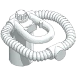{ .lu-ti width="24" loading="lazy" } [Oxygen Bottle with Tube (LOT 5206)](../5206.md) | 0.03250261%; mean 0.0003257329 | Not associated with a vendor |
| 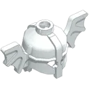{ .lu-ti width="24" loading="lazy" } [Bat Helmet (LOT 5209)](../5209.md) | 0.03250261%; mean 0.0003257329 | Not associated with a vendor |
| { .lu-ti width="24" loading="lazy" } [Alien Breastplate (LOT 5212)](../5212.md) | 0.03250261%; mean 0.0003257329 | Not associated with a vendor |
| { .lu-ti width="24" loading="lazy" } [Indian Feather with Bolt (LOT 5213)](../5213.md) | 0.03250261%; mean 0.0003257329 | Not associated with a vendor |
| { .lu-ti width="24" loading="lazy" } [Indian Feather with Clip (LOT 5214)](../5214.md) | 0.03250261%; mean 0.0003257329 | Not associated with a vendor |
| { .lu-ti width="24" loading="lazy" } [Revolver (LOT 5215)](../5215.md) | 0.03250261%; mean 0.0003257329 | Not associated with a vendor |
| { .lu-ti width="24" loading="lazy" } [Neck Scarf (LOT 5216)](../5216.md) | 0.03250261%; mean 0.0003257329 | Not associated with a vendor |
| { .lu-ti width="24" loading="lazy" } [Officer's Cap (LOT 5217)](../5217.md) | 0.03250261%; mean 0.0003257329 | Not associated with a vendor |
| { .lu-ti width="24" loading="lazy" } [Rifle (LOT 5218)](../5218.md) | 0.03250261%; mean 0.0003257329 | Not associated with a vendor |
| { .lu-ti width="24" loading="lazy" } [Movie Camera (LOT 5220)](../5220.md) | 0.03250261%; mean 0.0003257329 | Not associated with a vendor |
| { .lu-ti width="24" loading="lazy" } [Magnifying Glass (LOT 5222)](../5222.md) | 0.03250261%; mean 0.0003257329 | Not associated with a vendor |
| { .lu-ti width="24" loading="lazy" } [Diamond with Stick (LOT 5223)](../5223.md) | 0.03250261%; mean 0.0003257329 | Not associated with a vendor |
| { .lu-ti width="24" loading="lazy" } [Sextant (LOT 5224)](../5224.md) | 0.03250261%; mean 0.0003257329 | Not associated with a vendor |
| { .lu-ti width="24" loading="lazy" } [Rucksack, Opening (LOT 5225)](../5225.md) | 0.03250261%; mean 0.0003257329 | Not associated with a vendor |
| { .lu-ti width="24" loading="lazy" } [Safari Hat (LOT 5226)](../5226.md) | 0.03250261%; mean 0.0003257329 | Not associated with a vendor |
| { .lu-ti width="24" loading="lazy" } [Pharaoh's Headdress (LOT 5227)](../5227.md) | 0.03250261%; mean 0.0003257329 | Not associated with a vendor |
| 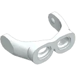{ .lu-ti width="24" loading="lazy" } [Flying Goggles (LOT 5229)](../5229.md) | 0.03250261%; mean 0.0003257329 | Not associated with a vendor |
| { .lu-ti width="24" loading="lazy" } [Flying Helmet (LOT 5230)](../5230.md) | 0.03250261%; mean 0.0003257329 | Not associated with a vendor |
| { .lu-ti width="24" loading="lazy" } [Safari Helmet (LOT 5231)](../5231.md) | 0.03250261%; mean 0.0003257329 | Not associated with a vendor |
| { .lu-ti width="24" loading="lazy" } [Ninja Sword (LOT 5232)](../5232.md) | 0.03250261%; mean 0.0003257329 | Not associated with a vendor |
| { .lu-ti width="24" loading="lazy" } [Samurai Armor (LOT 5233)](../5233.md) | 0.03250261%; mean 0.0003257329 | Not associated with a vendor |
| { .lu-ti width="24" loading="lazy" } [Grappling Hook (LOT 5241)](../5241.md) | 0.03250261%; mean 0.0003257329 | Not associated with a vendor |
| 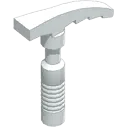{ .lu-ti width="24" loading="lazy" } [Ice Axe (LOT 5242)](../5242.md) | 0.03250261%; mean 0.0003257329 | Not associated with a vendor |
| { .lu-ti width="24" loading="lazy" } [Circular Saw (LOT 5243)](../5243.md) | 0.03250261%; mean 0.0003257329 | Not associated with a vendor |
| 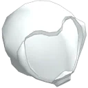{ .lu-ti width="24" loading="lazy" } [Insectoid Helmet (LOT 5245)](../5245.md) | 0.03250261%; mean 0.0003257329 | Not associated with a vendor |
| { .lu-ti width="24" loading="lazy" } [Shell (LOT 5246)](../5246.md) | 0.03250261%; mean 0.0003257329 | Not associated with a vendor |
| 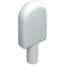{ .lu-ti width="24" loading="lazy" } [Popsicle (LOT 5247)](../5247.md) | 0.03250261%; mean 0.0003257329 | Not associated with a vendor |
| { .lu-ti width="24" loading="lazy" } [Pneumatic Hammer (LOT 5250)](../5250.md) | 0.03250261%; mean 0.0003257329 | Not associated with a vendor |
| { .lu-ti width="24" loading="lazy" } [Slider Roller with Handle (LOT 5251)](../5251.md) | 0.03250261%; mean 0.0003257329 | Not associated with a vendor |
| { .lu-ti width="24" loading="lazy" } [Knight's Helmet with Brim (LOT 5258)](../5258.md) | 0.03250261%; mean 0.0003257329 | Not associated with a vendor |
| { .lu-ti width="24" loading="lazy" } [Inca Helmet (LOT 5260)](../5260.md) | 0.03250261%; mean 0.0003257329 | Not associated with a vendor |
| { .lu-ti width="24" loading="lazy" } [Snowshoe (LOT 5261)](../5261.md) | 0.03250261%; mean 0.0003257329 | Not associated with a vendor |
| { .lu-ti width="24" loading="lazy" } [Polar Hood with Fur Lining (LOT 5262)](../5262.md) | 0.03250261%; mean 0.0003257329 | Not associated with a vendor |
| { .lu-ti width="24" loading="lazy" } [Binoculars, High-tech (LOT 5264)](../5264.md) | 0.03250261%; mean 0.0003257329 | Not associated with a vendor |
| { .lu-ti width="24" loading="lazy" } [Polar Rucksack (LOT 5265)](../5265.md) | 0.03250261%; mean 0.0003257329 | Not associated with a vendor |
| { .lu-ti width="24" loading="lazy" } [Space Helmet without Chin Strap (LOT 5266)](../5266.md) | 0.03250261%; mean 0.0003257329 | Not associated with a vendor |
| { .lu-ti width="24" loading="lazy" } [Lifering with Stud (LOT 5267)](../5267.md) | 0.03250261%; mean 0.0003257329 | Not associated with a vendor |
| { .lu-ti width="24" loading="lazy" } [Hood (LOT 5269)](../5269.md) | 0.03250261%; mean 0.0003257329 | Not associated with a vendor |
| { .lu-ti width="24" loading="lazy" } [Wig with Multiple Braids (LOT 5276)](../5276.md) | 0.03250261%; mean 0.0003257329 | Not associated with a vendor |
| { .lu-ti width="24" loading="lazy" } [Wig, Crew Cut (LOT 5282)](../5282.md) | 0.03250261%; mean 0.0003257329 | Not associated with a vendor |
| { .lu-ti width="24" loading="lazy" } [Book (LOT 5311)](../5311.md) | 0.03250261%; mean 0.0003257329 | Not associated with a vendor |
| { .lu-ti width="24" loading="lazy" } [Apple with Leaf (LOT 5312)](../5312.md) | 0.03250261%; mean 0.0003257329 | Not associated with a vendor |
| { .lu-ti width="24" loading="lazy" } [Pot with Handle (LOT 5313)](../5313.md) | 0.03250261%; mean 0.0003257329 | Not associated with a vendor |
| { .lu-ti width="24" loading="lazy" } [Turkey Drumstick (LOT 5314)](../5314.md) | 0.03250261%; mean 0.0003257329 | Not associated with a vendor |
| { .lu-ti width="24" loading="lazy" } [Glass (LOT 5315)](../5315.md) | 0.03250261%; mean 0.0003257329 | Not associated with a vendor |
| 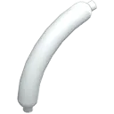{ .lu-ti width="24" loading="lazy" } [Sausage (LOT 5316)](../5316.md) | 0.03250261%; mean 0.0003257329 | Not associated with a vendor |
| { .lu-ti width="24" loading="lazy" } [Banana (LOT 5317)](../5317.md) | 0.03250261%; mean 0.0003257329 | Not associated with a vendor |
| { .lu-ti width="24" loading="lazy" } [Ice-Cream Cone (LOT 5318)](../5318.md) | 0.03250261%; mean 0.0003257329 | Not associated with a vendor |
| { .lu-ti width="24" loading="lazy" } [Croissant (LOT 5321)](../5321.md) | 0.03250261%; mean 0.0003257329 | Not associated with a vendor |
| { .lu-ti width="24" loading="lazy" } [Comb (LOT 5322)](../5322.md) | 0.03250261%; mean 0.0003257329 | Not associated with a vendor |
| { .lu-ti width="24" loading="lazy" } [Carrot (LOT 5323)](../5323.md) | 0.03250261%; mean 0.0003257329 | Not associated with a vendor |
| { .lu-ti width="24" loading="lazy" } [Rosette with Ribbon (LOT 5324)](../5324.md) | 0.03250261%; mean 0.0003257329 | Not associated with a vendor |
| { .lu-ti width="24" loading="lazy" } [Celery (LOT 5325)](../5325.md) | 0.03250261%; mean 0.0003257329 | Not associated with a vendor |
| { .lu-ti width="24" loading="lazy" } [Turban (LOT 5329)](../5329.md) | 0.03250261%; mean 0.0003257329 | Not associated with a vendor |
| { .lu-ti width="24" loading="lazy" } [Old Man's Wig (LOT 5330)](../5330.md) | 0.03250261%; mean 0.0003257329 | Not associated with a vendor |
| { .lu-ti width="24" loading="lazy" } [Man's Wig (LOT 5331)](../5331.md) | 0.03250261%; mean 0.0003257329 | Not associated with a vendor |
| { .lu-ti width="24" loading="lazy" } [Boy's Hair (LOT 5332)](../5332.md) | 0.03250261%; mean 0.0003257329 | Not associated with a vendor |
| { .lu-ti width="24" loading="lazy" } [Girl's Hair (LOT 5334)](../5334.md) | 0.03250261%; mean 0.0003257329 | Not associated with a vendor |
| { .lu-ti width="24" loading="lazy" } [Knit Cap (LOT 5351)](../5351.md) | 0.03250261%; mean 0.0003257329 | Not associated with a vendor |
| { .lu-ti width="24" loading="lazy" } [Minifig Short Legs and Hips (LOT 5354)](../5354.md) | 0.03250261%; mean 0.0003257329 | Not associated with a vendor |
| { .lu-ti width="24" loading="lazy" } [Wig, Wolfman  (LOT 5359)](../5359.md) | 0.03250261%; mean 0.0003257329 | Not associated with a vendor |
| { .lu-ti width="24" loading="lazy" } [Skateboard 1 (LOT 5360)](../5360.md) | 0.03250261%; mean 0.0003257329 | Not associated with a vendor |
| { .lu-ti width="24" loading="lazy" } [Basketball (LOT 5362)](../5362.md) | 0.03250261%; mean 0.0003257329 | Not associated with a vendor |
| { .lu-ti width="24" loading="lazy" } [Wig with Blow-dried Hairdo (LOT 5364)](../5364.md) | 0.03250261%; mean 0.0003257329 | Not associated with a vendor |
| { .lu-ti width="24" loading="lazy" } [Scimitar (LOT 5366)](../5366.md) | 0.03250261%; mean 0.0003257329 | Not associated with a vendor |
| { .lu-ti width="24" loading="lazy" } [Russian Fur Cap (LOT 5370)](../5370.md) | 0.03250261%; mean 0.0003257329 | Not associated with a vendor |
| { .lu-ti width="24" loading="lazy" } [Spiked Pike (LOT 5371)](../5371.md) | 0.03250261%; mean 0.0003257329 | Not associated with a vendor |
| { .lu-ti width="24" loading="lazy" } [Knife (LOT 5377)](../5377.md) | 0.03250261%; mean 0.0003257329 | Not associated with a vendor |
| { .lu-ti width="24" loading="lazy" } [Skateboard 2 (LOT 5381)](../5381.md) | 0.03250261%; mean 0.0003257329 | Not associated with a vendor |
| { .lu-ti width="24" loading="lazy" } [Ice Hockey Helmet (LOT 5383)](../5383.md) | 0.03250261%; mean 0.0003257329 | Not associated with a vendor |
| { .lu-ti width="24" loading="lazy" } [Hockey Body Armor (LOT 5384)](../5384.md) | 0.03250261%; mean 0.0003257329 | Not associated with a vendor |
| { .lu-ti width="24" loading="lazy" } [Wing 4x7 Scaled (LOT 5389)](../5389.md) | 0.03250261%; mean 0.0003257329 | Not associated with a vendor |
| { .lu-ti width="24" loading="lazy" } [Visor No. 1 Wise (LOT 5391)](../5391.md) | 0.03250261%; mean 0.0003257329 | Not associated with a vendor |
| { .lu-ti width="24" loading="lazy" } [Visor No. 3 Rookie (LOT 5392)](../5392.md) | 0.03250261%; mean 0.0003257329 | Not associated with a vendor |
| { .lu-ti width="24" loading="lazy" } [Visor No. 4 Brute (LOT 5393)](../5393.md) | 0.03250261%; mean 0.0003257329 | Not associated with a vendor |
| 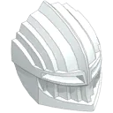{ .lu-ti width="24" loading="lazy" } [Visor No. 2 Joker (LOT 5394)](../5394.md) | 0.03250261%; mean 0.0003257329 | Not associated with a vendor |
| 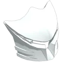{ .lu-ti width="24" loading="lazy" } [Visor No. 5 Evil (LOT 5395)](../5395.md) | 0.03250261%; mean 0.0003257329 | Not associated with a vendor |
| { .lu-ti width="24" loading="lazy" } [Dark Knight Helmet (LOT 5397)](../5397.md) | 0.03250261%; mean 0.0003257329 | Not associated with a vendor |
| { .lu-ti width="24" loading="lazy" } [Knight Shield Octagonal with Stud (LOT 5398)](../5398.md) | 0.03250261%; mean 0.0003257329 | Not associated with a vendor |
| { .lu-ti width="24" loading="lazy" } [Sword with Inverted V-Guard (LOT 5399)](../5399.md) | 0.03250261%; mean 0.0003257329 | Not associated with a vendor |
| { .lu-ti width="24" loading="lazy" } [Bracket 1x1 with Pin (LOT 5401)](../5401.md) | 0.03250261%; mean 0.0003257329 | Not associated with a vendor |
| { .lu-ti width="24" loading="lazy" } [Viking Helmet (LOT 5418)](../5418.md) | 0.03250261%; mean 0.0003257329 | Not associated with a vendor |
| { .lu-ti width="24" loading="lazy" } [BattleAxe Head with Horizontal Clip (LOT 5419)](../5419.md) | 0.03250261%; mean 0.0003257329 | Not associated with a vendor |
| { .lu-ti width="24" loading="lazy" } [Wig Manga 1 (LOT 5433)](../5433.md) | 0.03250261%; mean 0.0003257329 | Not associated with a vendor |
| { .lu-ti width="24" loading="lazy" } [Wig Manga 2 (LOT 5434)](../5434.md) | 0.03250261%; mean 0.0003257329 | Not associated with a vendor |
| { .lu-ti width="24" loading="lazy" } [Hammer (LOT 5446)](../5446.md) | 0.03250261%; mean 0.0003257329 | Not associated with a vendor |
| { .lu-ti width="24" loading="lazy" } [Oil Can (LOT 5447)](../5447.md) | 0.03250261%; mean 0.0003257329 | Not associated with a vendor |
| { .lu-ti width="24" loading="lazy" } [Drilling Machine (LOT 5448)](../5448.md) | 0.03250261%; mean 0.0003257329 | Not associated with a vendor |
| 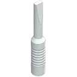{ .lu-ti width="24" loading="lazy" } [Screwdriver (LOT 5449)](../5449.md) | 0.03250261%; mean 0.0003257329 | Not associated with a vendor |
| { .lu-ti width="24" loading="lazy" } [Open Firm Key (LOT 5450)](../5450.md) | 0.03250261%; mean 0.0003257329 | Not associated with a vendor |
| { .lu-ti width="24" loading="lazy" } [Closed Wrench (LOT 5451)](../5451.md) | 0.03250261%; mean 0.0003257329 | Not associated with a vendor |
| { .lu-ti width="24" loading="lazy" } [Silver Harpoons (LOT 5471)](../5471.md) | 0.03250261%; mean 0.0003257329 | Not associated with a vendor |
| { .lu-ti width="24" loading="lazy" } [Scythe Blade (LOT 5502)](../5502.md) | 0.03250261%; mean 0.0003257329 | Not associated with a vendor |
| { .lu-ti width="24" loading="lazy" } [Round Shield (LOT 5503)](../5503.md) | 0.03250261%; mean 0.0003257329 | Not associated with a vendor |
| { .lu-ti width="24" loading="lazy" } [Morningstar (LOT 5504)](../5504.md) | 0.03250261%; mean 0.0003257329 | Not associated with a vendor |
| { .lu-ti width="24" loading="lazy" } [Lightning Bolt with Handle (LOT 5505)](../5505.md) | 0.03250261%; mean 0.0003257329 | Not associated with a vendor |
| { .lu-ti width="24" loading="lazy" } [Frogman's Feet (LOT 5506)](../5506.md) | 0.03250261%; mean 0.0003257329 | Not associated with a vendor |
| { .lu-ti width="24" loading="lazy" } [Lady Wig (LOT 5507)](../5507.md) | 0.03250261%; mean 0.0003257329 | Not associated with a vendor |
| { .lu-ti width="24" loading="lazy" } [Princess Hair (LOT 5508)](../5508.md) | 0.03250261%; mean 0.0003257329 | Not associated with a vendor |
| { .lu-ti width="24" loading="lazy" } [Dwarf King's Helmet (LOT 5546)](../5546.md) | 0.03250261%; mean 0.0003257329 | Not associated with a vendor |
| { .lu-ti width="24" loading="lazy" } [Dwarf Warrior's Helmet (LOT 5547)](../5547.md) | 0.03250261%; mean 0.0003257329 | Not associated with a vendor |
| { .lu-ti width="24" loading="lazy" } [Dwarf King Beard (LOT 5548)](../5548.md) | 0.03250261%; mean 0.0003257329 | Not associated with a vendor |
| { .lu-ti width="24" loading="lazy" } [Dwarf Warrior Beard (LOT 5549)](../5549.md) | 0.03250261%; mean 0.0003257329 | Not associated with a vendor |
| { .lu-ti width="24" loading="lazy" } [Warrior Helmet (LOT 5550)](../5550.md) | 0.03250261%; mean 0.0003257329 | Not associated with a vendor |
| { .lu-ti width="24" loading="lazy" } [Notched Scimitar (LOT 5551)](../5551.md) | 0.03250261%; mean 0.0003257329 | Not associated with a vendor |
| { .lu-ti width="24" loading="lazy" } [Nozzle with Shaft (LOT 5556)](../5556.md) | 0.03250261%; mean 0.0003257329 | Not associated with a vendor |
| 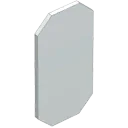{ .lu-ti width="24" loading="lazy" } [Knight Shield Octagonal (LOT 5572)](../5572.md) | 0.03250261%; mean 0.0003257329 | Not associated with a vendor |
| { .lu-ti width="24" loading="lazy" } [Breastplate (LOT 5576)](../5576.md) | 0.03250261%; mean 0.0003257329 | Not associated with a vendor |
| { .lu-ti width="24" loading="lazy" } [Wig with Long Ponytail (LOT 5582)](../5582.md) | 0.03250261%; mean 0.0003257329 | Not associated with a vendor |
| { .lu-ti width="24" loading="lazy" } [Helmet with Jagged Jaw (LOT 5583)](../5583.md) | 0.03250261%; mean 0.0003257329 | Not associated with a vendor |
| { .lu-ti width="24" loading="lazy" } [Barbed Wire (LOT 5585)](../5585.md) | 0.03250261%; mean 0.0003257329 | Not associated with a vendor |
| { .lu-ti width="24" loading="lazy" } [Wig, Bowl Cut (LOT 5587)](../5587.md) | 0.03250261%; mean 0.0003257329 | Not associated with a vendor |
| { .lu-ti width="24" loading="lazy" } [Antique Key (LOT 5590)](../5590.md) | 0.03250261%; mean 0.0003257329 | Not associated with a vendor |
| { .lu-ti width="24" loading="lazy" } [Wig, Boy (LOT 5592)](../5592.md) | 0.03250261%; mean 0.0003257329 | Not associated with a vendor |
| { .lu-ti width="24" loading="lazy" } [Light Sword Handle (LOT 5598)](../5598.md) | 0.03250261%; mean 0.0003257329 | Not associated with a vendor |
| { .lu-ti width="24" loading="lazy" } [Bucket (LOT 5601)](../5601.md) | 0.03250261%; mean 0.0003257329 | Not associated with a vendor |
| { .lu-ti width="24" loading="lazy" } [Fanfare Horn, Chrome (LOT 5604)](../5604.md) | 0.03250261%; mean 0.0003257329 | Not associated with a vendor |
| { .lu-ti width="24" loading="lazy" } [Handle for Bucket (LOT 5605)](../5605.md) | 0.03250261%; mean 0.0003257329 | Not associated with a vendor |
| { .lu-ti width="24" loading="lazy" } [Space Suit (LOT 5607)](../5607.md) | 0.03250261%; mean 0.0003257329 | Not associated with a vendor |
| { .lu-ti width="24" loading="lazy" } [Goblet (LOT 5608)](../5608.md) | 0.03250261%; mean 0.0003257329 | Not associated with a vendor |
| { .lu-ti width="24" loading="lazy" } [BaseBall Cap (LOT 5622)](../5622.md) | 0.03250261%; mean 0.0003257329 | Not associated with a vendor |
| { .lu-ti width="24" loading="lazy" } [Epaulets (LOT 8803)](../8803.md) | 0.03250261%; mean 0.0003257329 | Not associated with a vendor |
| { .lu-ti width="24" loading="lazy" } [Flintlock Pistol (LOT 8807)](../8807.md) | 0.03250261%; mean 0.0003257329 | Not associated with a vendor |
| { .lu-ti width="24" loading="lazy" } [Wig with Small Pigtails (LOT 8839)](../8839.md) | 0.03250261%; mean 0.0003257329 | Not associated with a vendor |
| { .lu-ti width="24" loading="lazy" } [Cowboy Hat (LOT 8840)](../8840.md) | 0.03250261%; mean 0.0003257329 | Not associated with a vendor |
| { .lu-ti width="24" loading="lazy" } [Mini Crash Helmet (LOT 8846)](../8846.md) | 0.03250261%; mean 0.0003257329 | Not associated with a vendor |
| { .lu-ti width="24" loading="lazy" } [Great Helm with Chin Guard (LOT 8848)](../8848.md) | 0.03250261%; mean 0.0003257329 | Not associated with a vendor |
| { .lu-ti width="24" loading="lazy" } [Pitchfork (LOT 8858)](../8858.md) | 0.03250261%; mean 0.0003257329 | Not associated with a vendor |
| { .lu-ti width="24" loading="lazy" } [Forestman Cap (LOT 8860)](../8860.md) | 0.03250261%; mean 0.0003257329 | Not associated with a vendor |
| { .lu-ti width="24" loading="lazy" } [Plastic Cape (LOT 8861)](../8861.md) | 0.03250261%; mean 0.0003257329 | Not associated with a vendor |
| { .lu-ti width="24" loading="lazy" } [Bobbed Hair (LOT 8870)](../8870.md) | 0.03250261%; mean 0.0003257329 | Not associated with a vendor |
| { .lu-ti width="24" loading="lazy" } [Islander Demon Mask (LOT 8871)](../8871.md) | 0.03250261%; mean 0.0003257329 | Not associated with a vendor |
| { .lu-ti width="24" loading="lazy" } [Space Suit with Helmet and Propeller (LOT 8887)](../8887.md) | 0.03250261%; mean 0.0003257329 | Not associated with a vendor |
| { .lu-ti width="24" loading="lazy" } [Space Suit with Helmet and Breathing Device (LOT 8888)](../8888.md) | 0.03250261%; mean 0.0003257329 | Not associated with a vendor |
| { .lu-ti width="24" loading="lazy" } [Visor with Antenna (LOT 8890)](../8890.md) | 0.03250261%; mean 0.0003257329 | Not associated with a vendor |
| { .lu-ti width="24" loading="lazy" } [Oval Suitcase (LOT 8894)](../8894.md) | 0.03250261%; mean 0.0003257329 | Not associated with a vendor |
| { .lu-ti width="24" loading="lazy" } [Helmet with Hose and Stud (LOT 8919)](../8919.md) | 0.03250261%; mean 0.0003257329 | Not associated with a vendor |
| 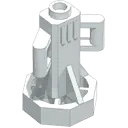{ .lu-ti width="24" loading="lazy" } [Underwater scooter (LOT 8926)](../8926.md) | 0.03250261%; mean 0.0003257329 | Not associated with a vendor |
| { .lu-ti width="24" loading="lazy" } [Medicine Man Wig (LOT 8929)](../8929.md) | 0.03250261%; mean 0.0003257329 | Not associated with a vendor |
| { .lu-ti width="24" loading="lazy" } [Indian Wig (LOT 8930)](../8930.md) | 0.03250261%; mean 0.0003257329 | Not associated with a vendor |
| { .lu-ti width="24" loading="lazy" } [Alien Helmet (LOT 8931)](../8931.md) | 0.03250261%; mean 0.0003257329 | Not associated with a vendor |
| { .lu-ti width="24" loading="lazy" } [Crash Helmet (LOT 8932)](../8932.md) | 0.03250261%; mean 0.0003257329 | Not associated with a vendor |
| { .lu-ti width="24" loading="lazy" } [Chief Brilliant Plumage (LOT 8934)](../8934.md) | 0.03250261%; mean 0.0003257329 | Not associated with a vendor |
| { .lu-ti width="24" loading="lazy" } [Samurai Helmet (LOT 8938)](../8938.md) | 0.03250261%; mean 0.0003257329 | Not associated with a vendor |
| { .lu-ti width="24" loading="lazy" } [Aqua Suit Helmet (LOT 8940)](../8940.md) | 0.03250261%; mean 0.0003257329 | Not associated with a vendor |
| { .lu-ti width="24" loading="lazy" } [Hairdryer (LOT 8987)](../8987.md) | 0.03250261%; mean 0.0003257329 | Not associated with a vendor |
| { .lu-ti width="24" loading="lazy" } [Turkey (LOT 8988)](../8988.md) | 0.03250261%; mean 0.0003257329 | Not associated with a vendor |
| { .lu-ti width="24" loading="lazy" } [Decoration Ball (LOT 8989)](../8989.md) | 0.03250261%; mean 0.0003257329 | Not associated with a vendor |
| { .lu-ti width="24" loading="lazy" } [Skates with 2 Studs (LOT 9007)](../9007.md) | 0.03250261%; mean 0.0003257329 | Not associated with a vendor |
| { .lu-ti width="24" loading="lazy" } [Snowboard (LOT 9028)](../9028.md) | 0.03250261%; mean 0.0003257329 | Not associated with a vendor |
| { .lu-ti width="24" loading="lazy" } [Cloth Cape (LOT 9036)](../9036.md) | 0.03250261%; mean 0.0003257329 | Not associated with a vendor |
| { .lu-ti width="24" loading="lazy" } [Shackles (LOT 9065)](../9065.md) | 0.03250261%; mean 0.0003257329 | Not associated with a vendor |
| { .lu-ti width="24" loading="lazy" } [Troll Club (LOT 9097)](../9097.md) | 0.03250261%; mean 0.0003257329 | Not associated with a vendor |
| { .lu-ti width="24" loading="lazy" } [Handcuffs (LOT 9108)](../9108.md) | 0.03250261%; mean 0.0003257329 | Not associated with a vendor |
| { .lu-ti width="24" loading="lazy" } [Fedora Hat (LOT 9110)](../9110.md) | 0.03250261%; mean 0.0003257329 | Not associated with a vendor |
| { .lu-ti width="24" loading="lazy" } [Whip, Furled (LOT 9117)](../9117.md) | 0.03250261%; mean 0.0003257329 | Not associated with a vendor |
| { .lu-ti width="24" loading="lazy" } [Shoulder Bag (LOT 9118)](../9118.md) | 0.03250261%; mean 0.0003257329 | Not associated with a vendor |
| { .lu-ti width="24" loading="lazy" } [Joker Hat (LOT 9124)](../9124.md) | 0.03250261%; mean 0.0003257329 | Not associated with a vendor |
| { .lu-ti width="24" loading="lazy" } [Evil Wig (LOT 9128)](../9128.md) | 0.03250261%; mean 0.0003257329 | Not associated with a vendor |
| { .lu-ti width="24" loading="lazy" } [Telescope Bar 1x1x2 (LOT 9145)](../9145.md) | 0.03250261%; mean 0.0003257329 | Not associated with a vendor |
| { .lu-ti width="24" loading="lazy" } [Blade with Haft (LOT 9153)](../9153.md) | 0.03250261%; mean 0.0003257329 | Not associated with a vendor |
| { .lu-ti width="24" loading="lazy" } [Dynamite (LOT 9154)](../9154.md) | 0.03250261%; mean 0.0003257329 | Not associated with a vendor |
| { .lu-ti width="24" loading="lazy" } [Wig, Older Guy (LOT 9156)](../9156.md) | 0.03250261%; mean 0.0003257329 | Not associated with a vendor |
| { .lu-ti width="24" loading="lazy" } [Breastplate Chrome Silver (LOT 9161)](../9161.md) | 0.03250261%; mean 0.0003257329 | Not associated with a vendor |
| { .lu-ti width="24" loading="lazy" } [Bugle (LOT 9162)](../9162.md) | 0.03250261%; mean 0.0003257329 | Not associated with a vendor |
| { .lu-ti width="24" loading="lazy" } [Samurai Helmet Ornament (LOT 9164)](../9164.md) | 0.03250261%; mean 0.0003257329 | Not associated with a vendor |
| { .lu-ti width="24" loading="lazy" } [Hand Tool with Suction Cup (LOT 9165)](../9165.md) | 0.03250261%; mean 0.0003257329 | Not associated with a vendor |
| { .lu-ti width="24" loading="lazy" } [Alien Helmet "Snake" (LOT 9179)](../9179.md) | 0.03250261%; mean 0.0003257329 | Not associated with a vendor |
| { .lu-ti width="24" loading="lazy" } [Slizer Helmet (LOT 9181)](../9181.md) | 0.03250261%; mean 0.0003257329 | Not associated with a vendor |
| { .lu-ti width="24" loading="lazy" } [Skull Helmet (LOT 9182)](../9182.md) | 0.03250261%; mean 0.0003257329 | Not associated with a vendor |
| { .lu-ti width="24" loading="lazy" } [Squid Head (LOT 9184)](../9184.md) | 0.03250261%; mean 0.0003257329 | Not associated with a vendor |
| { .lu-ti width="24" loading="lazy" } [Kranxx Head (LOT 9185)](../9185.md) | 0.03250261%; mean 0.0003257329 | Not associated with a vendor |
| { .lu-ti width="24" loading="lazy" } [Protective Vest (LOT 9187)](../9187.md) | 0.03250261%; mean 0.0003257329 | Not associated with a vendor |
| { .lu-ti width="24" loading="lazy" } [Wig, Girl with Long Hair (LOT 9190)](../9190.md) | 0.03250261%; mean 0.0003257329 | Not associated with a vendor |
| { .lu-ti width="24" loading="lazy" } [Fez (LOT 9191)](../9191.md) | 0.03250261%; mean 0.0003257329 | Not associated with a vendor |
| 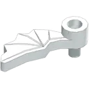{ .lu-ti width="24" loading="lazy" } [Right Wing for Dragon Knight's Helmet (LOT 9211)](../9211.md) | 0.03250261%; mean 0.0003257329 | Not associated with a vendor |
| { .lu-ti width="24" loading="lazy" } [Left Wing for Dragon Knight's Helmet (LOT 9212)](../9212.md) | 0.03250261%; mean 0.0003257329 | Not associated with a vendor |
| { .lu-ti width="24" loading="lazy" } [Dragon Ornament for Dragon Knight's Helmet (LOT 9213)](../9213.md) | 0.03250261%; mean 0.0003257329 | Not associated with a vendor |
| { .lu-ti width="24" loading="lazy" } [Rosette (LOT 9216)](../9216.md) | 0.03250261%; mean 0.0003257329 | Not associated with a vendor |
| { .lu-ti width="24" loading="lazy" } [Imitation jewelry Wheel (LOT 9217)](../9217.md) | 0.03250261%; mean 0.0003257329 | Not associated with a vendor |
| { .lu-ti width="24" loading="lazy" } [Feather for Helmet (LOT 9218)](../9218.md) | 0.03250261%; mean 0.0003257329 | Not associated with a vendor |
| { .lu-ti width="24" loading="lazy" } [Small Feather for Helmet (LOT 9219)](../9219.md) | 0.03250261%; mean 0.0003257329 | Not associated with a vendor |
| { .lu-ti width="24" loading="lazy" } [Big Feather for Helmet (LOT 9220)](../9220.md) | 0.03250261%; mean 0.0003257329 | Not associated with a vendor |
| { .lu-ti width="24" loading="lazy" } [Animal Horns (LOT 9221)](../9221.md) | 0.03250261%; mean 0.0003257329 | Not associated with a vendor |
| { .lu-ti width="24" loading="lazy" } [Splendorous Feather (LOT 9222)](../9222.md) | 0.03250261%; mean 0.0003257329 | Not associated with a vendor |
| { .lu-ti width="24" loading="lazy" } [Atlantis Suit (LOT 9230)](../9230.md) | 0.03250261%; mean 0.0003257329 | Not associated with a vendor |
| { .lu-ti width="24" loading="lazy" } [Squidman Head (LOT 9232)](../9232.md) | 0.03250261%; mean 0.0003257329 | Not associated with a vendor |
| 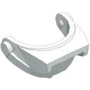{ .lu-ti width="24" loading="lazy" } [Visor with Slit (LOT 9234)](../9234.md) | 0.03250261%; mean 0.0003257329 | Not associated with a vendor |
| { .lu-ti width="24" loading="lazy" } [Visor for Atlantis Suit (LOT 9243)](../9243.md) | 0.03250261%; mean 0.0003257329 | Not associated with a vendor |
| 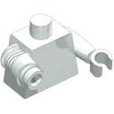{ .lu-ti width="24" loading="lazy" } [Minifigure Torso with Right Arm Prosthesis (LOT 10184)](../10184.md) | 0.03250261%; mean 0.0003257329 | Not associated with a vendor |
| { .lu-ti width="24" loading="lazy" } [Minifigure Legs (LOT 10190)](../10190.md) | 0.03250261%; mean 0.0003257329 | Not associated with a vendor |
| { .lu-ti width="24" loading="lazy" } [Minifigure Torso (LOT 10200)](../10200.md) | 0.03250261%; mean 0.0003257329 | Not associated with a vendor |
| { .lu-ti width="24" loading="lazy" } [Minifigure Legs with Right Wooden Leg (LOT 10204)](../10204.md) | 0.03250261%; mean 0.0003257329 | Not associated with a vendor |
| { .lu-ti width="24" loading="lazy" } [Minifigure Torso with Left Hook Prosthesis (LOT 10205)](../10205.md) | 0.03250261%; mean 0.0003257329 | Not associated with a vendor |
| { .lu-ti width="24" loading="lazy" } [BroadSword (LOT 11113)](../11113.md) | 0.03250261%; mean 0.0003257329 | Not associated with a vendor |
| Imagination Powerup 3 points (LOT 11910; not an item registration) | 75%; mean 1.125 | Not associated with a vendor |
| Armor Powerup 3 points (LOT 11913; not an item registration) | 75%; mean 0.75 | Not associated with a vendor |
| Life Powerup 2 points (LOT 11915; not an item registration) | 75%; mean 0.75 | Not associated with a vendor |
| { .lu-ti width="24" loading="lazy" } [Faction Token Proxy (LOT 13763)](../13763.md) | 2.5%; mean 0.025 | Not associated with a vendor |
| 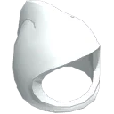{ .lu-ti width="24" loading="lazy" } [Farmer's Cap (LOT 16370)](../16370.md) | 0.03250261%; mean 0.0003257329 | Not associated with a vendor |
| { .lu-ti width="24" loading="lazy" } [Goggles (LOT 16373)](../16373.md) | 0.03250261%; mean 0.0003257329 | Not associated with a vendor |
| { .lu-ti width="24" loading="lazy" } [Wig, Medium Hair (LOT 16412)](../16412.md) | 0.03250261%; mean 0.0003257329 | Not associated with a vendor |
| { .lu-ti width="24" loading="lazy" } [Porcupine, Shoulder Armor (LOT 16415)](../16415.md) | 0.03250261%; mean 0.0003257329 | Not associated with a vendor |
| { .lu-ti width="24" loading="lazy" } [Knight&#96;s Helmet (LOT 16421)](../16421.md) | 0.03250261%; mean 0.0003257329 | Not associated with a vendor |
| { .lu-ti width="24" loading="lazy" } [Wig, Short Hair (LOT 16434)](../16434.md) | 0.03250261%; mean 0.0003257329 | Not associated with a vendor |
| { .lu-ti width="24" loading="lazy" } [Wig, Long Hair (LOT 16435)](../16435.md) | 0.03250261%; mean 0.0003257329 | Not associated with a vendor |
| { .lu-ti width="24" loading="lazy" } [Sack (LOT 16441)](../16441.md) | 0.03250261%; mean 0.0003257329 | Not associated with a vendor |
| { .lu-ti width="24" loading="lazy" } [Ø3.2 Shaft with Cored Knob (LOT 16444)](../16444.md) | 0.03250261%; mean 0.0003257329 | Not associated with a vendor |
| { .lu-ti width="24" loading="lazy" } [5 M. Ø3.2 Bone (LOT 16445)](../16445.md) | 0.03250261%; mean 0.0003257329 | Not associated with a vendor |
| { .lu-ti width="24" loading="lazy" } [Armour with Spike (LOT 16449)](../16449.md) | 0.03250261%; mean 0.0003257329 | Not associated with a vendor |
| { .lu-ti width="24" loading="lazy" } [Star with Ø3.2 Wheel (LOT 16450)](../16450.md) | 0.03250261%; mean 0.0003257329 | Not associated with a vendor |
| { .lu-ti width="24" loading="lazy" } [Hat (LOT 16451)](../16451.md) | 0.03250261%; mean 0.0003257329 | Not associated with a vendor |
| { .lu-ti width="24" loading="lazy" } [Sensei Beard (LOT 16459)](../16459.md) | 0.03250261%; mean 0.0003257329 | Not associated with a vendor |
| 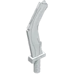{ .lu-ti width="24" loading="lazy" } [Egyptian Sword (LOT 16461)](../16461.md) | 0.03250261%; mean 0.0003257329 | Not associated with a vendor |
| { .lu-ti width="24" loading="lazy" } [Anubis Head (LOT 16462)](../16462.md) | 0.03250261%; mean 0.0003257329 | Not associated with a vendor |
| { .lu-ti width="24" loading="lazy" } [Horus Hat (LOT 16463)](../16463.md) | 0.03250261%; mean 0.0003257329 | Not associated with a vendor |
| { .lu-ti width="24" loading="lazy" } [Egyptian Eaglewing (LOT 16464)](../16464.md) | 0.03250261%; mean 0.0003257329 | Not associated with a vendor |
| { .lu-ti width="24" loading="lazy" } [Shaft Ø3.2 with Cored Ø3.2 Hole (LOT 16466)](../16466.md) | 0.03250261%; mean 0.0003257329 | Not associated with a vendor |
| 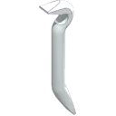{ .lu-ti width="24" loading="lazy" } [Crowbar (LOT 16507)](../16507.md) | 0.03250261%; mean 0.0003257329 | Not associated with a vendor |
| { .lu-ti width="24" loading="lazy" } [Helmet with Ø3.2 Shaft at Front (LOT 16509)](../16509.md) | 0.03250261%; mean 0.0003257329 | Not associated with a vendor |

## Raw matrix entries

| Row | Loot table | Rarity table | Trigger | Min | Max | Flag | Gate |
| --- | --- | --- | --- | --- | --- | --- | --- |
| 329 | 81 | 4 | 1 | 1 | 3 |  |  |
| 330 | 415 | 4 | 0.75 | 1 | 1 |  |  |
| 331 | 420 | 4 | 0.75 | 1 | 2 |  |  |
| 333 | 243 | 19 | 0.05 | 1 | 3 |  |  |
| 985 | 670 | 23 | 0.025 | 1 | 1 |  |  |
| 1489 | 110 | 18 | 0.33 | 1 | 1 |  |  |
| 1648 | 424 | 4 | 0.75 | 1 | 1 |  |  |

[LootMatrix](../../../db/LootMatrix.md), [LootTable](../../../db/LootTable.md), [RarityTable](../../../db/RarityTable.md).
