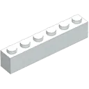

# Loot matrix 145

[Item database](../README.md) | [Methodology](../Methodology.md)

## Sources and mapped locations

| Kind | Source | Location evidence | Conditions |
| --- | --- | --- | --- |
| Package | [Brick Booster Pack (LOT 5834)](../sources/object-5834.md) | No matched local placement found | Static association, not a live-spawn guarantee |

## Item candidates

Default vendor-stock probabilities are shown only when this matrix has a registered vendor. Loot probabilities use the generic algorithm, not a guarantee of actual use by every script/activity.

| Item | Modeled loot chance / expected count | Default vendor stock |
| --- | --- | --- |
| { .lu-ti width="24" loading="lazy" } [Brick 2x4 (LOT 29)](../29.md) | 68.74529905%; mean 1.1363636 | Not associated with a vendor |
| { .lu-ti width="24" loading="lazy" } [Brick 2x3 (LOT 30)](../30.md) | 68.74529905%; mean 1.1363636 | Not associated with a vendor |
| { .lu-ti width="24" loading="lazy" } [Brick 2x2 (LOT 31)](../31.md) | 68.74529905%; mean 1.1363636 | Not associated with a vendor |
| { .lu-ti width="24" loading="lazy" } [Brick 1x2 (LOT 32)](../32.md) | 68.74529905%; mean 1.1363636 | Not associated with a vendor |
| { .lu-ti width="24" loading="lazy" } [Brick 1x1 (LOT 33)](../33.md) | 68.74529905%; mean 1.1363636 | Not associated with a vendor |
| { .lu-ti width="24" loading="lazy" } [Brick 2x8 (LOT 35)](../35.md) | 68.74529905%; mean 1.1363636 | Not associated with a vendor |
| { .lu-ti width="24" loading="lazy" } [Brick 1x8 (LOT 36)](../36.md) | 68.74529905%; mean 1.1363636 | Not associated with a vendor |
| { .lu-ti width="24" loading="lazy" } [Brick 1x6 (LOT 37)](../37.md) | 68.74529905%; mean 1.1363636 | Not associated with a vendor |
| { .lu-ti width="24" loading="lazy" } [Brick 1x4 (LOT 38)](../38.md) | 68.74529905%; mean 1.1363636 | Not associated with a vendor |
| { .lu-ti width="24" loading="lazy" } [Plate 2x4 (LOT 39)](../39.md) | 68.74529905%; mean 1.1363636 | Not associated with a vendor |
| { .lu-ti width="24" loading="lazy" } [Plate 2x3 (LOT 40)](../40.md) | 68.74529905%; mean 1.1363636 | Not associated with a vendor |
| { .lu-ti width="24" loading="lazy" } [Plate 1x2 (LOT 41)](../41.md) | 68.74529905%; mean 1.1363636 | Not associated with a vendor |
| { .lu-ti width="24" loading="lazy" } [Plate 1x1 (LOT 42)](../42.md) | 68.74529905%; mean 1.1363636 | Not associated with a vendor |
| { .lu-ti width="24" loading="lazy" } [Plate 1x8 (LOT 58)](../58.md) | 68.74529905%; mean 1.1363636 | Not associated with a vendor |
| { .lu-ti width="24" loading="lazy" } [Brick 1x3 (LOT 59)](../59.md) | 68.74529905%; mean 1.1363636 | Not associated with a vendor |
| { .lu-ti width="24" loading="lazy" } [Plate 1x3 (LOT 60)](../60.md) | 68.74529905%; mean 1.1363636 | Not associated with a vendor |
| { .lu-ti width="24" loading="lazy" } [Plate 1x6 (LOT 62)](../62.md) | 68.74529905%; mean 1.1363636 | Not associated with a vendor |
| { .lu-ti width="24" loading="lazy" } [Plate 1x4 (LOT 66)](../66.md) | 68.74529905%; mean 1.1363636 | Not associated with a vendor |
| { .lu-ti width="24" loading="lazy" } [Brick 2x6 (LOT 98)](../98.md) | 68.74529905%; mean 1.1363636 | Not associated with a vendor |
| { .lu-ti width="24" loading="lazy" } [Plate 2x6 (LOT 144)](../144.md) | 68.74529905%; mean 1.1363636 | Not associated with a vendor |
| { .lu-ti width="24" loading="lazy" } [Plate 2x2 (LOT 865)](../865.md) | 68.74529905%; mean 1.1363636 | Not associated with a vendor |
| { .lu-ti width="24" loading="lazy" } [Plate 2x8 (LOT 869)](../869.md) | 68.74529905%; mean 1.1363636 | Not associated with a vendor |

## Raw matrix entries

| Row | Loot table | Rarity table | Trigger | Min | Max | Flag | Gate |
| --- | --- | --- | --- | --- | --- | --- | --- |
| 336 | 110 | 18 | 1 | 25 | 25 |  |  |

[LootMatrix](../../../db/LootMatrix.md), [LootTable](../../../db/LootTable.md), [RarityTable](../../../db/RarityTable.md).
