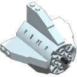

# Loot matrix 153

[Item database](../README.md) | [Methodology](../Methodology.md)

## Sources and mapped locations

| Kind | Source | Location evidence | Conditions |
| --- | --- | --- | --- |
| Drop | [AG - Ship - smashable long crate - Common Engines (LOT 4804)](../sources/object-4804.md) | [Venture Explorer (1000)](../locations/zone-1000.md) | DestructibleComponent 437; static component precedence; Static association, not a live-spawn guarantee |
| Drop | [VE Instance- Ship - smashable long crate - Common Engines (LOT 12445)](../sources/object-12445.md) | No matched local placement found | DestructibleComponent 1723; static component precedence; Static association, not a live-spawn guarantee |

## Item candidates

Default vendor-stock probabilities are shown only when this matrix has a registered vendor. Loot probabilities use the generic algorithm, not a guarantee of actual use by every script/activity.

| Item | Modeled loot chance / expected count | Default vendor stock |
| --- | --- | --- |
| { .lu-ti width="24" loading="lazy" } [Classic Rocket Engine (LOT 4715)](../4715.md) | 33.33333333%; mean 0.33333333 | Not associated with a vendor |
| { .lu-ti width="24" loading="lazy" } [Classic Blue Rocket Engine (LOT 14446)](../14446.md) | 33.33333333%; mean 0.33333333 | Not associated with a vendor |
| { .lu-ti width="24" loading="lazy" } [Classic Pink Rocket Engine (LOT 14453)](../14453.md) | 33.33333333%; mean 0.33333333 | Not associated with a vendor |

## Raw matrix entries

| Row | Loot table | Rarity table | Trigger | Min | Max | Flag | Gate |
| --- | --- | --- | --- | --- | --- | --- | --- |
| 348 | 85 | 11 | 1 | 1 | 1 |  |  |

[LootMatrix](../../../db/LootMatrix.md), [LootTable](../../../db/LootTable.md), [RarityTable](../../../db/RarityTable.md).
