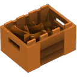
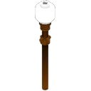
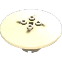

# Loot matrix 157

[Item database](../README.md) | [Methodology](../Methodology.md)

## Sources and mapped locations

No named consumer was resolved in the covered static tables. The presence of this matrix does not prove that a player can invoke it.

## Item candidates

Default vendor-stock probabilities are shown only when this matrix has a registered vendor. Loot probabilities use the generic algorithm, not a guarantee of actual use by every script/activity.

| Item | Modeled loot chance / expected count | Default vendor stock |
| --- | --- | --- |
| { .lu-ti width="24" loading="lazy" } [Tiny Mushroom Model (LOT 6027)](../6027.md) | 4.54545455%; mean 0.045454545 | Not associated with a vendor |
| { .lu-ti width="24" loading="lazy" } [Small Mushroom Model (LOT 6028)](../6028.md) | 4.54545455%; mean 0.045454545 | Not associated with a vendor |
| { .lu-ti width="24" loading="lazy" } [Medium Mushroom Model (LOT 6029)](../6029.md) | 4.54545455%; mean 0.045454545 | Not associated with a vendor |
| { .lu-ti width="24" loading="lazy" } [Large Mushroom Model (LOT 6030)](../6030.md) | 4.54545455%; mean 0.045454545 | Not associated with a vendor |
| { .lu-ti width="24" loading="lazy" } [Wooden Barrel Model (LOT 6035)](../6035.md) | 4.54545455%; mean 0.045454545 | Not associated with a vendor |
| { .lu-ti width="24" loading="lazy" } [Crate of Bananas Model (LOT 6040)](../6040.md) | 4.54545455%; mean 0.045454545 | Not associated with a vendor |
| { .lu-ti width="24" loading="lazy" } [Pirate Lantern Model (LOT 6041)](../6041.md) | 4.54545455%; mean 0.045454545 | Not associated with a vendor |
| { .lu-ti width="24" loading="lazy" } [Timeclock Model (LOT 6043)](../6043.md) | 4.54545455%; mean 0.045454545 | Not associated with a vendor |
| { .lu-ti width="24" loading="lazy" } [Small Table Model (LOT 6044)](../6044.md) | 4.54545455%; mean 0.045454545 | Not associated with a vendor |
| { .lu-ti width="24" loading="lazy" } [Hat Stand Model 1 (LOT 6053)](../6053.md) | 4.54545455%; mean 0.045454545 | Not associated with a vendor |
| { .lu-ti width="24" loading="lazy" } [Hat Stand Model 2 (LOT 6054)](../6054.md) | 4.54545455%; mean 0.045454545 | Not associated with a vendor |
| { .lu-ti width="24" loading="lazy" } [Hat Stand Model 3 (LOT 6055)](../6055.md) | 4.54545455%; mean 0.045454545 | Not associated with a vendor |
| { .lu-ti width="24" loading="lazy" } [Sword Barrel Model (LOT 6058)](../6058.md) | 4.54545455%; mean 0.045454545 | Not associated with a vendor |
| { .lu-ti width="24" loading="lazy" } [Fence Model (LOT 6071)](../6071.md) | 4.54545455%; mean 0.045454545 | Not associated with a vendor |
| { .lu-ti width="24" loading="lazy" } [Wood Pile Model (LOT 6072)](../6072.md) | 4.54545455%; mean 0.045454545 | Not associated with a vendor |
| { .lu-ti width="24" loading="lazy" } [Palm Tree Model (LOT 6523)](../6523.md) | 4.54545455%; mean 0.045454545 | Not associated with a vendor |
| { .lu-ti width="24" loading="lazy" } [Box of Pistols Model (LOT 6774)](../6774.md) | 4.54545455%; mean 0.045454545 | Not associated with a vendor |
| { .lu-ti width="24" loading="lazy" } [Box of Cups Model (LOT 6778)](../6778.md) | 4.54545455%; mean 0.045454545 | Not associated with a vendor |
| { .lu-ti width="24" loading="lazy" } [Tiki Torch Model (LOT 6779)](../6779.md) | 4.54545455%; mean 0.045454545 | Not associated with a vendor |
| { .lu-ti width="24" loading="lazy" } [Shark Model (LOT 6942)](../6942.md) | 4.54545455%; mean 0.045454545 | Not associated with a vendor |
| Unnamed LOT 6943 (LOT 6943; not an item registration) | 0% in the generic loot model | Not associated with a vendor |
| { .lu-ti width="24" loading="lazy" } [Goblet Box Model (LOT 8055)](../8055.md) | 4.54545455%; mean 0.045454545 | Not associated with a vendor |
| { .lu-ti width="24" loading="lazy" } [Mushroom Model 5 (LOT 9537)](../9537.md) | 4.54545455%; mean 0.045454545 | Not associated with a vendor |

## Raw matrix entries

| Row | Loot table | Rarity table | Trigger | Min | Max | Flag | Gate |
| --- | --- | --- | --- | --- | --- | --- | --- |
| 362 | 87 | 13 | 1 | 1 | 1 |  |  |

[LootMatrix](../../../db/LootMatrix.md), [LootTable](../../../db/LootTable.md), [RarityTable](../../../db/RarityTable.md).
