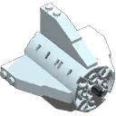
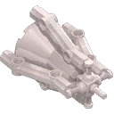

# Loot matrix 185

[Item database](../README.md) | [Methodology](../Methodology.md)

## Sources and mapped locations

No named consumer was resolved in the covered static tables. The presence of this matrix does not prove that a player can invoke it.

## Item candidates

Default vendor-stock probabilities are shown only when this matrix has a registered vendor. Loot probabilities use the generic algorithm, not a guarantee of actual use by every script/activity.

| Item | Modeled loot chance / expected count | Default vendor stock |
| --- | --- | --- |
| { .lu-ti width="24" loading="lazy" } [Classic Rocket Engine (LOT 4715)](../4715.md) | 33.33333333%; mean 0.33333333 | Not associated with a vendor |
| { .lu-ti width="24" loading="lazy" } [Steampunk Rocket Engine (LOT 4718)](../4718.md) | 33.33333333%; mean 0.33333333 | Not associated with a vendor |
| { .lu-ti width="24" loading="lazy" } [Pod Rocket Engine (LOT 4721)](../4721.md) | 33.33333333%; mean 0.33333333 | Not associated with a vendor |

## Raw matrix entries

| Row | Loot table | Rarity table | Trigger | Min | Max | Flag | Gate |
| --- | --- | --- | --- | --- | --- | --- | --- |
| 393 | 95 | 12 | 1 | 1 | 1 |  |  |

[LootMatrix](../../../db/LootMatrix.md), [LootTable](../../../db/LootTable.md), [RarityTable](../../../db/RarityTable.md).
