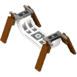
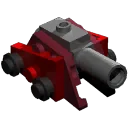

# Loot matrix 187

[Item database](../README.md) | [Methodology](../Methodology.md)

## Sources and mapped locations

No named consumer was resolved in the covered static tables. The presence of this matrix does not prove that a player can invoke it.

## Item candidates

Default vendor-stock probabilities are shown only when this matrix has a registered vendor. Loot probabilities use the generic algorithm, not a guarantee of actual use by every script/activity.

| Item | Modeled loot chance / expected count | Default vendor stock |
| --- | --- | --- |
| { .lu-ti width="24" loading="lazy" } [Water Cooler Model (LOT 6039)](../6039.md) | 7.22222222%; mean 0.072222222 | Not associated with a vendor |
| { .lu-ti width="24" loading="lazy" } [Coffee Table Model (LOT 6064)](../6064.md) | 7.22222222%; mean 0.072222222 | Not associated with a vendor |
| { .lu-ti width="24" loading="lazy" } [Cot Model (LOT 6066)](../6066.md) | 7.22222222%; mean 0.072222222 | Not associated with a vendor |
| { .lu-ti width="24" loading="lazy" } [Mini Raft Model (LOT 6521)](../6521.md) | 17.5%; mean 0.175 | Not associated with a vendor |
| { .lu-ti width="24" loading="lazy" } [Volley Gun Model (LOT 6522)](../6522.md) | 17.5%; mean 0.175 | Not associated with a vendor |
| { .lu-ti width="24" loading="lazy" } [Island Plant Model (LOT 6524)](../6524.md) | 7.22222222%; mean 0.072222222 | Not associated with a vendor |
| { .lu-ti width="24" loading="lazy" } [Large Cannon Model (LOT 6526)](../6526.md) | 7.22222222%; mean 0.072222222 | Not associated with a vendor |
| { .lu-ti width="24" loading="lazy" } [Small Cannon Model (LOT 6776)](../6776.md) | 7.22222222%; mean 0.072222222 | Not associated with a vendor |
| { .lu-ti width="24" loading="lazy" } [Candle Holder Model (LOT 7122)](../7122.md) | 7.22222222%; mean 0.072222222 | Not associated with a vendor |
| { .lu-ti width="24" loading="lazy" } [Antique Chair Model (LOT 7135)](../7135.md) | 7.22222222%; mean 0.072222222 | Not associated with a vendor |
| { .lu-ti width="24" loading="lazy" } [Armchair Model (LOT 8051)](../8051.md) | 7.22222222%; mean 0.072222222 | Not associated with a vendor |

## Raw matrix entries

| Row | Loot table | Rarity table | Trigger | Min | Max | Flag | Gate |
| --- | --- | --- | --- | --- | --- | --- | --- |
| 408 | 288 | 14 | 1 | 1 | 1 |  |  |

[LootMatrix](../../../db/LootMatrix.md), [LootTable](../../../db/LootTable.md), [RarityTable](../../../db/RarityTable.md).
