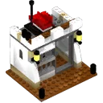
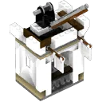
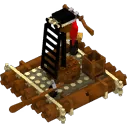
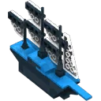
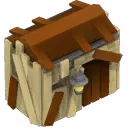

# Loot matrix 190

[Item database](../README.md) | [Methodology](../Methodology.md)

## Sources and mapped locations

No named consumer was resolved in the covered static tables. The presence of this matrix does not prove that a player can invoke it.

## Item candidates

Default vendor-stock probabilities are shown only when this matrix has a registered vendor. Loot probabilities use the generic algorithm, not a guarantee of actual use by every script/activity.

| Item | Modeled loot chance / expected count | Default vendor stock |
| --- | --- | --- |
| { .lu-ti width="24" loading="lazy" } [Medium Crate Model (LOT 6033)](../6033.md) | 12.5%; mean 0.125 | Not associated with a vendor |
| { .lu-ti width="24" loading="lazy" } [Large Crate Model (LOT 6034)](../6034.md) | 12.5%; mean 0.125 | Not associated with a vendor |
| { .lu-ti width="24" loading="lazy" } [Tent Model (LOT 6036)](../6036.md) | 12.5%; mean 0.125 | Not associated with a vendor |
| { .lu-ti width="24" loading="lazy" } [Brig Model (LOT 6045)](../6045.md) | 0% in the generic loot model | Not associated with a vendor |
| { .lu-ti width="24" loading="lazy" } [Hut Model (LOT 6060)](../6060.md) | 0% in the generic loot model | Not associated with a vendor |
| { .lu-ti width="24" loading="lazy" } [Island Jail Model (LOT 6518)](../6518.md) | 12.5%; mean 0.125 | Not associated with a vendor |
| { .lu-ti width="24" loading="lazy" } [Island Fort Model (LOT 6520)](../6520.md) | 12.5%; mean 0.125 | Not associated with a vendor |
| { .lu-ti width="24" loading="lazy" } [Deluxe Raft Model (LOT 6525)](../6525.md) | 12.5%; mean 0.125 | Not associated with a vendor |
| { .lu-ti width="24" loading="lazy" } [Mini Galleon Model (LOT 6781)](../6781.md) | 0% in the generic loot model | Not associated with a vendor |
| { .lu-ti width="24" loading="lazy" } [Mini Windrunner Model (LOT 6782)](../6782.md) | 12.5%; mean 0.125 | Not associated with a vendor |
| { .lu-ti width="24" loading="lazy" } [Pirate Duck Model (LOT 6941)](../6941.md) | 12.5%; mean 0.125 | Not associated with a vendor |
| { .lu-ti width="24" loading="lazy" } [Dock Model (LOT 7123)](../7123.md) | 0% in the generic loot model | Not associated with a vendor |
| { .lu-ti width="24" loading="lazy" } [Organ Model (LOT 7124)](../7124.md) | 0% in the generic loot model | Not associated with a vendor |
| { .lu-ti width="24" loading="lazy" } [Shack Model (LOT 7125)](../7125.md) | 0% in the generic loot model | Not associated with a vendor |
| { .lu-ti width="24" loading="lazy" } [Soda Rack Model (LOT 7126)](../7126.md) | 0% in the generic loot model | Not associated with a vendor |

## Raw matrix entries

| Row | Loot table | Rarity table | Trigger | Min | Max | Flag | Gate |
| --- | --- | --- | --- | --- | --- | --- | --- |
| 411 | 290 | 17 | 1 | 1 | 1 |  |  |

[LootMatrix](../../../db/LootMatrix.md), [LootTable](../../../db/LootTable.md), [RarityTable](../../../db/RarityTable.md).
