# Loot matrix 196

[Item database](../README.md) | [Methodology](../Methodology.md)

## Sources and mapped locations

| Kind | Source | Location evidence | Conditions |
| --- | --- | --- | --- |
| Drop | [Sentinel Turret (LOT 6254)](../sources/object-6254.md) | No matched local placement found | DestructibleComponent 506; static component precedence; Static association, not a live-spawn guarantee |
| Drop | [AG - Choice Build Buff Station (LOT 6412)](../sources/object-6412.md) | [Avant Gardens Survival (1101)](../locations/zone-1101.md) | DestructibleComponent 533; static component precedence; Static association, not a live-spawn guarantee |
| Drop | [VE Instance - Ship Turret (LOT 8432)](../sources/object-8432.md) | No matched local placement found | DestructibleComponent 885; static component precedence; Static association, not a live-spawn guarantee |
| Drop | [Test Enemy Turret - Darren (LOT 9639)](../sources/object-9639.md) | No matched local placement found | DestructibleComponent 506; static component precedence; Static association, not a live-spawn guarantee |
| Activity | AG Quickbuilds (activity ID 6, rating threshold 1, reward 26) | Selected only if this is the highest eligible rating threshold; instance zone not specified. | AG Quickbuilds (activity ID 6, rating threshold 1, reward 26); Selected only if this is the highest eligible rating threshold; instance zone not specified.; Static association, not a live-spawn guarantee |
| Activity | NS Quickbuilds (activity ID 7, rating threshold 1, reward 27) | Selected only if this is the highest eligible rating threshold; instance zone not specified. | NS Quickbuilds (activity ID 7, rating threshold 1, reward 27); Selected only if this is the highest eligible rating threshold; instance zone not specified.; Static association, not a live-spawn guarantee |
| Activity | GF Quickbuilds (activity ID 8, rating threshold 1, reward 28) | Selected only if this is the highest eligible rating threshold; instance zone not specified. | GF Quickbuilds (activity ID 8, rating threshold 1, reward 28); Selected only if this is the highest eligible rating threshold; instance zone not specified.; Static association, not a live-spawn guarantee |
| Activity | FV Quickbuilds (activity ID 9, rating threshold 1, reward 29) | Selected only if this is the highest eligible rating threshold; instance zone not specified. | FV Quickbuilds (activity ID 9, rating threshold 1, reward 29); Selected only if this is the highest eligible rating threshold; instance zone not specified.; Static association, not a live-spawn guarantee |
| Activity | GF Quickbuilds - Pirate Arch (activity ID 15, rating threshold 1, reward 38) | Selected only if this is the highest eligible rating threshold; instance zone not specified. | GF Quickbuilds - Pirate Arch (activity ID 15, rating threshold 1, reward 38); Selected only if this is the highest eligible rating threshold; instance zone not specified.; Static association, not a live-spawn guarantee |
| Activity | GF Pet X QB (activity ID 17, rating threshold 1, reward 38) | Selected only if this is the highest eligible rating threshold; instance zone not specified. | GF Pet X QB (activity ID 17, rating threshold 1, reward 38); Selected only if this is the highest eligible rating threshold; instance zone not specified.; Static association, not a live-spawn guarantee |
| Activity | AG Quickbuilds - AG wall (activity ID 21, rating threshold 1, reward 26) | Selected only if this is the highest eligible rating threshold; instance zone not specified. | AG Quickbuilds - AG wall (activity ID 21, rating threshold 1, reward 26); Selected only if this is the highest eligible rating threshold; instance zone not specified.; Static association, not a live-spawn guarantee |
| Activity | AG Quickbuilds - Monument finish line (activity ID 22, rating threshold 1, reward 26) | Selected only if this is the highest eligible rating threshold; instance zone not specified. | AG Quickbuilds - Monument finish line (activity ID 22, rating threshold 1, reward 26); Selected only if this is the highest eligible rating threshold; instance zone not specified.; Static association, not a live-spawn guarantee |
| Activity | NS Quickbuilds - Guitar (activity ID 25, rating threshold 1, reward 27) | Selected only if this is the highest eligible rating threshold; instance zone not specified. | NS Quickbuilds - Guitar (activity ID 25, rating threshold 1, reward 27); Selected only if this is the highest eligible rating threshold; instance zone not specified.; Static association, not a live-spawn guarantee |
| Activity | NS Quickbuilds - Bass (activity ID 26, rating threshold 1, reward 27) | Selected only if this is the highest eligible rating threshold; instance zone not specified. | NS Quickbuilds - Bass (activity ID 26, rating threshold 1, reward 27); Selected only if this is the highest eligible rating threshold; instance zone not specified.; Static association, not a live-spawn guarantee |
| Activity | NS Quickbuilds - Keyboard (activity ID 27, rating threshold 1, reward 27) | Selected only if this is the highest eligible rating threshold; instance zone not specified. | NS Quickbuilds - Keyboard (activity ID 27, rating threshold 1, reward 27); Selected only if this is the highest eligible rating threshold; instance zone not specified.; Static association, not a live-spawn guarantee |
| Activity | NS Quickbuilds - Drums (activity ID 28, rating threshold 1, reward 27) | Selected only if this is the highest eligible rating threshold; instance zone not specified. | NS Quickbuilds - Drums (activity ID 28, rating threshold 1, reward 27); Selected only if this is the highest eligible rating threshold; instance zone not specified.; Static association, not a live-spawn guarantee |
| Activity | GF Quickbuilds - Pirate Arch (activity ID 29, rating threshold 1, reward 28) | Selected only if this is the highest eligible rating threshold; instance zone not specified. | GF Quickbuilds - Pirate Arch (activity ID 29, rating threshold 1, reward 28); Selected only if this is the highest eligible rating threshold; instance zone not specified.; Static association, not a live-spawn guarantee |
| Activity | GF Quickbuilds - Siren (activity ID 6685, rating threshold 1, reward 28) | Selected only if this is the highest eligible rating threshold; instance zone not specified. | GF Quickbuilds - Siren (activity ID 6685, rating threshold 1, reward 28); Selected only if this is the highest eligible rating threshold; instance zone not specified.; Static association, not a live-spawn guarantee |
| Activity | NS Quickbuilds - Duck (activity ID 30, rating threshold 1, reward 27) | Selected only if this is the highest eligible rating threshold; instance zone not specified. | NS Quickbuilds - Duck (activity ID 30, rating threshold 1, reward 27); Selected only if this is the highest eligible rating threshold; instance zone not specified.; Static association, not a live-spawn guarantee |
| Activity | GF Quickbuilds - Siren (activity ID 6686, rating threshold 1, reward 28) | Selected only if this is the highest eligible rating threshold; instance zone not specified. | GF Quickbuilds - Siren (activity ID 6686, rating threshold 1, reward 28); Selected only if this is the highest eligible rating threshold; instance zone not specified.; Static association, not a live-spawn guarantee |
| Activity | Test Spider Cave quickbuilds (activity ID 31, rating threshold 1, reward 26) | Selected only if this is the highest eligible rating threshold; instance zone not specified. | Test Spider Cave quickbuilds (activity ID 31, rating threshold 1, reward 26); Selected only if this is the highest eligible rating threshold; instance zone not specified.; Static association, not a live-spawn guarantee |
| Activity | GF Quickbuilds - Siren (activity ID 32, rating threshold 1, reward 28) | Selected only if this is the highest eligible rating threshold; instance zone not specified. | GF Quickbuilds - Siren (activity ID 32, rating threshold 1, reward 28); Selected only if this is the highest eligible rating threshold; instance zone not specified.; Static association, not a live-spawn guarantee |
| Activity | NS Quickbuilds - Speaker (activity ID 33, rating threshold 1, reward 27) | Selected only if this is the highest eligible rating threshold; instance zone not specified. | NS Quickbuilds - Speaker (activity ID 33, rating threshold 1, reward 27); Selected only if this is the highest eligible rating threshold; instance zone not specified.; Static association, not a live-spawn guarantee |
| Activity | NS Quickbuilds - Lasers (activity ID 34, rating threshold 1, reward 27) | Selected only if this is the highest eligible rating threshold; instance zone not specified. | NS Quickbuilds - Lasers (activity ID 34, rating threshold 1, reward 27); Selected only if this is the highest eligible rating threshold; instance zone not specified.; Static association, not a live-spawn guarantee |
| Activity | NS Quickbuilds - Spotlight (activity ID 35, rating threshold 1, reward 27) | Selected only if this is the highest eligible rating threshold; instance zone not specified. | NS Quickbuilds - Spotlight (activity ID 35, rating threshold 1, reward 27); Selected only if this is the highest eligible rating threshold; instance zone not specified.; Static association, not a live-spawn guarantee |
| Activity | NS Quickbuilds - Fireworks (activity ID 36, rating threshold 1, reward 27) | Selected only if this is the highest eligible rating threshold; instance zone not specified. | NS Quickbuilds - Fireworks (activity ID 36, rating threshold 1, reward 27); Selected only if this is the highest eligible rating threshold; instance zone not specified.; Static association, not a live-spawn guarantee |
| Activity | AG Quickbuilds - Beacon (activity ID 40, rating threshold 1, reward 26) | Selected only if this is the highest eligible rating threshold; instance zone not specified. | AG Quickbuilds - Beacon (activity ID 40, rating threshold 1, reward 26); Selected only if this is the highest eligible rating threshold; instance zone not specified.; Static association, not a live-spawn guarantee |
| Activity | AG Quickbuilds - Sentinel Beacon (activity ID 6209, rating threshold 1, reward 26) | Selected only if this is the highest eligible rating threshold; instance zone not specified. | AG Quickbuilds - Sentinel Beacon (activity ID 6209, rating threshold 1, reward 26); Selected only if this is the highest eligible rating threshold; instance zone not specified.; Static association, not a live-spawn guarantee |
| Activity | AG Quickbuilds - Sentinel Turret (activity ID 6254, rating threshold 1, reward 26) | Selected only if this is the highest eligible rating threshold; instance zone not specified. | AG Quickbuilds - Sentinel Turret (activity ID 6254, rating threshold 1, reward 26); Selected only if this is the highest eligible rating threshold; instance zone not specified.; Static association, not a live-spawn guarantee |
| Activity | AG Quickbuilds - Sentinel Beacon 1 (activity ID 111, rating threshold 1, reward 26) | Selected only if this is the highest eligible rating threshold; instance zone not specified. | AG Quickbuilds - Sentinel Beacon 1 (activity ID 111, rating threshold 1, reward 26); Selected only if this is the highest eligible rating threshold; instance zone not specified.; Static association, not a live-spawn guarantee |
| Activity | AG Quickbuilds - Sentinel Beacon 2 (activity ID 112, rating threshold 1, reward 26) | Selected only if this is the highest eligible rating threshold; instance zone not specified. | AG Quickbuilds - Sentinel Beacon 2 (activity ID 112, rating threshold 1, reward 26); Selected only if this is the highest eligible rating threshold; instance zone not specified.; Static association, not a live-spawn guarantee |
| Activity | AG Quickbuilds - Sentinel Beacon 3 (activity ID 113, rating threshold 1, reward 26) | Selected only if this is the highest eligible rating threshold; instance zone not specified. | AG Quickbuilds - Sentinel Beacon 3 (activity ID 113, rating threshold 1, reward 26); Selected only if this is the highest eligible rating threshold; instance zone not specified.; Static association, not a live-spawn guarantee |
| Activity | AG Quickbuilds - Sentinel Beacon 4 (activity ID 114, rating threshold 1, reward 26) | Selected only if this is the highest eligible rating threshold; instance zone not specified. | AG Quickbuilds - Sentinel Beacon 4 (activity ID 114, rating threshold 1, reward 26); Selected only if this is the highest eligible rating threshold; instance zone not specified.; Static association, not a live-spawn guarantee |
| Activity | AG Quickbuilds (activity ID 123, rating threshold 1, reward 26) | Selected only if this is the highest eligible rating threshold; instance zone not specified. | AG Quickbuilds (activity ID 123, rating threshold 1, reward 26); Selected only if this is the highest eligible rating threshold; instance zone not specified.; Static association, not a live-spawn guarantee |
| Activity | AG Quickbuilds (activity ID 124, rating threshold 1, reward 26) | Selected only if this is the highest eligible rating threshold; instance zone not specified. | AG Quickbuilds (activity ID 124, rating threshold 1, reward 26); Selected only if this is the highest eligible rating threshold; instance zone not specified.; Static association, not a live-spawn guarantee |
| Activity | AG Quickbuilds (activity ID 125, rating threshold 1, reward 26) | Selected only if this is the highest eligible rating threshold; instance zone not specified. | AG Quickbuilds (activity ID 125, rating threshold 1, reward 26); Selected only if this is the highest eligible rating threshold; instance zone not specified.; Static association, not a live-spawn guarantee |
| Activity | AG Quickbuilds - Rebuildable Wall (activity ID 6319, rating threshold 1, reward 26) | Selected only if this is the highest eligible rating threshold; instance zone not specified. | AG Quickbuilds - Rebuildable Wall (activity ID 6319, rating threshold 1, reward 26); Selected only if this is the highest eligible rating threshold; instance zone not specified.; Static association, not a live-spawn guarantee |
| Activity | AG Quickbuilds - Sentinel Turret (activity ID 8432, rating threshold 1, reward 26) | Selected only if this is the highest eligible rating threshold; instance zone not specified. | AG Quickbuilds - Sentinel Turret (activity ID 8432, rating threshold 1, reward 26); Selected only if this is the highest eligible rating threshold; instance zone not specified.; Static association, not a live-spawn guarantee |
| Activity | AG Mech QB non turret (activity ID 14670, rating threshold 1, reward 26) | Selected only if this is the highest eligible rating threshold; instance zone not specified. | AG Mech QB non turret (activity ID 14670, rating threshold 1, reward 26); Selected only if this is the highest eligible rating threshold; instance zone not specified.; Static association, not a live-spawn guarantee |
| Activity | GF Tiki Torch Extinguish (activity ID 6511, rating threshold 1, reward 40) | Selected only if this is the highest eligible rating threshold; instance zone not specified. | GF Tiki Torch Extinguish (activity ID 6511, rating threshold 1, reward 40); Selected only if this is the highest eligible rating threshold; instance zone not specified.; Static association, not a live-spawn guarantee |
| Activity | GF Quickbuilds - Jail Wall (activity ID 7100, rating threshold 1, reward 26) | Selected only if this is the highest eligible rating threshold; instance zone not specified. | GF Quickbuilds - Jail Wall (activity ID 7100, rating threshold 1, reward 26); Selected only if this is the highest eligible rating threshold; instance zone not specified.; Static association, not a live-spawn guarantee |
| Activity | AG Finish Line (activity ID 6097, rating threshold 1, reward 26) | Selected only if this is the highest eligible rating threshold; instance zone not specified. | AG Finish Line (activity ID 6097, rating threshold 1, reward 26); Selected only if this is the highest eligible rating threshold; instance zone not specified.; Static association, not a live-spawn guarantee |
| Activity | NS Fountain Quickbuild (activity ID 6648, rating threshold 1, reward 27) | Selected only if this is the highest eligible rating threshold; instance zone not specified. | NS Fountain Quickbuild (activity ID 6648, rating threshold 1, reward 27); Selected only if this is the highest eligible rating threshold; instance zone not specified.; Static association, not a live-spawn guarantee |

## Item candidates

Default vendor-stock probabilities are shown only when this matrix has a registered vendor. Loot probabilities use the generic algorithm, not a guarantee of actual use by every script/activity.

| Item | Modeled loot chance / expected count | Default vendor stock |
| --- | --- | --- |
| 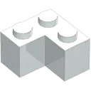{ .lu-ti width="24" loading="lazy" } [Corner Brick 1x2x2 (LOT 16)](../16.md) | 0.00819672%; mean 0.000081967213 | Not associated with a vendor |
| 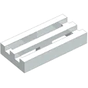{ .lu-ti width="24" loading="lazy" } [Tile 1x2 Grill (LOT 18)](../18.md) | 0.00819672%; mean 0.000081967213 | Not associated with a vendor |
| { .lu-ti width="24" loading="lazy" } [Corner Plate 1x2x2 (LOT 19)](../19.md) | 0.00819672%; mean 0.000081967213 | Not associated with a vendor |
| 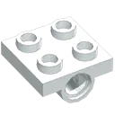{ .lu-ti width="24" loading="lazy" } [Technic Bearing Plate 2x2 with Pin Hole (LOT 23)](../23.md) | 0.00819672%; mean 0.000081967213 | Not associated with a vendor |
| 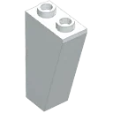{ .lu-ti width="24" loading="lazy" } [Slope Brick 75° 1x2x3 Inverted (LOT 24)](../24.md) | 0.00819672%; mean 0.000081967213 | Not associated with a vendor |
| 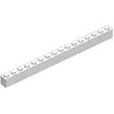{ .lu-ti width="24" loading="lazy" } [Brick 1x16 (LOT 26)](../26.md) | 0.00819672%; mean 0.000081967213 | Not associated with a vendor |
| { .lu-ti width="24" loading="lazy" } [Brick 2x4 (LOT 29)](../29.md) | 1.81818182%; mean 0.018181818 | Not associated with a vendor |
| { .lu-ti width="24" loading="lazy" } [Brick 2x3 (LOT 30)](../30.md) | 1.81818182%; mean 0.018181818 | Not associated with a vendor |
| { .lu-ti width="24" loading="lazy" } [Brick 2x2 (LOT 31)](../31.md) | 1.81818182%; mean 0.018181818 | Not associated with a vendor |
| { .lu-ti width="24" loading="lazy" } [Brick 1x2 (LOT 32)](../32.md) | 1.81818182%; mean 0.018181818 | Not associated with a vendor |
| { .lu-ti width="24" loading="lazy" } [Brick 1x1 (LOT 33)](../33.md) | 1.81818182%; mean 0.018181818 | Not associated with a vendor |
| 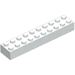{ .lu-ti width="24" loading="lazy" } [Brick 2x10 (LOT 34)](../34.md) | 0.00819672%; mean 0.000081967213 | Not associated with a vendor |
| { .lu-ti width="24" loading="lazy" } [Brick 2x8 (LOT 35)](../35.md) | 1.81818182%; mean 0.018181818 | Not associated with a vendor |
| { .lu-ti width="24" loading="lazy" } [Brick 1x8 (LOT 36)](../36.md) | 1.81818182%; mean 0.018181818 | Not associated with a vendor |
| { .lu-ti width="24" loading="lazy" } [Brick 1x6 (LOT 37)](../37.md) | 1.81818182%; mean 0.018181818 | Not associated with a vendor |
| { .lu-ti width="24" loading="lazy" } [Brick 1x4 (LOT 38)](../38.md) | 1.81818182%; mean 0.018181818 | Not associated with a vendor |
| { .lu-ti width="24" loading="lazy" } [Plate 2x4 (LOT 39)](../39.md) | 1.81818182%; mean 0.018181818 | Not associated with a vendor |
| { .lu-ti width="24" loading="lazy" } [Plate 2x3 (LOT 40)](../40.md) | 1.81818182%; mean 0.018181818 | Not associated with a vendor |
| { .lu-ti width="24" loading="lazy" } [Plate 1x2 (LOT 41)](../41.md) | 1.81818182%; mean 0.018181818 | Not associated with a vendor |
| { .lu-ti width="24" loading="lazy" } [Plate 1x1 (LOT 42)](../42.md) | 1.81818182%; mean 0.018181818 | Not associated with a vendor |
| 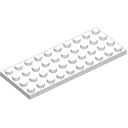{ .lu-ti width="24" loading="lazy" } [Plate 4x10 (LOT 43)](../43.md) | 0.00819672%; mean 0.000081967213 | Not associated with a vendor |
| { .lu-ti width="24" loading="lazy" } [Plate 4x4 (LOT 44)](../44.md) | 0.00819672%; mean 0.000081967213 | Not associated with a vendor |
| 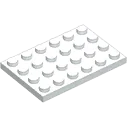{ .lu-ti width="24" loading="lazy" } [Plate 4x6 (LOT 45)](../45.md) | 0.00819672%; mean 0.000081967213 | Not associated with a vendor |
| 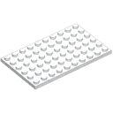{ .lu-ti width="24" loading="lazy" } [Plate 6x10 (LOT 46)](../46.md) | 0.00819672%; mean 0.000081967213 | Not associated with a vendor |
| 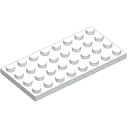{ .lu-ti width="24" loading="lazy" } [Plate 4x8 (LOT 47)](../47.md) | 0.00819672%; mean 0.000081967213 | Not associated with a vendor |
| 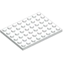{ .lu-ti width="24" loading="lazy" } [Plate 6x8 (LOT 48)](../48.md) | 0.00819672%; mean 0.000081967213 | Not associated with a vendor |
| { .lu-ti width="24" loading="lazy" } [Slope Brick 45° 2x2 (LOT 49)](../49.md) | 0.00819672%; mean 0.000081967213 | Not associated with a vendor |
| 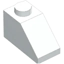{ .lu-ti width="24" loading="lazy" } [Slope Brick 45° 1x2 (LOT 50)](../50.md) | 0.00819672%; mean 0.000081967213 | Not associated with a vendor |
| { .lu-ti width="24" loading="lazy" } [Slope Brick 45° 2x2 Outside Corner (LOT 51)](../51.md) | 0.00819672%; mean 0.000081967213 | Not associated with a vendor |
| { .lu-ti width="24" loading="lazy" } [Slope Brick 45° 2x2 Inside Corner (LOT 52)](../52.md) | 0.00819672%; mean 0.000081967213 | Not associated with a vendor |
| { .lu-ti width="24" loading="lazy" } [Brick 1x1 Round (LOT 53)](../53.md) | 0.00819672%; mean 0.000081967213 | Not associated with a vendor |
| 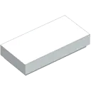{ .lu-ti width="24" loading="lazy" } [Tile 1x2 (LOT 55)](../55.md) | 0.00819672%; mean 0.000081967213 | Not associated with a vendor |
| 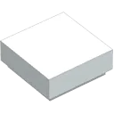{ .lu-ti width="24" loading="lazy" } [Tile 1x1 (LOT 56)](../56.md) | 0.00819672%; mean 0.000081967213 | Not associated with a vendor |
| { .lu-ti width="24" loading="lazy" } [Plate 1x8 (LOT 58)](../58.md) | 1.81818182%; mean 0.018181818 | Not associated with a vendor |
| { .lu-ti width="24" loading="lazy" } [Brick 1x3 (LOT 59)](../59.md) | 1.81818182%; mean 0.018181818 | Not associated with a vendor |
| { .lu-ti width="24" loading="lazy" } [Plate 1x3 (LOT 60)](../60.md) | 1.81818182%; mean 0.018181818 | Not associated with a vendor |
| { .lu-ti width="24" loading="lazy" } [Plate 1x6 (LOT 62)](../62.md) | 1.82622951%; mean 0.018263785 | Not associated with a vendor |
| 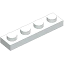{ .lu-ti width="24" loading="lazy" } [Plate 1x4 (LOT 66)](../66.md) | 1.81818182%; mean 0.018181818 | Not associated with a vendor |
| 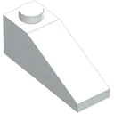{ .lu-ti width="24" loading="lazy" } [Slope Brick 25° 1x3 (LOT 73)](../73.md) | 0.00819672%; mean 0.000081967213 | Not associated with a vendor |
| { .lu-ti width="24" loading="lazy" } [Brick 1x1 with 4 Studs (LOT 76)](../76.md) | 0.00819672%; mean 0.000081967213 | Not associated with a vendor |
| { .lu-ti width="24" loading="lazy" } [Plate 1x1 Round (LOT 84)](../84.md) | 0.00819672%; mean 0.000081967213 | Not associated with a vendor |
| 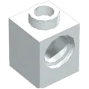{ .lu-ti width="24" loading="lazy" } [Technic Brick 1x1 (LOT 86)](../86.md) | 0.00819672%; mean 0.000081967213 | Not associated with a vendor |
| { .lu-ti width="24" loading="lazy" } [Brick 2x6 (LOT 98)](../98.md) | 1.81818182%; mean 0.018181818 | Not associated with a vendor |
| { .lu-ti width="24" loading="lazy" } [Slope Brick 1x1x2/3 (LOT 104)](../104.md) | 0.00819672%; mean 0.000081967213 | Not associated with a vendor |
| { .lu-ti width="24" loading="lazy" } [Washing Machine Brick (LOT 109)](../109.md) | 0.00819672%; mean 0.000081967213 | Not associated with a vendor |
| 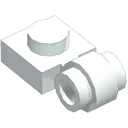{ .lu-ti width="24" loading="lazy" } [Plate 1x1 with Collar and Bilateral Studs (LOT 110)](../110.md) | 0.00819672%; mean 0.000081967213 | Not associated with a vendor |
| { .lu-ti width="24" loading="lazy" } [Slope Brick 45° 1x2 Inverted (LOT 111)](../111.md) | 0.00819672%; mean 0.000081967213 | Not associated with a vendor |
| { .lu-ti width="24" loading="lazy" } [Slope Brick 25° 2x3 (LOT 113)](../113.md) | 0.00819672%; mean 0.000081967213 | Not associated with a vendor |
| { .lu-ti width="24" loading="lazy" } [Slope Brick 25° 1x3 Inverted (LOT 114)](../114.md) | 0.00819672%; mean 0.000081967213 | Not associated with a vendor |
| 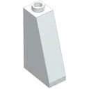{ .lu-ti width="24" loading="lazy" } [Slope Brick 75° 1x2x3 (LOT 115)](../115.md) | 0.00819672%; mean 0.000081967213 | Not associated with a vendor |
| { .lu-ti width="24" loading="lazy" } [Brick 2x2 Round (LOT 120)](../120.md) | 0.00819672%; mean 0.000081967213 | Not associated with a vendor |
| 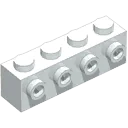{ .lu-ti width="24" loading="lazy" } [Brick 1x4 with Studs on Side (LOT 121)](../121.md) | 0.00819672%; mean 0.000081967213 | Not associated with a vendor |
| 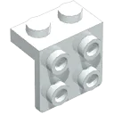{ .lu-ti width="24" loading="lazy" } [Angle Bracket Plate 1x2 / 2x2 (LOT 124)](../124.md) | 0.00819672%; mean 0.000081967213 | Not associated with a vendor |
| { .lu-ti width="24" loading="lazy" } [Slope Brick 25° 3x3 Outside Corner (LOT 141)](../141.md) | 0.00819672%; mean 0.000081967213 | Not associated with a vendor |
| 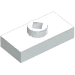{ .lu-ti width="24" loading="lazy" } [Plate 1x2 with Single Stud (LOT 143)](../143.md) | 0.00819672%; mean 0.000081967213 | Not associated with a vendor |
| { .lu-ti width="24" loading="lazy" } [Plate 2x6 (LOT 144)](../144.md) | 1.81818182%; mean 0.018181818 | Not associated with a vendor |
| Life Powerup 1 point (LOT 177; not an item registration) | 25%; mean 0.25 | Not associated with a vendor |
| { .lu-ti width="24" loading="lazy" } [Plate 2x2 Round (LOT 178)](../178.md) | 0.00819672%; mean 0.000081967213 | Not associated with a vendor |
| 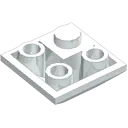{ .lu-ti width="24" loading="lazy" } [Slope Brick 45° 2x2 Corner, Inverted (LOT 179)](../179.md) | 0.00819672%; mean 0.000081967213 | Not associated with a vendor |
| 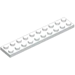{ .lu-ti width="24" loading="lazy" } [Plate 2x10 (LOT 180)](../180.md) | 0.00819672%; mean 0.000081967213 | Not associated with a vendor |
| 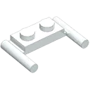{ .lu-ti width="24" loading="lazy" } [Plate 1x2 with Handles (LOT 335)](../335.md) | 0.00819672%; mean 0.000081967213 | Not associated with a vendor |
| { .lu-ti width="24" loading="lazy" } [Windscreen 3x6 25° (LOT 343)](../343.md) | 0.00819672%; mean 0.000081967213 | Not associated with a vendor |
| 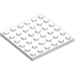{ .lu-ti width="24" loading="lazy" } [Plate 6x6 (LOT 349)](../349.md) | 0.00819672%; mean 0.000081967213 | Not associated with a vendor |
| 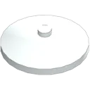{ .lu-ti width="24" loading="lazy" } [Dish 4x4 Inverted (LOT 350)](../350.md) | 0.00819672%; mean 0.000081967213 | Not associated with a vendor |
| 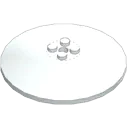{ .lu-ti width="24" loading="lazy" } [Dish 8x8 Inverted (LOT 351)](../351.md) | 0.00819672%; mean 0.000081967213 | Not associated with a vendor |
| 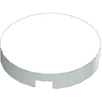{ .lu-ti width="24" loading="lazy" } [Tile 2x2 Round (LOT 362)](../362.md) | 0.00819672%; mean 0.000081967213 | Not associated with a vendor |
| { .lu-ti width="24" loading="lazy" } [Slope Brick 25° 3x3 (LOT 364)](../364.md) | 0.00819672%; mean 0.000081967213 | Not associated with a vendor |
| { .lu-ti width="24" loading="lazy" } [Tile 1x8 (LOT 365)](../365.md) | 0.00819672%; mean 0.000081967213 | Not associated with a vendor |
| 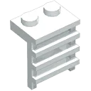{ .lu-ti width="24" loading="lazy" } [Plate 1x2 with Ladder (LOT 366)](../366.md) | 0.00819672%; mean 0.000081967213 | Not associated with a vendor |
| 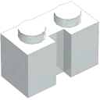{ .lu-ti width="24" loading="lazy" } [Brick 1x2 with Groove (LOT 373)](../373.md) | 0.00819672%; mean 0.000081967213 | Not associated with a vendor |
| 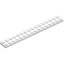{ .lu-ti width="24" loading="lazy" } [Plate 2x16 (LOT 379)](../379.md) | 0.00819672%; mean 0.000081967213 | Not associated with a vendor |
| 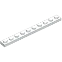{ .lu-ti width="24" loading="lazy" } [Plate 1x10 (LOT 390)](../390.md) | 0.00819672%; mean 0.000081967213 | Not associated with a vendor |
| { .lu-ti width="24" loading="lazy" } [Slope Brick 25° 6x6 Double (LOT 394)](../394.md) | 0.00819672%; mean 0.000081967213 | Not associated with a vendor |
| 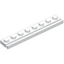{ .lu-ti width="24" loading="lazy" } [Plate 1x8 with Slide (LOT 395)](../395.md) | 0.00819672%; mean 0.000081967213 | Not associated with a vendor |
| { .lu-ti width="24" loading="lazy" } [Slope Brick 6x8 (LOT 396)](../396.md) | 0.00819672%; mean 0.000081967213 | Not associated with a vendor |
| 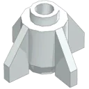{ .lu-ti width="24" loading="lazy" } [Brick 1x1x1 Round with Fins (LOT 400)](../400.md) | 0.00819672%; mean 0.000081967213 | Not associated with a vendor |
| 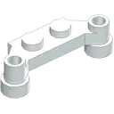{ .lu-ti width="24" loading="lazy" } [Plate 1x4 with Offset Ends (LOT 401)](../401.md) | 0.00819672%; mean 0.000081967213 | Not associated with a vendor |
| 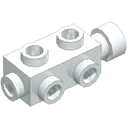{ .lu-ti width="24" loading="lazy" } [Camera Brick 1x2x2/3 (LOT 404)](../404.md) | 0.00819672%; mean 0.000081967213 | Not associated with a vendor |
| 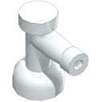{ .lu-ti width="24" loading="lazy" } [Tap 1x1 (LOT 408)](../408.md) | 0.00819672%; mean 0.000081967213 | Not associated with a vendor |
| 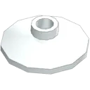{ .lu-ti width="24" loading="lazy" } [Dish 2x2 Inverted (LOT 415)](../415.md) | 0.00819672%; mean 0.000081967213 | Not associated with a vendor |
| { .lu-ti width="24" loading="lazy" } [Slope Brick 25°/45° 4x3 (LOT 424)](../424.md) | 0.00819672%; mean 0.000081967213 | Not associated with a vendor |
| 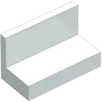{ .lu-ti width="24" loading="lazy" } [Panel 1x2x1 (LOT 428)](../428.md) | 0.00819672%; mean 0.000081967213 | Not associated with a vendor |
| { .lu-ti width="24" loading="lazy" } [Plate 6x6, 1/4-Circle (LOT 434)](../434.md) | 0.00819672%; mean 0.000081967213 | Not associated with a vendor |
| 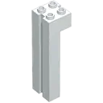{ .lu-ti width="24" loading="lazy" } [Brick 1x2x5 with Groove (LOT 446)](../446.md) | 0.00819672%; mean 0.000081967213 | Not associated with a vendor |
| 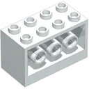{ .lu-ti width="24" loading="lazy" } [Brick 2x4x2 with Bottom Connection on Sides (LOT 450)](../450.md) | 0.00819672%; mean 0.000081967213 | Not associated with a vendor |
| { .lu-ti width="24" loading="lazy" } [Corner Plate 6x6x45° (LOT 462)](../462.md) | 0.00819672%; mean 0.000081967213 | Not associated with a vendor |
| 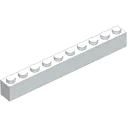{ .lu-ti width="24" loading="lazy" } [Brick 1x10 (LOT 465)](../465.md) | 0.00819672%; mean 0.000081967213 | Not associated with a vendor |
| 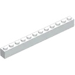{ .lu-ti width="24" loading="lazy" } [Brick 1x12 (LOT 466)](../466.md) | 0.00819672%; mean 0.000081967213 | Not associated with a vendor |
| 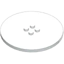{ .lu-ti width="24" loading="lazy" } [Tile 8x8 Round with 4 Studs (LOT 474)](../474.md) | 0.00819672%; mean 0.000081967213 | Not associated with a vendor |
| 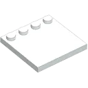{ .lu-ti width="24" loading="lazy" } [Tile 4x4 with 4 Studs (LOT 475)](../475.md) | 0.00819672%; mean 0.000081967213 | Not associated with a vendor |
| 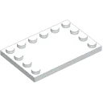{ .lu-ti width="24" loading="lazy" } [Tile 4x6 with 12 Studs (LOT 476)](../476.md) | 0.00819672%; mean 0.000081967213 | Not associated with a vendor |
| 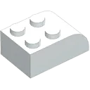{ .lu-ti width="24" loading="lazy" } [Brick 2x3 with Curved Top (LOT 483)](../483.md) | 0.00819672%; mean 0.000081967213 | Not associated with a vendor |
| { .lu-ti width="24" loading="lazy" } [Panel 1x1x1 Corner (LOT 487)](../487.md) | 0.00819672%; mean 0.000081967213 | Not associated with a vendor |
| 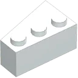{ .lu-ti width="24" loading="lazy" } [Wedge Brick 2x3 Right (LOT 499)](../499.md) | 0.00819672%; mean 0.000081967213 | Not associated with a vendor |
| 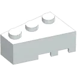{ .lu-ti width="24" loading="lazy" } [Wedge Brick 2x3 Left (LOT 500)](../500.md) | 0.00819672%; mean 0.000081967213 | Not associated with a vendor |
| { .lu-ti width="24" loading="lazy" } [Tile 4x8 with 12 Studs (LOT 501)](../501.md) | 0.00819672%; mean 0.000081967213 | Not associated with a vendor |
| { .lu-ti width="24" loading="lazy" } [Tile 1x6 (LOT 503)](../503.md) | 0.00819672%; mean 0.000081967213 | Not associated with a vendor |
| { .lu-ti width="24" loading="lazy" } [Plate 6x6 Octagonal with Cut-Out (LOT 518)](../518.md) | 0.00819672%; mean 0.000081967213 | Not associated with a vendor |
| { .lu-ti width="24" loading="lazy" } [Dome 2x2x1 2/3 (LOT 535)](../535.md) | 0.00819672%; mean 0.000081967213 | Not associated with a vendor |
| { .lu-ti width="24" loading="lazy" } [Panel 4x6x6 Sloped (LOT 537)](../537.md) | 0.00819672%; mean 0.000081967213 | Not associated with a vendor |
| { .lu-ti width="24" loading="lazy" } [Brick 2x10 with Bay (LOT 541)](../541.md) | 0.00819672%; mean 0.000081967213 | Not associated with a vendor |
| { .lu-ti width="24" loading="lazy" } [Slope Brick 55° 1x6x5 (LOT 551)](../551.md) | 0.00819672%; mean 0.000081967213 | Not associated with a vendor |
| { .lu-ti width="24" loading="lazy" } [Wedge Plate 6x12 Left (LOT 566)](../566.md) | 0.00819672%; mean 0.000081967213 | Not associated with a vendor |
| { .lu-ti width="24" loading="lazy" } [Wedge Plate 6x12 Right (LOT 567)](../567.md) | 0.00819672%; mean 0.000081967213 | Not associated with a vendor |
| { .lu-ti width="24" loading="lazy" } [Plate 3x3, 1/4-Circle (LOT 568)](../568.md) | 0.00819672%; mean 0.000081967213 | Not associated with a vendor |
| { .lu-ti width="24" loading="lazy" } [Cylinder Brick 3x6x2 2/3 (LOT 571)](../571.md) | 0.00819672%; mean 0.000081967213 | Not associated with a vendor |
| { .lu-ti width="24" loading="lazy" } [Brick 2x2x2 Round  (LOT 572)](../572.md) | 0.00819672%; mean 0.000081967213 | Not associated with a vendor |
| { .lu-ti width="24" loading="lazy" } [Astromech Robot Leg (LOT 573)](../573.md) | 0.00819672%; mean 0.000081967213 | Not associated with a vendor |
| { .lu-ti width="24" loading="lazy" } [Slope Brick 18° 2x4 (LOT 574)](../574.md) | 0.00819672%; mean 0.000081967213 | Not associated with a vendor |
| { .lu-ti width="24" loading="lazy" } [Brick 2x2 Round with Dome (LOT 576)](../576.md) | 0.00819672%; mean 0.000081967213 | Not associated with a vendor |
| { .lu-ti width="24" loading="lazy" } [Light Sword Blade (LOT 579)](../579.md) | 0.00819672%; mean 0.000081967213 | Not associated with a vendor |
| { .lu-ti width="24" loading="lazy" } [Slope Brick 75° 2x2x3 (LOT 590)](../590.md) | 0.00819672%; mean 0.000081967213 | Not associated with a vendor |
| { .lu-ti width="24" loading="lazy" } [Corner Plate 45° 4x4 (LOT 591)](../591.md) | 0.00819672%; mean 0.000081967213 | Not associated with a vendor |
| { .lu-ti width="24" loading="lazy" } [Corner Plate 45° 8x8 (LOT 592)](../592.md) | 0.00819672%; mean 0.000081967213 | Not associated with a vendor |
| { .lu-ti width="24" loading="lazy" } [Corner Brick 45° 3x3 (LOT 593)](../593.md) | 0.00819672%; mean 0.000081967213 | Not associated with a vendor |
| { .lu-ti width="24" loading="lazy" } [Beam 2x16x1 2/3 with Studs and Lattice (LOT 595)](../595.md) | 0.00819672%; mean 0.000081967213 | Not associated with a vendor |
| { .lu-ti width="24" loading="lazy" } [Plate 4x4 1/4-Circle (LOT 603)](../603.md) | 0.00819672%; mean 0.000081967213 | Not associated with a vendor |
| { .lu-ti width="24" loading="lazy" } [Plate 1x8 with Extended Slide (LOT 604)](../604.md) | 0.00819672%; mean 0.000081967213 | Not associated with a vendor |
| { .lu-ti width="24" loading="lazy" } [Plate 1x2 with Slide (LOT 613)](../613.md) | 0.00819672%; mean 0.000081967213 | Not associated with a vendor |
| { .lu-ti width="24" loading="lazy" } [Wedge Plate 4x6 (LOT 614)](../614.md) | 0.00819672%; mean 0.000081967213 | Not associated with a vendor |
| { .lu-ti width="24" loading="lazy" } [Plate 8x8 (LOT 639)](../639.md) | 0.00819672%; mean 0.000081967213 | Not associated with a vendor |
| { .lu-ti width="24" loading="lazy" } [Wedge 2x6 Curved Right (LOT 641)](../641.md) | 0.00819672%; mean 0.000081967213 | Not associated with a vendor |
| { .lu-ti width="24" loading="lazy" } [Wedge 2x6 Curved Left (LOT 642)](../642.md) | 0.00819672%; mean 0.000081967213 | Not associated with a vendor |
| { .lu-ti width="24" loading="lazy" } [Slope Brick 1x6 Curved (LOT 647)](../647.md) | 0.00819672%; mean 0.000081967213 | Not associated with a vendor |
| { .lu-ti width="24" loading="lazy" } [Slope Brick 1x6 Curved, Inverted (LOT 648)](../648.md) | 0.00819672%; mean 0.000081967213 | Not associated with a vendor |
| { .lu-ti width="24" loading="lazy" } [Wedge 2x6 Curved Inverted Right (LOT 649)](../649.md) | 0.00819672%; mean 0.000081967213 | Not associated with a vendor |
| { .lu-ti width="24" loading="lazy" } [Wedge 2x6 Curved Inverted Left (LOT 650)](../650.md) | 0.00819672%; mean 0.000081967213 | Not associated with a vendor |
| { .lu-ti width="24" loading="lazy" } [Wedge Brick 2x4 Right (LOT 651)](../651.md) | 0.00819672%; mean 0.000081967213 | Not associated with a vendor |
| { .lu-ti width="24" loading="lazy" } [Wedge Brick 2x4 Left (LOT 652)](../652.md) | 0.00819672%; mean 0.000081967213 | Not associated with a vendor |
| { .lu-ti width="24" loading="lazy" } [Wedge Plate 2x4 Right (LOT 653)](../653.md) | 0.00819672%; mean 0.000081967213 | Not associated with a vendor |
| { .lu-ti width="24" loading="lazy" } [Wedge Plate 2x4 Left (LOT 654)](../654.md) | 0.00819672%; mean 0.000081967213 | Not associated with a vendor |
| { .lu-ti width="24" loading="lazy" } [Plate 1x2 with Shaft 12M (LOT 659)](../659.md) | 0.00819672%; mean 0.000081967213 | Not associated with a vendor |
| { .lu-ti width="24" loading="lazy" } [Slope Brick 18° 4x4 Corner (LOT 663)](../663.md) | 0.00819672%; mean 0.000081967213 | Not associated with a vendor |
| { .lu-ti width="24" loading="lazy" } [Wedge 2x4 Triple Left  (LOT 664)](../664.md) | 0.00819672%; mean 0.000081967213 | Not associated with a vendor |
| { .lu-ti width="24" loading="lazy" } [Wedge 2x4 Triple Right (LOT 665)](../665.md) | 0.00819672%; mean 0.000081967213 | Not associated with a vendor |
| { .lu-ti width="24" loading="lazy" } [Wedge 4x6 Curved (LOT 666)](../666.md) | 0.00819672%; mean 0.000081967213 | Not associated with a vendor |
| { .lu-ti width="24" loading="lazy" } [Wedge Brick 2x4 Right Sloped (LOT 669)](../669.md) | 0.00819672%; mean 0.000081967213 | Not associated with a vendor |
| { .lu-ti width="24" loading="lazy" } [Wedge Brick 2x4 Left Sloped (LOT 670)](../670.md) | 0.00819672%; mean 0.000081967213 | Not associated with a vendor |
| { .lu-ti width="24" loading="lazy" } [Wedge Plate 2x3 Right (LOT 671)](../671.md) | 0.00819672%; mean 0.000081967213 | Not associated with a vendor |
| { .lu-ti width="24" loading="lazy" } [Wedge Plate 2x3 Left (LOT 672)](../672.md) | 0.00819672%; mean 0.000081967213 | Not associated with a vendor |
| { .lu-ti width="24" loading="lazy" } [Brick 8x8 (LOT 673)](../673.md) | 0.00819672%; mean 0.000081967213 | Not associated with a vendor |
| { .lu-ti width="24" loading="lazy" } [Dish 3x3 Inverted (LOT 675)](../675.md) | 0.00819672%; mean 0.000081967213 | Not associated with a vendor |
| { .lu-ti width="24" loading="lazy" } [Brick 8x16 (LOT 676)](../676.md) | 0.00819672%; mean 0.000081967213 | Not associated with a vendor |
| { .lu-ti width="24" loading="lazy" } [Dish 6x6 Inverted  (LOT 677)](../677.md) | 0.00819672%; mean 0.000081967213 | Not associated with a vendor |
| { .lu-ti width="24" loading="lazy" } [Wedge Plate 3x12 Left (LOT 693)](../693.md) | 0.00819672%; mean 0.000081967213 | Not associated with a vendor |
| { .lu-ti width="24" loading="lazy" } [Wedge Plate 3x12 Right (LOT 694)](../694.md) | 0.00819672%; mean 0.000081967213 | Not associated with a vendor |
| { .lu-ti width="24" loading="lazy" } [Bonnet 2x3x2/3 Curved with Flap and 2 Studs (LOT 700)](../700.md) | 0.00819672%; mean 0.000081967213 | Not associated with a vendor |
| { .lu-ti width="24" loading="lazy" } [Bonnet 2x2x2/3 Curved with 2 Studs (LOT 701)](../701.md) | 0.00819672%; mean 0.000081967213 | Not associated with a vendor |
| { .lu-ti width="24" loading="lazy" } [Bonnet 1x2x2/3 Curved with Flap (LOT 702)](../702.md) | 0.00819672%; mean 0.000081967213 | Not associated with a vendor |
| { .lu-ti width="24" loading="lazy" } [Brick 1x1 with 2 Studs (LOT 711)](../711.md) | 0.00819672%; mean 0.000081967213 | Not associated with a vendor |
| { .lu-ti width="24" loading="lazy" } [Plate 1x1 with Tooth (LOT 726)](../726.md) | 0.00819672%; mean 0.000081967213 | Not associated with a vendor |
| { .lu-ti width="24" loading="lazy" } [Wedge Plate 3x8 Right (LOT 728)](../728.md) | 0.00819672%; mean 0.000081967213 | Not associated with a vendor |
| { .lu-ti width="24" loading="lazy" } [Wedge Plate 3x8 Left (LOT 729)](../729.md) | 0.00819672%; mean 0.000081967213 | Not associated with a vendor |
| { .lu-ti width="24" loading="lazy" } [Dish 10x10 (LOT 746)](../746.md) | 0.00819672%; mean 0.000081967213 | Not associated with a vendor |
| { .lu-ti width="24" loading="lazy" } [Wedge Plate 2x4 (LOT 748)](../748.md) | 0.00819672%; mean 0.000081967213 | Not associated with a vendor |
| { .lu-ti width="24" loading="lazy" } [Brick 12x12 0 4.85 Combo (LOT 752)](../752.md) | 0.00819672%; mean 0.000081967213 | Not associated with a vendor |
| { .lu-ti width="24" loading="lazy" } [Brick 1x2 with 4 Studs (LOT 753)](../753.md) | 0.00819672%; mean 0.000081967213 | Not associated with a vendor |
| { .lu-ti width="24" loading="lazy" } [Wedge Plate 3x6 Right (LOT 755)](../755.md) | 0.00819672%; mean 0.000081967213 | Not associated with a vendor |
| { .lu-ti width="24" loading="lazy" } [Wedge Plate 3x6 Left (LOT 756)](../756.md) | 0.00819672%; mean 0.000081967213 | Not associated with a vendor |
| { .lu-ti width="24" loading="lazy" } [Tube Straight 2 with Stud (LOT 766)](../766.md) | 0.00819672%; mean 0.000081967213 | Not associated with a vendor |
| { .lu-ti width="24" loading="lazy" } [Tube Curved 2x2 (LOT 767)](../767.md) | 0.00819672%; mean 0.000081967213 | Not associated with a vendor |
| { .lu-ti width="24" loading="lazy" } [Slope Brick 1x3 45° Inverted Double (LOT 789)](../789.md) | 0.00819672%; mean 0.000081967213 | Not associated with a vendor |
| { .lu-ti width="24" loading="lazy" } [Corner Plate 10x10 45° (LOT 797)](../797.md) | 0.00819672%; mean 0.000081967213 | Not associated with a vendor |
| { .lu-ti width="24" loading="lazy" } [Airplane Wing 4x9 (LOT 800)](../800.md) | 0.00819672%; mean 0.000081967213 | Not associated with a vendor |
| { .lu-ti width="24" loading="lazy" } [Corner Plate 3x6 Double 45° (LOT 804)](../804.md) | 0.00819672%; mean 0.000081967213 | Not associated with a vendor |
| { .lu-ti width="24" loading="lazy" } [Tile 1x4 (LOT 807)](../807.md) | 0.00819672%; mean 0.000081967213 | Not associated with a vendor |
| { .lu-ti width="24" loading="lazy" } [Brick 2x4x2 with Studs on Sides (LOT 809)](../809.md) | 0.00819672%; mean 0.000081967213 | Not associated with a vendor |
| { .lu-ti width="24" loading="lazy" } [Angle Bracket Plate 1x2 / 1x4 (LOT 811)](../811.md) | 0.00819672%; mean 0.000081967213 | Not associated with a vendor |
| { .lu-ti width="24" loading="lazy" } [Plate 2x12 (LOT 814)](../814.md) | 0.00819672%; mean 0.000081967213 | Not associated with a vendor |
| { .lu-ti width="24" loading="lazy" } [Corner Plate 45° 3x3 (LOT 815)](../815.md) | 0.00819672%; mean 0.000081967213 | Not associated with a vendor |
| { .lu-ti width="24" loading="lazy" } [Brick 1x1x5 (LOT 816)](../816.md) | 0.00819672%; mean 0.000081967213 | Not associated with a vendor |
| { .lu-ti width="24" loading="lazy" } [Brick 1x2x5 (LOT 817)](../817.md) | 0.00819672%; mean 0.000081967213 | Not associated with a vendor |
| { .lu-ti width="24" loading="lazy" } [Brick 4x4 ¼-Circle (LOT 846)](../846.md) | 0.00819672%; mean 0.000081967213 | Not associated with a vendor |
| { .lu-ti width="24" loading="lazy" } [Corner Plate 2x4x4 (LOT 852)](../852.md) | 0.00819672%; mean 0.000081967213 | Not associated with a vendor |
| { .lu-ti width="24" loading="lazy" } [Slide Shoe Round 2x2 (LOT 854)](../854.md) | 0.00819672%; mean 0.000081967213 | Not associated with a vendor |
| { .lu-ti width="24" loading="lazy" } [Train Roof 45° 2x6 with Cut-Out (LOT 861)](../861.md) | 0.00819672%; mean 0.000081967213 | Not associated with a vendor |
| { .lu-ti width="24" loading="lazy" } [Profile Brick 1x2 (LOT 863)](../863.md) | 0.00819672%; mean 0.000081967213 | Not associated with a vendor |
| { .lu-ti width="24" loading="lazy" } [Plate 2x2 (LOT 865)](../865.md) | 1.81818182%; mean 0.018181818 | Not associated with a vendor |
| { .lu-ti width="24" loading="lazy" } [Plate 6x16 (LOT 866)](../866.md) | 0.00819672%; mean 0.000081967213 | Not associated with a vendor |
| { .lu-ti width="24" loading="lazy" } [Plate 6x12 (LOT 867)](../867.md) | 0.00819672%; mean 0.000081967213 | Not associated with a vendor |
| { .lu-ti width="24" loading="lazy" } [Plate 4x12 (LOT 868)](../868.md) | 0.00819672%; mean 0.000081967213 | Not associated with a vendor |
| { .lu-ti width="24" loading="lazy" } [Plate 2x8 (LOT 869)](../869.md) | 1.81818182%; mean 0.018181818 | Not associated with a vendor |
| { .lu-ti width="24" loading="lazy" } [Slope Brick 45° 4x2 (LOT 870)](../870.md) | 0.00819672%; mean 0.000081967213 | Not associated with a vendor |
| { .lu-ti width="24" loading="lazy" } [Slope Brick 45° 3x2 (LOT 871)](../871.md) | 0.00819672%; mean 0.000081967213 | Not associated with a vendor |
| { .lu-ti width="24" loading="lazy" } [Slope Brick 45° Ridged 2x4 (LOT 872)](../872.md) | 0.00819672%; mean 0.000081967213 | Not associated with a vendor |
| { .lu-ti width="24" loading="lazy" } [Slope Brick 45° Ridged 2x2 (LOT 873)](../873.md) | 0.00819672%; mean 0.000081967213 | Not associated with a vendor |
| { .lu-ti width="24" loading="lazy" } [Slope Brick 45° Ridged 1x2 (LOT 874)](../874.md) | 0.00819672%; mean 0.000081967213 | Not associated with a vendor |
| { .lu-ti width="24" loading="lazy" } [Slope Brick 45° Triple Ridged 1x2 (LOT 875)](../875.md) | 0.00819672%; mean 0.000081967213 | Not associated with a vendor |
| { .lu-ti width="24" loading="lazy" } [Slope Brick 45° 1x2 Top, with Inverted Connection (LOT 876)](../876.md) | 0.00819672%; mean 0.000081967213 | Not associated with a vendor |
| { .lu-ti width="24" loading="lazy" } [Flat Tile 2x2 (LOT 877)](../877.md) | 0.00819672%; mean 0.000081967213 | Not associated with a vendor |
| { .lu-ti width="24" loading="lazy" } [Plate 2x3 Semi-Round with Eye (LOT 878)](../878.md) | 0.00819672%; mean 0.000081967213 | Not associated with a vendor |
| { .lu-ti width="24" loading="lazy" } [Brick 1x2x2 (LOT 890)](../890.md) | 0.00819672%; mean 0.000081967213 | Not associated with a vendor |
| { .lu-ti width="24" loading="lazy" } [Slope Brick 25° 4x3 (LOT 891)](../891.md) | 0.00819672%; mean 0.000081967213 | Not associated with a vendor |
| { .lu-ti width="24" loading="lazy" } [Slope Brick 25° Ridged 2x4 (LOT 892)](../892.md) | 0.00819672%; mean 0.000081967213 | Not associated with a vendor |
| { .lu-ti width="24" loading="lazy" } [Slope Brick 25° Ridged 2x2 (LOT 893)](../893.md) | 0.00819672%; mean 0.000081967213 | Not associated with a vendor |
| { .lu-ti width="24" loading="lazy" } [Plate 6x14 (LOT 900)](../900.md) | 0.00819672%; mean 0.000081967213 | Not associated with a vendor |
| { .lu-ti width="24" loading="lazy" } [Slope Brick 45° 2x2 Inverted (LOT 916)](../916.md) | 0.00819672%; mean 0.000081967213 | Not associated with a vendor |
| { .lu-ti width="24" loading="lazy" } [Slope Brick 65° 2x2x2 (LOT 917)](../917.md) | 0.00819672%; mean 0.000081967213 | Not associated with a vendor |
| { .lu-ti width="24" loading="lazy" } [Slope Brick 75° 2x2x3 Corner (LOT 919)](../919.md) | 0.00819672%; mean 0.000081967213 | Not associated with a vendor |
| { .lu-ti width="24" loading="lazy" } [Slope Brick 73° 2x2x2 Pyramid (LOT 920)](../920.md) | 0.00819672%; mean 0.000081967213 | Not associated with a vendor |
| { .lu-ti width="24" loading="lazy" } [Slope Brick 25° 2x3 Inverted (LOT 927)](../927.md) | 0.00819672%; mean 0.000081967213 | Not associated with a vendor |
| Imagination Powerup 1 point (LOT 935; not an item registration) | 100%; mean 2 | Not associated with a vendor |
| { .lu-ti width="24" loading="lazy" } [Brick 2x2 with Bow and Studs (LOT 1199)](../1199.md) | 0.00819672%; mean 0.000081967213 | Not associated with a vendor |
| { .lu-ti width="24" loading="lazy" } [Robot Arm with Stud and Clip (LOT 1218)](../1218.md) | 0.00819672%; mean 0.000081967213 | Not associated with a vendor |
| { .lu-ti width="24" loading="lazy" } [Pneumatic T-Piece (LOT 1265)](../1265.md) | 0.00819672%; mean 0.000081967213 | Not associated with a vendor |
| { .lu-ti width="24" loading="lazy" } [Healing Banana (LOT 1966)](../1966.md) | 0.19736842%; mean 0.0019736842 | Not associated with a vendor |
| { .lu-ti width="24" loading="lazy" } [Notion Potion (LOT 2198)](../2198.md) | 0.19736842%; mean 0.0019736842 | Not associated with a vendor |
| { .lu-ti width="24" loading="lazy" } [Quicksicle (LOT 2620)](../2620.md) | 0.19736842%; mean 0.0019736842 | Not associated with a vendor |
| { .lu-ti width="24" loading="lazy" } [Armor Polish (LOT 2993)](../2993.md) | 0.19736842%; mean 0.0019736842 | Not associated with a vendor |
| { .lu-ti width="24" loading="lazy" } [Healing Cherry (LOT 2994)](../2994.md) | 0.19736842%; mean 0.0019736842 | Not associated with a vendor |
| { .lu-ti width="24" loading="lazy" } [Armor Shine (LOT 2996)](../2996.md) | 0.19736842%; mean 0.0019736842 | Not associated with a vendor |
| { .lu-ti width="24" loading="lazy" } [Strong Notion Potion (LOT 2998)](../2998.md) | 0.19736842%; mean 0.0019736842 | Not associated with a vendor |
| { .lu-ti width="24" loading="lazy" } [BBQ Blast Hot Dog (LOT 3011)](../3011.md) | 0.19736842%; mean 0.0019736842 | Not associated with a vendor |
| { .lu-ti width="24" loading="lazy" } [Green Imaginite (LOT 3039)](../3039.md) | 0.19736842%; mean 0.0019736842 | Not associated with a vendor |
| { .lu-ti width="24" loading="lazy" } [Red Imaginite (LOT 3040)](../3040.md) | 0.3125%; mean 0.003125 | Not associated with a vendor |
| { .lu-ti width="24" loading="lazy" } [Amber Gem (LOT 3100)](../3100.md) | 0.19736842%; mean 0.0019736842 | Not associated with a vendor |
| { .lu-ti width="24" loading="lazy" } [Brick 1x2 Hollow (LOT 5074)](../5074.md) | 0.00819672%; mean 0.000081967213 | Not associated with a vendor |
| { .lu-ti width="24" loading="lazy" } [Train Bogie Plate 4x6 (LOT 5112)](../5112.md) | 0.00819672%; mean 0.000081967213 | Not associated with a vendor |
| { .lu-ti width="24" loading="lazy" } [Slope Brick 45° 8x2 (LOT 5127)](../5127.md) | 0.00819672%; mean 0.000081967213 | Not associated with a vendor |
| { .lu-ti width="24" loading="lazy" } [Element Separator (LOT 5152)](../5152.md) | 0.00819672%; mean 0.000081967213 | Not associated with a vendor |
| { .lu-ti width="24" loading="lazy" } [Brick 12x12 1/4-Circle (LOT 5176)](../5176.md) | 0.00819672%; mean 0.000081967213 | Not associated with a vendor |
| { .lu-ti width="24" loading="lazy" } [Tile 6x12 with 22 Studs (LOT 5179)](../5179.md) | 0.00819672%; mean 0.000081967213 | Not associated with a vendor |
| { .lu-ti width="24" loading="lazy" } [Cone 1x1 (LOT 5180)](../5180.md) | 0.00819672%; mean 0.000081967213 | Not associated with a vendor |
| { .lu-ti width="24" loading="lazy" } [Brick 4X10 (LOT 5182)](../5182.md) | 0.00819672%; mean 0.000081967213 | Not associated with a vendor |
| { .lu-ti width="24" loading="lazy" } [Brick 2x2x3 (LOT 5219)](../5219.md) | 0.00819672%; mean 0.000081967213 | Not associated with a vendor |
| { .lu-ti width="24" loading="lazy" } [Panel 1x4x1 (LOT 5274)](../5274.md) | 0.00819672%; mean 0.000081967213 | Not associated with a vendor |
| { .lu-ti width="24" loading="lazy" } [Slope Brick 45° 4x6 Double (LOT 5294)](../5294.md) | 0.00819672%; mean 0.000081967213 | Not associated with a vendor |
| { .lu-ti width="24" loading="lazy" } [Wedge 3x12 Curved Right (LOT 5355)](../5355.md) | 0.00819672%; mean 0.000081967213 | Not associated with a vendor |
| { .lu-ti width="24" loading="lazy" } [Wedge 3x12 Curved Left (LOT 5356)](../5356.md) | 0.00819672%; mean 0.000081967213 | Not associated with a vendor |
| { .lu-ti width="24" loading="lazy" } [Tile 8x16 (LOT 5390)](../5390.md) | 0.00819672%; mean 0.000081967213 | Not associated with a vendor |
| { .lu-ti width="24" loading="lazy" } [Technic Hub with 4 Sticks (LOT 5400)](../5400.md) | 0.00819672%; mean 0.000081967213 | Not associated with a vendor |
| { .lu-ti width="24" loading="lazy" } [Windscreen 3x6 25° (LOT 5489)](../5489.md) | 0.00819672%; mean 0.000081967213 | Not associated with a vendor |
| { .lu-ti width="24" loading="lazy" } [Plate 4x4 Round with Pin Hole (LOT 5519)](../5519.md) | 0.00819672%; mean 0.000081967213 | Not associated with a vendor |
| { .lu-ti width="24" loading="lazy" } [Slope Brick 18° 1x4 (LOT 5521)](../5521.md) | 0.00819672%; mean 0.000081967213 | Not associated with a vendor |
| { .lu-ti width="24" loading="lazy" } [Plate 1x12 (LOT 5523)](../5523.md) | 0.00819672%; mean 0.000081967213 | Not associated with a vendor |
| { .lu-ti width="24" loading="lazy" } [Slope Brick 65° 2x1x2 (LOT 5524)](../5524.md) | 0.00819672%; mean 0.000081967213 | Not associated with a vendor |
| { .lu-ti width="24" loading="lazy" } [Hiccup Tablets (LOT 5832)](../5832.md) | 0.19736842%; mean 0.0019736842 | Not associated with a vendor |
| { .lu-ti width="24" loading="lazy" } [Brick Booster Pack (LOT 5834)](../5834.md) | 0.19736842%; mean 0.0019736842 | Not associated with a vendor |
| { .lu-ti width="24" loading="lazy" } [Super Brick Booster Pack (LOT 5835)](../5835.md) | 0.3125%; mean 0.003125 | Not associated with a vendor |
| { .lu-ti width="24" loading="lazy" } [Picnic Basket (LOT 5836)](../5836.md) | 0.19736842%; mean 0.0019736842 | Not associated with a vendor |
| { .lu-ti width="24" loading="lazy" } [Super Picnic Basket (LOT 5837)](../5837.md) | 0.3125%; mean 0.003125 | Not associated with a vendor |
| { .lu-ti width="24" loading="lazy" } [Tiny Mushroom Model (LOT 6027)](../6027.md) | 0.0234375%; mean 0.000234375 | Not associated with a vendor |
| { .lu-ti width="24" loading="lazy" } [Small Mushroom Model (LOT 6028)](../6028.md) | 0.0234375%; mean 0.000234375 | Not associated with a vendor |
| { .lu-ti width="24" loading="lazy" } [Medium Mushroom Model (LOT 6029)](../6029.md) | 0.0234375%; mean 0.000234375 | Not associated with a vendor |
| { .lu-ti width="24" loading="lazy" } [Large Mushroom Model (LOT 6030)](../6030.md) | 0.0234375%; mean 0.000234375 | Not associated with a vendor |
| { .lu-ti width="24" loading="lazy" } [Tiny Crate Model (LOT 6031)](../6031.md) | 0.00384615%; mean 0.000038461538 | Not associated with a vendor |
| { .lu-ti width="24" loading="lazy" } [Small Crate Model (LOT 6032)](../6032.md) | 0.00384615%; mean 0.000038461538 | Not associated with a vendor |
| { .lu-ti width="24" loading="lazy" } [Medium Crate Model (LOT 6033)](../6033.md) | 0.004%; mean 0.00004 | Not associated with a vendor |
| { .lu-ti width="24" loading="lazy" } [Large Crate Model (LOT 6034)](../6034.md) | 0.004%; mean 0.00004 | Not associated with a vendor |
| { .lu-ti width="24" loading="lazy" } [Wooden Barrel Model (LOT 6035)](../6035.md) | 0.0234375%; mean 0.000234375 | Not associated with a vendor |
| { .lu-ti width="24" loading="lazy" } [Tent Model (LOT 6036)](../6036.md) | 0.004%; mean 0.00004 | Not associated with a vendor |
| { .lu-ti width="24" loading="lazy" } [Desk Model (LOT 6037)](../6037.md) | 0.00384615%; mean 0.000038461538 | Not associated with a vendor |
| { .lu-ti width="24" loading="lazy" } [Water Cooler Model (LOT 6039)](../6039.md) | 0.0234375%; mean 0.000234375 | Not associated with a vendor |
| { .lu-ti width="24" loading="lazy" } [Small Table Model (LOT 6044)](../6044.md) | 0.0234375%; mean 0.000234375 | Not associated with a vendor |
| { .lu-ti width="24" loading="lazy" } [Weapon Rack Model (LOT 6056)](../6056.md) | 0.00384615%; mean 0.000038461538 | Not associated with a vendor |
| { .lu-ti width="24" loading="lazy" } [Hut Model (LOT 6060)](../6060.md) | 0.00384615%; mean 0.000038461538 | Not associated with a vendor |
| { .lu-ti width="24" loading="lazy" } [Coffee Table Model (LOT 6064)](../6064.md) | 0.0234375%; mean 0.000234375 | Not associated with a vendor |
| { .lu-ti width="24" loading="lazy" } [Cart Model (LOT 6065)](../6065.md) | 0.0234375%; mean 0.000234375 | Not associated with a vendor |
| { .lu-ti width="24" loading="lazy" } [Fence Model (LOT 6071)](../6071.md) | 0.0234375%; mean 0.000234375 | Not associated with a vendor |
| { .lu-ti width="24" loading="lazy" } [Wood Pile Model (LOT 6072)](../6072.md) | 0.0234375%; mean 0.000234375 | Not associated with a vendor |
| { .lu-ti width="24" loading="lazy" } [Thirst Quencher (LOT 6201)](../6201.md) | 0.19736842%; mean 0.0019736842 | Not associated with a vendor |
| { .lu-ti width="24" loading="lazy" } [Nexus Force Healing Kit (LOT 6207)](../6207.md) | 0.19736842%; mean 0.0019736842 | Not associated with a vendor |
| Armor Powerup 1 point (LOT 6431; not an item registration) | 25%; mean 0.25 | Not associated with a vendor |
| { .lu-ti width="24" loading="lazy" } [Box of Cups Model (LOT 6778)](../6778.md) | 0.0234375%; mean 0.000234375 | Not associated with a vendor |
| { .lu-ti width="24" loading="lazy" } [Light Blue Gem (LOT 6865)](../6865.md) | 0.3125%; mean 0.003125 | Not associated with a vendor |
| { .lu-ti width="24" loading="lazy" } [Pink Gem (LOT 6866)](../6866.md) | 0.19736842%; mean 0.0019736842 | Not associated with a vendor |
| { .lu-ti width="24" loading="lazy" } [Flash Bang (LOT 6884)](../6884.md) | 0.19736842%; mean 0.0019736842 | Not associated with a vendor |
| { .lu-ti width="24" loading="lazy" } [Candle Holder Model (LOT 7122)](../7122.md) | 0.0234375%; mean 0.000234375 | Not associated with a vendor |
| { .lu-ti width="24" loading="lazy" } [Dock Model (LOT 7123)](../7123.md) | 0.00384615%; mean 0.000038461538 | Not associated with a vendor |
| { .lu-ti width="24" loading="lazy" } [Cabinet Model (LOT 7134)](../7134.md) | 0.00384615%; mean 0.000038461538 | Not associated with a vendor |
| { .lu-ti width="24" loading="lazy" } [Antique Chair Model (LOT 7135)](../7135.md) | 0.0234375%; mean 0.000234375 | Not associated with a vendor |
| { .lu-ti width="24" loading="lazy" } [Double Trash Can Model (LOT 7759)](../7759.md) | 0.0234375%; mean 0.000234375 | Not associated with a vendor |
| { .lu-ti width="24" loading="lazy" } [Trash Can Model (LOT 7761)](../7761.md) | 0.0234375%; mean 0.000234375 | Not associated with a vendor |
| { .lu-ti width="24" loading="lazy" } [Bench Model (LOT 7770)](../7770.md) | 0.0234375%; mean 0.000234375 | Not associated with a vendor |
| { .lu-ti width="24" loading="lazy" } [Firecracker (LOT 7778)](../7778.md) | 0.19736842%; mean 0.0019736842 | Not associated with a vendor |
| { .lu-ti width="24" loading="lazy" } [Goblet Box Model (LOT 8055)](../8055.md) | 0.0234375%; mean 0.000234375 | Not associated with a vendor |
| { .lu-ti width="24" loading="lazy" } [Console Model (LOT 8068)](../8068.md) | 0.0234375%; mean 0.000234375 | Not associated with a vendor |
| { .lu-ti width="24" loading="lazy" } [Yellow Barricade Model (LOT 8069)](../8069.md) | 0.0234375%; mean 0.000234375 | Not associated with a vendor |
| { .lu-ti width="24" loading="lazy" } [Barricade Model (LOT 8073)](../8073.md) | 0.0234375%; mean 0.000234375 | Not associated with a vendor |
| { .lu-ti width="24" loading="lazy" } [Birdhouse Model (LOT 8077)](../8077.md) | 0.0234375%; mean 0.000234375 | Not associated with a vendor |
| { .lu-ti width="24" loading="lazy" } [Cloud Burst (LOT 8366)](../8366.md) | 0.19736842%; mean 0.0019736842 | Not associated with a vendor |
| { .lu-ti width="24" loading="lazy" } [Scooter Chassis 2x6 with Lateral Studs (LOT 8788)](../8788.md) | 0.00819672%; mean 0.000081967213 | Not associated with a vendor |
| { .lu-ti width="24" loading="lazy" } [Plate 6x24 (LOT 8826)](../8826.md) | 0.00819672%; mean 0.000081967213 | Not associated with a vendor |
| { .lu-ti width="24" loading="lazy" } [Brick 1x4 Hollow (LOT 8827)](../8827.md) | 0.00819672%; mean 0.000081967213 | Not associated with a vendor |
| { .lu-ti width="24" loading="lazy" } [Tile 1x4 with Hinge for Fence Gate (LOT 8831)](../8831.md) | 0.00819672%; mean 0.000081967213 | Not associated with a vendor |
| { .lu-ti width="24" loading="lazy" } [Garrison Cap (LOT 8852)](../8852.md) | 0.00819672%; mean 0.000081967213 | Not associated with a vendor |
| { .lu-ti width="24" loading="lazy" } [Slope Brick 53° 1x3x3 1/3 with Studs (LOT 8879)](../8879.md) | 0.00819672%; mean 0.000081967213 | Not associated with a vendor |
| { .lu-ti width="24" loading="lazy" } [Tile 6x16 with 26 Studs (LOT 8895)](../8895.md) | 0.00819672%; mean 0.000081967213 | Not associated with a vendor |
| { .lu-ti width="24" loading="lazy" } [Spiral Tube with Flanges (LOT 8896)](../8896.md) | 0.00819672%; mean 0.000081967213 | Not associated with a vendor |
| { .lu-ti width="24" loading="lazy" } [Brick 2x6x3 (LOT 8897)](../8897.md) | 0.00819672%; mean 0.000081967213 | Not associated with a vendor |
| { .lu-ti width="24" loading="lazy" } [Panel 2x4x4 1/2-Circle (LOT 8898)](../8898.md) | 0.00819672%; mean 0.000081967213 | Not associated with a vendor |
| { .lu-ti width="24" loading="lazy" } [Tile 6x6 (LOT 8913)](../8913.md) | 0.00819672%; mean 0.000081967213 | Not associated with a vendor |
| { .lu-ti width="24" loading="lazy" } [Ball Ø52mm (LOT 8914)](../8914.md) | 0.00819672%; mean 0.000081967213 | Not associated with a vendor |
| { .lu-ti width="24" loading="lazy" } [Brick 2x4x3 (LOT 8937)](../8937.md) | 0.00819672%; mean 0.000081967213 | Not associated with a vendor |
| { .lu-ti width="24" loading="lazy" } [Dome 4x4 Faceted (LOT 8941)](../8941.md) | 0.00819672%; mean 0.000081967213 | Not associated with a vendor |
| { .lu-ti width="24" loading="lazy" } [Brick 4x18 (LOT 8950)](../8950.md) | 0.00819672%; mean 0.000081967213 | Not associated with a vendor |
| { .lu-ti width="24" loading="lazy" } [Slope Brick 2x6 Curved (LOT 9015)](../9015.md) | 0.00819672%; mean 0.000081967213 | Not associated with a vendor |
| { .lu-ti width="24" loading="lazy" } [Tile 1x2 Engraved  (LOT 9084)](../9084.md) | 0.00819672%; mean 0.000081967213 | Not associated with a vendor |
| { .lu-ti width="24" loading="lazy" } [Technic Crane Arm 16 (LOT 9086)](../9086.md) | 0.00819672%; mean 0.000081967213 | Not associated with a vendor |
| { .lu-ti width="24" loading="lazy" } [Brick 4x12 (LOT 9088)](../9088.md) | 0.00819672%; mean 0.000081967213 | Not associated with a vendor |
| { .lu-ti width="24" loading="lazy" } [Spike 2x8 (Flexible) with 2 Studs (LOT 9106)](../9106.md) | 0.00819672%; mean 0.000081967213 | Not associated with a vendor |
| { .lu-ti width="24" loading="lazy" } [Tile 1x3 (LOT 9130)](../9130.md) | 0.00819672%; mean 0.000081967213 | Not associated with a vendor |
| { .lu-ti width="24" loading="lazy" } [Frame Plate 4x4 (LOT 9157)](../9157.md) | 0.00819672%; mean 0.000081967213 | Not associated with a vendor |
| { .lu-ti width="24" loading="lazy" } [Slope Brick 1x2x2/3 (LOT 9192)](../9192.md) | 0.00819672%; mean 0.000081967213 | Not associated with a vendor |
| { .lu-ti width="24" loading="lazy" } [Space Blaster, Smooth (LOT 9193)](../9193.md) | 0.00819672%; mean 0.000081967213 | Not associated with a vendor |
| { .lu-ti width="24" loading="lazy" } [Dome 4x4 Smooth Ø32 (LOT 9194)](../9194.md) | 0.00819672%; mean 0.000081967213 | Not associated with a vendor |
| { .lu-ti width="24" loading="lazy" } [Tile 2x4 (LOT 9195)](../9195.md) | 0.00819672%; mean 0.000081967213 | Not associated with a vendor |
| { .lu-ti width="24" loading="lazy" } [Brick 4x4 Round with Pin Hole (LOT 9197)](../9197.md) | 0.00819672%; mean 0.000081967213 | Not associated with a vendor |
| { .lu-ti width="24" loading="lazy" } [Brick 1x1 with 1 Stud on Side (LOT 9201)](../9201.md) | 0.00819672%; mean 0.000081967213 | Not associated with a vendor |
| { .lu-ti width="24" loading="lazy" } [Plate 2x2 with 1 Stud (LOT 9203)](../9203.md) | 0.00819672%; mean 0.000081967213 | Not associated with a vendor |
| { .lu-ti width="24" loading="lazy" } [Plate 2x6x2/3 with 4 Horizontal Studs (LOT 9204)](../9204.md) | 0.00819672%; mean 0.000081967213 | Not associated with a vendor |
| { .lu-ti width="24" loading="lazy" } [Tile 2x6 with Holder (LOT 9237)](../9237.md) | 0.00819672%; mean 0.000081967213 | Not associated with a vendor |
| { .lu-ti width="24" loading="lazy" } [Television Model (LOT 9488)](../9488.md) | 0.00384615%; mean 0.000038461538 | Not associated with a vendor |
| { .lu-ti width="24" loading="lazy" } [Troll Cart Model (LOT 9490)](../9490.md) | 0.0234375%; mean 0.000234375 | Not associated with a vendor |
| { .lu-ti width="24" loading="lazy" } [Castle Weapon Rack Model (LOT 9493)](../9493.md) | 0.0234375%; mean 0.000234375 | Not associated with a vendor |
| { .lu-ti width="24" loading="lazy" } [Medieval Wagon Model (LOT 9591)](../9591.md) | 0.00384615%; mean 0.000038461538 | Not associated with a vendor |
| { .lu-ti width="24" loading="lazy" } [Medieval Vendor Model (LOT 9596)](../9596.md) | 0.00384615%; mean 0.000038461538 | Not associated with a vendor |
| { .lu-ti width="24" loading="lazy" } [Medieval Village Stable Model (LOT 9648)](../9648.md) | 0.00142857%; mean 0.000014285714 | Not associated with a vendor |
| { .lu-ti width="24" loading="lazy" } [Medieval Village Forge Model (LOT 9649)](../9649.md) | 0.00142857%; mean 0.000014285714 | Not associated with a vendor |
| { .lu-ti width="24" loading="lazy" } [Medieval Village Inn Model (LOT 9650)](../9650.md) | 0.00142857%; mean 0.000014285714 | Not associated with a vendor |
| { .lu-ti width="24" loading="lazy" } [Medieval Village House Model (LOT 9651)](../9651.md) | 0.00142857%; mean 0.000014285714 | Not associated with a vendor |
| { .lu-ti width="24" loading="lazy" } [Castle Arbalest Model (LOT 9652)](../9652.md) | 0.00384615%; mean 0.000038461538 | Not associated with a vendor |
| { .lu-ti width="24" loading="lazy" } [Castle Barrel Gun Model (LOT 9653)](../9653.md) | 0.00384615%; mean 0.000038461538 | Not associated with a vendor |
| { .lu-ti width="24" loading="lazy" } [Castle Catapult Model (LOT 9654)](../9654.md) | 0.00384615%; mean 0.000038461538 | Not associated with a vendor |
| { .lu-ti width="24" loading="lazy" } [Castle Inner Corner Model (LOT 9656)](../9656.md) | 0.00142857%; mean 0.000014285714 | Not associated with a vendor |
| { .lu-ti width="24" loading="lazy" } [Castle Outside Corner Model (LOT 9657)](../9657.md) | 0.00142857%; mean 0.000014285714 | Not associated with a vendor |
| { .lu-ti width="24" loading="lazy" } [Castle Small Corner Model (LOT 9658)](../9658.md) | 0.004%; mean 0.00004 | Not associated with a vendor |
| { .lu-ti width="24" loading="lazy" } [Castle Crossing Model (LOT 9659)](../9659.md) | 0.004%; mean 0.00004 | Not associated with a vendor |
| { .lu-ti width="24" loading="lazy" } [Castle Gate Model (LOT 9660)](../9660.md) | 0.00142857%; mean 0.000014285714 | Not associated with a vendor |
| { .lu-ti width="24" loading="lazy" } [Castle Outhouse Model (LOT 9661)](../9661.md) | 0.004%; mean 0.00004 | Not associated with a vendor |
| { .lu-ti width="24" loading="lazy" } [Castle Ramp Model (LOT 9662)](../9662.md) | 0.00142857%; mean 0.000014285714 | Not associated with a vendor |
| { .lu-ti width="24" loading="lazy" } [Castle Staircase Model (LOT 9663)](../9663.md) | 0.004%; mean 0.00004 | Not associated with a vendor |
| { .lu-ti width="24" loading="lazy" } [Castle Tower Model (LOT 9664)](../9664.md) | 0.00142857%; mean 0.000014285714 | Not associated with a vendor |
| { .lu-ti width="24" loading="lazy" } [Castle Wall Bridge Model (LOT 9665)](../9665.md) | 0.00142857%; mean 0.000014285714 | Not associated with a vendor |
| { .lu-ti width="24" loading="lazy" } [Castle Wall End Model (LOT 9666)](../9666.md) | 0.004%; mean 0.00004 | Not associated with a vendor |
| { .lu-ti width="24" loading="lazy" } [Castle Small Wall Model 1 (LOT 9667)](../9667.md) | 0.00384615%; mean 0.000038461538 | Not associated with a vendor |
| { .lu-ti width="24" loading="lazy" } [Castle Small Wall Model 2 (LOT 9668)](../9668.md) | 0.00384615%; mean 0.000038461538 | Not associated with a vendor |
| { .lu-ti width="24" loading="lazy" } [Castle Small Wall Model 3 (LOT 9669)](../9669.md) | 0.00384615%; mean 0.000038461538 | Not associated with a vendor |
| { .lu-ti width="24" loading="lazy" } [Castle Small Wall Model 4 (LOT 9670)](../9670.md) | 0.00384615%; mean 0.000038461538 | Not associated with a vendor |
| { .lu-ti width="24" loading="lazy" } [Castle Straight Wall Model (LOT 9671)](../9671.md) | 0.004%; mean 0.00004 | Not associated with a vendor |
| { .lu-ti width="24" loading="lazy" } [Castle Medium Straight Wall Model (LOT 9672)](../9672.md) | 0.004%; mean 0.00004 | Not associated with a vendor |
| { .lu-ti width="24" loading="lazy" } [Castle Medium Spikes Wall Model (LOT 9673)](../9673.md) | 0.004%; mean 0.00004 | Not associated with a vendor |
| { .lu-ti width="24" loading="lazy" } [Castle T-Wall Model (LOT 9674)](../9674.md) | 0.00142857%; mean 0.000014285714 | Not associated with a vendor |
| { .lu-ti width="24" loading="lazy" } [Castle Tower Wall With No Top Model (LOT 9675)](../9675.md) | 0.00142857%; mean 0.000014285714 | Not associated with a vendor |
| { .lu-ti width="24" loading="lazy" } [Castle Tower Wall With Top Model (LOT 9676)](../9676.md) | 0.00142857%; mean 0.000014285714 | Not associated with a vendor |
| { .lu-ti width="24" loading="lazy" } [Castle Widening Wall Model (LOT 9677)](../9677.md) | 0.00142857%; mean 0.000014285714 | Not associated with a vendor |
| { .lu-ti width="24" loading="lazy" } [Castle Wall With Stairs Model (LOT 9678)](../9678.md) | 0.004%; mean 0.00004 | Not associated with a vendor |
| { .lu-ti width="24" loading="lazy" } [Turntable 2x2 (LOT 10195)](../10195.md) | 0.00819672%; mean 0.000081967213 | Not associated with a vendor |
| { .lu-ti width="24" loading="lazy" } [House Bathtub Model 1 (LOT 10328)](../10328.md) | 0.00384615%; mean 0.000038461538 | Not associated with a vendor |
| { .lu-ti width="24" loading="lazy" } [House Bathtub Model 2 (LOT 10329)](../10329.md) | 0.00384615%; mean 0.000038461538 | Not associated with a vendor |
| { .lu-ti width="24" loading="lazy" } [House Closed Door Model 1 (LOT 10330)](../10330.md) | 0.0234375%; mean 0.000234375 | Not associated with a vendor |
| { .lu-ti width="24" loading="lazy" } [House Open Door Model 1 (LOT 10331)](../10331.md) | 0.0234375%; mean 0.000234375 | Not associated with a vendor |
| { .lu-ti width="24" loading="lazy" } [House Closed Door Model 2 (LOT 10332)](../10332.md) | 0.00384615%; mean 0.000038461538 | Not associated with a vendor |
| { .lu-ti width="24" loading="lazy" } [House Open Door Model 2 (LOT 10333)](../10333.md) | 0.00384615%; mean 0.000038461538 | Not associated with a vendor |
| { .lu-ti width="24" loading="lazy" } [House Closed Door Model 3 (LOT 10334)](../10334.md) | 0.0234375%; mean 0.000234375 | Not associated with a vendor |
| { .lu-ti width="24" loading="lazy" } [House Open Door Model 3 (LOT 10335)](../10335.md) | 0.0234375%; mean 0.000234375 | Not associated with a vendor |
| { .lu-ti width="24" loading="lazy" } [House Kitchen Model 1 (LOT 10336)](../10336.md) | 0.004%; mean 0.00004 | Not associated with a vendor |
| { .lu-ti width="24" loading="lazy" } [House Kitchen Model 2 (LOT 10337)](../10337.md) | 0.00384615%; mean 0.000038461538 | Not associated with a vendor |
| { .lu-ti width="24" loading="lazy" } [House Kitchen Model 3 (LOT 10338)](../10338.md) | 0.00384615%; mean 0.000038461538 | Not associated with a vendor |
| { .lu-ti width="24" loading="lazy" } [House Laundry Model 1 (LOT 10339)](../10339.md) | 0.00384615%; mean 0.000038461538 | Not associated with a vendor |
| { .lu-ti width="24" loading="lazy" } [House Laundry Model 2 (LOT 10340)](../10340.md) | 0.00384615%; mean 0.000038461538 | Not associated with a vendor |
| { .lu-ti width="24" loading="lazy" } [House Library Model 1 (LOT 10341)](../10341.md) | 0.004%; mean 0.00004 | Not associated with a vendor |
| { .lu-ti width="24" loading="lazy" } [House Library Model 2 (LOT 10342)](../10342.md) | 0.00384615%; mean 0.000038461538 | Not associated with a vendor |
| { .lu-ti width="24" loading="lazy" } [House Library Model 3 (LOT 10343)](../10343.md) | 0.00384615%; mean 0.000038461538 | Not associated with a vendor |
| { .lu-ti width="24" loading="lazy" } [House Library Model 4 (LOT 10344)](../10344.md) | 0.00384615%; mean 0.000038461538 | Not associated with a vendor |
| { .lu-ti width="24" loading="lazy" } [House Toilet Model 2 (LOT 10345)](../10345.md) | 0.00384615%; mean 0.000038461538 | Not associated with a vendor |
| { .lu-ti width="24" loading="lazy" } [House Vanity Model 1 (LOT 10346)](../10346.md) | 0.00384615%; mean 0.000038461538 | Not associated with a vendor |
| { .lu-ti width="24" loading="lazy" } [House Vanity Model 2 (LOT 10347)](../10347.md) | 0.00384615%; mean 0.000038461538 | Not associated with a vendor |
| { .lu-ti width="24" loading="lazy" } [House Vanity Model 3 (LOT 10348)](../10348.md) | 0.004%; mean 0.00004 | Not associated with a vendor |
| { .lu-ti width="24" loading="lazy" } [House Vanity Model 4 (LOT 10349)](../10349.md) | 0.00384615%; mean 0.000038461538 | Not associated with a vendor |
| { .lu-ti width="24" loading="lazy" } [House Wall Arch Model (LOT 10350)](../10350.md) | 0.0234375%; mean 0.000234375 | Not associated with a vendor |
| { .lu-ti width="24" loading="lazy" } [House Wall Art Model 1 (LOT 10351)](../10351.md) | 0.00384615%; mean 0.000038461538 | Not associated with a vendor |
| { .lu-ti width="24" loading="lazy" } [House Wall Art Model 2 (LOT 10352)](../10352.md) | 0.00384615%; mean 0.000038461538 | Not associated with a vendor |
| { .lu-ti width="24" loading="lazy" } [House Wall Blank Model 1 (LOT 10353)](../10353.md) | 0.0234375%; mean 0.000234375 | Not associated with a vendor |
| { .lu-ti width="24" loading="lazy" } [House Wall Blank Model 2 (LOT 10354)](../10354.md) | 0.0234375%; mean 0.000234375 | Not associated with a vendor |
| { .lu-ti width="24" loading="lazy" } [House Wall Blank Model 3 (LOT 10355)](../10355.md) | 0.0234375%; mean 0.000234375 | Not associated with a vendor |
| { .lu-ti width="24" loading="lazy" } [House Wall Corner Model 1 (LOT 10356)](../10356.md) | 0.00384615%; mean 0.000038461538 | Not associated with a vendor |
| { .lu-ti width="24" loading="lazy" } [House Wall Corner Model 2 (LOT 10357)](../10357.md) | 0.00384615%; mean 0.000038461538 | Not associated with a vendor |
| { .lu-ti width="24" loading="lazy" } [House Wall Corner Model 3 (LOT 10358)](../10358.md) | 0.00384615%; mean 0.000038461538 | Not associated with a vendor |
| { .lu-ti width="24" loading="lazy" } [House Wall Fireplace Model 1 (LOT 10359)](../10359.md) | 0.004%; mean 0.00004 | Not associated with a vendor |
| { .lu-ti width="24" loading="lazy" } [House Window Model 1 (LOT 10360)](../10360.md) | 0.00384615%; mean 0.000038461538 | Not associated with a vendor |
| { .lu-ti width="24" loading="lazy" } [House Window Model 2 (LOT 10361)](../10361.md) | 0.00384615%; mean 0.000038461538 | Not associated with a vendor |
| { .lu-ti width="24" loading="lazy" } [House Window Model 3 (LOT 10362)](../10362.md) | 0.004%; mean 0.00004 | Not associated with a vendor |
| { .lu-ti width="24" loading="lazy" } [House Window Model 4 (LOT 10363)](../10363.md) | 0.004%; mean 0.00004 | Not associated with a vendor |
| { .lu-ti width="24" loading="lazy" } [House Window Model 5 (LOT 10364)](../10364.md) | 0.004%; mean 0.00004 | Not associated with a vendor |
| { .lu-ti width="24" loading="lazy" } [House Window Model 6 (LOT 10365)](../10365.md) | 0.004%; mean 0.00004 | Not associated with a vendor |
| { .lu-ti width="24" loading="lazy" } [Faction Token Proxy (LOT 13763)](../13763.md) | 10%; mean 0.1 | Not associated with a vendor |
| { .lu-ti width="24" loading="lazy" } [Cockpit 4x4x4 (LOT 16323)](../16323.md) | 0.00819672%; mean 0.000081967213 | Not associated with a vendor |
| { .lu-ti width="24" loading="lazy" } [Banner with 3.18 Stick 3x8 (LOT 16343)](../16343.md) | 0.00819672%; mean 0.000081967213 | Not associated with a vendor |
| { .lu-ti width="24" loading="lazy" } [Brick 4x6 (LOT 16366)](../16366.md) | 0.00819672%; mean 0.000081967213 | Not associated with a vendor |
| { .lu-ti width="24" loading="lazy" } [Holder with Cross Axle and Knob (LOT 16374)](../16374.md) | 0.00819672%; mean 0.000081967213 | Not associated with a vendor |
| { .lu-ti width="24" loading="lazy" } [Brick 6x6x2 W. Ø4.85 (LOT 16375)](../16375.md) | 0.00819672%; mean 0.000081967213 | Not associated with a vendor |
| { .lu-ti width="24" loading="lazy" } [Lamp Shade (LOT 16405)](../16405.md) | 0.00819672%; mean 0.000081967213 | Not associated with a vendor |
| { .lu-ti width="24" loading="lazy" } [Front 4x6x1 2/3 (LOT 16410)](../16410.md) | 0.00819672%; mean 0.000081967213 | Not associated with a vendor |
| { .lu-ti width="24" loading="lazy" } [Brick 2x2 with Groove (LOT 16423)](../16423.md) | 0.00819672%; mean 0.000081967213 | Not associated with a vendor |
| { .lu-ti width="24" loading="lazy" } [Round Wall 3x6x10 (LOT 16442)](../16442.md) | 0.00819672%; mean 0.000081967213 | Not associated with a vendor |
| { .lu-ti width="24" loading="lazy" } [Plate 1x4 with 2 Knobs (LOT 16443)](../16443.md) | 0.00819672%; mean 0.000081967213 | Not associated with a vendor |

## Raw matrix entries

| Row | Loot table | Rarity table | Trigger | Min | Max | Flag | Gate |
| --- | --- | --- | --- | --- | --- | --- | --- |
| 416 | 3 | 4 | 0.25 | 1 | 1 |  |  |
| 417 | 32 | 4 | 1 | 2 | 2 |  |  |
| 419 | 97 | 4 | 0.25 | 1 | 1 |  |  |
| 833 | 670 | 23 | 0.1 | 1 | 1 |  |  |
| 1378 | 110 | 19 | 0.4 | 1 | 1 |  |  |
| 1492 | 111 | 18 | 0.02 | 1 | 1 |  |  |
| 5089 | 114 | 4 | 0.01 | 1 | 1 |  |  |
| 5090 | 73 | 4 | 0.05 | 1 | 1 |  |  |

[LootMatrix](../../../db/LootMatrix.md), [LootTable](../../../db/LootTable.md), [RarityTable](../../../db/RarityTable.md).
