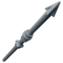
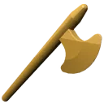
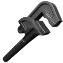
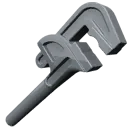
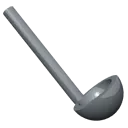

# Loot matrix 198

[Item database](../README.md) | [Methodology](../Methodology.md)

## Sources and mapped locations

| Kind | Source | Location evidence | Conditions |
| --- | --- | --- | --- |
| Activity | PvP Siege Winner T2 (activity ID 37, rating threshold 500, reward 42) | Selected only if this is the highest eligible rating threshold; instance zone 1401. | PvP Siege Winner T2 (activity ID 37, rating threshold 500, reward 42); Selected only if this is the highest eligible rating threshold; instance zone 1401.; Static association, not a live-spawn guarantee |

## Item candidates

Default vendor-stock probabilities are shown only when this matrix has a registered vendor. Loot probabilities use the generic algorithm, not a guarantee of actual use by every script/activity.

| Item | Modeled loot chance / expected count | Default vendor stock |
| --- | --- | --- |
| { .lu-ti width="24" loading="lazy" } [Exceptional Hatchet (LOT 2643)](../2643.md) | 2.20987654%; mean 0.022222222 | Not associated with a vendor |
| { .lu-ti width="24" loading="lazy" } [Worthy Corseque (LOT 2644)](../2644.md) | 17.87109375%; mean 0.1875 | Not associated with a vendor |
| { .lu-ti width="24" loading="lazy" } [Worthy Shovel (LOT 3067)](../3067.md) | 17.87109375%; mean 0.1875 | Not associated with a vendor |
| { .lu-ti width="24" loading="lazy" } [Superior Fish on a Stick (LOT 6973)](../6973.md) | 4.23979592%; mean 0.042857143 | Not associated with a vendor |
| { .lu-ti width="24" loading="lazy" } [Worthy Force Blade (LOT 7068)](../7068.md) | 17.87109375%; mean 0.1875 | Not associated with a vendor |
| { .lu-ti width="24" loading="lazy" } [Superior Lance (LOT 7070)](../7070.md) | 4.23979592%; mean 0.042857143 | Not associated with a vendor |
| { .lu-ti width="24" loading="lazy" } [Worthy Javelin (LOT 7079)](../7079.md) | 17.87109375%; mean 0.1875 | Not associated with a vendor |
| { .lu-ti width="24" loading="lazy" } [Superior Shortsword (LOT 8479)](../8479.md) | 4.23979592%; mean 0.042857143 | Not associated with a vendor |
| { .lu-ti width="24" loading="lazy" } [Exceptional Axe (LOT 8480)](../8480.md) | 2.20987654%; mean 0.022222222 | Not associated with a vendor |
| { .lu-ti width="24" loading="lazy" } [Worthy Wrench (LOT 8481)](../8481.md) | 17.87109375%; mean 0.1875 | Not associated with a vendor |
| { .lu-ti width="24" loading="lazy" } [Exceptional Pipe Wrench (LOT 8482)](../8482.md) | 2.20987654%; mean 0.022222222 | Not associated with a vendor |
| { .lu-ti width="24" loading="lazy" } [Exceptional Ladle (LOT 8483)](../8483.md) | 2.20987654%; mean 0.022222222 | Not associated with a vendor |
| { .lu-ti width="24" loading="lazy" } [Worthy Butterfly Net (LOT 8484)](../8484.md) | 17.87109375%; mean 0.1875 | Not associated with a vendor |
| { .lu-ti width="24" loading="lazy" } [Superior Huge Axe (LOT 8485)](../8485.md) | 4.23979592%; mean 0.042857143 | Not associated with a vendor |
| { .lu-ti width="24" loading="lazy" } [Exceptional Spear (LOT 8487)](../8487.md) | 2.20987654%; mean 0.022222222 | Not associated with a vendor |
| { .lu-ti width="24" loading="lazy" } [Superior Hammer (LOT 8488)](../8488.md) | 4.23979592%; mean 0.042857143 | Not associated with a vendor |
| { .lu-ti width="24" loading="lazy" } [Worthy Ice Saw (LOT 8489)](../8489.md) | 17.87109375%; mean 0.1875 | Not associated with a vendor |
| { .lu-ti width="24" loading="lazy" } [Superior Halberd (LOT 8490)](../8490.md) | 4.23979592%; mean 0.042857143 | Not associated with a vendor |
| { .lu-ti width="24" loading="lazy" } [Wand of Knockback (LOT 8491)](../8491.md) | 2.20987654%; mean 0.022222222 | Not associated with a vendor |
| { .lu-ti width="24" loading="lazy" } [Wand of Sleep (LOT 8492)](../8492.md) | 2.20987654%; mean 0.022222222 | Not associated with a vendor |
| { .lu-ti width="24" loading="lazy" } [Superior Katana (LOT 8493)](../8493.md) | 4.23979592%; mean 0.042857143 | Not associated with a vendor |
| { .lu-ti width="24" loading="lazy" } [Exceptional Dagger (LOT 8494)](../8494.md) | 2.20987654%; mean 0.022222222 | Not associated with a vendor |
| { .lu-ti width="24" loading="lazy" } [Exceptional Force Blade (LOT 8495)](../8495.md) | 2.20987654%; mean 0.022222222 | Not associated with a vendor |
| { .lu-ti width="24" loading="lazy" } [Worthy Morning Star (LOT 8496)](../8496.md) | 17.87109375%; mean 0.1875 | Not associated with a vendor |

## Raw matrix entries

| Row | Loot table | Rarity table | Trigger | Min | Max | Flag | Gate |
| --- | --- | --- | --- | --- | --- | --- | --- |
| 539 | 102 | 4 | 1 | 2 | 2 |  |  |

[LootMatrix](../../../db/LootMatrix.md), [LootTable](../../../db/LootTable.md), [RarityTable](../../../db/RarityTable.md).
