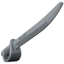
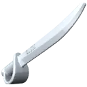

# Loot matrix 235

[Item database](../README.md) | [Methodology](../Methodology.md)

## Sources and mapped locations

No named consumer was resolved in the covered static tables. The presence of this matrix does not prove that a player can invoke it.

**Generic loot probability unavailable:** at least one entry has maxToDrop < minToDrop. Vendor code treats a zero endpoint as “include the full table”; the generic loot code does not define that interpretation. No drop percentage is fabricated for this matrix.

## Item candidates

Default vendor-stock probabilities are shown only when this matrix has a registered vendor. Loot probabilities use the generic algorithm, not a guarantee of actual use by every script/activity.

| Item | Modeled loot chance / expected count | Default vendor stock |
| --- | --- | --- |
| { .lu-ti width="24" loading="lazy" } [Superior Pirate's Scimitar (LOT 1764)](../1764.md) | Undefined for generic loot: reversed count range | Not associated with a vendor |
| { .lu-ti width="24" loading="lazy" } [Exceptional Flintlock Rifle of Blasting (LOT 1891)](../1891.md) | Undefined for generic loot: reversed count range | Not associated with a vendor |
| { .lu-ti width="24" loading="lazy" } [Healing Banana (LOT 1966)](../1966.md) | Undefined for generic loot: reversed count range | Not associated with a vendor |
| { .lu-ti width="24" loading="lazy" } [Quicksicle (LOT 2620)](../2620.md) | Undefined for generic loot: reversed count range | Not associated with a vendor |
| { .lu-ti width="24" loading="lazy" } [Shiver Me Timbers Axe (LOT 2631)](../2631.md) | Undefined for generic loot: reversed count range | Not associated with a vendor |
| { .lu-ti width="24" loading="lazy" } [Exceptional Flintlock Pistol (LOT 2990)](../2990.md) | Undefined for generic loot: reversed count range | Not associated with a vendor |
| { .lu-ti width="24" loading="lazy" } [Armor Polish (LOT 2993)](../2993.md) | Undefined for generic loot: reversed count range | Not associated with a vendor |
| { .lu-ti width="24" loading="lazy" } [Healing Cherry (LOT 2994)](../2994.md) | Undefined for generic loot: reversed count range | Not associated with a vendor |
| { .lu-ti width="24" loading="lazy" } [Healing Apple (LOT 2995)](../2995.md) | Undefined for generic loot: reversed count range | Not associated with a vendor |
| { .lu-ti width="24" loading="lazy" } [Armor Shine (LOT 2996)](../2996.md) | Undefined for generic loot: reversed count range | Not associated with a vendor |
| { .lu-ti width="24" loading="lazy" } [Armor Gleam (LOT 2997)](../2997.md) | Undefined for generic loot: reversed count range | Not associated with a vendor |
| { .lu-ti width="24" loading="lazy" } [Strong Notion Potion (LOT 2998)](../2998.md) | Undefined for generic loot: reversed count range | Not associated with a vendor |
| { .lu-ti width="24" loading="lazy" } [BBQ Blast Hot Dog (LOT 3011)](../3011.md) | Undefined for generic loot: reversed count range | Not associated with a vendor |
| { .lu-ti width="24" loading="lazy" } [Superior Mate's Cutlass (LOT 6843)](../6843.md) | Undefined for generic loot: reversed count range | Not associated with a vendor |
| { .lu-ti width="24" loading="lazy" } [Quality Flintlock Pistol of Blasting (LOT 6844)](../6844.md) | Undefined for generic loot: reversed count range | Not associated with a vendor |
| { .lu-ti width="24" loading="lazy" } [Captain's Cutlass (LOT 6846)](../6846.md) | Undefined for generic loot: reversed count range | Not associated with a vendor |
| { .lu-ti width="24" loading="lazy" } [Exceptional Flintlock Rifle (LOT 6847)](../6847.md) | Undefined for generic loot: reversed count range | Not associated with a vendor |
| { .lu-ti width="24" loading="lazy" } [Captain Jack's Volleygun (LOT 6848)](../6848.md) | Undefined for generic loot: reversed count range | Not associated with a vendor |
| { .lu-ti width="24" loading="lazy" } [Improved Composite Axe (LOT 6881)](../6881.md) | Undefined for generic loot: reversed count range | Not associated with a vendor |
| { .lu-ti width="24" loading="lazy" } [Flash Bang (LOT 6884)](../6884.md) | Undefined for generic loot: reversed count range | Not associated with a vendor |
| { .lu-ti width="24" loading="lazy" } [Stinky Fish (LOT 6885)](../6885.md) | Undefined for generic loot: reversed count range | Not associated with a vendor |
| { .lu-ti width="24" loading="lazy" } [Tasty Fish (LOT 6886)](../6886.md) | Undefined for generic loot: reversed count range | Not associated with a vendor |
| { .lu-ti width="24" loading="lazy" } [Superior Tiki Staff (LOT 6887)](../6887.md) | Undefined for generic loot: reversed count range | Not associated with a vendor |
| { .lu-ti width="24" loading="lazy" } [Turban of Healing (LOT 6922)](../6922.md) | Undefined for generic loot: reversed count range | Not associated with a vendor |
| { .lu-ti width="24" loading="lazy" } [Wand of Freezing 1 (LOT 6923)](../6923.md) | Undefined for generic loot: reversed count range | Not associated with a vendor |
| { .lu-ti width="24" loading="lazy" } [Shield of Armor (LOT 6924)](../6924.md) | Undefined for generic loot: reversed count range | Not associated with a vendor |
| { .lu-ti width="24" loading="lazy" } [Helm Of Entrapment (LOT 6925)](../6925.md) | Undefined for generic loot: reversed count range | Not associated with a vendor |
| { .lu-ti width="24" loading="lazy" } [Shirt of Armor (LOT 6926)](../6926.md) | Undefined for generic loot: reversed count range | Not associated with a vendor |
| { .lu-ti width="24" loading="lazy" } [Creative Pants (LOT 6927)](../6927.md) | Undefined for generic loot: reversed count range | Not associated with a vendor |
| { .lu-ti width="24" loading="lazy" } [T-Shirt of Protection (LOT 6928)](../6928.md) | Undefined for generic loot: reversed count range | Not associated with a vendor |
| { .lu-ti width="24" loading="lazy" } [Armored Shirt (LOT 6929)](../6929.md) | Undefined for generic loot: reversed count range | Not associated with a vendor |
| { .lu-ti width="24" loading="lazy" } [Worthy Drumstick of Repulsion (LOT 6930)](../6930.md) | Undefined for generic loot: reversed count range | Not associated with a vendor |
| { .lu-ti width="24" loading="lazy" } [Shield of Shielding (LOT 6931)](../6931.md) | Undefined for generic loot: reversed count range | Not associated with a vendor |
| { .lu-ti width="24" loading="lazy" } [Wizard's Hat of Whirlwind (LOT 6932)](../6932.md) | Undefined for generic loot: reversed count range | Not associated with a vendor |
| { .lu-ti width="24" loading="lazy" } [Hood of Healing (LOT 6933)](../6933.md) | Undefined for generic loot: reversed count range | Not associated with a vendor |
| { .lu-ti width="24" loading="lazy" } [Net of Bees (LOT 6934)](../6934.md) | Undefined for generic loot: reversed count range | Not associated with a vendor |
| { .lu-ti width="24" loading="lazy" } [Knit Cap of Stunning (LOT 6935)](../6935.md) | Undefined for generic loot: reversed count range | Not associated with a vendor |
| { .lu-ti width="24" loading="lazy" } [Exceptional Morning Star (LOT 6936)](../6936.md) | Undefined for generic loot: reversed count range | Not associated with a vendor |
| { .lu-ti width="24" loading="lazy" } [Basic Flintlock Pistol (LOT 6937)](../6937.md) | Undefined for generic loot: reversed count range | Not associated with a vendor |
| { .lu-ti width="24" loading="lazy" } [Elite Long Sword (LOT 6938)](../6938.md) | Undefined for generic loot: reversed count range | Not associated with a vendor |
| { .lu-ti width="24" loading="lazy" } [Superior Fish on a Stick (LOT 6973)](../6973.md) | Undefined for generic loot: reversed count range | Not associated with a vendor |

## Raw matrix entries

| Row | Loot table | Rarity table | Trigger | Min | Max | Flag | Gate |
| --- | --- | --- | --- | --- | --- | --- | --- |
| 516 | 118 | 4 | 1 | 1 | 0 |  |  |
| 517 | 117 | 4 | 1 | 1 | 0 |  |  |

[LootMatrix](../../../db/LootMatrix.md), [LootTable](../../../db/LootTable.md), [RarityTable](../../../db/RarityTable.md).
