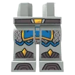

# Loot matrix 249

[Item database](../README.md) | [Methodology](../Methodology.md)

## Sources and mapped locations

| Kind | Source | Location evidence | Conditions |
| --- | --- | --- | --- |
| Package | [Rank 1 Knight Kit Package (LOT 7590)](../sources/object-7590.md) | No matched local placement found | Static association, not a live-spawn guarantee |

## Item candidates

Default vendor-stock probabilities are shown only when this matrix has a registered vendor. Loot probabilities use the generic algorithm, not a guarantee of actual use by every script/activity.

| Item | Modeled loot chance / expected count | Default vendor stock |
| --- | --- | --- |
| { .lu-ti width="24" loading="lazy" } [Rank 1 Knight Book (LOT 80)](../80.md) | 100%; mean 1 | Not associated with a vendor |
| { .lu-ti width="24" loading="lazy" } [Knight Helm 1 (LOT 7355)](../7355.md) | 100%; mean 1 | Not associated with a vendor |
| { .lu-ti width="24" loading="lazy" } [Knight Breastplate 1 (LOT 7367)](../7367.md) | 100%; mean 1 | Not associated with a vendor |
| { .lu-ti width="24" loading="lazy" } [Knight Leggings 1 (LOT 7379)](../7379.md) | 100%; mean 1 | Not associated with a vendor |
| { .lu-ti width="24" loading="lazy" } [Knight Greatsword 1 (LOT 7391)](../7391.md) | 100%; mean 1 | Not associated with a vendor |

## Raw matrix entries

| Row | Loot table | Rarity table | Trigger | Min | Max | Flag | Gate |
| --- | --- | --- | --- | --- | --- | --- | --- |
| 555 | 128 | 22 | 1 | 1 | 1 |  |  |
| 556 | 129 | 22 | 1 | 1 | 1 |  |  |
| 557 | 130 | 22 | 1 | 1 | 1 |  |  |
| 624 | 147 | 22 | 1 | 1 | 1 |  |  |
| 1432 | 372 | 22 | 1 | 1 | 1 |  |  |

[LootMatrix](../../../db/LootMatrix.md), [LootTable](../../../db/LootTable.md), [RarityTable](../../../db/RarityTable.md).
