# Loot matrix 253

[Item database](../README.md) | [Methodology](../Methodology.md)

## Sources and mapped locations

| Kind | Source | Location evidence | Conditions |
| --- | --- | --- | --- |
| Drop | [PC - Garden Tools (LOT 4953)](../sources/object-4953.md) | [Pet Cove (1201)](../locations/zone-1201.md) | DestructibleComponent 466; static component precedence; Static association, not a live-spawn guarantee |
| Drop | [PC - DogHouse (LOT 7440)](../sources/object-7440.md) | [Nimbus Station (1200)](../locations/zone-1200.md); [Pet Cove (1201)](../locations/zone-1201.md) | DestructibleComponent 690; static component precedence; Static association, not a live-spawn guarantee |
| Drop | [PC -BirdHouse (LOT 7441)](../sources/object-7441.md) | [Nimbus Station (1200)](../locations/zone-1200.md) | DestructibleComponent 691; static component precedence; Static association, not a live-spawn guarantee |
| Drop | [PC - Smashable Fence (LOT 7615)](../sources/object-7615.md) | [Pet Cove (1201)](../locations/zone-1201.md) | DestructibleComponent 702; static component precedence; Static association, not a live-spawn guarantee |
| Drop | [PR - QB Birdhouse (LOT 7616)](../sources/object-7616.md) | [Pet Cove (1201)](../locations/zone-1201.md) | DestructibleComponent 706; static component precedence; Static association, not a live-spawn guarantee |
| Drop | [PR - Smashable Bridge (LOT 7618)](../sources/object-7618.md) | [Pet Cove (1201)](../locations/zone-1201.md) | DestructibleComponent 708; static component precedence; Static association, not a live-spawn guarantee |
| Drop | [PC - Flower Smash (LOT 7626)](../sources/object-7626.md) | [Pet Cove (1201)](../locations/zone-1201.md); [Portabello (1604)](../locations/zone-1604.md) | DestructibleComponent 709; static component precedence; Static association, not a live-spawn guarantee |
| Drop | [AM - Center draw bridge (LOT 12047)](../sources/object-12047.md) | [Crux Prime (1800)](../locations/zone-1800.md) | DestructibleComponent 1672; static component precedence; Static association, not a live-spawn guarantee |

## Item candidates

Default vendor-stock probabilities are shown only when this matrix has a registered vendor. Loot probabilities use the generic algorithm, not a guarantee of actual use by every script/activity.

| Item | Modeled loot chance / expected count | Default vendor stock |
| --- | --- | --- |
| { .lu-ti width="24" loading="lazy" } [Brick 2x4 (LOT 29)](../29.md) | 1.81818182%; mean 0.018181818 | Not associated with a vendor |
| { .lu-ti width="24" loading="lazy" } [Brick 2x3 (LOT 30)](../30.md) | 1.81818182%; mean 0.018181818 | Not associated with a vendor |
| { .lu-ti width="24" loading="lazy" } [Brick 2x2 (LOT 31)](../31.md) | 1.81818182%; mean 0.018181818 | Not associated with a vendor |
| { .lu-ti width="24" loading="lazy" } [Brick 1x2 (LOT 32)](../32.md) | 1.81818182%; mean 0.018181818 | Not associated with a vendor |
| { .lu-ti width="24" loading="lazy" } [Brick 1x1 (LOT 33)](../33.md) | 1.81818182%; mean 0.018181818 | Not associated with a vendor |
| { .lu-ti width="24" loading="lazy" } [Brick 2x8 (LOT 35)](../35.md) | 1.81818182%; mean 0.018181818 | Not associated with a vendor |
| { .lu-ti width="24" loading="lazy" } [Brick 1x8 (LOT 36)](../36.md) | 1.81818182%; mean 0.018181818 | Not associated with a vendor |
| { .lu-ti width="24" loading="lazy" } [Brick 1x6 (LOT 37)](../37.md) | 1.81818182%; mean 0.018181818 | Not associated with a vendor |
| { .lu-ti width="24" loading="lazy" } [Brick 1x4 (LOT 38)](../38.md) | 1.81818182%; mean 0.018181818 | Not associated with a vendor |
| 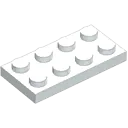{ .lu-ti width="24" loading="lazy" } [Plate 2x4 (LOT 39)](../39.md) | 1.81818182%; mean 0.018181818 | Not associated with a vendor |
| { .lu-ti width="24" loading="lazy" } [Plate 2x3 (LOT 40)](../40.md) | 1.81818182%; mean 0.018181818 | Not associated with a vendor |
| { .lu-ti width="24" loading="lazy" } [Plate 1x2 (LOT 41)](../41.md) | 1.81818182%; mean 0.018181818 | Not associated with a vendor |
| 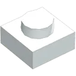{ .lu-ti width="24" loading="lazy" } [Plate 1x1 (LOT 42)](../42.md) | 1.81818182%; mean 0.018181818 | Not associated with a vendor |
| { .lu-ti width="24" loading="lazy" } [Plate 1x8 (LOT 58)](../58.md) | 1.81818182%; mean 0.018181818 | Not associated with a vendor |
| { .lu-ti width="24" loading="lazy" } [Brick 1x3 (LOT 59)](../59.md) | 1.81818182%; mean 0.018181818 | Not associated with a vendor |
| { .lu-ti width="24" loading="lazy" } [Plate 1x3 (LOT 60)](../60.md) | 1.81818182%; mean 0.018181818 | Not associated with a vendor |
| { .lu-ti width="24" loading="lazy" } [Plate 1x6 (LOT 62)](../62.md) | 1.81818182%; mean 0.018181818 | Not associated with a vendor |
| { .lu-ti width="24" loading="lazy" } [Plate 1x4 (LOT 66)](../66.md) | 1.81818182%; mean 0.018181818 | Not associated with a vendor |
| { .lu-ti width="24" loading="lazy" } [Brick 2x6 (LOT 98)](../98.md) | 1.81818182%; mean 0.018181818 | Not associated with a vendor |
| { .lu-ti width="24" loading="lazy" } [Plate 2x6 (LOT 144)](../144.md) | 1.81818182%; mean 0.018181818 | Not associated with a vendor |
| { .lu-ti width="24" loading="lazy" } [Plate 2x2 (LOT 865)](../865.md) | 1.81818182%; mean 0.018181818 | Not associated with a vendor |
| { .lu-ti width="24" loading="lazy" } [Plate 2x8 (LOT 869)](../869.md) | 1.81818182%; mean 0.018181818 | Not associated with a vendor |
| 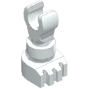{ .lu-ti width="24" loading="lazy" } [Skeleton Leg (LOT 1201)](../1201.md) | 0.01691723%; mean 0.00016949153 | Not associated with a vendor |
| 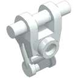{ .lu-ti width="24" loading="lazy" } [Robot Torso (LOT 1202)](../1202.md) | 0.01691723%; mean 0.00016949153 | Not associated with a vendor |
| 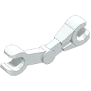{ .lu-ti width="24" loading="lazy" } [Robot Arm (LOT 1203)](../1203.md) | 0.01691723%; mean 0.00016949153 | Not associated with a vendor |
| 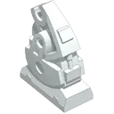{ .lu-ti width="24" loading="lazy" } [Robot Leg 1x2 with Clip (LOT 1205)](../1205.md) | 0.01691723%; mean 0.00016949153 | Not associated with a vendor |
| 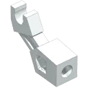{ .lu-ti width="24" loading="lazy" } [Robot Arm with Clip (LOT 1206)](../1206.md) | 0.01691723%; mean 0.00016949153 | Not associated with a vendor |
| 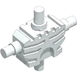{ .lu-ti width="24" loading="lazy" } [Robot Torso with Shaft (LOT 1207)](../1207.md) | 0.01691723%; mean 0.00016949153 | Not associated with a vendor |
| 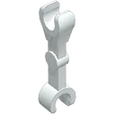{ .lu-ti width="24" loading="lazy" } [Robot Arm with Angled Hand (LOT 1208)](../1208.md) | 0.01691723%; mean 0.00016949153 | Not associated with a vendor |
| { .lu-ti width="24" loading="lazy" } [Tip of the Tail Ø6 (LOT 1230)](../1230.md) | 0.01691723%; mean 0.00016949153 | Not associated with a vendor |
| 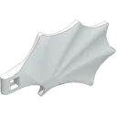{ .lu-ti width="24" loading="lazy" } [Dragon's Wing (LOT 1231)](../1231.md) | 0.01691723%; mean 0.00016949153 | Not associated with a vendor |
| 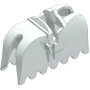{ .lu-ti width="24" loading="lazy" } [Warhorse Caparison (LOT 5035)](../5035.md) | 0.01691723%; mean 0.00016949153 | Not associated with a vendor |
| 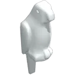{ .lu-ti width="24" loading="lazy" } [Parrot (LOT 5050)](../5050.md) | 0.01691723%; mean 0.00016949153 | Not associated with a vendor |
| { .lu-ti width="24" loading="lazy" } [Shark Body (LOT 5051)](../5051.md) | 0.01691723%; mean 0.00016949153 | Not associated with a vendor |
| 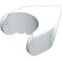{ .lu-ti width="24" loading="lazy" } [Shark Jaw (LOT 5052)](../5052.md) | 0.01691723%; mean 0.00016949153 | Not associated with a vendor |
| 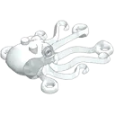{ .lu-ti width="24" loading="lazy" } [Octopus (LOT 5160)](../5160.md) | 0.01691723%; mean 0.00016949153 | Not associated with a vendor |
| 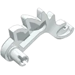{ .lu-ti width="24" loading="lazy" } [Dragon's Arm, Right (LOT 5170)](../5170.md) | 0.01691723%; mean 0.00016949153 | Not associated with a vendor |
| 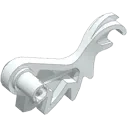{ .lu-ti width="24" loading="lazy" } [Dragon's Arm, Left (LOT 5171)](../5171.md) | 0.01691723%; mean 0.00016949153 | Not associated with a vendor |
| { .lu-ti width="24" loading="lazy" } [Kitten (LOT 5186)](../5186.md) | 0.01691723%; mean 0.00016949153 | Not associated with a vendor |
| 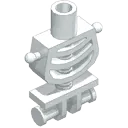{ .lu-ti width="24" loading="lazy" } [Skeleton Body Type 1 (LOT 5189)](../5189.md) | 0.01691723%; mean 0.00016949153 | Not associated with a vendor |
| { .lu-ti width="24" loading="lazy" } [Skeleton Arm Type 1 (LOT 5190)](../5190.md) | 0.01691723%; mean 0.00016949153 | Not associated with a vendor |
| 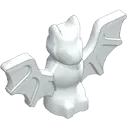{ .lu-ti width="24" loading="lazy" } [Bat (LOT 5207)](../5207.md) | 0.01691723%; mean 0.00016949153 | Not associated with a vendor |
| 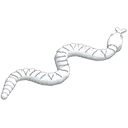{ .lu-ti width="24" loading="lazy" } [Snake (LOT 5211)](../5211.md) | 0.01691723%; mean 0.00016949153 | Not associated with a vendor |
| { .lu-ti width="24" loading="lazy" } [Scorpion (LOT 5228)](../5228.md) | 0.01691723%; mean 0.00016949153 | Not associated with a vendor |
| 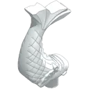{ .lu-ti width="24" loading="lazy" } [Fish Ornament with Stick (LOT 5248)](../5248.md) | 0.01691723%; mean 0.00016949153 | Not associated with a vendor |
| { .lu-ti width="24" loading="lazy" } [Spider (LOT 5252)](../5252.md) | 0.01691723%; mean 0.00016949153 | Not associated with a vendor |
| 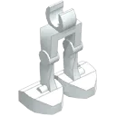{ .lu-ti width="24" loading="lazy" } [Robot Legs (LOT 5268)](../5268.md) | 0.01691723%; mean 0.00016949153 | Not associated with a vendor |
| 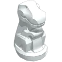{ .lu-ti width="24" loading="lazy" } [Dino Cub (LOT 5275)](../5275.md) | 0.01691723%; mean 0.00016949153 | Not associated with a vendor |
| { .lu-ti width="24" loading="lazy" } [Martian Head with Clip (LOT 5279)](../5279.md) | 0.01691723%; mean 0.00016949153 | Not associated with a vendor |
| 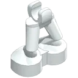{ .lu-ti width="24" loading="lazy" } [Martian Legs with Clip (LOT 5280)](../5280.md) | 0.01691723%; mean 0.00016949153 | Not associated with a vendor |
| { .lu-ti width="24" loading="lazy" } [Crab (LOT 5319)](../5319.md) | 0.01691723%; mean 0.00016949153 | Not associated with a vendor |
| 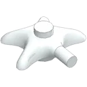{ .lu-ti width="24" loading="lazy" } [Starfish (LOT 5320)](../5320.md) | 0.01691723%; mean 0.00016949153 | Not associated with a vendor |
| 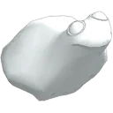{ .lu-ti width="24" loading="lazy" } [Frog (LOT 5326)](../5326.md) | 0.01691723%; mean 0.00016949153 | Not associated with a vendor |
| 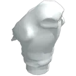{ .lu-ti width="24" loading="lazy" } [Snowy Owl (LOT 5327)](../5327.md) | 0.01691723%; mean 0.00016949153 | Not associated with a vendor |
| { .lu-ti width="24" loading="lazy" } [Rat (LOT 5328)](../5328.md) | 0.01691723%; mean 0.00016949153 | Not associated with a vendor |
| 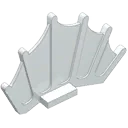{ .lu-ti width="24" loading="lazy" } [Dinosaur Back Fin 8x2x5 (LOT 5341)](../5341.md) | 0.01691723%; mean 0.00016949153 | Not associated with a vendor |
| { .lu-ti width="24" loading="lazy" } [Flipper with Pin (LOT 5342)](../5342.md) | 0.01691723%; mean 0.00016949153 | Not associated with a vendor |
| 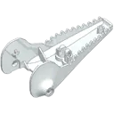{ .lu-ti width="24" loading="lazy" } [Mosasaur Bottom Jaw (LOT 5343)](../5343.md) | 0.01691723%; mean 0.00016949153 | Not associated with a vendor |
| 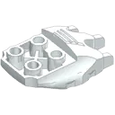{ .lu-ti width="24" loading="lazy" } [Dino Foot 2x4x2/3 (LOT 5345)](../5345.md) | 0.01691723%; mean 0.00016949153 | Not associated with a vendor |
| 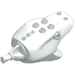{ .lu-ti width="24" loading="lazy" } [Snake Head with Pin (LOT 5363)](../5363.md) | 0.01691723%; mean 0.00016949153 | Not associated with a vendor |
| 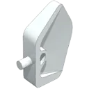{ .lu-ti width="24" loading="lazy" } [Elephant Ear (LOT 5368)](../5368.md) | 0.01691723%; mean 0.00016949153 | Not associated with a vendor |
| 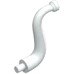{ .lu-ti width="24" loading="lazy" } [Elephant Tail/Trunk (LOT 5369)](../5369.md) | 0.01691723%; mean 0.00016949153 | Not associated with a vendor |
| 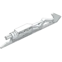{ .lu-ti width="24" loading="lazy" } [Technic Skate (LOT 5374)](../5374.md) | 0.01691723%; mean 0.00016949153 | Not associated with a vendor |
| 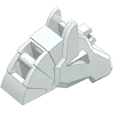{ .lu-ti width="24" loading="lazy" } [Horse Head Armor with Clip (LOT 5396)](../5396.md) | 0.01691723%; mean 0.00016949153 | Not associated with a vendor |
| { .lu-ti width="24" loading="lazy" } [Dog/Wolf (LOT 5402)](../5402.md) | 0.01691723%; mean 0.00016949153 | Not associated with a vendor |
| 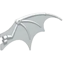{ .lu-ti width="24" loading="lazy" } [Technic Dragon Wing with 2 Pin Holes (LOT 5409)](../5409.md) | 0.01691723%; mean 0.00016949153 | Not associated with a vendor |
| 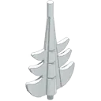{ .lu-ti width="24" loading="lazy" } [Tail with Jagged Fins and Shaft (LOT 5416)](../5416.md) | 0.01691723%; mean 0.00016949153 | Not associated with a vendor |
| 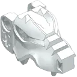{ .lu-ti width="24" loading="lazy" } [BIONICLE Wolf's Head (LOT 5420)](../5420.md) | 0.01691723%; mean 0.00016949153 | Not associated with a vendor |
| 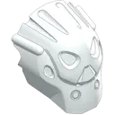{ .lu-ti width="24" loading="lazy" } [Mini-Head Toa No. 1 (LOT 5422)](../5422.md) | 0.01691723%; mean 0.00016949153 | Not associated with a vendor |
| 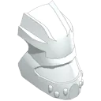{ .lu-ti width="24" loading="lazy" } [Mini-Head Piraka No. 2 (LOT 5423)](../5423.md) | 0.01691723%; mean 0.00016949153 | Not associated with a vendor |
| { .lu-ti width="24" loading="lazy" } [Mini-Head Toa No. 2 (LOT 5424)](../5424.md) | 0.01691723%; mean 0.00016949153 | Not associated with a vendor |
| 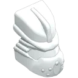{ .lu-ti width="24" loading="lazy" } [Mini-Head Piraka No. 3 (LOT 5425)](../5425.md) | 0.01691723%; mean 0.00016949153 | Not associated with a vendor |
| { .lu-ti width="24" loading="lazy" } [Mini-Head Toa No. 3 (LOT 5426)](../5426.md) | 0.01691723%; mean 0.00016949153 | Not associated with a vendor |
| 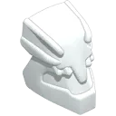{ .lu-ti width="24" loading="lazy" } [Mini-Head Piraka No. 4 (LOT 5427)](../5427.md) | 0.01691723%; mean 0.00016949153 | Not associated with a vendor |
| 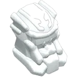{ .lu-ti width="24" loading="lazy" } [Mini-Head Toa No. 4 (LOT 5428)](../5428.md) | 0.01691723%; mean 0.00016949153 | Not associated with a vendor |
| { .lu-ti width="24" loading="lazy" } [Mini-Head Piraka No. 5 (LOT 5429)](../5429.md) | 0.01691723%; mean 0.00016949153 | Not associated with a vendor |
| 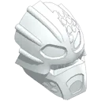{ .lu-ti width="24" loading="lazy" } [Mini-Head Toa No. 5 (LOT 5430)](../5430.md) | 0.01691723%; mean 0.00016949153 | Not associated with a vendor |
| { .lu-ti width="24" loading="lazy" } [Mini-Head Piraka No. 6 (LOT 5431)](../5431.md) | 0.01691723%; mean 0.00016949153 | Not associated with a vendor |
| 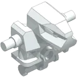{ .lu-ti width="24" loading="lazy" } [Robot Torso (LOT 5435)](../5435.md) | 0.01691723%; mean 0.00016949153 | Not associated with a vendor |
| 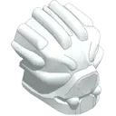{ .lu-ti width="24" loading="lazy" } [Mini-Head Toa No. 6 (LOT 5439)](../5439.md) | 0.01691723%; mean 0.00016949153 | Not associated with a vendor |
| 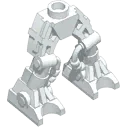{ .lu-ti width="24" loading="lazy" } [Mini Robot Legs with Stud (LOT 5440)](../5440.md) | 0.01691723%; mean 0.00016949153 | Not associated with a vendor |
| 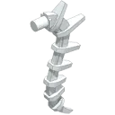{ .lu-ti width="24" loading="lazy" } [Spiked Tentacle (LOT 5444)](../5444.md) | 0.01691723%; mean 0.00016949153 | Not associated with a vendor |
| 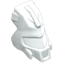{ .lu-ti width="24" loading="lazy" } [Mini-Head Piraka No. 1 (LOT 5445)](../5445.md) | 0.01691723%; mean 0.00016949153 | Not associated with a vendor |
| 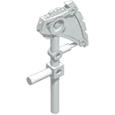{ .lu-ti width="24" loading="lazy" } [BIONICLE Tool 1/12 (LOT 5456)](../5456.md) | 0.01691723%; mean 0.00016949153 | Not associated with a vendor |
| 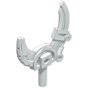{ .lu-ti width="24" loading="lazy" } [BIONICLE Tool 2/12 (LOT 5457)](../5457.md) | 0.01691723%; mean 0.00016949153 | Not associated with a vendor |
| { .lu-ti width="24" loading="lazy" } [BIONICLE Tool 3/12 (LOT 5458)](../5458.md) | 0.01691723%; mean 0.00016949153 | Not associated with a vendor |
| { .lu-ti width="24" loading="lazy" } [BIONICLE Tool 4/12 (LOT 5459)](../5459.md) | 0.01691723%; mean 0.00016949153 | Not associated with a vendor |
| { .lu-ti width="24" loading="lazy" } [BIONICLE Tool 5/12 (LOT 5460)](../5460.md) | 0.01691723%; mean 0.00016949153 | Not associated with a vendor |
| { .lu-ti width="24" loading="lazy" } [BIONICLE Tool 6/12 (LOT 5461)](../5461.md) | 0.01691723%; mean 0.00016949153 | Not associated with a vendor |
| { .lu-ti width="24" loading="lazy" } [BIONICLE Tool 7/12 (LOT 5462)](../5462.md) | 0.01691723%; mean 0.00016949153 | Not associated with a vendor |
| { .lu-ti width="24" loading="lazy" } [BIONICLE Tool 8/12 (LOT 5463)](../5463.md) | 0.01691723%; mean 0.00016949153 | Not associated with a vendor |
| { .lu-ti width="24" loading="lazy" } [BIONICLE Tool 9/12 (LOT 5464)](../5464.md) | 0.01691723%; mean 0.00016949153 | Not associated with a vendor |
| { .lu-ti width="24" loading="lazy" } [BIONICLE Tool 10/12 (LOT 5465)](../5465.md) | 0.01691723%; mean 0.00016949153 | Not associated with a vendor |
| { .lu-ti width="24" loading="lazy" } [BIONICLE Tool 11/12 (LOT 5466)](../5466.md) | 0.01691723%; mean 0.00016949153 | Not associated with a vendor |
| { .lu-ti width="24" loading="lazy" } [BIONICLE Tool 12/12 (LOT 5467)](../5467.md) | 0.01691723%; mean 0.00016949153 | Not associated with a vendor |
| { .lu-ti width="24" loading="lazy" } [BIONICLE Blade (LOT 5476)](../5476.md) | 0.01691723%; mean 0.00016949153 | Not associated with a vendor |
| { .lu-ti width="24" loading="lazy" } [Mini-Head Bad Monster 8 (LOT 5477)](../5477.md) | 0.01691723%; mean 0.00016949153 | Not associated with a vendor |
| { .lu-ti width="24" loading="lazy" } [Mini-Head Bad Monster 9 (LOT 5478)](../5478.md) | 0.01691723%; mean 0.00016949153 | Not associated with a vendor |
| { .lu-ti width="24" loading="lazy" } [Mini-Head Good Monster 8 (LOT 5479)](../5479.md) | 0.01691723%; mean 0.00016949153 | Not associated with a vendor |
| { .lu-ti width="24" loading="lazy" } [Mini-Head Good Monster 9 (LOT 5480)](../5480.md) | 0.01691723%; mean 0.00016949153 | Not associated with a vendor |
| { .lu-ti width="24" loading="lazy" } [Mini-Head Bad Monster 7 (LOT 5481)](../5481.md) | 0.01691723%; mean 0.00016949153 | Not associated with a vendor |
| { .lu-ti width="24" loading="lazy" } [Mini-Head Good Monster 7 (LOT 5482)](../5482.md) | 0.01691723%; mean 0.00016949153 | Not associated with a vendor |
| { .lu-ti width="24" loading="lazy" } [Skeleton Horse (LOT 5501)](../5501.md) | 0.01691723%; mean 0.00016949153 | Not associated with a vendor |
| { .lu-ti width="24" loading="lazy" } [Skeleton Body Type 2 (LOT 5514)](../5514.md) | 0.01691723%; mean 0.00016949153 | Not associated with a vendor |
| { .lu-ti width="24" loading="lazy" } [Dolphin (LOT 8900)](../8900.md) | 0.01691723%; mean 0.00016949153 | Not associated with a vendor |
| { .lu-ti width="24" loading="lazy" } [Foal (LOT 8918)](../8918.md) | 0.01691723%; mean 0.00016949153 | Not associated with a vendor |
| { .lu-ti width="24" loading="lazy" } [Manta Ray (LOT 8924)](../8924.md) | 0.01691723%; mean 0.00016949153 | Not associated with a vendor |
| { .lu-ti width="24" loading="lazy" } [Sawfish Head (LOT 8925)](../8925.md) | 0.01691723%; mean 0.00016949153 | Not associated with a vendor |
| { .lu-ti width="24" loading="lazy" } [Pterodactyl (LOT 8951)](../8951.md) | 0.01691723%; mean 0.00016949153 | Not associated with a vendor |
| { .lu-ti width="24" loading="lazy" } [Rabbit (LOT 8990)](../8990.md) | 0.01691723%; mean 0.00016949153 | Not associated with a vendor |
| { .lu-ti width="24" loading="lazy" } [Tail Middle Part (LOT 8995)](../8995.md) | 0.01691723%; mean 0.00016949153 | Not associated with a vendor |
| { .lu-ti width="24" loading="lazy" } [Mosasaur Top Jaw (LOT 8996)](../8996.md) | 0.01691723%; mean 0.00016949153 | Not associated with a vendor |
| { .lu-ti width="24" loading="lazy" } [Ceratops Head 5x10x4 (LOT 8997)](../8997.md) | 0.01691723%; mean 0.00016949153 | Not associated with a vendor |
| { .lu-ti width="24" loading="lazy" } [Carnosaur Head 3x6x3 (LOT 8998)](../8998.md) | 0.01691723%; mean 0.00016949153 | Not associated with a vendor |
| { .lu-ti width="24" loading="lazy" } [Tail Base Long (LOT 8999)](../8999.md) | 0.01691723%; mean 0.00016949153 | Not associated with a vendor |
| { .lu-ti width="24" loading="lazy" } [Tail Base Short (LOT 9000)](../9000.md) | 0.01691723%; mean 0.00016949153 | Not associated with a vendor |
| { .lu-ti width="24" loading="lazy" } [Snake Tail Piece (LOT 9012)](../9012.md) | 0.01691723%; mean 0.00016949153 | Not associated with a vendor |
| { .lu-ti width="24" loading="lazy" } [Sitting Rat (LOT 9038)](../9038.md) | 0.01691723%; mean 0.00016949153 | Not associated with a vendor |
| { .lu-ti width="24" loading="lazy" } [Compy Dinosaur (LOT 9057)](../9057.md) | 0.01691723%; mean 0.00016949153 | Not associated with a vendor |
| { .lu-ti width="24" loading="lazy" } [Technic Dragon Wing 8x10 (LOT 9063)](../9063.md) | 0.01691723%; mean 0.00016949153 | Not associated with a vendor |
| { .lu-ti width="24" loading="lazy" } [Technic Shell 4x5x3 (LOT 9073)](../9073.md) | 0.01691723%; mean 0.00016949153 | Not associated with a vendor |
| { .lu-ti width="24" loading="lazy" } [BIONICLE Blade (LOT 9075)](../9075.md) | 0.01691723%; mean 0.00016949153 | Not associated with a vendor |
| { .lu-ti width="24" loading="lazy" } [Flexible Tentacle (LOT 9076)](../9076.md) | 0.01691723%; mean 0.00016949153 | Not associated with a vendor |
| { .lu-ti width="24" loading="lazy" } [BIONICLE Blades (LOT 9077)](../9077.md) | 0.01691723%; mean 0.00016949153 | Not associated with a vendor |
| { .lu-ti width="24" loading="lazy" } [Troll (LOT 9096)](../9096.md) | 0.01691723%; mean 0.00016949153 | Not associated with a vendor |
| { .lu-ti width="24" loading="lazy" } [BIONICLE Blade (LOT 9112)](../9112.md) | 0.01691723%; mean 0.00016949153 | Not associated with a vendor |
| { .lu-ti width="24" loading="lazy" } [Technic Wing (LOT 9113)](../9113.md) | 0.01691723%; mean 0.00016949153 | Not associated with a vendor |
| { .lu-ti width="24" loading="lazy" } [Hind Leg with Claws, Right (LOT 9121)](../9121.md) | 0.01691723%; mean 0.00016949153 | Not associated with a vendor |
| { .lu-ti width="24" loading="lazy" } [Hind Leg with Claws, Left (LOT 9122)](../9122.md) | 0.01691723%; mean 0.00016949153 | Not associated with a vendor |
| { .lu-ti width="24" loading="lazy" } [Ant (LOT 9125)](../9125.md) | 0.01691723%; mean 0.00016949153 | Not associated with a vendor |
| { .lu-ti width="24" loading="lazy" } [Foreleg, Right (LOT 9126)](../9126.md) | 0.01691723%; mean 0.00016949153 | Not associated with a vendor |
| { .lu-ti width="24" loading="lazy" } [Foreleg, Left (LOT 9127)](../9127.md) | 0.01691723%; mean 0.00016949153 | Not associated with a vendor |
| { .lu-ti width="24" loading="lazy" } [Technic Beam 2 with Robot Arm (LOT 9134)](../9134.md) | 0.01691723%; mean 0.00016949153 | Not associated with a vendor |
| { .lu-ti width="24" loading="lazy" } [Technic Aqua-Fin 5x9x4 (LOT 9135)](../9135.md) | 0.01691723%; mean 0.00016949153 | Not associated with a vendor |
| { .lu-ti width="24" loading="lazy" } [Stockfish (LOT 9146)](../9146.md) | 0.01691723%; mean 0.00016949153 | Not associated with a vendor |
| { .lu-ti width="24" loading="lazy" } [Cow Horn (LOT 9158)](../9158.md) | 0.01691723%; mean 0.00016949153 | Not associated with a vendor |
| { .lu-ti width="24" loading="lazy" } [Frenzy Head (LOT 9183)](../9183.md) | 0.01691723%; mean 0.00016949153 | Not associated with a vendor |
| { .lu-ti width="24" loading="lazy" } [Ladybird (LOT 9214)](../9214.md) | 0.01691723%; mean 0.00016949153 | Not associated with a vendor |
| { .lu-ti width="24" loading="lazy" } [Butterfly (LOT 9215)](../9215.md) | 0.01691723%; mean 0.00016949153 | Not associated with a vendor |
| { .lu-ti width="24" loading="lazy" } [Technic Tube Curved with Fin (LOT 9223)](../9223.md) | 0.01691723%; mean 0.00016949153 | Not associated with a vendor |
| { .lu-ti width="24" loading="lazy" } [Fang with Shaft (LOT 9224)](../9224.md) | 0.01691723%; mean 0.00016949153 | Not associated with a vendor |
| { .lu-ti width="24" loading="lazy" } [Squid Bottom Body (LOT 9225)](../9225.md) | 0.01691723%; mean 0.00016949153 | Not associated with a vendor |
| { .lu-ti width="24" loading="lazy" } [Shark Head for Minifigure (LOT 9231)](../9231.md) | 0.01691723%; mean 0.00016949153 | Not associated with a vendor |
| { .lu-ti width="24" loading="lazy" } [Stingray Helmet (LOT 9233)](../9233.md) | 0.01691723%; mean 0.00016949153 | Not associated with a vendor |
| { .lu-ti width="24" loading="lazy" } [Snake Tail Piece (LOT 10178)](../10178.md) | 0.01691723%; mean 0.00016949153 | Not associated with a vendor |
| { .lu-ti width="24" loading="lazy" } [Dragon's Head (LOT 10179)](../10179.md) | 0.01691723%; mean 0.00016949153 | Not associated with a vendor |
| { .lu-ti width="24" loading="lazy" } [Armored Dragon's Head (LOT 10180)](../10180.md) | 0.01691723%; mean 0.00016949153 | Not associated with a vendor |
| { .lu-ti width="24" loading="lazy" } [Shark 8x16 (LOT 10183)](../10183.md) | 0.01691723%; mean 0.00016949153 | Not associated with a vendor |
| { .lu-ti width="24" loading="lazy" } [Cow (LOT 10187)](../10187.md) | 0.01691723%; mean 0.00016949153 | Not associated with a vendor |
| { .lu-ti width="24" loading="lazy" } [Mini Rock Monster 1 (LOT 10188)](../10188.md) | 0.01691723%; mean 0.00016949153 | Not associated with a vendor |
| { .lu-ti width="24" loading="lazy" } [Monkey (LOT 10196)](../10196.md) | 0.01691723%; mean 0.00016949153 | Not associated with a vendor |
| { .lu-ti width="24" loading="lazy" } [Horse (LOT 10198)](../10198.md) | 0.01691723%; mean 0.00016949153 | Not associated with a vendor |
| { .lu-ti width="24" loading="lazy" } [Polar Bear (LOT 10199)](../10199.md) | 0.01691723%; mean 0.00016949153 | Not associated with a vendor |
| { .lu-ti width="24" loading="lazy" } [Rock Monster 1, Medium Large (LOT 10207)](../10207.md) | 0.01691723%; mean 0.00016949153 | Not associated with a vendor |
| { .lu-ti width="24" loading="lazy" } [Mini Rock Monster 2 (LOT 10208)](../10208.md) | 0.01691723%; mean 0.00016949153 | Not associated with a vendor |
| { .lu-ti width="24" loading="lazy" } [Rock Monster 2, Medium Large (LOT 10209)](../10209.md) | 0.01691723%; mean 0.00016949153 | Not associated with a vendor |
| { .lu-ti width="24" loading="lazy" } [Crocodile, Body (LOT 10236)](../10236.md) | 0.01691723%; mean 0.00016949153 | Not associated with a vendor |
| { .lu-ti width="24" loading="lazy" } [Crocodile/Dragon Top Jaw (LOT 10237)](../10237.md) | 0.01691723%; mean 0.00016949153 | Not associated with a vendor |
| { .lu-ti width="24" loading="lazy" } [Crocodile/Dragon Tail (LOT 10238)](../10238.md) | 0.01691723%; mean 0.00016949153 | Not associated with a vendor |
| { .lu-ti width="24" loading="lazy" } [Dinosaurus Tail (LOT 10241)](../10241.md) | 0.01691723%; mean 0.00016949153 | Not associated with a vendor |
| { .lu-ti width="24" loading="lazy" } [Tyrannosaurus Rex Top Jaw (LOT 10243)](../10243.md) | 0.01691723%; mean 0.00016949153 | Not associated with a vendor |
| { .lu-ti width="24" loading="lazy" } [Triceratops Top Jaw (LOT 10244)](../10244.md) | 0.01691723%; mean 0.00016949153 | Not associated with a vendor |
| { .lu-ti width="24" loading="lazy" } [Body 5x2x4, Left (LOT 10245)](../10245.md) | 0.01691723%; mean 0.00016949153 | Not associated with a vendor |
| { .lu-ti width="24" loading="lazy" } [Body 5x2x4 with Pins, Right (LOT 10246)](../10246.md) | 0.01691723%; mean 0.00016949153 | Not associated with a vendor |
| { .lu-ti width="24" loading="lazy" } [Neck - Tail Rotary Joint (LOT 10247)](../10247.md) | 0.01691723%; mean 0.00016949153 | Not associated with a vendor |
| { .lu-ti width="24" loading="lazy" } [Baby Dino Head (LOT 10248)](../10248.md) | 0.01691723%; mean 0.00016949153 | Not associated with a vendor |
| { .lu-ti width="24" loading="lazy" } [Leg 4x8x5 2/3 (LOT 10249)](../10249.md) | 0.01691723%; mean 0.00016949153 | Not associated with a vendor |
| { .lu-ti width="24" loading="lazy" } [Dragon's Head 2 (LOT 10250)](../10250.md) | 0.01691723%; mean 0.00016949153 | Not associated with a vendor |
| { .lu-ti width="24" loading="lazy" } [Dragon's Tail (LOT 10251)](../10251.md) | 0.01691723%; mean 0.00016949153 | Not associated with a vendor |
| { .lu-ti width="24" loading="lazy" } [Leg 5x8x7 2/3 without Decoration (LOT 10252)](../10252.md) | 0.01691723%; mean 0.00016949153 | Not associated with a vendor |
| { .lu-ti width="24" loading="lazy" } [Horn with Shaft (LOT 10254)](../10254.md) | 0.01691723%; mean 0.00016949153 | Not associated with a vendor |
| { .lu-ti width="24" loading="lazy" } [Technic Shell 3x5x3 (LOT 10255)](../10255.md) | 0.01691723%; mean 0.00016949153 | Not associated with a vendor |
| { .lu-ti width="24" loading="lazy" } [Animal Body 4x12x5  (LOT 10256)](../10256.md) | 0.01691723%; mean 0.00016949153 | Not associated with a vendor |
| { .lu-ti width="24" loading="lazy" } [Dragon's Head, Jaw (LOT 10257)](../10257.md) | 0.01691723%; mean 0.00016949153 | Not associated with a vendor |
| { .lu-ti width="24" loading="lazy" } [Troll, Right Hand (LOT 10260)](../10260.md) | 0.01691723%; mean 0.00016949153 | Not associated with a vendor |
| { .lu-ti width="24" loading="lazy" } [Troll, Left Hand (LOT 10261)](../10261.md) | 0.01691723%; mean 0.00016949153 | Not associated with a vendor |
| { .lu-ti width="24" loading="lazy" } [Troll, Right Arm, Assembled (LOT 10262)](../10262.md) | 0.01691723%; mean 0.00016949153 | Not associated with a vendor |
| { .lu-ti width="24" loading="lazy" } [Troll, Left Arm, Assembled (LOT 10263)](../10263.md) | 0.01691723%; mean 0.00016949153 | Not associated with a vendor |
| { .lu-ti width="24" loading="lazy" } [BIONICLE Claw (LOT 10265)](../10265.md) | 0.01691723%; mean 0.00016949153 | Not associated with a vendor |
| { .lu-ti width="24" loading="lazy" } [Dragon (LOT 10266)](../10266.md) | 0.01691723%; mean 0.00016949153 | Not associated with a vendor |
| { .lu-ti width="24" loading="lazy" } [Tyrannosaurus Rex Body 4x12x8 (LOT 10267)](../10267.md) | 0.01691723%; mean 0.00016949153 | Not associated with a vendor |
| { .lu-ti width="24" loading="lazy" } [Triceratops Body 4x11x5 (LOT 10268)](../10268.md) | 0.01691723%; mean 0.00016949153 | Not associated with a vendor |
| { .lu-ti width="24" loading="lazy" } [Stegosaurus Body 4x12x6 (LOT 10269)](../10269.md) | 0.01691723%; mean 0.00016949153 | Not associated with a vendor |
| { .lu-ti width="24" loading="lazy" } [Left Arm for Rock Monster 2, Medium Large (LOT 10272)](../10272.md) | 0.01691723%; mean 0.00016949153 | Not associated with a vendor |
| { .lu-ti width="24" loading="lazy" } [Right Arm for Rock Monster 2, Medium Large (LOT 10273)](../10273.md) | 0.01691723%; mean 0.00016949153 | Not associated with a vendor |
| Imagination Powerup 3 points (LOT 11910; not an item registration) | 100%; mean 1.5 | Not associated with a vendor |
| { .lu-ti width="24" loading="lazy" } [Faction Token Proxy (LOT 13763)](../13763.md) | 2%; mean 0.02 | Not associated with a vendor |
| { .lu-ti width="24" loading="lazy" } [Mini Dragon (LOT 16357)](../16357.md) | 0.01691723%; mean 0.00016949153 | Not associated with a vendor |
| { .lu-ti width="24" loading="lazy" } [Camel (LOT 16414)](../16414.md) | 0.01691723%; mean 0.00016949153 | Not associated with a vendor |
| { .lu-ti width="24" loading="lazy" } [Ostrich  (LOT 16420)](../16420.md) | 0.01691723%; mean 0.00016949153 | Not associated with a vendor |
| { .lu-ti width="24" loading="lazy" } [Owl (LOT 16436)](../16436.md) | 0.01691723%; mean 0.00016949153 | Not associated with a vendor |
| { .lu-ti width="24" loading="lazy" } [Dog with Knob (LOT 16439)](../16439.md) | 0.01691723%; mean 0.00016949153 | Not associated with a vendor |
| { .lu-ti width="24" loading="lazy" } [Skeleton Torso (LOT 16452)](../16452.md) | 0.01691723%; mean 0.00016949153 | Not associated with a vendor |
| { .lu-ti width="24" loading="lazy" } [Skeleton Arm (LOT 16453)](../16453.md) | 0.01691723%; mean 0.00016949153 | Not associated with a vendor |
| { .lu-ti width="24" loading="lazy" } [Skeleton Leg (LOT 16454)](../16454.md) | 0.01691723%; mean 0.00016949153 | Not associated with a vendor |
| { .lu-ti width="24" loading="lazy" } [General Skeleton Head (LOT 16455)](../16455.md) | 0.01691723%; mean 0.00016949153 | Not associated with a vendor |
| { .lu-ti width="24" loading="lazy" } [Skeletonhead with Knob (LOT 16456)](../16456.md) | 0.01691723%; mean 0.00016949153 | Not associated with a vendor |
| { .lu-ti width="24" loading="lazy" } [Head with Underjaw with Ø3.2 Shaft (LOT 16457)](../16457.md) | 0.01691723%; mean 0.00016949153 | Not associated with a vendor |
| { .lu-ti width="24" loading="lazy" } [Headtop with Ø3.2 Grip (LOT 16458)](../16458.md) | 0.01691723%; mean 0.00016949153 | Not associated with a vendor |
| { .lu-ti width="24" loading="lazy" } [Dragon Head (LOT 16460)](../16460.md) | 0.01691723%; mean 0.00016949153 | Not associated with a vendor |
| { .lu-ti width="24" loading="lazy" } [Skeleton Arm (LOT 16468)](../16468.md) | 0.01691723%; mean 0.00016949153 | Not associated with a vendor |

## Raw matrix entries

| Row | Loot table | Rarity table | Trigger | Min | Max | Flag | Gate |
| --- | --- | --- | --- | --- | --- | --- | --- |
| 567 | 420 | 4 | 1 | 1 | 2 |  |  |
| 568 | 110 | 18 | 0.4 | 1 | 1 |  |  |
| 869 | 670 | 23 | 0.02 | 1 | 1 |  |  |
| 1500 | 382 | 18 | 0.02 | 1 | 2 |  |  |

[LootMatrix](../../../db/LootMatrix.md), [LootTable](../../../db/LootTable.md), [RarityTable](../../../db/RarityTable.md).
